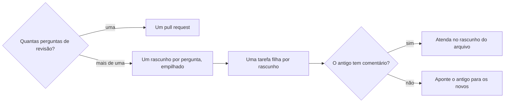

# Fatiar pull request

## Parâmetros de configuração

Leia cada valor nas instruções do projeto: primeiro na entrada com o nome desta habilidade, depois na entrada `Global` ou no primeiro nível do bloco. Quando um valor não estiver lá, use o padrão abaixo.

```yaml
# `Fatiar por subtarefa`: `não` junta só a mesma pergunta de revisão. `sim` abre um pull request por subtarefa, e dentro dela vale o mesmo corte.
"Fatiar por subtarefa": "não"
# `Cópia de trabalho` é `Global` e cada skill pode sobrescrevê-lo. `worktree` trabalha num git worktree novo da `main`, nunca no clone da pessoa. Vazio trabalha onde a pessoa já está.
"Cópia de trabalho": "worktree"
"Modo de aprendizado": "perguntar"
```

## Instruções

### Passo 1

Uma pergunta de revisão é o que uma pessoa julga sem abrir outro assunto.
A chave, o componente e o lugar em que ele aparece são perguntas diferentes.
Vários commits da mesma pergunta continuam no mesmo pull request.



Conte as perguntas antes de abrir.
Com uma, abra um pull request só.
Com mais de uma, abra um rascunho por pergunta.
Empilhe: o de baixo entra primeiro, e o de cima abre contra a branch do de baixo.
Cada diff mostra só os arquivos daquela pergunta.
Quando a branch de baixo é atualizada porque ficou atrás da base, as de cima andam junto, para cada diff continuar só com os arquivos daquela pergunta. Siga `atender-revisao-de-pull-request`.
O teto de arquivos do repositório continua valendo para cada pull request.
Ele não junta perguntas para caber em menos pull requests.
Com `Fatiar por subtarefa` em `sim`, abra um pull request por subtarefa, e dentro dela repita este corte.
A abertura segue `criar-pull-request`. As branches nascem seguindo `Cópia de trabalho`.

### Passo 2

Se o pull request aberto mistura perguntas, abra os rascunhos e aponte o antigo para os novos.
Não reescreva a branch já publicada para cortar o pull request.
Uma atualização posterior da de baixo, porque ela ficou atrás da base, move as de cima. Isso segue `atender-revisao-de-pull-request`.
Cada rascunho ganha uma tarefa filha da tarefa da demanda.
O pull request cita essa filha no título e no corpo.
A criação da filha segue a habilidade de tarefa do projeto.
Cada comentário do antigo segue `atender-revisao-de-pull-request` no rascunho que tem o arquivo.
A resposta no antigo aponta o commit do novo.

### Passo 3

Com mais de um PR que depende de outro, ligue-os numa pilha do GitHub.
A pilha é uma cadeia: cada PR abre contra a branch do de baixo, e há um PR por degrau.
Um PR irmão, que abre contra a mesma branch de outro, não cabe na cadeia.

Cada degrau passa nos testes sozinho e tem uma descrição curta.
Mudança minúscula não vira degrau: entra no PR vizinho.
Um degrau que só funciona com o de baixo não se reverte sozinho, e a descrição diz isso.
O PR de baixo que sozinho não tem valor fica em rascunho até a pilha estar pronta.

A ferramenta é a extensão oficial `github/gh-stack`, que traz o comando `gh stack`.
Instalar uma extensão baixa código: diga à pessoa o que vai instalar e espere o sim.
Sem a extensão, a pilha vale pela base de cada PR, como no Passo 1.

Para PRs que já existem, use `gh stack link` com os números, de baixo para cima.
O comando devolve o número da pilha.
Para acrescentar degraus depois, passe o número da pilha como primeiro argumento.
Não passe `--open`: ele tira todos os PRs do rascunho.
O `link` não cria estado local, então `gh stack view` diz que a branch não faz parte da pilha.
A pilha aparece na página dela no GitHub.

O `link` troca, sem pedir, a base de um PR que está fora da cadeia.
Leia a base de cada PR antes e depois.
O PR que mudou de base fica atrás da branch nova e pode entrar em conflito.
Atualize-o com a branch de baixo, seguindo `atualizar-branch-do-pull-request`, rode a validação do repositório e só então envie.
Se os dois lados acrescentaram código no mesmo trecho, mantenha os dois.
Na cópia de trabalho, dê à branch local o nome da branch de destino, para a mensagem do commit de merge não levar o nome da cópia.

`gh stack rebase` e `gh stack sync` reescrevem commits e enviam com `--force-with-lease`.
Num PR com revisão em andamento, as threads podem ficar desatualizadas: avise a pessoa antes de rodar.
O merge da pilha segue `mesclar-pull-request`.

### Passo 4

Ao terminar, siga `evoluir-habilidade` conforme `Modo de aprendizado`.

## Problemas comuns

### PR maior que a revisão

Se você juntar a chave, o componente e o lugar em que ele aparece num pull request só, a pessoa revisa assuntos diferentes de uma vez.

1. Abra um rascunho por pergunta, empilhado.
2. Cada diff fica só com os arquivos daquela pergunta.
3. O de baixo entra primeiro.

### Teto de arquivos junta assuntos

Se você mantiver os assuntos juntos porque o teto de arquivos ainda não estourou, a revisão continua misturada.

1. Separe mesmo assim.
2. O teto vale para cada pull request.
3. Ele não é motivo para juntar perguntas.

### Comentários ficaram no PR fechado

Se você fechar o pull request antigo e deixar os comentários só lá, a revisão não chega no rascunho que tem o arquivo.

1. Leve cada comentário com `atender-revisao-de-pull-request`.
2. Atenda no rascunho que tem o arquivo.
3. A resposta no antigo aponta o commit do novo.

### Fatia sem tarefa filha

Se você abrir o rascunho sem uma tarefa filha, o pull request fica só na tarefa da demanda inteira.

1. Crie uma tarefa filha por rascunho.
2. Cite a filha no título e no corpo.
3. A criação segue a habilidade de tarefa do projeto.

### A de baixo andou e o diff de cima misturou

Se você atualizar só a branch de baixo, o diff de cima passa a mostrar os arquivos de baixo.

1. Atualize cada branch de cima, na ordem.
2. Cada diff continua só com os arquivos daquela pergunta.
3. Siga `atender-revisao-de-pull-request`.

### PR irmão ligado à pilha

Se você ligar um PR que abre contra a mesma branch de outro, o `link` troca a base dele sozinho e ele fica atrás e em conflito.

1. Leia a base de cada PR antes e depois do `link`.
2. Atualize o PR que mudou de base com a branch de baixo, resolva o conflito e valide antes de enviar.
3. Se ele não depende do degrau de baixo, deixe-o fora da pilha.

### Degrau pequeno demais

Se você fizer um degrau de uma mudança minúscula, ou de uma camada que não funciona sozinha, a pilha ganha um PR que ninguém consegue julgar nem reverter sem os outros.

1. Junte a mudança minúscula ao PR vizinho.
2. Corte só onde cada degrau passa nos testes sozinho.
3. Quando a dependência é inevitável, a descrição diz que o degrau não se reverte sozinho.

### Branch publicada reescrita

Se você reescrever a branch do pull request que já está aberto, a história publicada muda sem a pessoa ter pedido.

1. Abra os rascunhos novos.
2. Aponte o antigo para eles.
3. Não reescreva a branch já publicada.

## Exemplos de entrada e saída

Estes exemplos ilustram fatos. Eles podem não estar no data source.

### A demanda junta a chave, a tela e a página que monta a tela

Três rascunhos empilhados.
O primeiro só liga a chave.
O segundo só traz a tela.
O terceiro só monta a tela na página.
Cada diff mostra uma pergunta.
O teto de arquivos do repositório não juntou os três.

### Quatro PRs abertos, um deles irmão de outro

Três PRs já empilhados e um quarto que abria contra a mesma branch do segundo.
O `gh stack link` ligou os quatro e trocou a base do quarto para a branch do terceiro.
O quarto ficou 23 commits atrás e em conflito.
Atualizei com a branch do terceiro, mantive as stories dos dois lados e rodei build, tipos e testes antes de enviar.

## Casos-limite

- A demanda cabe numa pergunta de revisão: um pull request só, mesmo com vários commits.
- O teto de arquivos ainda não estourou, mas o diff mistura perguntas: separe mesmo assim.
- O pull request aberto mistura perguntas e já tem comentário: abra os rascunhos, atenda cada comentário no rascunho do arquivo e aponte o commit novo na resposta.
- O pull request aberto mistura perguntas e ainda não tem comentário: abra os rascunhos, aponte o antigo e não reescreva a branch.
- Cada rascunho tem a própria tarefa filha, citada no título e no corpo.
- `Fatiar por subtarefa` em `sim`: um pull request por subtarefa, e dentro dela o mesmo corte.
- A branch de baixo fica atrás da base depois do corte: as de cima andam junto, e cada diff continua só com os arquivos daquela pergunta.
- A extensão `gh stack` não está instalada: peça o sim para instalar. Sem o sim, a pilha vale pela base de cada PR.
- Um PR da pilha ainda é rascunho: o merge da pilha recusa rascunho, e tirar do rascunho é decisão da pessoa.
- A pessoa quer na pilha um PR irmão de outro: o `link` muda a base dele, então atualize-o com a branch de baixo e valide antes de enviar.

## Pegadinhas

- O teto de arquivos ainda folgado parece permissão para juntar a chave, o componente e o lugar em que ele aparece. Cada um é uma pergunta de revisão. O teto não junta.
- O mesmo tema da demanda parece um pull request só. O que junta é a pergunta de revisão.
- Reescrever a branch publicada parece o jeito mais curto de cortar. O corte novo são rascunhos empilhados. A branch antiga fica.
- Fechar o pull request antigo parece encerrar os comentários. Eles seguem no rascunho que tem o arquivo.
- A tarefa da demanda parece bastar para todos os rascunhos. Cada rascunho tem a própria tarefa filha.
- Atualizar só a de baixo parece não mexer nas de cima. O diff delas mistura os arquivos de baixo. Elas andam junto.
- `gh stack link` parece só ligar PRs. Ele também troca a base de quem está fora da cadeia, sem avisar.
- `gh stack view` parece mostrar a pilha ligada com `link`. Sem estado local, ele diz que a branch não faz parte da pilha.
- O nome da branch local parece não importar. O commit de merge feito numa cópia de trabalho leva esse nome na mensagem, então dê à branch local o nome da de destino.

## Scripts disponíveis

- Nenhum.

1. Não há script para executar.
