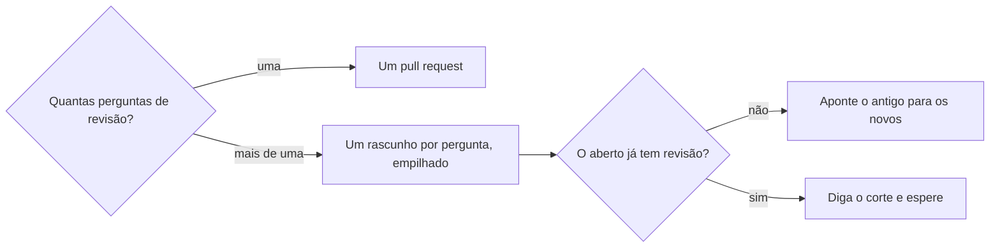

# Fatiar pull request

## Parâmetros de configuração

Leia cada valor nas instruções do projeto: primeiro na entrada com o nome desta habilidade, depois na entrada `Global` ou no primeiro nível do bloco. Quando um valor não estiver lá, use o padrão abaixo.

```yaml
# `Fatiar por subtarefa`: `não` junta só a mesma pergunta de revisão. `sim` abre um pull request por subtarefa, e dentro dela vale o mesmo corte.
"Fatiar por subtarefa": "não"
"Modo de aprendizado": "perguntar"
```

## Instruções

### Passo 1

Uma pergunta de revisão é o que uma pessoa julga sem abrir outro assunto.
A chave, o componente e o lugar em que ele aparece são perguntas diferentes.
Vários commits da mesma pergunta continuam no mesmo pull request.



Conte as perguntas antes de abrir.
Com uma, abra um pull request só.
Com mais de uma, abra um rascunho por pergunta.
Empilhe: o de baixo entra primeiro, e o de cima abre contra a branch do de baixo.
Cada diff mostra só os arquivos daquela pergunta.
O teto de arquivos do repositório continua valendo para cada pull request.
Ele não junta perguntas para caber em menos pull requests.
Com `Fatiar por subtarefa` em `sim`, abra um pull request por subtarefa, e dentro dela repita este corte.
A abertura segue `criar-pull-request`.

### Passo 2

Se o pull request aberto mistura perguntas e ainda não tem revisão, abra os rascunhos e aponte o antigo para os novos.
Não reescreva a branch já publicada.
Se já tem revisão, não feche.
Diga o corte e espere a pessoa.

### Passo 3

Ao terminar, siga `evoluir-habilidade` conforme `Modo de aprendizado`.

## Problemas comuns

### PR maior que a revisão

Se você juntar a chave, o componente e o lugar em que ele aparece num pull request só, a pessoa revisa assuntos diferentes de uma vez.

1. Abra um rascunho por pergunta, empilhado.
2. Cada diff fica só com os arquivos daquela pergunta.
3. O de baixo entra primeiro.

### Teto de arquivos junta assuntos

Se você mantiver os assuntos juntos porque o teto de arquivos ainda não estourou, a revisão continua misturada.

1. Separe mesmo assim.
2. O teto vale para cada pull request.
3. Ele não é motivo para juntar perguntas.

### Branch publicada reescrita

Se você reescrever a branch do pull request que já está aberto, a história publicada muda sem a pessoa ter pedido.

1. Abra os rascunhos novos.
2. Aponte o antigo para eles.
3. Não reescreva a branch já publicada.

## Exemplos de entrada e saída

Estes exemplos ilustram fatos. Eles podem não estar no data source.

### A demanda junta a chave, a tela e a página que monta a tela

Três rascunhos empilhados.
O primeiro só liga a chave.
O segundo só traz a tela.
O terceiro só monta a tela na página.
Cada diff mostra uma pergunta.
O teto de arquivos do repositório não juntou os três.

## Casos-limite

- A demanda cabe numa pergunta de revisão: um pull request só, mesmo com vários commits.
- O teto de arquivos ainda não estourou, mas o diff mistura perguntas: separe mesmo assim.
- O pull request aberto mistura perguntas e já tem revisão: não feche. Diga o corte e espere a pessoa.
- O pull request aberto mistura perguntas e ainda não tem revisão: abra os rascunhos, aponte o antigo e não reescreva a branch.
- `Fatiar por subtarefa` em `sim`: um pull request por subtarefa, e dentro dela o mesmo corte.

## Pegadinhas

- O teto de arquivos ainda folgado parece permissão para juntar a chave, o componente e o lugar em que ele aparece. Cada um é uma pergunta de revisão. O teto não junta.
- O mesmo tema da demanda parece um pull request só. O que junta é a pergunta de revisão.
- Reescrever a branch publicada parece o jeito mais curto de cortar. O corte novo são rascunhos empilhados. A branch antiga fica.

## Scripts disponíveis

- Nenhum.

1. Não há script para executar.
