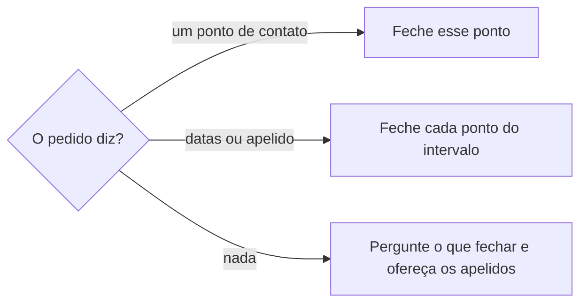
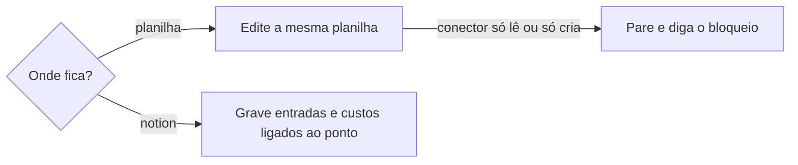

# Fazer fechamento

## Parâmetros de configuração

Leia cada valor nas instruções do projeto: primeiro na entrada com o nome desta habilidade, depois na entrada `Global` ou no primeiro nível do bloco. Quando um valor não estiver lá, use o padrão abaixo.
```yaml
# `Onde fica o fechamento` é `notion` ou `planilha`, e vazio quer dizer que quem faz o fechamento escolhe a cada pedido.
"Onde fica o fechamento": ""
# `Nome do ponto de contato` é como o negócio chama o que se fecha, como `evento`, `show` ou `pop-up`.
"Nome do ponto de contato": "ponto de contato"
# `Apelidos de intervalo` e `Início da semana` têm os mesmos nomes e padrões de `revisar-financas`.
"Apelidos de intervalo":
  "semana": "do Início da semana ao dia anterior da semana seguinte"
  "mês": "do dia 1 ao último dia do mês"
# `Apelidos de intervalo` e `Início da semana` têm os mesmos nomes e padrões de `revisar-financas`.
"Início da semana": "segunda-feira"
# `Regras de divisão` diz onde fica a regra de divisão com cada parceiro, como a casa de shows.
"Regras de divisão": ""
# `Fontes` lista os documentos que trazem os números, como o borderô da tiqueteira e o relatório de caixa do parceiro.
"Fontes": []
# `Moeda` é a moeda das tabelas.
"Moeda": "BRL"
"Modo de aprendizado": "perguntar"
```
## Instruções

### Passo 1

O fechamento diz o que fechou, quanto pagar a cada pessoa e o que falta cobrar ou repassar ao parceiro.
O recorte e o intervalo são escolha de cada pedido, não do negócio.



Pergunte antes de ler ou gravar.
O apelido vira datas.
Um apelido que não está em `Apelidos de intervalo` pede as datas.
A resposta começa pelo ponto de contato ou pelo intervalo, com cada data e o dia da semana.

### Passo 2

Os nomes das listas, das abas, das colunas e das propriedades vêm do mapeamento de dados do projeto.
Com `Onde fica o fechamento` vazio, pergunte se o fechamento fica no Notion ou na planilha.



Sem o link da planilha no pedido nem no mapeamento, procure-a pelo conector antes de pedir: pelo nome, depois pelo nome das abas no conteúdo, depois entre os arquivos compartilhados com a conta conectada.
Sem achar, diga que buscas rodou e peça que a dona da planilha a compartilhe com a conta do conector, ou mande o link.
Na planilha, edite o arquivo que já existe.
Não crie arquivo novo: o link muda e o que já foi marcado como pago se perde.
No Notion, ligue cada entrada e cada custo ao ponto de contato.
Se a lista ou a planilha não estiver no workspace conectado, pare. Não use a de outro workspace.

### Passo 3

Para cada ponto de contato, marque este checklist:

- [ ] Entradas, pelas `Fontes`.
- [ ] Custos ligados ao ponto. Custo que ninguém lançou segue `lancar-despesa-da-empresa`.
- [ ] Pessoas a pagar, com o valor combinado e o Pix. Pix que falta segue `definir-conta-bancaria`.
- [ ] Regra de divisão do parceiro, em `Regras de divisão`.
- [ ] Total do fechamento, quanto pagar a cada pessoa e quanto cobrar ou repassar ao parceiro.

Sem a regra de divisão, não calcule a divisão. Diga que a regra do parceiro está pendente.
Dado que falta, como o borderô, o caixa do parceiro ou o Pix: diga o que falta e de quem. Não estime o valor.
O cálculo não depende de onde o fechamento fica. O mesmo ponto fechado no Notion e na planilha dá os mesmos totais, pagamentos e cobranças.

### Passo 4

O ponto de contato com caixa, como uma pop-up, compara o caixa contado com as vendas registradas, por forma de pagamento.
Mostre a diferença, quando houver. Não ajuste a venda para o caixa bater.

### Passo 5

Antes de gravar, mostre o plano: o que vai para cada lista ou aba, linha por linha.
Confira o plano com o que a fonte já tem. Grave depois do sim da pessoa.
Grave só nos campos que o mapeamento libera para o fechamento.
O status de pagamento, a data do pagamento e o comprovante ficam como estão, mesmo quando o valor muda.
Valor que muda numa linha já paga: não grave. Mostre a diferença e pergunte.

### Passo 6

No intervalo, some o que ficou para pagar e para cobrar de todos os pontos.
O gasto do intervalo sem ponto de contato aparece à parte. Ele não entra em nenhum ponto.
O acerto com o parceiro que passa do prazo segue `definir-obrigacao-financeira`.
O lucro, a DRE e o fluxo de caixa do intervalo seguem `revisar-financas`.

### Passo 7

Ao terminar, siga `evoluir-habilidade` conforme `Modo de aprendizado`.

## Problemas comuns

### Arquivo novo a cada fechamento

Se você gerar uma planilha nova porque o conector não edita a que existe, o link muda e quem marcou os pagamentos perde o que marcou.

1. Edite a planilha que já existe.
2. Sem permissão de edição, pare e diga o bloqueio.
3. Não crie arquivo novo.

### Pagamento apagado

Se você regravar a linha inteira de um pagamento, o status, a data e o comprovante somem.

1. Grave só os campos que o mapeamento libera.
2. Mantenha o status, a data e o comprovante.
3. Valor diferente numa linha paga: mostre e pergunte.

### Divisão estimada

Se você supor o percentual do parceiro, o valor a cobrar ou repassar sai errado e vira cobrança indevida.

1. Leia a regra em `Regras de divisão`.
2. Sem regra, diga que está pendente.
3. Não estime.

## Exemplos de entrada e saída

Estes exemplos ilustram fatos. Eles podem não estar no data source.

### faz o fechamento

O pedido não disse o ponto de contato nem o intervalo. Perguntei o que fechar, oferecendo `semana` e `mês`, antes de ler.

### fecha a semana passada na planilha

A semana virou as datas de segunda-feira, 19/10/2026, a domingo, 25/10/2026. Fechei os dois eventos dela na mesma planilha, depois do sim ao plano. Um artista estava sem Pix: o pagamento dele ficou como pendente.

### faz o fechamento de caixa da pop-up de sábado

O caixa contado deu 40,00 a menos que as vendas registradas em dinheiro. Mostrei a diferença e não ajustei a venda.

## Casos-limite

- Pedido sem ponto de contato e sem intervalo: pergunte o que fechar.
- `Onde fica o fechamento` vazio: pergunte se fica no Notion ou na planilha.
- A planilha sem link: procure pelo conector antes de pedir. Sem achar, diga as buscas e peça o compartilhamento ou o link.
- O conector da planilha só lê ou só cria arquivo: pare e diga o bloqueio. Não crie arquivo novo.
- Parceiro sem regra de divisão: não calcule a divisão. Diga que está pendente.
- Pessoa a pagar sem Pix: o pagamento fica pendente, com o pedido do Pix.
- Linha já paga com valor diferente: mostre a diferença e pergunte.
- Gasto do intervalo sem ponto de contato: à parte.

## Pegadinhas

- O conector que lê e cria arquivos no Drive parece editar a planilha. Ele não edita um arquivo que já existe. A edição pede um conector de planilha com edição.
- A planilha de outra pessoa não aparece na busca do conector até ser compartilhada com a conta conectada. Achar nada não prova que ela não existe.
- A API do Notion devolve o resultado de uma fórmula, mas não o código dela. O total de uma propriedade de fechamento não mostra a regra. Confira o total com as entradas e os custos ligados ao ponto.
- O ponto de contato do negócio pode ter outro nome, como `evento` ou `show`. O nome vem de `Nome do ponto de contato`.

## Scripts disponíveis

- Nenhum.

1. Não há script para executar.
