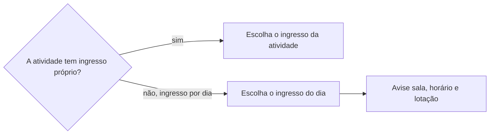

# Fazer inscrição

## Parâmetros de configuração

```yaml
"Modo de aprendizado": "perguntar"
```

## Instruções

### Passo 1

Ache a edição com `procurar-oportunidade` e leia o cronograma dela, quando houver. O link de inscrição vem da edição.

Antes do navegador, procure uma integração da plataforma para quem se inscreve: conector, MCP, CLI ou API. A API de uma tiqueteira costuma servir só a quem organiza o evento, para ler pedidos e participantes. Nesse caso, diga isso e siga pelo navegador que a pessoa deixou aberto.

### Passo 2

Leia a descrição do evento e a página de programação antes de escolher o ingresso.



Quando a atividade não tem inscrição própria, a vaga na sala é por ordem de chegada: diga a sala, o andar, o horário, a lotação e a hora do credenciamento.

### Passo 3

Confira o login na tiqueteira. Sem login, peça que a pessoa entre na conta no navegador e espere o aviso. A pessoa titular da conta é a participante: confirme o nome que o checkout mostra.

Sem a quantidade de ingressos, peça um no nome da conta e diga que dá para acrescentar outros.

### Passo 4

Preencha o checkout com o cadastro da pessoa titular, lido por `definir-pessoa`. Endereço e telefone vêm dele. Não invente campo que falta: pergunte. Um campo opcional de documento, como CNPJ, fica vazio.

A reserva do checkout expira em minutos. Junte as perguntas numa só.

### Passo 5

Antes de marcar o aceite de um termo, resuma o que ele pede, como guarda de dados ou cessão de imagem e voz, e espere o sim da pessoa. Com o sim, marque o aceite e finalize.

Depois do pedido, feche o pop-up de prêmio ou publicidade sem clicar na oferta. Guarde o print da tela de pedido confirmado, com o número e o status.

### Passo 6

Passe a inscrição a `definir-inscricao`, com o print, a hora do envio e o status que a tela mostrou. Atualize a linha da atividade no cronograma.

### Passo 7

Ao terminar, siga `evoluir-habilidade` conforme `Modo de aprendizado`.

## Problemas comuns

### Ingresso da atividade procurado à toa

Se você procurar um ingresso para a palestra num evento com ingresso por dia, a inscrição não sai ou sai no dia errado.

1. Leia a programação e a descrição.
2. Peça o ingresso do dia da atividade.
3. Avise que a sala é por ordem de chegada.

### Reserva expirada

Se você perguntar um campo de cada vez, a reserva do checkout expira e o ingresso volta à venda.

1. Preencha primeiro o que o cadastro responde.
2. Junte numa pergunta só o que faltar e o aceite do termo.

### Campo preenchido por um clique fora do lugar

Se você clicar por coordenada depois de a página rolar, o texto vai para outro campo e o checkout aponta campo obrigatório vazio.

1. Confira os valores dos campos depois de preencher.
2. Corrija o que ficou vazio ou trocado.

## Exemplos de entrada e saída

Estes exemplos ilustram fatos. Eles podem não estar no data source.

### faça a inscrição na palestra de segunda às 17h no Festival Rota Sul

A tiqueteira não tem integração para quem se inscreve. A programação diz que as salas lotam por ordem de chegada, então pedi o ingresso de segunda-feira, 29/09/2026. O checkout pediu endereço e o aceite de um termo com cessão de imagem: o endereço veio do cadastro da titular, e o aceite esperou o sim. O pedido saiu confirmado e foi para `definir-inscricao`, com o print.

## Casos-limite

- O ingresso é pago: pare e passe a compra à pessoa, com item e valor.
- O checkout pede CAPTCHA: pare e peça que a pessoa resolva.
- A pessoa não quer aceitar o termo: deixe o checkout sem finalizar e diga que a reserva vai expirar.
- A conta logada é de outra pessoa: diga o nome que aparece e pergunte antes de seguir.

## Pegadinhas

- A API pública de uma tiqueteira parece servir para se inscrever. Ela costuma ser só de quem organiza.
- O link "monte sua trilha" da programação parece a inscrição na atividade. Ele só monta uma lista para a pessoa.
- O checkout pede dados da pessoa titular da conta, não da empresa. Endereço sai do cadastro dela.
- A tela de sucesso abre com uma oferta de prêmio. Ela é publicidade e não faz parte da inscrição.
- Login, senha e código são da pessoa. A IA nunca os digita.

## Scripts disponíveis

- Nenhum.

1. Não há script para executar.
