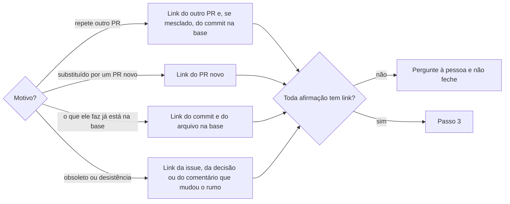

# Fechar pull request

## Parâmetros de configuração

Leia cada valor nas instruções do projeto: primeiro na entrada com o nome desta habilidade, depois na entrada `Global` ou no primeiro nível do bloco. Quando um valor não estiver lá, use o padrão abaixo. `Repositório` vem do remoto `origin` quando as instruções não dizem.

```yaml
"Repositório": ""
# `Idioma do comentário de fechamento`: `o idioma do PR` segue `Idioma do PR` de `criar-pull-request`.
"Idioma do comentário de fechamento": "o idioma do PR"
# `Apagar a branch ao fechar`: `sim` apaga a branch remota junto com o fechamento. `não` mantém.
"Apagar a branch ao fechar": "sim"
"Modo de aprendizado": "perguntar"
```

## Instruções

### Passo 1

Leia o estado do PR agora.
Já fechado ou mesclado: diga isso e pare.
Feche só com pedido da pessoa ou quando outra habilidade manda, como `atualizar-branch-do-pull-request` ao renomear a branch e `atender-revisao-de-pull-request` ao recriar o PR.
PR de outra pessoa só fecha com pedido explícito dela, naquele PR.

### Passo 2

Ache o motivo e a prova de cada afirmação do comentário, antes de escrever.



Quando o comentário diz que nada se perde, confira arquivo por arquivo o diff do PR contra a base e diga quais arquivos diferem e por quê.
Uma diferença sem explicação segura o fechamento até a pessoa decidir.

### Passo 3

Escreva o comentário no `Idioma do comentário de fechamento`.
A primeira linha diz o motivo numa frase.
Depois vem uma lista curta, um item por fato, cada um com o link que o comprova: PR, commit, arquivo na base, issue ou comentário.
A última linha diz o que fica da branch: nada se perde, ou o que se perde e onde o resto está.
Cada PR, issue e commit vai como link clicável, nunca só o número.

### Passo 4

Publique o comentário e feche o PR na mesma operação, com `Apagar a branch ao fechar`.
Confirme o estado CLOSED.
Uma thread de revisão ainda aberta vai para o PR que substitui este, como `fatiar-pull-request` faz com os comentários.
Para cada tarefa ligada ao PR, siga `sincronizar-status-da-tarefa`.
Siga `limpar-copias-de-trabalho` para a cópia de trabalho e a branch local do PR.

### Passo 5

Responda com o link do PR fechado e o link do comentário.

### Passo 6

Ao terminar, siga `evoluir-habilidade` conforme `Modo de aprendizado`.

## Problemas comuns

### Fechado sem motivo

Se você fechar o PR sem comentário, ou só com "duplicado", quem abrir o PR depois não sabe por que ele parou nem onde a mudança está.

1. Escreva o motivo na primeira linha.
2. Leve um link para cada fato.
3. Feche só depois de publicar o comentário.

### Motivo sem prova

Se você afirmar que a mudança já está na base sem conferir, um arquivo que só existia no PR some sem ninguém notar.

1. Compare cada arquivo do PR com a base.
2. Diga quais diferem e por quê.
3. Diferença sem explicação: pergunte antes de fechar.

## Exemplos de entrada e saída

Estes exemplos ilustram fatos. Eles podem não estar no data source.

### Pode fechar o #12, ele repete o #13 que já entrou

Comentei no #12 que ele repete o #13, mesclado no commit da base, com o link do commit e da pasta da skill na base. Conferi que 9 dos 11 arquivos eram iguais aos da base e que os outros dois só diferiam por entradas de PRs mesclados depois, cada um com link. Fechei com a branch apagada, e a resposta trouxe o link do PR e do comentário.

## Casos-limite

- Renomear a branch fecha o PR sem comentário: comente depois, com o link do PR novo.
- O PR tem thread de revisão aberta: leve a thread para o PR que o substitui antes de fechar.
- O PR é de bot de dependência e a versão já entrou por outro PR: o link desse PR é a prova.
- A pessoa pede para fechar sem dizer o motivo: pergunte o motivo antes.

## Pegadinhas

- O "Closed with unmerged commits" do GitHub parece explicar o fechamento. Ele não diz o motivo nem aponta para onde a mudança foi.
- Um PR fechado continua com o commit na referência dele. Apagar a branch não perde o trabalho, mas o comentário é o único lugar que diz onde ele está.
- O PR da mesma mudança pode ter título diferente, como um `!` a mais. Compare os arquivos, não só o título.

## Scripts disponíveis

- `gh pr view <número> --repo <Repositório> --json state,headRefName,headRefOid,author`: estado do Passo 1.
- `gh pr diff <número> --repo <Repositório> --name-only` e `git diff --quiet <commit do PR> origin/<base> -- <arquivo>`: comparação do Passo 2.
- `gh pr comment <número> --repo <Repositório> --body-file <arquivo>` e `gh pr close <número> --repo <Repositório> --delete-branch`: Passo 4. Sem apagar a branch, tire `--delete-branch`.

1. Leia o estado, junte as provas, escreva o comentário, publique, feche e confirme.
