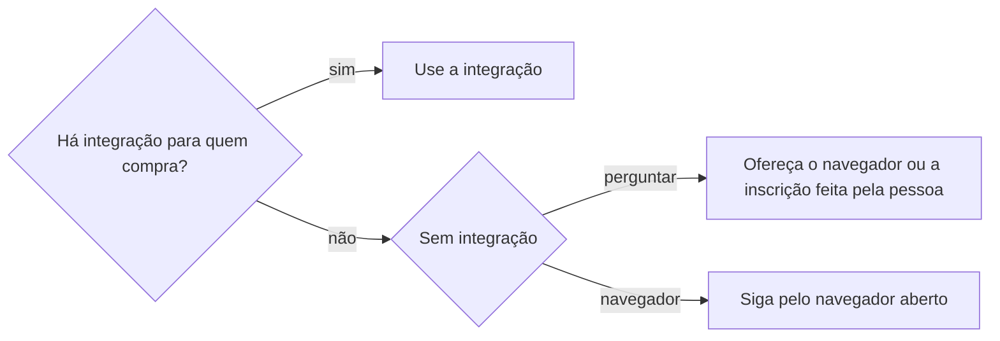
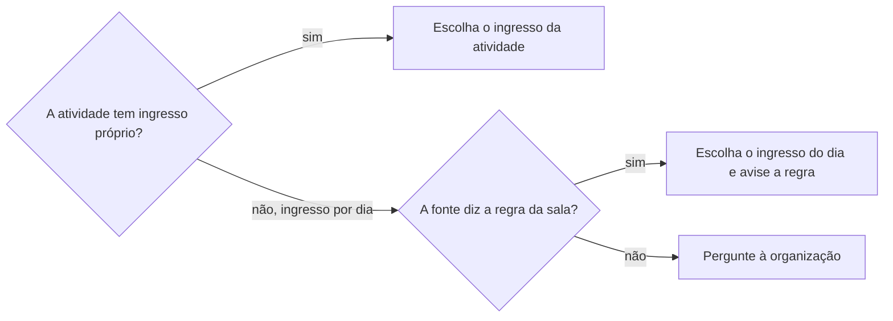

# Garantir ingresso

## Parâmetros de configuração

```yaml
# `Sem integração` é o que fazer quando a plataforma não tem conector, MCP, CLI nem API para quem compra: `perguntar` oferece o navegador ou a inscrição feita pela pessoa, com o comprovante; `navegador` segue direto pelo navegador.
"Sem integração": "perguntar"
# `Aceite de termos` é `automático`, que só pergunta o termo sensível; `perguntar`, que pergunta todo termo; ou `aceitar`, que aceita sem perguntar e não é recomendado.
"Aceite de termos": "automático"
# `CNPJ na inscrição da empresa` é `perguntar`, `preencher`, com o CNPJ do cadastro da empresa, ou `não preencher`.
"CNPJ na inscrição da empresa": "perguntar"
"Modo de aprendizado": "perguntar"
```

## Instruções

### Passo 1

Ache a edição com `procurar-oportunidade` e leia o cronograma dela, quando houver. O link do ingresso vem da edição.

Antes do navegador, procure uma integração da plataforma para quem compra: conector, MCP, CLI ou API. A API de uma tiqueteira costuma servir só a quem organiza o evento, para ler pedidos e participantes e fazer check-in.



Quando a pessoa prefere se inscrever sozinha, peça o print ou o e-mail do pedido e siga para `definir-inscricao`.

### Passo 2

Leia a descrição do evento e a página de programação antes de escolher o ingresso.



Quando a sala é por ordem de chegada, diga a sala, o andar, o horário, a lotação e a hora do credenciamento.

Quando nem a página, nem o e-mail, nem a conversa no WhatsApp dizem como se entra na atividade, redija a pergunta à organização com `redigir-com-tom-de-voz`. Envie só com o sim da pessoa.

### Passo 3

Confira o login na tiqueteira. Sem login, peça que a pessoa entre na conta no navegador e espere o aviso.

A pessoa titular da conta é a participante: confirme o nome que o checkout mostra. Sem a quantidade, peça um ingresso no nome da conta e diga que dá para acrescentar outros.

### Passo 4

Preencha todo campo do checkout, obrigatório ou opcional, que o cadastro responde: o da pessoa titular, lido por `definir-pessoa`, e o da empresa, lido por `definir-empresa`. A tabela liga cada campo já visto à fonte dele.

| Campo do checkout | Fonte |
| --- | --- |
| Nome, e-mail, CPF e telefone | Conta da tiqueteira, conferida com o cadastro da pessoa |
| CEP, rua, número, complemento, bairro, cidade e estado | Endereço do cadastro da pessoa |
| CNPJ | Cadastro da empresa, conforme `CNPJ na inscrição da empresa` |
| Nome da empresa | Cadastro da empresa |
| Segmento | Atividade da empresa no cadastro |
| Necessidade de acessibilidade | Cadastro da pessoa; sem registro, fica vazio |

Um campo que nenhum cadastro responde vira pergunta, e um campo fora da tabela entra nela ao final. Quando o agente não pode digitar um documento, ele pede que a pessoa preencha esse campo.

Confira se o checkout mostra um prazo de reserva. Com prazo, junte numa mensagem só os campos que o cadastro não respondeu e os termos que pedem o sim.

### Passo 5

Leia cada termo e veja se ele é obrigatório. O termo opcional fica desmarcado, salvo pedido da pessoa.

O termo obrigatório segue `Aceite de termos`. Em `automático`, é sensível o termo que cede imagem ou voz, usa os dados além do evento ou gera cobrança: resuma o que ele pede e espere o sim. O resto se aceita e entra no relatório.

No ingresso pago, mostre o item, o valor total e o meio de pagamento e espere o sim. Os dados do cartão ficam com a pessoa.

### Passo 6

Finalize. Feche o pop-up de prêmio, cashback ou publicidade sem clicar na oferta e confira que ele sumiu.

Guarde o print da tela do pedido confirmado sem o pop-up, com o número e o status. Se o pop-up não fechar, guarde os dois prints.

Passe o pedido a `definir-inscricao`, com o print, a hora do envio e o status que a tela mostrou. Atualize a linha da atividade no cronograma.

### Passo 7

Ao terminar, siga `evoluir-habilidade` conforme `Modo de aprendizado`. Cada campo do checkout que não estava na tabela do Passo 4 entra nela, com a fonte que respondeu.

## Problemas comuns

### Ingresso da atividade procurado à toa

Se você procurar um ingresso para a palestra num evento com ingresso por dia, a inscrição não sai ou sai no dia errado.

1. Leia a programação e a descrição.
2. Peça o ingresso do dia da atividade.
3. Diga a regra da sala, ou pergunte à organização quando nenhuma fonte diz.

### Reserva expirada

Se você perguntar um campo de cada vez num checkout com prazo, a reserva expira e o ingresso volta à venda.

1. Preencha primeiro o que o cadastro responde.
2. Junte numa mensagem só os campos que faltam e os termos que pedem o sim.

### Campo preenchido por um clique fora do lugar

Se você clicar por coordenada depois de a página rolar, o texto vai para outro campo e o checkout aponta campo obrigatório vazio.

1. Confira os valores dos campos depois de preencher.
2. Corrija o que ficou vazio ou trocado.

### Comprovante com publicidade

Se você guardar o print com o pop-up de prêmio aberto, o comprovante esconde o número e o status do pedido.

1. Feche o pop-up e confira que ele sumiu.
2. Guarde o print limpo, ou os dois quando ele não fecha.

## Exemplos de entrada e saída

Estes exemplos ilustram fatos. Eles podem não estar no data source.

### faça a inscrição na palestra de segunda às 17h no Festival Rota Sul

A tiqueteira não tem integração para quem compra, e a pessoa escolheu o navegador. A programação diz que as salas lotam por ordem de chegada, então pedi o ingresso grátis de segunda-feira, 29/09/2026. O endereço veio do cadastro da titular, e o termo obrigatório de cessão de imagem esperou o sim. O pedido saiu confirmado e foi para `definir-inscricao`, com o print sem o pop-up.

### compre dois ingressos da primeira fila

Mostrei o item, o valor total e o cartão salvo na conta e esperei o sim antes de finalizar. Os dados do cartão ficaram com a pessoa.

## Casos-limite

- O checkout pede CAPTCHA: pare e peça que a pessoa resolva.
- A pessoa recusa um termo obrigatório: deixe o checkout sem finalizar e diga que a reserva pode expirar.
- A conta logada é de outra pessoa: diga o nome que aparece e pergunte antes de seguir.
- A inscrição é num curso ou num edital, sem ingresso: esta skill não cobre.

## Pegadinhas

- A API pública de uma tiqueteira parece servir para tirar ingresso. Ela costuma ser só de quem organiza, sem rota para criar pedido.
- O link "monte sua trilha" da programação parece a inscrição na atividade. Ele só monta uma lista para a pessoa.
- O checkout pede dados da pessoa titular da conta, e não da empresa, salvo o CNPJ.
- A tela de sucesso de algumas tiqueteiras abre com uma oferta de prêmio ou cashback. Ela é publicidade e não faz parte do pedido.
- Login, senha, código e dados de cartão são da pessoa. A IA nunca os digita.

## Scripts disponíveis

- Nenhum.

1. Não há script para executar.
