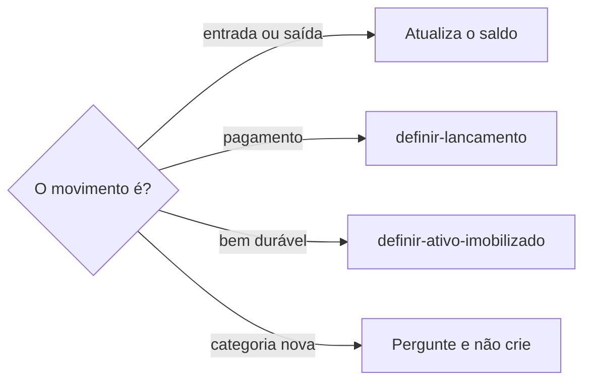

# Gerenciar estoque

## Parâmetros de configuração

Leia cada valor nas instruções do projeto: primeiro na entrada com o nome desta habilidade, depois na entrada `Global` ou no primeiro nível do bloco. Quando um valor não estiver lá, use o padrão abaixo.

```yaml
"Unidades do saldo": "metro, unidade, pacote, rolo, kit"
```

## Instruções

### Passo 1

Entrada, saída, saldo e reposição de item esgotável é esta habilidade. A pessoa informa o data source na execução. Sem essa indicação, use a lista do mapeamento de dados do projeto. O nome de cada propriedade vem desse mapeamento. Se a lista de estoque não estiver no workspace conectado, pare. Não use a lista de outro workspace.



### Passo 2

Entrada soma a quantidade ao saldo atual. Saída subtrai. A unidade do saldo segue a chave `Unidades do saldo`. Lote e volume não entram nessa propriedade. Se a pessoa falar lote ou volume, pergunte qual unidade da chave usar. Não grave lote nem volume. A quantidade adquirida é a quantidade comprada. Não use esse campo como saldo. Saldo desconhecido: deixe o saldo atual vazio. Não invente. Saída maior que o saldo conhecido: pergunte. Não grave saldo negativo.

### Passo 3

Antes de criar outro item, busque com `identificar-duplicata`. Provável: mostre o que bate e o que diverge e peça confirmação. Não crie duplicata. Dois registros do mesmo item seguem `mesclar-registro` só depois do sim.

### Passo 4

O efeito no caixa segue `definir-lancamento`. A despesa relacionada aponta o lançamento que já existe. Sem ele, não invente o pagamento. Não grave o pagamento aqui. Não crie a categoria de custo. Reposição sem a quantidade que a pessoa quer comprar: informe o saldo e pergunte. Não invente o quanto repor.

## Problemas comuns

### Saldo inventado

Se você preencher o saldo atual que ninguém informou, ou gravar a saída acima do saldo, o estoque mente.

1. Some ou subtraia só a quantidade dita.
2. Saldo desconhecido: deixe vazio.
3. Saída maior que o saldo conhecido: pergunte. Não grave negativo.

### Pagamento no estoque

Se você registrar o pagamento nesta habilidade, o caixa e o item se misturam.

1. Atualize quantidade e saldo aqui.
2. O dinheiro segue `definir-lancamento`.
3. Não crie a categoria de custo.

## Exemplos de entrada e saída

Estes exemplos ilustram fatos. Eles podem não estar no data source.

### entraram 3 unidades deste tecido

Somei 3 ao saldo atual, na unidade. O pagamento seguiu `definir-lancamento`. Não criei categoria.

### saíram 3 unidades e o saldo era 1

Perguntei. Não gravei saldo negativo.

### repõe este item

Informei o saldo. A quantidade a comprar não estava dita. Perguntei. Não inventei a reposição.

## Casos-limite

- A lista de estoque não está no workspace conectado: pare. Não use a lista de outro workspace.
- Bem durável: `definir-ativo-imobilizado`. Não cadastre o ativo aqui.
- Lote ou volume: pergunte a unidade da chave `Unidades do saldo`. Não grave lote nem volume.
- Item provável já existe: mostre e confirme. Não duplique.
- Pagamento: `definir-lancamento`. Sem o lançamento, não invente a despesa relacionada.

## Pegadinhas

- Lote e volume parecem unidade do saldo. A chave `Unidades do saldo` aceita metro, unidade, pacote, rolo e kit.
- A quantidade adquirida parece o saldo. Ela é a quantidade comprada. O disponível é o saldo atual.
- Compra de estoque parece incluir o pagamento. O dinheiro segue `definir-lancamento`.

## Scripts disponíveis

- Nenhum.

1. Não há script para executar.
