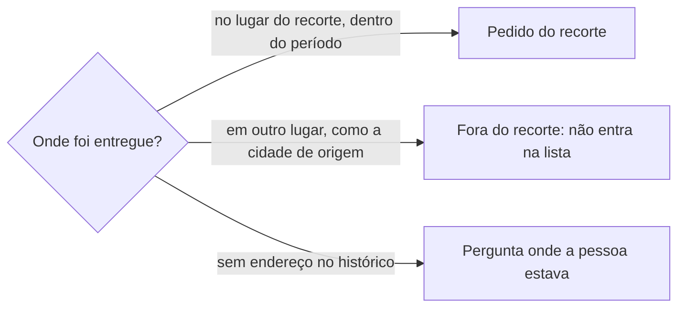

# Gerenciar pedidos de delivery

## Parâmetros de configuração

Leia cada valor nas instruções do projeto: primeiro na entrada com o nome desta habilidade, depois na entrada `Global` ou no primeiro nível do bloco. Quando um valor não estiver lá, use o padrão abaixo.
```yaml
"Modo de aprendizado": "perguntar"
```

## Instruções

### Passo 1

Defina o recorte da conferência: uma viagem ou um período. Numa viagem, ache-a na lista de viagens do mapeamento de dados do projeto e leia a cidade de destino e o período, da ida à volta. Se a pessoa informou o período, confira-o com o cadastro e aponte a diferença. Se a lista de viagens não estiver no workspace conectado, pare. Não use a lista de outro workspace. Num período sem viagem, peça o início e o fim.

Peça o histórico de pedidos do aplicativo, se a pessoa ainda não trouxe. A fonte é o que ela trouxe ou indicou: print do histórico, recibo, e-mail ou o próprio aplicativo aberto por ela. Leia print por `reconhecer-imagem`. Sem histórico, não deduza pedido: diga que a conferência depende dele.

A lista do aplicativo mostra o estabelecimento, os itens e a data, mas não o total pago, o número do pedido nem o endereço: esses ficam dentro de cada pedido. Uma lista basta para conferir o que existe e não para lançar. Para lançar, peça o detalhe do pedido.

O endereço de entrega e a forma de pagamento ficam no fim da tela do detalhe, e o print costuma cortá-los. Quando faltarem, peça o print rolado até o fim.

### Passo 2

Decida de quem é cada pedido pelo endereço de entrega, e só depois pela data.



Numa viagem, o dia da ida e o da volta podem ter pedido dos dois lados: o endereço separa. Um pedido fora do recorte não é dele nem, por isso, gasto da empresa. Não o liste como faltante.

Sem o endereço, a unidade do estabelecimento indica a cidade, mas só decide junto com o que a pessoa disse sobre onde estava. Quando o título de data de um cartão sai do print, a data dele fica entre as dos cartões vizinhos, porque o histórico vai do mais novo para o mais antigo. Não copie a data do cartão vizinho: diga o intervalo e peça a data.

### Passo 3

Busque as despesas de alimentação do recorte, sem pedir autorização para a leitura. Numa viagem, use a relação mapeada com a viagem. Compare cada pedido do recorte por número do pedido, valor pago, data e estabelecimento. Quando o pedido tem dois números, o do recibo e o do aplicativo, compare pelos dois. Itens ou valor diferentes entre o aplicativo e a despesa deixam o pedido em dúvida: pergunte, sem concluir duplicata nem diferença.

Busque também fora do recorte, por `identificar-duplicata`. Um lançamento sem a viagem não é pedido faltante: o que falta é o vínculo. Dê a cada pedido uma de três situações: lançado e dentro do recorte, lançado fora do recorte, ou não lançado.

### Passo 4

Entregue a lista dos pedidos do recorte com estabelecimento, data, valor pago e situação, e a página de cada despesa já lançada. Diga quantos pedidos conferiu e de qual fonte vieram.

Para cada pedido não lançado, siga `lancar-despesa-da-empresa`, com a viagem quando houver, usando o comprovante que a pessoa já trouxe. O print do detalhe do pedido é o comprovante: anexe-o à despesa, sem deixá-lo como pendência. O que faltar de evidência fica como pendência dita na resposta. Sem o total pago, não grave: o pedido fica na lista com o que falta pedir. Para o lançamento fora do recorte, complemente o vínculo na mesma despesa, sem criar outra. Se a pessoa disser que um pedido era pessoal, siga `lancar-despesa-pessoal`.

### Passo 5

Ao terminar, siga `evoluir-habilidade` conforme `Modo de aprendizado`.

## Problemas comuns

### Pedido de fora do recorte entra na conta

Se você confiar só na data do pedido, um pedido feito em casa no dia da ida entra como da viagem e vira despesa da empresa que não é.

1. Leia o endereço de entrega de cada pedido.
2. Deixe de fora o que foi entregue fora do recorte, como na cidade de origem.
3. Pergunte onde a pessoa estava quando o histórico não traz o endereço.

### Conferência só dentro do recorte

Se você buscar apenas o que já está ligado à viagem ou ao período, uma despesa lançada sem o vínculo aparece como faltante e vira lançamento duplicado.

1. Busque também por número do pedido, valor e data, fora do recorte.
2. Complemente o vínculo na despesa que já existe.
3. Só trate como faltante o que nenhuma busca achou.

### Pedido que a pessoa não trouxe

Se você listar pedido que o histórico não mostra, a conferência passa a inventar despesa.

1. Liste só o que veio do histórico, do recibo ou do e-mail.
2. Sem histórico, peça-o e não conclua.
3. Diga na resposta de qual fonte vieram os pedidos conferidos.

## Exemplos de entrada e saída

Estes exemplos ilustram fatos. Eles podem não estar no data source.

### confira se todos os pedidos de comida da viagem de outubro estão nas despesas

Li a viagem, com o destino e o período, e o histórico que você trouxe. Deixei de fora os pedidos entregues em Belo Horizonte, no dia da ida e depois da volta. Dos pedidos entregues no destino, um estava lançado e ligado à viagem, um estava lançado sem a viagem e os outros não estavam lançados. Complementei o vínculo do segundo e segui o lançamento dos demais com os comprovantes que você enviou.

### veja se os pedidos de novembro estão lançados

Li o histórico que você trouxe e conferi os pedidos de 1 a 30 de novembro contra as despesas de alimentação do mês. Três estavam lançados e dois não. Os dois seguiram `lancar-despesa-da-empresa` com o detalhe de cada pedido.

## Casos-limite

- O histórico não traz o endereço de entrega: pergunte onde a pessoa estava. Não decida só pela data.
- O pedido foi cancelado ou reembolsado por inteiro: não é despesa. Diga que ficou de fora e por quê.
- O pedido saiu em nome de outra pessoa que viajou junto: é da viagem. Siga `lancar-despesa-da-empresa` para saber quem pagou.
- A viagem não tem período no cadastro: peça a ida e a volta e diga que o cadastro está incompleto. Não deduza o período.
- Um segundo cartão do mesmo restaurante, perto de um pedido já lançado, pode ser outra refeição do mesmo dia, como o almoço e o jantar, ou a reentrega do que faltou na primeira. Compare a hora de criação, os itens e o total no detalhe de cada pedido e pergunte antes de apontá-lo como faltante.
- A reentrega é pedido novo no aplicativo, mas o pagamento é um só. Só é reentrega quando o detalhe mostra o pedido concluído com alteração ou reembolso e a pessoa confirma: então não lance outra despesa e diga na despesa existente que houve duas entregas. Sem isso, é outro pagamento e outra despesa.
- O pedido saiu concluído com alteração, com item removido e reembolso: o valor pago é o total do detalhe final, não o do print feito durante o preparo. Se o total e o reembolso não fecham, pergunte qual valor vale antes de mudar a despesa.
- Há mais de um aplicativo de entrega no período: confira o histórico de cada um, por vez.
- O pedido já está lançado e dentro do recorte: só confirme. Não lance de novo.

## Pegadinhas

- O total que o aplicativo mostra difere do subtotal dos itens por cupom, taxa e desconto de item indisponível. Compare pelo total pago, não pela soma dos itens.
- O mesmo pedido tem um número no recibo e outro no aplicativo. Os dois valem para achar a despesa.
- Um restaurante pode ter duas listagens no aplicativo, como a rede e a unidade de esfihas, e cada uma aparece como estabelecimento à parte. Dois pedidos do mesmo restaurante em dias seguidos também parecem o mesmo lançamento. Compare itens e total, não só o nome.
- O aplicativo mostra a hora em que o pedido foi criado e a em que foi concluído, e as duas podem cair em dias diferentes. A data do pedido é a da criação, e o endereço decide se ele é do recorte.
- Um pedido da cidade de origem parece gasto da viagem só porque cai no dia da ida. O endereço de entrega decide.

## Scripts disponíveis

- Nenhum.

1. Não há script para executar.
