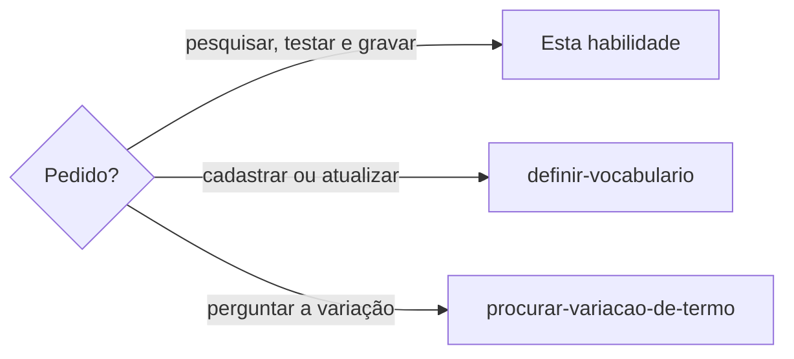

# Gravar termos no vocabulário

## Parâmetros de configuração

Quando `definir-vocabulario` chama esta habilidade, vale o que ela passa.

```yaml
"Validação dos campos": "warn"
```

## Instruções

### Passo 1

`definir-vocabulario` entrega o plano já classificado e validado, com idioma, modo e a lista. Esta habilidade pesquisa, testa e grava. Sem plano validado, volte para `definir-vocabulario`. Perguntar se um termo ou uma variação faltou segue `procurar-variacao-de-termo`.



### Passo 2

Para corrigir um termo que já está, leia a linha com `lookup` e guarde-a. Mande `state`, `term` e só o que muda: a escrita mantém o resto, e `""` ou `[]` limpa o campo, só a pedido. Leia a linha de novo depois. Se sumiu algo que você não mandou, o servidor é antigo: grave a linha guardada de volta e avise.

### Passo 3

Pesquise a grafia no vocabulário antes de gravar, com a consulta de Scripts disponíveis. Com mais de um termo, não consulte um por vez: `lookup-terms` lê todos de uma vez, na ordem enviada, e devolve a linha guardada de cada um que já está. Ele lê uma expressão com mais de uma palavra inteira. `exists` confere palavra por palavra e não serve para isso. O `dry_run` do lote em `insert` também diz o que já está, em `unchanged`, e o que é novo, em `inserted`, e valida o lote. Com terminal, rode o comando. Sem terminal, chame a ferramenta do servidor `vocabulary`. Sem os dois, como num agente do Notion, pare antes de pesquisar. Diga que o cadastro roda numa ferramenta de código com o projeto aberto. Não leia o vocabulário de memória. Outra caixa é o mesmo termo: a linha que já está recebe a orientação. Não cadastre uma segunda linha dessa grafia. Acento muda a palavra: roles e rolês, pais e país são termos diferentes, cada um com a própria linha. Uma forma igual, com os mesmos campos, volta sem alteração.

Plural, singular, feminino, masculino e outra palavra do mesmo assunto são linhas próprias. Cada uma tem o próprio estado. Casas e moradias convivem. Casa e casas convivem. Gato e gata convivem. Não junte essas linhas.

Termo que não existe e vai entrar como proibido, sem termos relacionados: pare e pergunte se a pessoa quer cadastrar um ou mais. Eles entram em `alternatives`. Se ela não quiser, a lista fica vazia. Não invente. Termo que já existe não pede essa pergunta.

Quando as duas linhas existirem, `related` aponta de uma para a outra. `related` vale nos três estados e não cria termo ausente. A escrita recusa o ponteiro solto.

### Passo 4

Teste antes com `--dry-run` ou `dry_run`: `refused` lista os problemas. Grave o plano inteiro numa escrita só, com a escrita de Scripts disponíveis. Com terminal, rode o comando. Sem terminal, chame a ferramenta do servidor `vocabulary`. Termo que não existia fica em minúsculas. Marca com caixa própria, como iPhone, leva `case_sensitive` e guarda a caixa. A linha que já existia conserva a grafia guardada. Se nenhum termo do plano existia, a resposta começa com a quantidade e segue com a lista do que entrou. Depois sugira plural, singular, feminino, masculino e outra grafia quando a palavra tiver. Não grave a sugestão. Pergunte o estado de cada forma. Pontuação e emoji não ganham essa sugestão. Um exemplo que também vem completo no lote permanece com essa linha. Um exemplo citado e ausente do lote nasce no estado desse vínculo, com as tags do termo. Uma falha deixa o vocabulário como estava. Não confirme o cadastro sem essa resposta.

## Problemas comuns

### Lote pela metade

Se você gravar um termo e seguir para o próximo depois de uma falha, o vocabulário fica incompleto.

1. Pare.
2. Corrija o plano.
3. Grave o lote inteiro de novo.

### Variação cadastrada de novo

Se você criar outra linha para a mesma palavra em outra caixa, o vocabulário repete a grafia.

1. Busque a grafia antes de gravar.
2. Atualize a linha que já está.
3. Diga o que foi criado, o que foi atualizado e o que já existia sem alteração.

### Duplicidade já no vocabulário

Se você gravar uma das linhas enquanto outra do mesmo termo continua lá, a orientação nova fica numa e some da outra.

1. Pare.
2. Repita as linhas e a sugestão que a consulta ou a escrita devolveu.
3. Espere a escolha. Não apague e não junte.

### Formas parecidas

Se você juntar o plural, o gênero ou outra palavra do mesmo assunto numa linha só, cada forma perde o próprio estado.

1. Deixe uma linha para cada forma.
2. Grave o estado que a pessoa definiu para essa forma.
3. Não copie o estado da forma vizinha.

### Variação gravada junto

Se você cadastrar o plural, o gênero ou outra grafia junto com a palavra nova, a forma vizinha ganha um estado que a pessoa não escolheu.

1. Grave só o que ela enviou, em minúsculas.
2. Diga a quantidade e a lista.
3. Sugira as outras formas e espere o estado.

### Proibido sem termo relacionado

Se você gravar o proibido novo sem perguntar pelos termos relacionados, a pessoa perde a chance de ligar o que usar no lugar.

1. Pare antes de gravar.
2. Pergunte se ela quer um ou mais termos relacionados.
3. Se sim, grave em `alternatives`. Se não, siga com a lista vazia.

## Exemplos de entrada e saída

Estes exemplos ilustram fatos. Eles podem não estar no data source.

### Cadastre `Casa` e `Moradias`.

As duas não estavam. Ficaram casa e moradias. A resposta foi: cadastrei 2 termos: casa, moradias. Sugeri casas e moradia, sem gravar.

### Cadastre `casas` como proibido e `moradias` como evitável. `Casa` já está permitida.

Casa ficou permitida. Casas ganhou a própria linha, proibida. Moradias ganhou a própria linha, `discouraged`. Não juntei as três.

### Cadastre o termo novo como proibido. Ainda não está.

Perguntei se ela queria termos relacionados. Ela pediu um. Ele entrou em alternatives, permitido. Não inventei outro.

### Atualize a reticências que já está e ignore a que não está.

O plano ficou em update. A reticências que já estava foi reescrita, com o quando usar. A que não estava voltou em skipped e não foi criada.

## Casos-limite

- O termo já está, só muda a caixa: a linha que já está é atualizada, ou fica sem alteração se os campos forem os mesmos.
- Lote vindo de outra ferramenta: um arquivo com `terms --file` e `upsert`. Diga o que entrou, o que foi atualizado e o que ficou em `incomplete`.
- Sem terminal e sem o servidor `vocabulary`, como num agente do Notion: pare. O cadastro roda numa ferramenta de código com o projeto aberto. Não confirme nada.
- A pessoa pergunta se um termo ou uma variação faltou: `procurar-variacao-de-termo`. `related` só aponta para termo que já está.

## Pegadinhas

- Cadastrar parece reescrever o que já está. Com `insert`, a linha que já existe fica.
- A maiúscula do pedido parece a grafia a guardar. Termo novo fica em minúsculas. A linha que já existe conserva a grafia guardada.
- Termo proibido parece exigir um substituto inventado. Sem a resposta da pessoa, `alternatives` fica vazio.
- Uma variação ausente parece já ligada pela palavra vizinha. Ela não existe até ser cadastrada. `related` não a cria.
- Duas linhas do mesmo termo parecem um convite a apagar a mais curta. A escrita não apaga. Sinalize e espere a escolha.
- Um exemplo citado parece herdar a descrição do termo. Se ele não vem como item do lote, nasce só com o estado daquele vínculo.
- O comando de escrita, com `--term` ou `--file`, parece dispensar a validação. Sem o plano que `validar-plano-de-vocabulario` aprovou, não grave. Quem decidiu fica em `decided_by` e a data em `notes`, nunca na descrição.

## Scripts disponíveis

- `node node_modules/harness/vocabulary/dist/cli.js lookup --language <idioma> --term <termo>` lê um termo e devolve se ele existe e a linha guardada.
- `node node_modules/harness/vocabulary/dist/cli.js lookup-terms --language <idioma> --term <termo> --term <termo>` lê até 100 termos de uma vez, na ordem enviada, e devolve `results` com o que `lookup` devolve para cada um.
- `node node_modules/harness/vocabulary/dist/cli.js exists --language <idioma> --text <trecho>` devolve só o registro de cada token do trecho para se ele existe.
- `node node_modules/harness/vocabulary/dist/cli.js terms` grava o lote. `--language`, `--mode` e `--validation` valem para o lote. Cada `--term` abre um termo, com `--state`, `--description`, `--reason`, `--when`, `--substitution`, `--decided-by`, `--decided-by-email`, `--decided-by-url`, `--source` e `--notes`. `--decided-by` é o nome. Os dois seguintes completam o objeto. `--categories`, `--examples`, `--rejected`, `--alternatives`, `--related`, `--tags`, `--allowed-in` e `--forbidden-in` repetem, um valor por vez. `--file` lê o lote inteiro de um JSON.
- `--glossary`, antes do comando, aponta outro vocabulário.
- `d="${HARNESS_GLOSSARY_DIR:-${HARNESS_ROOT:-.}/.agents/glossary}"; mkdir -p "$d"; [ -e "$d/<idioma>.json" ] || echo '{}' > "$d/<idioma>.json"` cria o vocabulário vazio do idioma.
- `lookup_term`, `lookup_terms`, `exists_in_text` e `write_terms`, no servidor `vocabulary`, fazem a mesma consulta e a mesma escrita quando não há terminal.

1. Com terminal, rode `lookup-terms` para os termos do plano, `lookup` para um termo e `exists` para um trecho. Com `Unknown language`, crie o vocabulário do idioma, em BCP 47, como `en`, e repita.
2. Com terminal, rode `terms` com `--language`, `--mode` e um `--term` para cada termo.
3. Sem terminal, chame `lookup_terms`, `lookup_term`, `exists_in_text` e `write_terms` com os mesmos campos. Com `Unknown language`, pare: o vocabulário nasce com terminal.
4. Sem terminal e sem o servidor `vocabulary`, pare.
