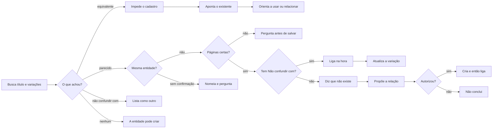

# Identificar duplicata

## Parâmetros de configuração

```yaml
{}
```

## Instruções

### Passo 1

Buscar ou cadastrar um registro novo pede esta checagem antes de criar. A pessoa informa o data source na execução. Quando o mapeamento de dados do projeto descreve essa lista, o nome de cada propriedade vem dele. Este texto usa os conceitos: o título, as Variações de nome, Não confundir com e o contexto da desambiguação. Se o data source não estiver no workspace conectado, pare. Não use a lista de outro workspace. A habilidade da entidade cria o registro. Esta habilidade não cria, não mescla e não apaga. Cravar a grafia fica com `definir-grafia`. Consolidar nomes fica com `mesclar-registro`. O vínculo de nomes parecidos que são outra entidade fica nesta habilidade. Fonte que usa esta habilidade para desambiguação mantém no esquema, no mínimo, o título como nome canônico, Variações de nome em texto, Não confundir com como relação, e o contexto da desambiguação em texto, ou a propriedade equivalente de cada uma. O contexto explica a diferença permanente. Ele não entra em Variações de nome nem na grafia. Sem uma dessas propriedades, avise e proponha a criação. Não dê a desambiguação por pronta. Não crie a propriedade antes do sim. Título, URL e variações de um perfil social ficam com `definir-perfil-social`. O vínculo desse perfil também fica com `definir-perfil-social`.

### Passo 2

O termo principal é o título da lista. Busque o nome como a pessoa escreveu. Busque também o nome alternativo e a grafia diferente: sigla, apelido, nome antigo, e o nome com edição ou ano e sem eles. A variação que a fonte já guarda entra na mesma busca: alias, variação de nome e grafia. Não confundir com aponta o parecido que é outro registro. Não trate esse vínculo como o mesmo cadastro.

### Passo 3

Ao avaliar um item novo ou um conflito, siga esta ordem. Não pule etapa.

1. Busque o nome principal e as variações.
2. Compare o link oficial quando couber, as datas, o local e os perfis. Não invente evidência que a página não traz.
3. Se for duplicata, a consolidação no registro canônico fica com `mesclar-registro`.
4. Se for parecido e for outra entidade, ligue em Não confundir com.
5. Atualize Variações de nome no formato padrão.
6. Grave a diferença permanente no contexto da desambiguação. A informação temporal fica em comentário datado.

Um perfil social equivalente não encerra a resposta. Na mesma passada, abra a pessoa relacionada e busque na lista de pessoas outro registro da mesma pessoa. Dois registros da mesma pessoa, mesmo com um perfil só, são duplicata. A resposta traz o diff do que cada página traz. Não chame uma de canônica. Não confundir com não separa essa duplicata. Consolidar fica com `mesclar-registro`. Não diga que não há duplicata só porque o perfil é único. A resposta não pede para nomear a habilidade nem fala de créditos.

Ao comparar itens parecidos, verifique Não confundir com e diga se a propriedade existe, mesmo sem a pessoa perguntar o esquema.



Equivalente confirmado: não crie outro. Um registro só: aponte essa página como o registro canônico existente e oriente a usar ou relacionar. Dois registros do mesmo item: a resposta traz o diff do que cada página traz, inclusive o que uma tem e a outra deixa vazio. Não chame uma de canônica. Não escolha qual usar. Consolidar fica com `mesclar-registro`. Nomes parecidos confirmados como outra entidade: não consolide. Cada entidade permanece com o seu registro canônico. A correção não fica só no chat. Sem segurança sobre quais páginas ligar, pergunte antes de salvar. Com as páginas certas e com segurança suficiente, relacione por Não confundir com antes de concluir. A variação recebe só nome, grafia, apelido, transcrição incorreta e forma alternativa do mesmo registro canônico. Quando a propriedade é Variações de nome, use uma lista de bullets, um nome por item, com ponto e vírgula no fim, e mantenha as formas com e sem sigla e com e sem ano. Forma que já está na lista não entra de novo. A diferença permanente, como categoria, produto semelhante, localidade, endereço, perfil, organizador, função ou comentário estável sobre uma grafia, vai no contexto da desambiguação, ou na propriedade equivalente. Com os dois registros distintos, relacione em Não confundir com e use esse texto como explicação complementar. O texto não substitui a relação. Contato, preço, disponibilidade, resposta, decisão, status, prazo e mudança operacional vão em comentário datado. Com a propriedade específica, não guarde o contexto permanente no corpo nem em observação geral. Sem Não confundir com, diga que não existe e proponha criá-la como relação para o próprio banco, ou para o banco adequado. Não crie antes do sim. Com o sim, crie a propriedade e só então registre a desambiguação. Banco que já tem pares parecidos conhecidos: sugira ou faça o vínculo desses pares. Não consolide conceitos diferentes. Data significativa segue `definir-data-significativa`. Perfil social segue `definir-perfil-social`, inclusive o vínculo. Sem confirmação, nomeie cada um e pergunte. Não escolha. Não crie. Nenhum equivalente: pare nesta habilidade. A habilidade da entidade segue o cadastro.

## Problemas comuns

### Contexto na variação

Se você gravar localidade, organizador ou a diferença permanente na variação de nome, a grafia do mesmo registro se mistura com outro cadastro.

1. A variação recebe só nome, grafia, apelido, transcrição incorreta e forma alternativa do mesmo canônico.
2. A diferença permanente vai no contexto de desambiguação.
3. Os dois registros ligam em Não confundir com. O texto não substitui a relação.

### Fato temporal no contexto

Se você gravar preço, prazo ou status no contexto permanente, a explicação estável fica datada.

1. Contato, preço, disponibilidade, resposta, decisão, status, prazo e mudança operacional vão em comentário datado.
2. O contexto permanente fica com a diferença estável.
3. Com a propriedade específica, não use corpo nem observação geral.

### Esquema sem o mínimo

Se você desambiguar num banco sem título canônico, variação, vínculo ou contexto, a diferença permanente entra na grafia.

1. Confira título, Variações de nome, Não confundir com e o contexto da desambiguação, ou a equivalente de cada uma.
2. O contexto da diferença permanente fica fora da variação e da grafia.
3. Sem a propriedade, avise e proponha a criação. Não dê por pronta. Não crie antes do sim.

### Perfil único com pessoa duplicada

Se você encerrar a busca ao achar um perfil só, a pessoa duplicada na lista de pessoas fica de fora.

1. Abra a pessoa relacionada.
2. Busque na lista de pessoas outro registro da mesma pessoa.
3. Dois registros da mesma pessoa: traga o diff. Não chame uma de canônica. Não confundir com não separa essa duplicata. Consolidar fica com `mesclar-registro`.

### Cadastro sem busca

Se você criar sem buscar o título e as variações, o mesmo registro entra de novo.

1. Busque o termo principal no título.
2. Busque nome alternativo, grafia diferente, sigla, apelido, nome antigo e o nome com e sem edição ou ano.
3. Abra o match e compare site oficial, localidade, datas, organizador e perfis sociais.

### Dois registros numa frase só

Se você só disser que são o mesmo item, o que uma página traz e a outra não fica de fora.

1. Abra cada página.
2. Separe no diff o que cada uma traz, inclusive o campo vazio de um lado.
3. Não chame uma de canônica.

### Equivalente que vira página nova

Se você cadastrar mesmo depois de achar o equivalente, a lista ganha a duplicata.

1. Impeça o cadastro.
2. Aponte o registro canônico existente.
3. Oriente a usar ou relacionar essa página.

### Parecido tratado como o mesmo

Se você consolidar nomes parecidos que são outra entidade, duas entidades viram uma.

1. Confirme que não são a mesma entidade.
2. Preencha Não confundir com na hora. Sem segurança sobre as páginas, pergunte antes de salvar.
3. Sem Não confundir com, diga que não existe e proponha a relação. Com o sim, crie e só então ligue. Variação, grafia, observação e corpo não substituem o vínculo.

## Exemplos de entrada e saída

Estes exemplos ilustram fatos. Eles podem não estar no data source.

### Cadastre esse registro. Os identificadores já batem com uma página.

Um equivalente já existia. Não criei outro. Apontei o registro canônico existente e orientei a usar ou relacionar essa página.

### Feira de Verão Norte e Feira de Verão Sul são parecidas e são eventos diferentes.

Cada uma permaneceu com o seu registro canônico. Liguei as duas em Não confundir com na hora. A cidade ficou no contexto da desambiguação. Não consolidei.

### Estes nomes parecem e são entidades diferentes.

Cada entidade permaneceu com o seu registro canônico. Liguei em Não confundir com. Não consolidei.

### perfilexemplo___ tá duplicado?

Havia um perfil só, perfilexemplo___. Na lista de pessoas havia dois registros da mesma pessoa, os dois com o título @perfilexemplo___ (Instagram). Um tinha localidade, perfil social relacionado e variação de grafia. O outro não tinha esses vínculos, e a observação dizia que os dados já estavam consolidados e que a página não foi apagada. Mostrei o diff. Não chamei uma de canônica. Não confundir com não separa essa duplicata. Consolidar fica com `mesclar-registro`. Não pedi para nomear a habilidade.

### Cadastre o mesmo nome, agora sem o ano.

Busquei o nome como foi escrito, o nome alternativo, a grafia diferente, a sigla, o apelido, o nome antigo e o nome com e sem o ano. Abri os matches e comparei site oficial, localidade, datas, organizador e perfis sociais.

## Casos-limite

- O data source não está no workspace conectado: pare.
- Um equivalente só: aponte essa página como o registro canônico existente.
- Um perfil social e dois registros da mesma pessoa: mostre o diff na mesma resposta. Não chame uma de canônica. Não confundir com não separa essa duplicata. Consolidar fica com `mesclar-registro`.
- Dois registros já na lista: o diff diz o que cada página traz. Não chame uma de canônica.
- Nome parecido sem confirmação: nomeie cada um e pergunte. Não crie. Não ligue.
- Nomes parecidos confirmados como outra entidade: cada registro canônico permanece. Não consolide. Diga se Não confundir com existe. Com segurança, relacione antes de concluir.
- O banco não tem Não confundir com: diga que não existe e proponha a relação para o próprio banco, ou para o banco adequado. Com o sim, crie a propriedade e só então ligue. Sem o sim, não conclua.
- Variação de nome recebe só forma do mesmo canônico. Diferença permanente vai no contexto. Fato temporal vai em comentário datado.
- Propriedade recém-criada num banco com pares parecidos conhecidos: sugira ou faça o vínculo. Não consolide conceitos diferentes.
- Falta título canônico, Variações de nome, Não confundir com ou o contexto da desambiguação: avise, proponha a propriedade que falta e não dê a desambiguação por pronta.
- Não confundir com: liste como outro registro. Não escolha. Não consolide.
- Nenhum equivalente: pare. A habilidade da entidade cria.
- A página não traz site, localidade, data, organizador ou perfil: não invente a evidência.

## Pegadinhas

- O título exato parece bastar. A busca também usa nome alternativo, grafia diferente, sigla, apelido, nome antigo e o nome com e sem edição ou ano.
- Nome parecido parece duplicata. Confirmado como outra entidade, cada canônico permanece e o vínculo entra em Não confundir com antes de concluir. A resposta diz se a propriedade existe, mesmo sem pergunta sobre o esquema. Variação, grafia, observação e corpo não substituem a relação.
- Alias, variação de nome e grafia parecem outro registro. Acham o mesmo.
- A ordem parece opcional. A avaliação segue busca, comparação, consolidação ou vínculo, variação no formato padrão, e contexto permanente com o temporal no comentário.
- Mesclar parece este passo. A habilidade mostra o diff do que cada página traz e não escolhe a canônica. Consolidar fica com `mesclar-registro`.
- A lista de perfis sociais parece limpa. Muitos perfis nasceram sem esta checagem. O handle canônico, a variação de nome e Não confundir com entram antes de criar outro.
- Um perfil só parece o fim da checagem. A pessoa relacionada pode estar duplicada na lista de pessoas. Não confundir com não separa esses dois registros.
- Pedir para nomear a habilidade parece economizar crédito. A resposta não pede isso.

## Scripts disponíveis

- Nenhum.

1. Não há script para executar.
