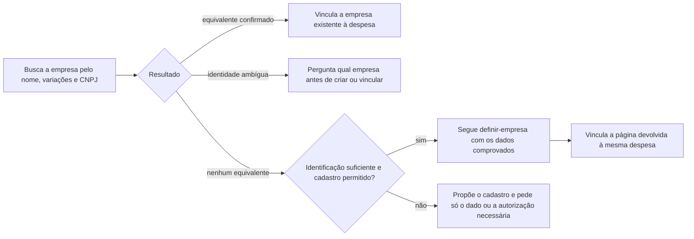
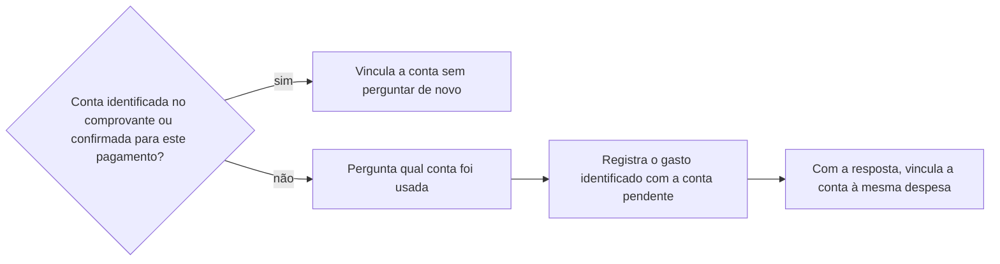

# Identificar pagamento

## Parâmetros de configuração

Leia cada valor nas instruções do projeto: primeiro na entrada com o nome desta habilidade, depois na entrada `Global` ou no primeiro nível do bloco. Quando um valor não estiver lá, use o padrão abaixo.
```yaml
# Esta habilidade não tem parâmetros.
{}
```

## Instruções

### Passo 1

Resolva a empresa recebedora com o nome e o CNPJ da evidência, inclusive ao complementar uma despesa já salva. Use `identificar-duplicata` antes de criar. A instituição de pagamento não é a empresa recebedora. Não deduza a razão social completa de um nome comercial.



Não encerre com "vínculo pendente": entregue a ação realizada ou a proposta e o bloqueio. Reaproveite a leitura e os comprovantes; cadastrar a recebedora não cria outra despesa. Nome no título, no assunto do comprovante ou nas observações não substitui a relação com a empresa. Preserve a conta, a pessoa pagadora e os anexos já confirmados. Não infira que o nome exibido no Pix seja dono, contato ou responsável pela empresa.

Compare cada identificador do comprovante com o que o cadastro da recebedora guarda: chave Pix, CNPJ, nome, instituição e conta. Uma diferença, mesmo de uma letra, é discrepância.

Antes de avisar a pessoa, tente resolver a discrepância numa fonte pública. Com um CNPJ no comprovante, consulte o registro da Receita Federal, por uma API pública de CNPJ, e compare razão social, nome fantasia, situação cadastral e endereço com o cadastro da recebedora. Quando o registro mostra que o CNPJ é da mesma empresa, por exemplo porque o nome do comprovante é o nome fantasia e o endereço bate, a diferença está explicada.

Com a confirmação, atualize o cadastro como `definir-empresa` manda, com o CNPJ e a chave Pix do comprovante, e guarde a razão social e o nome fantasia nas grafias alternativas. Diga na resposta a fonte e o que mudou. Não pergunte à pessoa nem à empresa o que o registro público já responde.

Avise a pessoa antes de seguir, com os dois valores lado a lado, porque pode ser tentativa de golpe, quando o registro mostra outra empresa, uma situação que não é ativa ou um endereço diferente, quando a consulta não responde, ou quando a chave Pix difere de uma que o cadastro já guarda, porque o registro público não prova chave Pix. A pessoa decide qual vale. Corrija o cadastro só depois da decisão dela, e diga o que mudou.

Vincule a conta de origem somente quando os dados da conta no comprovante identificarem inequivocamente um cadastro ou quando a pessoa já tiver confirmado a conta deste pagamento. Nome do titular e instituição, sozinhos, indicam uma candidata, não a conta usada: podem existir contas pessoais e empresariais no mesmo banco.

Cruze também o tipo e os dígitos visíveis do CPF ou CNPJ do titular da conta de origem com os documentos dos cadastros, respeitando as posições da máscara e sem completar dígitos ocultos. Use o documento do pagador, não o do recebedor nem o da instituição. Identificar o titular não identifica uma conta específica: combine-o com a instituição e os demais dados da conta na evidência. Se o conjunto identificar inequivocamente a conta, vincule sem perguntar; se houver colisão de trechos, mais de uma conta compatível ou identificação insuficiente, confirme com a pessoa.



A falta de identificação da conta não bloqueia o lançamento quando os demais dados obrigatórios estão sustentados. Até a resposta, mantenha o vínculo vazio e informe a pendência. Uma confirmação vale para o pagamento confirmado, não vira regra para outros pagamentos do mesmo banco. Ao receber a resposta, complemente a mesma despesa sem duplicá-la nem alterar os comprovantes.

## Problemas comuns

### Recebedor deduzido do nome comercial

Se você deduzir a razão social completa de um nome comercial, ou tratar a instituição de pagamento como a empresa recebedora, a despesa fica vinculada a uma empresa que ninguém confirmou.

1. Resolva a empresa pelo nome e pelo CNPJ da evidência.
2. Use `identificar-duplicata` antes de criar e `definir-empresa` só com os dados comprovados.

### Diferença de identificador tratada como erro de digitação

Se você corrigir em silêncio uma letra de diferença na chave Pix, no CNPJ ou no nome, pode estar aceitando um golpe.

1. Consulte o registro público do CNPJ. Se ele mostra a mesma empresa, o nome do comprovante é o nome fantasia e o endereço bate, atualize o cadastro e diga a fonte.
2. Sem essa confirmação, mostre os dois valores lado a lado.
3. Espere a pessoa decidir qual vale e corrija o cadastro só depois.

### Pergunta que o registro público responde

Se você perguntar à pessoa ou à empresa se o nome do comprovante é o da recebedora sem consultar o CNPJ, a pessoa gasta uma decisão que a Receita já tinha respondido.

1. Consulte o CNPJ do comprovante antes de perguntar.
2. Pergunte só quando o registro mostra outra empresa, situação que não é ativa, endereço diferente, ou não responde.

### Conta escolhida pelo banco

Se você vincular a conta só pelo nome do titular e pela instituição, a despesa pode ficar na conta pessoal quando o pagamento saiu da empresarial, no mesmo banco.

1. Vincule só com a identificação inequívoca no comprovante ou com a confirmação deste pagamento.
2. Sem isso, pergunte qual conta foi usada e registre o gasto com o vínculo vazio.

## Exemplos de entrada e saída

Estes exemplos ilustram fatos. Eles podem não estar no data source.

### o comprovante traz a chave Pix financeiro@empresa.com e o cadastro da recebedora guarda financeiroo@empresa.com

Avisei a pessoa antes de seguir, com as duas chaves lado a lado, porque pode ser tentativa de golpe. Só corrigi o cadastro depois da decisão dela.

### o comprovante traz o nome Alfa Studio e um CNPJ, e o cadastro tem a empresa Alfa Gráfica sem CNPJ

Consultei o CNPJ no registro da Receita: a razão social é Alfa Gráfica Ltda, o nome fantasia é Alfa Studio, a situação é ativa e o endereço é o do cadastro. Gravei o CNPJ e a chave Pix no cadastro, guardei Alfa Studio nas grafias alternativas e disse a fonte. Não perguntei à pessoa nem à gráfica.

## Casos-limite

- A conta de origem não aparece no comprovante: grave o gasto com o vínculo vazio e informe a pendência.
- Mais de uma conta é compatível com o titular: confirme com a pessoa.
- O registro público mostra outra empresa no CNPJ do comprovante, ou a consulta não responde: avise a pessoa com os dois valores lado a lado, sem gravar.
- A empresa recebedora não existe no cadastro: siga `definir-empresa` com os dados comprovados, ou proponha o cadastro e peça só o dado que falta.

## Pegadinhas

- O nome exibido no Pix parece o dono da empresa. Ele não prova dono, contato nem responsável.
- Uma confirmação de conta parece regra para o banco inteiro. Ela vale só para o pagamento confirmado.
- O nome do comprovante diferente do cadastro parece golpe. Pode ser o nome fantasia: o CNPJ no registro público diz.
- Cadastrar a recebedora parece criar outra despesa. A despesa é a mesma, e os comprovantes ficam como estavam.

## Scripts disponíveis

- Nenhum.

1. Não há script para executar.
