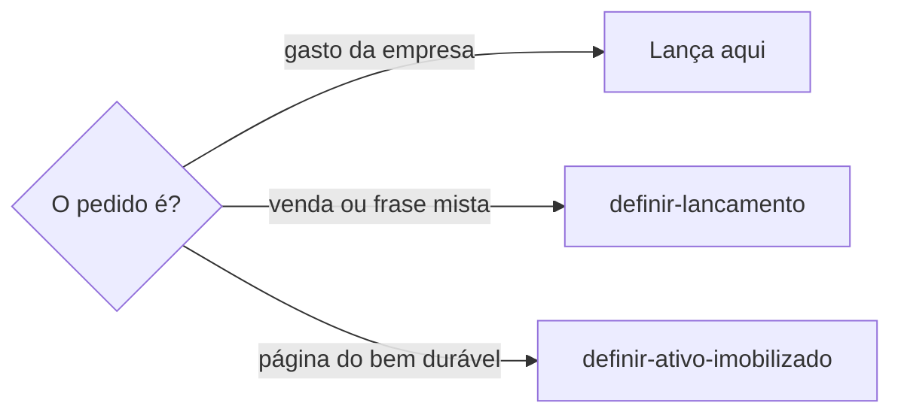
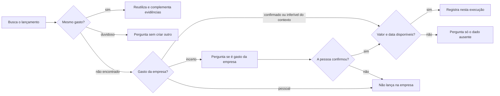

# Lançar despesa da empresa

## Parâmetros de configuração

Leia cada valor nas instruções do projeto: primeiro na entrada com o nome desta habilidade, depois na entrada `Global` ou no primeiro nível do bloco. Quando um valor não estiver lá, use o padrão abaixo. `Moeda` é a moeda das contas. `Moedas estrangeiras` lista as outras moedas em que a empresa paga.

```yaml
"Moeda": "BRL"
"Moedas estrangeiras": []
```

## Instruções

### Passo 1

Pagamento, taxa, comprovante, custo, investimento, boleto, Pix, fatura ou inscrição paga é esta habilidade. A pessoa informa o data source na execução. Sem essa indicação, use a lista do mapeamento de dados do projeto. O nome de cada propriedade vem desse mapeamento. Se a lista de despesas e investimentos não estiver no workspace conectado, pare. Não use a lista de outro workspace. A relação com `definir-ativo-imobilizado` é rastrear o lançamento financeiro que originou a compra ou aquisição do ativo. A página do bem fica naquela habilidade. Não crie a página do ativo aqui.



Venda ou frase que mistura venda, gasto e estoque segue `definir-lancamento`. Esta habilidade grava o gasto da empresa.

### Passo 2

Busque antes de criar, sem pedir autorização para a leitura. Compare recebedor e suas variações de nome, documento ou cobrança, valor, data e meio de pagamento. Um valor igual sozinho não confirma duplicata. Uma nota e um print da mesma transação são evidências de um lançamento, não duas despesas.



A inferência precisa de evidência no contexto da empresa, no produto ou na finalidade informada. Ter um comprovante ou um CPF não basta. Não exija a palavra "lançar". A leitura não prova que a busca ou a gravação já aconteceu.

### Passo 3

Grave os dados nas propriedades mapeadas, não no corpo. Separe a data do documento da data de pagamento. Não invente valor, data, conta, finalidade, categoria nem parcelas. Campo opcional ausente fica pendente, sem impedir o lançamento com os dados suficientes. Preserve o modelo da página.

Anexe os originais na propriedade mapeada de comprovantes, sem novo reconhecimento. Mantenha as evidências anteriores ao complementar um lançamento. Preserve os dados confirmados e pergunte sobre conflito antes de sobrescrever. Uma transação ainda em processamento não equivale a conciliação concluída; uma cobrança sem confirmação não equivale a pagamento.

Pagamento numa moeda de `Moedas estrangeiras`: grave o valor original, o câmbio, a data e a fonte do câmbio, e o valor convertido na `Moeda`. Sem o câmbio na evidência, pergunte. Não invente o câmbio.

### Passo 4

Confira o registro salvo e os anexos. Entregue a página do lançamento e as pendências. Diga o que foi encontrado, criado ou complementado; não apresente transcrição como lançamento. O lançamento é a origem financeira da compra. A página do bem, a separação entre ativo e estoque e a compra de item controlável ficam com `definir-ativo-imobilizado`.

## Problemas comuns

### Ativo criado na despesa

Se você criar a página do bem nesta habilidade, o lançamento e o ativo se misturam.

1. Rastreie o lançamento que originou a compra.
2. A página do bem fica em `definir-ativo-imobilizado`.
3. Não crie a página do ativo aqui.

### Lançamento inventado

Se você inventar valor ou data, o lançamento deixa de ser a origem da compra.

1. Busque antes de criar.
2. Compare documento, recebedor, valor e data.
3. Registre só os dados da evidência e do contexto confirmado.

### Comprovante só transcrito

Se você parar na transcrição de uma despesa inferível ou confirmada, o gasto não entra na lista.

1. Busque o lançamento sem perguntar.
2. Siga a decisão do passo 2.
3. Confira a gravação antes de dizer que lançou.

## Exemplos de entrada e saída

Estes exemplos ilustram fatos. Eles podem não estar no data source.

### rastreie o lançamento dessa máquina

O lançamento que originou a compra é este. A página da máquina fica em `definir-ativo-imobilizado`. Não criei o ativo aqui.

### uma nota de tecido e o print da mesma compra no cartão; o gasto da empresa foi confirmado e ainda não está lançado.

Busquei pelo recebedor, documento, valor e data. Registrei um lançamento com as duas evidências. Não fiz dois lançamentos nem inventei a finalidade do tecido.

## Casos-limite

- A lista de despesas e investimentos não está no workspace conectado: pare. Não use a lista de outro workspace.
- O pedido é a página do bem durável: `definir-ativo-imobilizado`. Não crie o ativo aqui.
- Compra de item controlável ou separação entre ativo e estoque: `definir-ativo-imobilizado`. Não reescreva essas regras aqui.
- Falta categoria ou conta de origem, mas valor, data e gasto da empresa estão sustentados: registre e entregue a pendência, sem adivinhar.
- Venda ou frase mista: `definir-lancamento`. Não grave a venda aqui.

## Pegadinhas

- Rastrear o lançamento parece criar o ativo. O lançamento fica aqui. A página do bem fica em `definir-ativo-imobilizado`.
- Item controlável parece esta habilidade decidir o destino. A separação entre ativo e estoque fica em `definir-ativo-imobilizado`.
- Venda recebida na hora parece este gasto. A frase mista começa em `definir-lancamento`.
- Nota fiscal e print de cartão podem ser o mesmo gasto. Dois arquivos não são duas despesas.
- Uma tela pode dizer "Crédito" como modalidade do cartão, não como entrada de receita.

## Scripts disponíveis

- Nenhum.

1. Não há script para executar.
