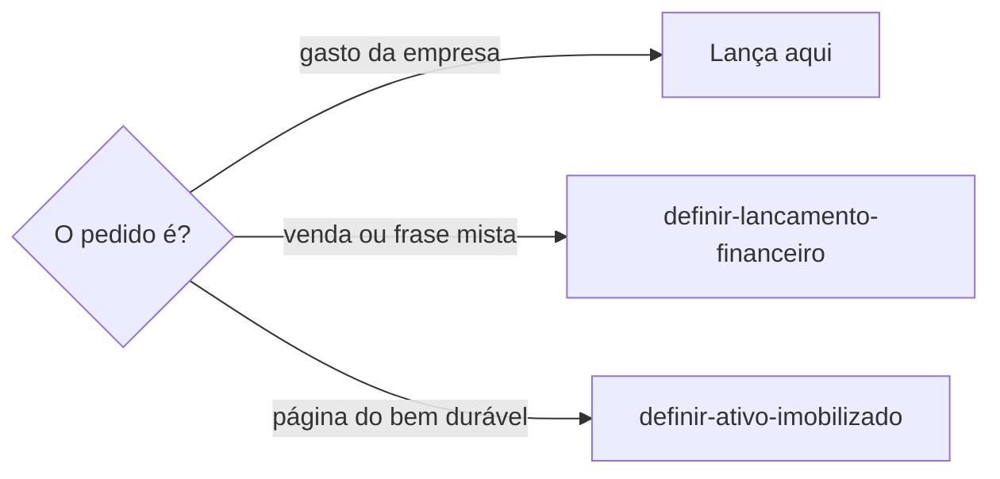
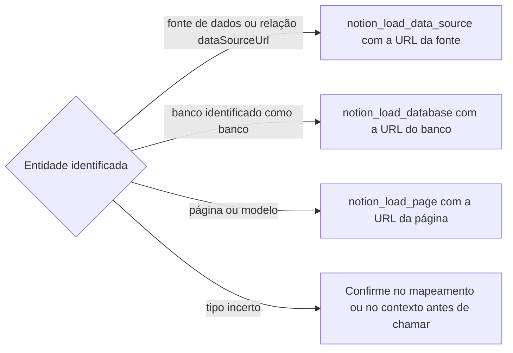
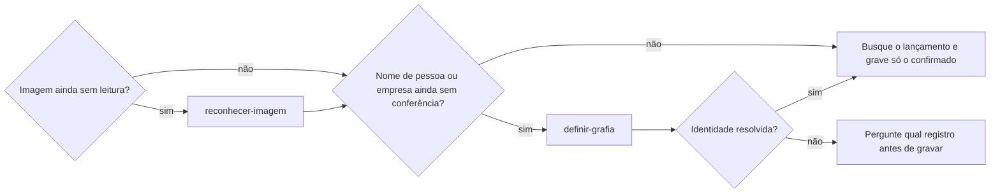
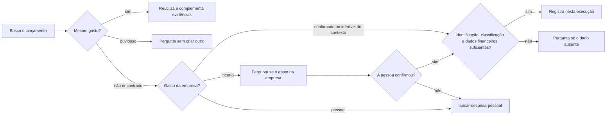
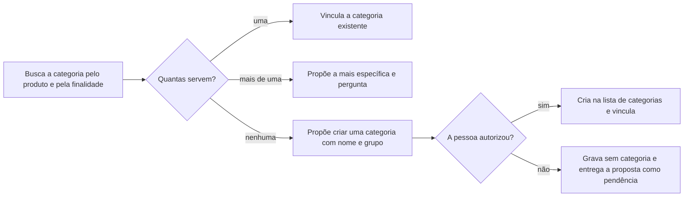
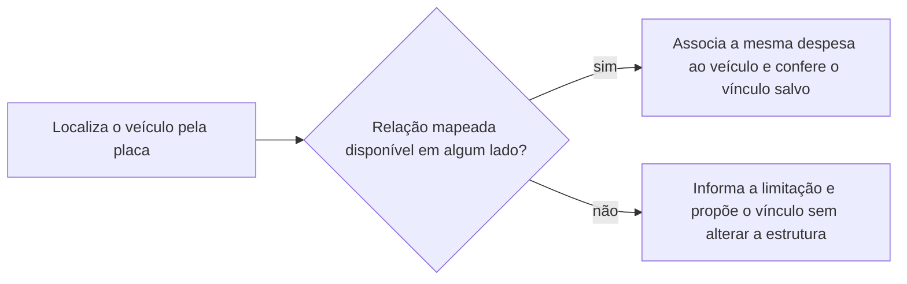
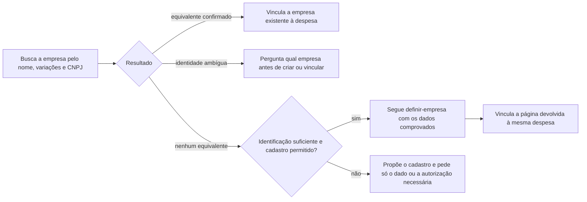
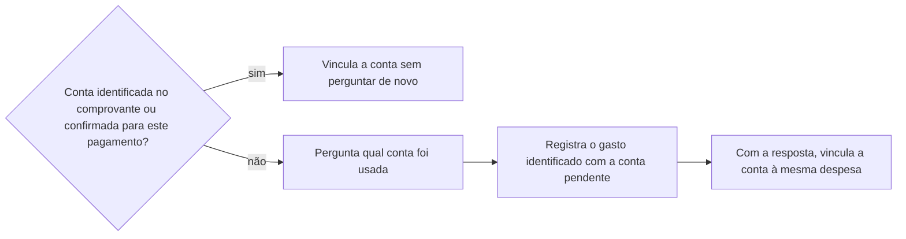

# Lançar despesa da empresa

## Parâmetros de configuração

Leia cada valor nas instruções do projeto: primeiro na entrada com o nome desta habilidade, depois na entrada `Global` ou no primeiro nível do bloco. Quando um valor não estiver lá, use o padrão abaixo.
```yaml
# `Moeda` é a moeda das contas.
"Moeda": "BRL"
# `Moedas estrangeiras` lista as outras moedas em que a empresa paga.
"Moedas estrangeiras": []
```
## Instruções

### Passo 1

Pagamento, taxa, comprovante, custo, investimento, boleto, Pix, fatura ou inscrição paga é esta habilidade. A pessoa informa o data source na execução. Sem essa indicação, use a lista do mapeamento de dados do projeto. O nome de cada propriedade vem desse mapeamento. Se a lista de despesas e investimentos não estiver no workspace conectado, pare. Não use a lista de outro workspace. A relação com `definir-ativo-imobilizado` é rastrear o lançamento financeiro que originou a compra ou aquisição do ativo. A página do bem fica naquela habilidade. Não crie a página do ativo aqui.



Venda ou frase que mistura venda, gasto e estoque segue `definir-lancamento-financeiro`. Esta habilidade grava o gasto da empresa.

Antes da primeira chamada no Notion, identifique o tipo da entidade pelo mapeamento ou pelo contexto estruturado. Não deduza o tipo só pelo título ou por um UUID.



Preserve as URLs retornadas. Não transforme o UUID de uma fonte em URL de banco ou página. Um modelo é uma página: seu `parent.url` identifica a fonte, não a URL do banco. Leia o esquema da fonte antes de consultar ou gravar suas propriedades. Confira nele cada nome do mapeamento. Um nome que o esquema não mostra, como um título renomeado, não entra na consulta nem na gravação: ache a propriedade equivalente pelo tipo e pela descrição, como a única de tipo título, use o nome do esquema e avise a divergência para corrigir o mapeamento. Sem equivalente seguro, pergunte antes de gravar.

Erro genérico de acesso descreve a chamada que falhou, não prova a causa nem a falta de acesso ao banco inteiro. Confira os argumentos e o tipo da entidade. Corrija a chamada somente com evidência de incompatibilidade; não repita a mesma chamada, não alterne carregadores por tentativa e não contorne uma negativa real. Uma leitura bem-sucedida da fonte ou do modelo é evidência de leitura desse recurso, não garantia de acesso a todos os registros nem de escrita. Com a fonte corretamente carregada, continue a busca de duplicata e o fluxo do gasto, sem pedir que a pessoa libere um acesso cuja ausência não foi demonstrada. Se a chamada correta continuar bloqueada, informe a operação e o erro retornado, diga que a causa específica não foi informada e não afirme que houve lançamento.

Conclua a preparação antes de buscar ou gravar o lançamento. Quando a entrada já vem de `reconhecer-imagem`, reutilize a leitura entregue; não chame a mesma leitura de novo. Confira os nomes tanto na evidência quanto no comando original, inclusive os de pessoa sócia em uma exclusão de item pessoal.



### Passo 2

Busque antes de criar, sem pedir autorização para a leitura. Compare recebedor e suas variações de nome, documento ou cobrança, valor, data e meio de pagamento. Um valor igual sozinho não confirma duplicata. Uma nota e um print da mesma transação são evidências de um lançamento, não duas despesas.



A inferência precisa de evidência no contexto da empresa, no produto ou na finalidade informada. Ter um comprovante ou um CPF não basta. Não exija a palavra "lançar". A leitura não prova que a busca ou a gravação já aconteceu.

### Passo 3

Antes de qualquer gravação, confira e marque este checklist com o que a evidência e o contexto já sustentam:

- [ ] Produto ou serviço exato e finalidade do gasto, confirmados pela pessoa ou discriminados na evidência.
- [ ] Natureza pessoal ou da empresa, sem confundir quem pagou com quem deve.
- [ ] Dados necessários à categoria e aos vínculos aplicáveis no mapeamento: por exemplo, o veículo ou a obrigação a que o gasto pertence.
- [ ] Valor, datas e situação do pagamento sustentados pela evidência, conforme o tipo de cobrança.
- [ ] Evidência lida e separada do comando, sem nova leitura.
- [ ] Nomes de pessoa ou empresa usados no lançamento conferidos no cadastro.
- [ ] Busca de duplicata concluída antes de criar.

O recebedor e a modalidade Pix não identificam o produto nem sua finalidade. Dizer apenas “despesa pessoal” ou “despesa da empresa” só confirma a natureza. Consulte o contexto e os registros relacionados; reúna as perguntas que faltam, espere as respostas e só depois grave. Não repita perguntas já respondidas nem exija campos sem relação com o gasto. Não use nome genérico de recebedor como substituto da identificação.

Antes de deixar a categoria de custo vazia, busque na lista que a propriedade de categoria aponta, pelo produto e pela finalidade confirmados, e pelas variações e grafias da categoria. Sem propriedade de categoria no mapeamento, informe a limitação; não crie estrutura nem grave uma categoria inventada no corpo. Isso não impede registrar um gasto já identificado com os vínculos disponíveis. Uma informação opcional ausente não substitui a identificação obrigatória do produto e da finalidade.



A categoria nova segue o padrão de nome e de grupo das categorias que já existem na lista. Não force uma categoria vizinha só porque o grupo combina.

A placa serve para localizar o veículo existente, não para preencher o título, a descrição ou as observações da despesa. O cadastro do veículo é a fonte da placa. Associe a mesma despesa ao veículo pela relação mapeada, conferindo também o lado do veículo; a relação pode existir só nesse lado. A viagem é outro vínculo: preserve a associação confirmada para a prestação de contas, sem substituir a relação com o veículo.



A falta da relação não autoriza copiar a placa para texto livre nem declarar a associação concluída. Ao corrigir um lançamento, preserve valor, pagamento, comprovantes e viagem; retire a placa redundante do texto sem criar outra despesa.

Resolva a empresa recebedora com o nome e o CNPJ da evidência, inclusive ao complementar uma despesa já salva. Use `identificar-duplicata` antes de criar. A instituição de pagamento não é a empresa recebedora. Não deduza a razão social completa de um nome comercial.



Não encerre com apenas "empresa não cadastrada" ou "vínculo pendente": entregue a ação realizada ou a proposta concreta e o bloqueio. Reaproveite a leitura e os comprovantes; cadastrar a recebedora não cria outra despesa. Nome no título, no assunto do comprovante ou nas observações não substitui a relação com a empresa. Confira o vínculo salvo e preserve a conta, a pessoa pagadora e os anexos já confirmados. Não infira que o nome exibido no Pix seja dono, contato ou responsável pela empresa.

Vincule a conta de origem somente quando os dados da conta no comprovante identificarem inequivocamente um cadastro ou quando a pessoa já tiver confirmado a conta deste pagamento. Nome do titular e instituição, sozinhos, indicam uma candidata, não a conta usada: podem existir contas pessoais e empresariais no mesmo banco. Ter apenas uma candidata cadastrada não supre a identificação. Cruze também o tipo e os dígitos visíveis do CPF ou CNPJ do titular da conta de origem com os documentos dos cadastros, respeitando as posições da máscara e sem completar dígitos ocultos. Use o documento do pagador, não o do recebedor nem o da instituição. Esse cruzamento pode distinguir titularidades de pessoa física e jurídica; não confunda identificar o titular com identificar uma conta específica. Combine-o com a instituição e os demais dados da conta presentes na evidência. Se o conjunto identificar inequivocamente a conta, vincule sem perguntar; se houver colisão de trechos, mais de uma conta compatível ou identificação insuficiente, confirme com a pessoa. Reutilize a leitura da evidência e não repita uma confirmação já dada para este pagamento.



A falta de identificação da conta não bloqueia o lançamento quando os demais dados obrigatórios estão sustentados. Até a resposta, mantenha o vínculo vazio e informe a pendência. Uma confirmação vale para o pagamento confirmado, não vira regra para outros pagamentos do mesmo banco. Ao receber a resposta, complemente a mesma despesa sem duplicá-la nem alterar os comprovantes.

Grave os dados nas propriedades mapeadas, não no corpo. Separe a data do documento da data de pagamento. Não invente valor, data, conta, finalidade, categoria nem parcelas. Campo opcional ausente fica pendente; produto, finalidade e informação necessária à classificação não são opcionais. Depois do checklist completo, a pendência opcional não impede o lançamento. Preserve o modelo da página.

Anexe os originais na propriedade mapeada de comprovantes na mesma execução do lançamento, sem novo reconhecimento e sem pedir confirmação adicional. Recupere os anexos já enviados do histórico antes de declarar que estão inacessíveis. Use a referência de arquivo aceita pela ferramenta; um ID de anexo da conversa não é necessariamente um ID de arquivo do Notion. Erro de arquivo não encontrado exige conferir a referência original e usar o formato suportado, não pedir novo envio nem tratar a falha de referência como falta do comprovante. Mantenha as evidências anteriores ao complementar um lançamento. Preserve os dados confirmados e pergunte sobre conflito antes de sobrescrever. Uma transação ainda em processamento não equivale a conciliação concluída; uma cobrança sem confirmação não equivale a pagamento.

Pagamento numa moeda de `Moedas estrangeiras`: grave o valor original, o câmbio, a data e a fonte do câmbio, e o valor convertido na `Moeda`. Sem o câmbio na evidência, pergunte. Não invente o câmbio.

### Passo 4

Confira o registro salvo, os anexos na propriedade de comprovantes e os vínculos da empresa recebedora, do veículo e da viagem aplicáveis ao gasto. Só remova a pendência de anexo e atualize a conciliação depois de confirmar a gravação das evidências. Entregue a página do lançamento e as pendências, distinguindo o dado que falta de um cadastro ainda não encaminhado. Diga o que foi encontrado, criado ou complementado; não apresente transcrição como lançamento. O lançamento é a origem financeira da compra. A página do bem, a separação entre ativo e estoque e a compra de item controlável ficam com `definir-ativo-imobilizado`.

## Problemas comuns

### Nome ditado gravado como pessoa

Se você registrar o nome do comando de voz sem conferir o cadastro, a despesa pode atribuir a parcela pessoal à pessoa errada.

1. Preserve a leitura do comprovante separada do comando.
2. Resolva a grafia com `definir-grafia` antes da escrita.
3. Retome o lançamento com o nome e o registro confirmados.

### Comprovante sem identificação do gasto

Se você gravar só com recebedor, valor e data, a despesa entra sem saber o que foi comprado nem como categorizá-la.

1. Confira o checklist antes de gravar, inclusive ao complementar um registro.
2. Pergunte o produto ou serviço, a finalidade e os dados de classificação ainda ausentes.
3. Espere a resposta e atualize o mesmo lançamento, preservando o comprovante e sem duplicar.

### Categoria deixada vazia

Se você deixar a categoria de custo vazia sem buscar nem propor, a despesa fica fora dos totais por categoria e a pessoa tem de descobrir sozinha o que falta.

1. Busque a categoria pelo produto e pela finalidade.
2. Proponha a existente que serve ou, sem nenhuma, uma categoria nova com nome e grupo.
3. Vincule depois do aceite. Sem aceite, entregue a proposta como pendência.

### Ativo criado na despesa

Se você criar a página do bem nesta habilidade, o lançamento e o ativo se misturam.

1. Rastreie o lançamento que originou a compra.
2. A página do bem fica em `definir-ativo-imobilizado`.
3. Não crie o ativo aqui.

### Lançamento inventado

Se você inventar valor ou data, o lançamento deixa de ser a origem da compra.

1. Busque antes de criar.
2. Compare documento, recebedor, valor e data.
3. Registre só os dados da evidência e do contexto confirmado.

### Comprovante só transcrito

Se você parar na transcrição de uma despesa inferível ou confirmada, o gasto não entra na lista.

1. Busque o lançamento sem perguntar.
2. Siga a decisão do passo 2.
3. Confira a gravação antes de dizer que lançou.

## Exemplos de entrada e saída

Estes exemplos ilustram fatos. Eles podem não estar no data source.

### rastreie o lançamento dessa máquina

O lançamento que originou a compra é este. A página da máquina fica em `definir-ativo-imobilizado`. Não criei o ativo aqui.

### uma nota de tecido e o print da mesma compra no cartão; o gasto da empresa foi confirmado e ainda não está lançado.

Busquei pelo recebedor, documento, valor e data. Registrei um lançamento com as duas evidências. Não fiz dois lançamentos nem inventei a finalidade do tecido.

## Casos-limite

- A lista de despesas e investimentos não está no workspace conectado: pare. Não use a lista de outro workspace.
- O pedido é a página do bem durável: `definir-ativo-imobilizado`. Não crie o ativo aqui.
- Compra de item controlável ou separação entre ativo e estoque: `definir-ativo-imobilizado`. Não reescreva essas regras aqui.
- Falta conta de origem opcional, mas a identificação, a classificação e os dados financeiros estão sustentados: registre e entregue a pendência, sem adivinhar.
- Valor, data e natureza da empresa estão confirmados, mas falta o que foi pago ou sua finalidade: pergunte e aguarde antes de gravar.
- Venda ou frase mista: `definir-lancamento-financeiro`. Não grave a venda aqui.

## Pegadinhas

- Rastrear o lançamento parece criar o ativo. O lançamento fica aqui. A página do bem fica em `definir-ativo-imobilizado`.
- Item controlável parece esta habilidade decidir o destino. A separação entre ativo e estoque fica em `definir-ativo-imobilizado`.
- Venda recebida na hora parece este gasto. A frase mista começa em `definir-lancamento-financeiro`.
- O comprovante identifica a transferência, não necessariamente a compra. Recebedor e Pix não são produto nem finalidade.
- Nota fiscal e print de cartão podem ser o mesmo gasto. Dois arquivos não são duas despesas.
- Uma tela pode dizer "Crédito" como modalidade do cartão, não como entrada de receita.
- "Não invente categoria" parece proibir propor uma. Proibido é gravar sem aceite. Buscar, propor a existente e sugerir criar a que falta fazem parte do lançamento.
- O mapeamento pode estar atrás da base. Um nome de propriedade que o esquema não mostra é divergência do mapeamento, não falta de acesso nem campo vazio.

## Scripts disponíveis

- Nenhum.

1. Não há script para executar.
