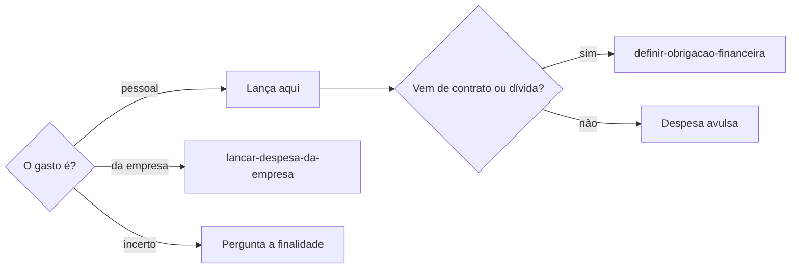

# Lançar despesa pessoal

## Parâmetros de configuração

Leia cada valor nas instruções do projeto: primeiro na entrada com o nome desta habilidade, depois na entrada `Global`. Quando um valor não estiver lá, use o padrão abaixo.

```yaml
"Moeda": "BRL"
"Modo de aprendizado": "perguntar"
```

## Instruções

### Passo 1

Gasto pessoal é esta habilidade: compra, fatura, parcela, boleto ou pagamento de uma pessoa. Gasto da empresa fica com `lancar-despesa-da-empresa`, e o contrato ou a dívida que gera as cobranças fica com `definir-obrigacao-financeira`. A despesa pessoal nunca entra na lista da empresa, mesmo quando a pessoa é sócia.



### Passo 2

A pessoa informa o data source na execução, que é a lista de despesas dela. Sem essa indicação, use a lista do mapeamento de dados do projeto, com os nomes de propriedade dele. Se a lista não estiver no workspace conectado, pare. Não use a lista de outra pessoa nem de outro workspace. Busque antes de criar, pelo recebedor, valor, vencimento e parcela. Fatura e comprovante da mesma cobrança são uma despesa só.

### Passo 3

Grave o nome curto, o valor original, o vencimento e, quando houver, a parcela no formato número/total e a obrigação de origem. Fatura em aberto não tem data de pagamento. Pagamento só entra com comprovante: data, valor pago, e juros ou multa como a diferença entre o pago e o original. Recibo do pagador num boleto não é comprovante. Quando outra pessoa paga, registre quem pagou, separado de quem deve. Não invente valor, data nem parcela. O histórico fica nos comentários, não no corpo.

### Passo 4

Ao citar uma fatura vencida ou a vencer, diga o vencimento e o valor. Sem o valor, diga que falta e onde a pessoa o encontra.

### Passo 5

Confira a página salva e entregue a despesa, a obrigação ligada e as pendências. Ao terminar, siga `evoluir-habilidade` conforme `Modo de aprendizado`.

## Problemas comuns

### Pessoal na lista da empresa

Se você lançar o gasto pessoal de uma pessoa sócia na lista da empresa, a contabilidade da empresa mistura as duas finanças.

1. Lance na lista de despesas da pessoa.
2. Pergunte a finalidade quando ela não estiver clara.

### Fatura marcada como paga

Se você preencher a data de pagamento a partir da fatura, a cobrança some do radar antes de ser paga.

1. Deixe a data de pagamento vazia.
2. Complete quando chegar o comprovante.

## Exemplos de entrada e saída

Estes exemplos ilustram fatos. Eles podem não estar no data source.

### fatura da parcela 77 de 100 do consórcio do carro, vence dia 20

Lancei a despesa com o valor original, o vencimento e a parcela 77/100, ligada à obrigação do consórcio. A data de pagamento ficou vazia até o comprovante.

### lentes de contato para fantasia, já pagas

Lancei como despesa avulsa, sem obrigação, com o valor e a data de pagamento do comprovante.

## Casos-limite

- O valor está num PDF protegido por senha: lance com o vencimento, deixe o valor pendente e diga onde a pessoa o encontra.
- Pago com juros: o valor original fica o da fatura e o valor pago, o do comprovante.
- A finalidade era da empresa: siga `lancar-despesa-da-empresa`.

## Pegadinhas

- Ser sócia da empresa parece tornar o gasto da empresa. A finalidade decide.
- Fatura com vencimento parece despesa paga. Sem comprovante, ela segue em aberto.

## Scripts disponíveis

- Nenhum.

1. Não há script para executar.
