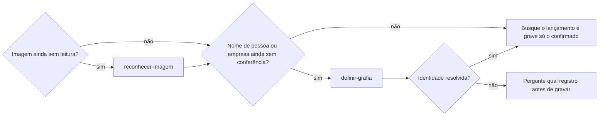
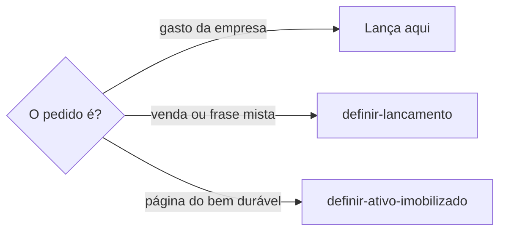

# Lançar despesa

## Parâmetros de configuração

Leia cada valor nas instruções do projeto: primeiro na entrada com o nome desta habilidade, depois na entrada `Global` ou no primeiro nível do bloco. Quando um valor não estiver lá, use o padrão abaixo. `Moeda` é a moeda das contas. `Moedas estrangeiras` lista as outras moedas em que a empresa paga.

```yaml
"Moeda": "BRL"
"Moedas estrangeiras": []
```

## Instruções

### Passo 1

Conclua a preparação antes de buscar ou gravar o lançamento. Quando a entrada já vem de `reconhecer-imagem`, reutilize a leitura entregue; não chame a mesma leitura de novo. Confira os nomes tanto na evidência quanto no comando original, inclusive os de pessoa sócia em uma exclusão de item pessoal.



Marque a preparação concluída antes da escrita:

- [ ] Evidência lida e separada do comando.
- [ ] Nomes usados no lançamento conferidos no cadastro.
- [ ] Operação original preservada, sem nova leitura nem checagem já concluída.

### Passo 2

Pagamento, taxa, comprovante, custo, investimento, boleto, Pix, fatura ou inscrição paga é esta habilidade. A pessoa informa o data source na execução. Sem essa indicação, use a lista do mapeamento de dados do projeto. O nome de cada propriedade vem desse mapeamento. Se a lista de despesas e investimentos não estiver no workspace conectado, pare. Não use a lista de outro workspace. A relação com `definir-ativo-imobilizado` é rastrear o lançamento financeiro que originou a compra ou aquisição do ativo. A página do bem fica naquela habilidade. Não crie a página do ativo aqui.



Venda ou frase que mistura venda, gasto e estoque segue `definir-lancamento`. Esta habilidade grava o gasto da empresa.

### Passo 3

O lançamento que já existe é a origem financeira da compra do bem durável. Aponte esse lançamento. Sem ele, registre o pagamento com o que a pessoa trouxe. Não invente valor nem data. Pagamento numa moeda de `Moedas estrangeiras`, como o serviço de tecnologia cobrado em dólar: grave o valor na moeda original, o câmbio, a data e a fonte do câmbio, e o valor convertido na `Moeda`. Sem o câmbio no comprovante ou na fatura, pergunte. Não invente o câmbio. A página do bem, o destino entre ativo e estoque e a compra de item controlável seguem `definir-ativo-imobilizado`. Não reescreva essas regras aqui.

## Problemas comuns

### Nome ditado gravado como pessoa

Se você registrar o nome do comando de voz sem conferir o cadastro, a despesa pode atribuir a parcela pessoal à pessoa errada.

1. Preserve a leitura do comprovante separada do comando.
2. Resolva a grafia com `definir-grafia` antes da escrita.
3. Retome o lançamento com o nome e o registro confirmados.

### Ativo criado na despesa

Se você criar a página do bem nesta habilidade, o lançamento e o ativo se misturam.

1. Rastreie o lançamento que originou a compra.
2. A página do bem fica em `definir-ativo-imobilizado`.
3. Não crie a página do ativo aqui.

### Lançamento inventado

Se você inventar valor ou data, o lançamento deixa de ser a origem da compra.

1. Use o lançamento que já existe.
2. Sem ele, registre o pagamento com o que a pessoa trouxe.
3. Não invente valor nem data.

## Exemplos de entrada e saída

Estes exemplos ilustram fatos. Eles podem não estar no data source.

### rastreie o lançamento dessa máquina

O lançamento que originou a compra é este. A página da máquina fica em `definir-ativo-imobilizado`. Não criei o ativo aqui.

## Casos-limite

- A lista de despesas e investimentos não está no workspace conectado: pare. Não use a lista de outro workspace.
- O pedido é a página do bem durável: `definir-ativo-imobilizado`. Não crie o ativo aqui.
- Compra de item controlável ou separação entre ativo e estoque: `definir-ativo-imobilizado`. Não reescreva essas regras aqui.
- O comprovante veio em imagem com comando ditado: a leitura e a conferência dos nomes precedem a escrita, sem pedir que a pessoa nomeie as habilidades.
- Não há lançamento: registre o pagamento com o que a pessoa trouxe. Não invente valor nem data.
- Venda ou frase mista: `definir-lancamento`. Não grave a venda aqui.

## Pegadinhas

- Rastrear o lançamento parece criar o ativo. O lançamento fica aqui. A página do bem fica em `definir-ativo-imobilizado`.
- Item controlável parece esta habilidade decidir o destino. A separação entre ativo e estoque fica em `definir-ativo-imobilizado`.
- Venda recebida na hora parece este gasto. A frase mista começa em `definir-lancamento`.
- O nome da pessoa pode estar só no comando que acompanha o comprovante. Ler a imagem não confirma a grafia desse nome.
- Uma leitura já entregue por `reconhecer-imagem` não pede outra chamada à mesma habilidade.

## Scripts disponíveis

- Nenhum.

1. Não há script para executar.
