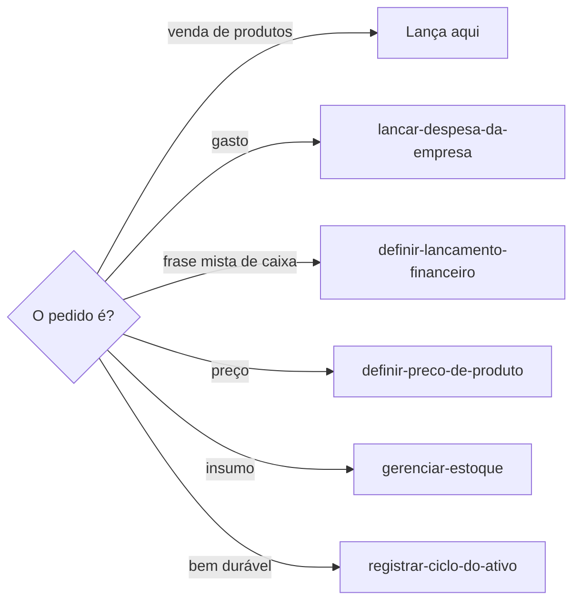
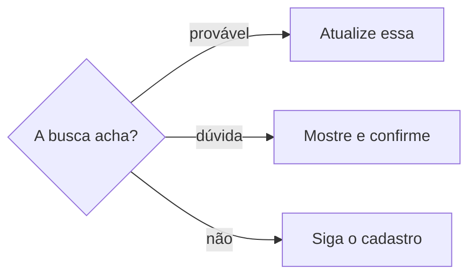

# Lançar venda

## Parâmetros de configuração

Leia cada valor nas instruções do projeto: primeiro na entrada com o nome desta habilidade, depois na entrada `Global` ou no primeiro nível do bloco. Quando um valor não estiver lá, use o padrão abaixo. Banco vazio: use `procurar-banco-de-dados`. Outro valor vazio: pergunte à pessoa uma vez e não escolha.

```yaml
"Modo de aprendizado": "perguntar"
# Nomes de banco: o projeto define. Os nomes das propriedades vêm do mapeamento de dados do projeto.
"Banco de vendas": ""
"Banco de contas bancárias": ""
# Opcional. Vazio: a venda não vincula unidade nem mexe no saldo, e o produto vendido entra pelo mapeamento.
"Banco de unidades": ""
# `Fonte do valor recebido` é onde se lê o valor que entrou, como o extrato do meio de pagamento.
"Fonte do valor recebido": ""
# `Início da nota no envio`: data, no formato AAAA-MM-DD, a partir da qual a venda com envio exige nota fiscal para transportar a mercadoria.
"Início da nota no envio": ""
# `Forma de entrega sem envio`: a forma de entrega que não transporta a mercadoria e dispensa a nota do envio.
"Forma de entrega sem envio": ""
```

## Instruções

### Passo 1

Cadastrar, completar, corrigir ou conciliar uma venda de um ou mais produtos é esta habilidade. A venda fica em `Banco de vendas`. Este texto usa conceitos, como a data real da venda, o valor inferido e o valor pago, e o mapeamento de dados do projeto diz o nome de cada propriedade.

A página de venda serve para acompanhar a evolução das vendas e o retorno. A evolução usa a data real e as peças. O retorno por ponto de contato usa o ponto já vinculado. Não crie propriedade de retorno e não grave um número para ele.

`Banco de vendas` vazio: use `procurar-banco-de-dados`, dizendo que o banco guarda as vendas. Não use a lista de outro workspace.



### Passo 2

Saque com cartão de crédito na máquina de cartão não é venda. Alguém passa o próprio cartão para receber o dinheiro, sem levar produto. Não há receita, e a entrada não vai para as vendas, mesmo quando o extrato mostra a liberação do dinheiro.

Uma entrada sem venda, devolvida logo depois para quem passou o cartão, pode ser um saque desse tipo. Antes de conciliar, pergunte à pessoa. Não crie uma venda para fechar a conciliação. Se a pessoa contar que vai passar um cartão para sacar, avise antes, pelos motivos abaixo.

Quando for saque, consulte em `Banco de contas bancárias` quem era titular da conta da máquina na data da entrada:

- Conta de pessoa física: o saque é movimento dessa pessoa e não entra nos registros da empresa. Comente na conciliação o que a entrada é, para ninguém procurar a venda de novo.
- Conta da empresa: avise que o saque infla o faturamento e que a máquina não aceita cobrança sem venda, e recomende não repetir. Registre a entrada e a devolução como um par, em `definir-lancamento-financeiro`, com os comprovantes. Confirme o tratamento contábil com quem cuida da contabilidade.

Se parte desse dinheiro pagou um débito da empresa, quem pagou segue `lancar-despesa-da-empresa`.

### Passo 3

Antes de criar, busque a venda pelo número do pedido, pelo link do pedido e pelo identificador da transação.



Complete só o que falta. Corrija só o que está errado. Dado válido que já está na propriedade certa permanece. Não reescreva a página. Dado no lugar errado, correção e reversão seguem o Passo 10.

### Passo 4

Pessoa cliente, conjunto e unidades são páginas que já existem. A pessoa cliente, no máximo uma, é o histórico de compras. Cadastrar a pessoa segue `definir-pessoa`.

Com `Banco de unidades` preenchido, a unidade traz o tamanho e as outras variantes, e esse vínculo é o rastro do estoque. As peças vendidas e os tipos de peças saem dessas unidades. Não preencha. Um conjunto não substitui as unidades. Com o banco vazio, vincule só o produto vendido, pelo mapeamento, e não vincule unidade.

Antes de vincular, busque com `identificar-duplicata`. Sem a página, ou sem a variante na unidade, pare e pergunte. Não crie a pessoa, o produto, a unidade nem a variante na venda. Não escolha entre parecidos.

O saldo segue `gerenciar-estoque`. Não altere o saldo aqui.

### Passo 5

A data real da venda fica na data e hora da venda. Ponto de contato entra quando a venda aconteceu nele. O projeto chega por esse ponto, e a ordem do projeto é calculada. Não preencha.

Quando o pedido da loja on-line é lançamento retroativo de uma venda que já ocorreu, busque a venda original pela data real, pelo cliente e pelas unidades. Vincule o pedido nessa página. Não crie outra. Sem a venda original, pare e pergunte.

A data da loja fica no campo de lançamento na loja. Pedido, ID da confirmação e link do pedido entram para conciliar com o canal. Data real, meio de pagamento, valor e contexto permanecem. Contexto é cliente, unidades, conjunto, ponto de contato, local e forma de entrega. O meio e o valor do lançamento tardio não substituem os da venda real.

Pedido, ID da confirmação e ID da transação são três dados separados. O número do pedido não confirma a venda nem identifica a transação.

### Passo 6

O preço nominal é o valor inferido da venda, calculado das peças. O desconto comercial aplicado também é calculado. Grave só o motivo do desconto. Definir o preço de catálogo segue `definir-preco-de-produto`.

O motivo diz o porquê de cada parte do desconto, como o ajuste ao preço dos vizinhos ou o desconto do Pix à vista, e quem concedeu, quando a pessoa disse. Um rótulo como "preço do evento" não basta. Quando o porquê muda com a coleção do produto, leia a coleção na página do produto antes de perguntar.

O valor pago pelos produtos fica no valor real da venda, sem o frete. O valor recebido pela empresa vem de `Fonte do valor recebido`. O meio efetivo é o meio de pagamento da venda real. O crédito da loja utilizado é só o crédito usado, sem somar o pagamento novo.

Taxa de transação inferida, valor líquido final, valor real com frete, peças vendidas e tipos de peças são calculados. Não preencha. Taxa, repasse e erro de lançamento não entram como desconto. Sem repasse de espaço ou de evento, o repasse fica zero.

### Passo 7

O ponto de contato é o lugar em que a venda aconteceu, como uma feira ou um evento. Sem o lugar dito pela pessoa, pergunte o ponto de contato antes de criar a venda e, na retirada, o local. O canal usado para achar a cliente, como o WhatsApp dela, não é o ponto da venda: não o grave no título, no ponto nem no corpo.

Não copie esse ponto para o local da retirada, que é só onde a pessoa retirou os produtos. O ponto que originou o crédito não é o ponto da venda, a origem do estoque nem o local da retirada.

Origem do estoque, destino do envio e local de processamento não são propriedades da venda. Não grave esses papéis em ponto de contato, local da retirada nem no ponto que originou o crédito. Sugira a propriedade que falta e espere o sim. Não crie. Um lugar da venda diferente do ponto de contato também não entra nesse ponto.

Entrega em mãos no ponto de contato: o custo de frete para a loja pode ficar vazio ou zero. Comprovante vai no campo de comprovantes, não no corpo. O status do pagamento é a definir ou pago.

### Passo 8

Concilie a loja on-line, o comprovante, o relato e qualquer outra fonte da mesma venda, por campo. O valor recebido vem de `Fonte do valor recebido`. O valor com frete pode vir da loja. O valor inferido vem das peças.

Fonte que diverge: mostre o diff por campo antes de alterar o valor ambíguo. A pessoa confirma qual valor e qual fonte são canônicos naquele campo. Essa confirmação não vale para os outros campos. Não escolha uma fonte para todos os campos. A decisão canônica segue o Passo 10, antes da alteração.

### Passo 9

Grave a forma de entrega em toda venda. A situação da nota fiscal é calculada pela data de emissão, pela forma de entrega e pela data da venda. Não preencha.

Venda a partir de `Início da nota no envio` com forma de entrega diferente de `Forma de entrega sem envio` precisa de nota fiscal antes da postagem, mesmo para pessoa física. Nessa venda, diga se a nota falta e peça a emissão antes da etiqueta. A data de emissão só entra quando a nota existe.

Um dos dois parâmetros vazio: pergunte uma vez se o projeto exige a nota no envio e não imponha regra. Quando um deles mudar, proponha trocar os mesmos valores no começo da fórmula da situação da nota e espere o sim.

### Passo 10

Migração, correção, reversão e decisão de conciliação registram a trilha num comentário da página, antes de apagar, mover ou reverter. O comentário diz o que mudou, por que mudou, qual fonte foi usada e quando a alteração aconteceu. Completar um campo vazio não exige esse comentário. O chat não substitui o comentário.

Propriedade que não existe: sugira e espere o sim. Não crie. Um caso isolado não remodela a lista.

### Passo 11

Ao terminar, siga `evoluir-habilidade` conforme `Modo de aprendizado`.

## Problemas comuns

### Venda duplicada pelo retroativo

Se você criar uma página nova porque o pedido da loja chegou depois, a venda original e o canal ficam separados.

1. Busque a venda original pela data real, pelo cliente e pelas unidades.
2. Vincule o pedido nessa página. Grave a data da loja, o pedido, a confirmação e o link.
3. Deixe data real, pagamento, valor e contexto como estão. Sem a venda original, pare e pergunte.

### Diff pulado

Se você alterar um valor ambíguo sem mostrar o diff, a venda troca de fonte sem a pessoa ver.

1. Mostre o valor atual, o proposto e a fonte de cada campo.
2. A pessoa confirma o valor e a fonte canônicos daquele campo. A confirmação não vale para os outros.
3. Não escolha uma fonte como superior para todos os campos.

### Lugar no papel errado

Se você gravar origem do estoque, destino do envio ou processamento em ponto de contato ou local da retirada, a etapa fica no lugar errado.

1. Ponto de contato é o lugar em que a venda aconteceu.
2. Local da retirada é só a retirada. O ponto do crédito não entra nesses dois.
3. Origem do estoque, destino do envio e local de processamento: sugira a propriedade e espere o sim. Não crie. Não misture.

### Concessão misturada

Se você gravar taxa, repasse ou erro de lançamento como desconto, o resultado da venda muda de natureza.

1. Deixe o preço nominal e o desconto comercial aplicado calculados. Grave o motivo.
2. Separe valor pago pelos produtos, valor recebido, crédito usado e meio efetivo.
3. Taxa e repasse ficam nos campos deles. Divergência segue o Passo 8.

### Fórmula preenchida

Se você editar o valor inferido ao registrar o desconto, o cálculo das peças se perde.

1. Grave o motivo e o valor pago nas propriedades editáveis.
2. Deixe as fórmulas e os rollups como estão.
3. Não preencha valor inferido, desconto aplicado nem taxa calculada.

### Dado válido apagado

Se você reescrever a venda ao completar um campo, o dado válido que já existia some.

1. Complete só o que falta.
2. Corrija só o que está errado.
3. Deixe o dado válido na propriedade em que já está.

### Peça ou saldo escritos na venda

Se você preencher as peças vendidas ou alterar o saldo, o histórico e o rastro saem da unidade.

1. Vincule a pessoa cliente, o conjunto e as unidades com as variantes que já existem.
2. Deixe as peças vendidas e os tipos de peças calculados.
3. Deixe o saldo em `gerenciar-estoque`.

### Pessoa ou unidade duplicada

Se você criar cliente ou unidade que já existe, a venda aponta para o registro errado.

1. Busque com `identificar-duplicata` antes de vincular.
2. Sem a página, pare e pergunte.
3. Não crie a pessoa, o produto nem a unidade.

### Retorno inventado

Se você criar uma propriedade de retorno ou gravar um número para ele, a lista ganha um campo que ela não tem.

1. Deixe a evolução na data real e nas peças.
2. Deixe o retorno por ponto de contato no ponto já vinculado.
3. Não crie propriedade de retorno.

### Auditoria só no chat

Se você deixar migração, correção, reversão ou decisão de conciliação só no chat, a trilha some.

1. Comente na página o que mudou, por que mudou, a fonte e quando a alteração aconteceu.
2. Faça isso antes de apagar, mover ou reverter.
3. Não crie propriedade por um caso isolado.

### Nome de banco inventado

Se você escolher um banco ou uma propriedade que o projeto não definiu, a venda vai para a lista errada.

1. Leia o parâmetro e o mapeamento de dados do projeto.
2. Parâmetro vazio: pergunte uma vez e espere.
3. Não escreva nome de banco nesta habilidade.

## Exemplos de entrada e saída

Estes exemplos ilustram fatos. Eles podem não estar no data source.

### Registre esta venda para eu acompanhar a evolução e o retorno.

A venda ficou nas vendas, com a data real e as peças. Não criei propriedade de retorno.

### Complete esta venda. O restante já está certo.

Preenchi o que faltava. O dado válido permaneceu. A correção ficou no comentário da página.

### Relacione a cliente, o conjunto, as peças e as unidades desta venda.

Vinculei a pessoa cliente, o conjunto e as unidades que já existiam, com as variantes. As peças continuaram calculadas. O saldo não mudou.

### Cadastre esta venda de duas peças.

Vinculei as unidades que já existiam. Não criei pessoa nem produto. O valor inferido continuou calculado.

### O pedido foi lançado retroativamente na loja. Preserve a data real da venda.

A data real ficou na data e hora da venda. A data da loja ficou no lançamento na loja. O meio de pagamento real não foi trocado.

### O extrato tem uma liberação sem venda. Concilie.

Perguntei se era venda ou saque com cartão de crédito. Uma parente tinha passado o cartão, e o dinheiro voltou para ela no mesmo dia, sem as taxas. Na data, a conta da máquina era de pessoa física, conforme as contas bancárias. A entrada ficou fora das vendas, e o comentário da conciliação disse o que ela era.

### Concilie esta venda. Os valores divergem entre as fontes.

Mostrei o diff por campo, inclusive da outra fonte. A pessoa confirmou o valor e a fonte canônicos de cada campo. Não usei uma fonte para a venda inteira.

### Confirme onde a venda aconteceu, onde a pessoa retirou e para onde foi o envio.

O ponto de contato ficou no lugar em que a venda aconteceu. A retirada ficou no local da retirada. O destino do envio não entrou nesses campos. Sugeri a propriedade e esperei o sim.

### Registre o pagamento desta venda, com desconto e crédito.

O preço nominal e o desconto comercial continuaram calculados. Gravei o motivo, o valor pago pelos produtos, o valor recebido, o crédito usado e o meio efetivo. Taxa e repasse não entraram como desconto.

### Reverta esta correção e deixe a trilha.

O comentário da página disse o que voltou, por que voltou, a fonte e quando. A reversão não ficou só no chat.

## Casos-limite

- O banco de vendas não está no workspace conectado: pare. Não use a lista de outro workspace.
- Venda provável já existe: atualize. Não duplique. Dúvida: mostre e confirme.
- Venda existente com um campo ausente e os demais válidos: preencha o ausente. Os válidos permanecem.
- Cliente, unidade ou conjunto ausente: pare e pergunte. Não crie.
- Unidade sem a variante dita: pare e pergunte. Não invente a variante na venda. O saldo não muda aqui.
- Taxa, repasse ou diferença sem explicação: não grave como desconto. Mostre o diff e pergunte.
- O pedido é acompanhar evolução ou retorno: registre a venda com a data real, as peças e, quando houve, o ponto de contato. Não crie propriedade de retorno.
- Retirada sem local, ou venda sem o ponto de contato em que aconteceu: confirme antes de gravar.
- Origem do estoque, destino do envio, local de processamento ou um local da venda diferente do ponto de contato: não grave em ponto de contato nem em local da retirada. Sugira e espere o sim.
- Há outra fonte da mesma venda: ela entra no diff do campo em que diverge. O canônico daquele campo não vale para os outros.
- Lançamento retroativo sem a venda original na lista: pare e pergunte. Não crie uma segunda venda a partir do pedido tardio.
- Reversão ou decisão de conciliação: o comentário da página vem antes da alteração e traz o que mudou, o porquê, a fonte e quando.
- Entrada no extrato sem venda que é saque com cartão de crédito: não entra nas vendas. O titular da conta na data da entrada decide se fica fora dos registros ou se vira o par de entrada e devolução, com o alerta.
- `Banco de unidades` vazio: não vincule unidade nem mexa no saldo.
- Gasto: `lancar-despesa-da-empresa`. Frase mista de caixa: `definir-lancamento-financeiro`. Insumo: `gerenciar-estoque`. Venda de bem durável: `registrar-ciclo-do-ativo`.

## Pegadinhas

- A liberação de dinheiro no extrato parece venda. Um saque com cartão de crédito na máquina de cartão não é venda nem receita.
- O número do pedido parece confirmação e transação. Pedido, ID da confirmação e ID da transação são três dados.
- A data em que o pedido entrou na loja parece a data da venda. No lançamento retroativo, a data real permanece.
- O pedido tardio na loja parece uma venda nova. Ele vincula a venda original. Data, pagamento, valor e contexto reais permanecem.
- Relacionar o produto parece preencher as peças vendidas. A peça sai da unidade, e a variante está nessa unidade. O saldo fica em `gerenciar-estoque`.
- Valor pago, valor recebido e preço nominal parecem o mesmo número. Preço nominal é o valor inferido. Valor pago pelos produtos exclui frete e taxa. Valor recebido é o que entrou pela fonte do valor recebido.
- O WhatsApp usado para achar a cliente parece o canal da venda. Ele só identifica a pessoa. O ponto de contato vem da pessoa, perguntado antes de criar.
- O endereço de envio parece local da retirada. Retirada é onde a pessoa retirou. Destino do envio, origem do estoque e local de processamento não são propriedades da venda.
- O histórico da página parece a trilha. Migração, correção, reversão e decisão de conciliação ficam num comentário, com o que mudou, o porquê, a fonte e quando.
- O valor inferido parece um campo para editar o desconto. Ele é calculado a partir das peças. O motivo é que se escreve.
- O comprovante no corpo parece guardado. O arquivo fica no campo de comprovantes.
- Um campo faltando parece motivo para criar a propriedade. Sem o sim, a lista não muda.
- Completar um campo parece reescrever a venda. O dado válido que já está na propriedade certa permanece.
- Uma fonte parece superior para a venda inteira. O canônico é por campo, e quem confirma é a pessoa.
- A dispensa da nota na venda a pessoa física parece dispensar o envio. Contribuinte do ICMS precisa de nota fiscal para transportar a mercadoria, e a declaração de conteúdo é recusada.

## Scripts disponíveis

- Nenhum.

1. Não há script para executar.
