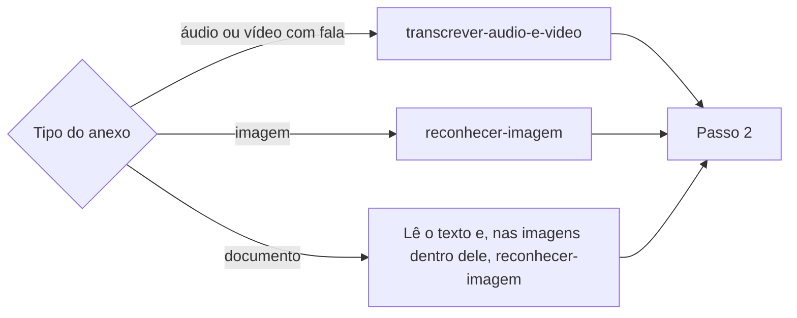

# Ler anexo da conversa

## Parâmetros de configuração

Leia cada valor nas instruções do projeto: primeiro na entrada com o nome desta habilidade, depois na entrada `Global` ou no primeiro nível do bloco. Quando um valor não estiver lá, use o padrão abaixo.
```yaml
# `Reação ao áudio transcrito` é o emoji que marca o áudio já transcrito. Vazio não reage. A pessoa do outro lado vê a reação, e o valor preenchido vale como o sim da pessoa.
"Reação ao áudio transcrito": ""
```

## Instruções

### Passo 1

Liste os anexos da conversa lida, exportada, colada ou recebida, com quem mandou e quando. Baixe cada um, ou pegue-o no arquivo da exportação. No WhatsApp Web, o download segue `usar-whatsapp-web`. Não liste só o nome e o tamanho: o anexo é aberto na mesma leitura, em qualquer tarefa e sem esperar pedido.



### Passo 2

Mostre o texto de um áudio inteiro, sem resumir, com a palavra que pode estar errada marcada como incerta. A transcrição entra no registro da conversa, como o comentário datado, e no que você conclui dela. Nunca escreva que o áudio "não foi transcrito" quando a transcrição roda local e sem custo: só a falha dela, dita com o que falhou, ou o programa ou o modelo por instalar, que pede o sim, deixam o áudio sem texto.

Com `Reação ao áudio transcrito` preenchida, reaja ao áudio, sem perguntar.

### Passo 3

Um documento de dados técnicos que o contato manda, como a ficha técnica de um tecido em PDF, a etiqueta, a lista de preços ou a foto de uma amostra, é aberto e lido. Um documento não é imagem, mas pode ter imagens, como a etiqueta dentro do PDF: leia o texto direto e as imagens por `reconhecer-imagem`. Mapa, tabela de preços e comunicado em imagem entram do mesmo modo. Uma imagem que você não leu não prova que o dado não saiu, e um "vou mandar" posterior não anula o que já foi mandado: diga que o dado foi enviado e que você não o leu, não que ele falta.

Extraia os dados e grave-os no cadastro que a skill do assunto manda, como `definir-tecido` para a ficha de um tecido, com o anexo no campo de arquivo dele. Diga à pessoa o que mudou e o que não bate, como o código da etiqueta diferente do código da lista de preços.

Quando a lista de preços cita um item que a pessoa encomendou, pergunte a situação do pedido, como a cor, o pagamento e a chegada, e grave-a na página do item, como `definir-tecido` manda.

## Problemas comuns

### Anexo do contato listado sem abrir

Se você listar só o nome e o tamanho dos PDFs, das etiquetas ou das fotos que o contato mandou, a pessoa pergunta se você chegou a vê-los e os dados ficam fora do cadastro.

1. Baixe e leia cada anexo na mesma leitura, sem esperar pedido.
2. Grave os dados no cadastro do assunto e o anexo no campo de arquivo dele.
3. Diga o que mudou e o que não bate entre os anexos, e pergunte a situação do pedido que a lista de preços cita.

### Áudio deixado sem transcrever

Se você registrar que o áudio "não foi transcrito", ou esperar a pessoa cobrar, a leitura do histórico sai errada e o registro e o perfil de tom ficam sem a fala.

1. Transcreva todo áudio da conversa na mesma rodada, também o da exportação ou o colado.
2. Grave a transcrição no registro e use-a na conclusão, com o trecho incerto marcado.
3. Pergunte só para instalar programa ou baixar modelo, ou para um arquivo que não é de conversa.

### Imagem dentro do documento ignorada

Se você ler só o texto do PDF, a etiqueta ou a tabela que está como imagem dentro dele fica fora do cadastro.

1. Procure imagens no documento depois de ler o texto.
2. Leia cada uma por `reconhecer-imagem` e some o resultado aos dados do documento.

## Exemplos de entrada e saída

Estes exemplos ilustram fatos. Eles podem não estar no data source.

### a pessoa entregou a exportação da conversa com a Vera, que tem um áudio dela, e pediu só o registro

Transcrevi o áudio na mesma rodada, sem perguntar, pelos dois motores. O comentário datado do registro traz o texto inteiro, com uma palavra marcada como incerta.

### a fornecedora de tecidos mandou três PDFs de ficha técnica às 16h24

Baixei e li os três PDFs na mesma leitura, sem a pessoa pedir. Cadastrei cada tecido por `definir-tecido`, com a ficha no campo de arquivo, e avisei que o código da etiqueta de um deles não bate com o da lista de preços. A lista citava um tecido que a pessoa encomendou, e perguntei se ele já foi pago e se já chegou, para gravar na página dele.

## Casos-limite

- A exportação traz o áudio como arquivo, ou a conversa colada só cita o áudio: transcreva o arquivo; se a exportação veio sem mídia, diga que o áudio não veio e peça o arquivo.
- O anexo é um arquivo que não é de conversa, como uma gravação de reunião: pergunte antes de transcrever.

## Pegadinhas

- Um anexo listado com nome e tamanho parece uma leitura feita. Sem abrir o conteúdo, o dado do documento não chegou ao cadastro e a pessoa tem de cobrar.
- Um PDF parece só texto. A etiqueta e a tabela de preços costumam estar em imagem dentro dele.

## Scripts disponíveis

- Nenhum.

1. Não há script para executar.
