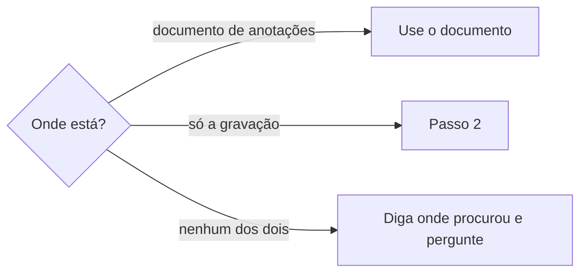

# Levantar gravações de reuniões

## Parâmetros de configuração

Leia cada valor nas instruções do projeto: primeiro na entrada com o nome desta habilidade, depois na entrada `Global` ou no primeiro nível do bloco. Quando um valor não estiver lá, use o padrão abaixo.

```yaml
# `Pastas das gravações das reuniões` lista as pastas locais onde a pessoa guarda gravações. Vazio, a busca local não roda e só vale o documento de anotações.
"Pastas das gravações das reuniões": []
# `Extensões das gravações` lista as extensões que contam como gravação.
"Extensões das gravações": ["mov", "mp4", "m4a", "mp3", "wav"]
"Modo de aprendizado": "perguntar"
```

## Instruções

### Passo 1

Ache a fonte da reunião antes de pedir qualquer coisa à pessoa.
Parta da data e do horário, que vêm do pedido ou da agenda, como manda `procurar-agenda`.



Procure primeiro o documento de anotações, onde a ferramenta de reunião costuma deixá-lo.
Ele já traz a transcrição e quem fala, então ganha da gravação.
Documento achado segue `definir-registro-de-reuniao`, que o usa como registro.

### Passo 2

Sem documento, procure a gravação nas `Pastas das gravações das reuniões`.
Com a lista vazia, pule este passo e diga que a busca local não está configurada.
Procure pela data e pelo horário no nome do arquivo e, na falta deles, pela data de modificação, que marca o fim da gravação e não o começo.
Só considere os arquivos com uma das `Extensões das gravações`.

### Passo 3

Quando a pessoa pede o levantamento, cruze cada gravação com o que o projeto já guarda.
Diga, para cada uma, se já tem transcrição local, se já tem registro e se já foi para a página publicada.
A transcrição local é um registro em arquivo ou o texto que `transcrever-audio-e-video` deixou na pasta de saída.
O registro e a página seguem o armazenamento de `definir-registro-de-reuniao`, pela data, pelo horário e pelo título.
Entregue uma tabela com uma linha por gravação.
O levantamento só lê e lista: não transcreve, não registra nem publica.

### Passo 4

A gravação sem transcrição segue `transcrever-audio-e-video`, e só depois do pedido da pessoa para aquela gravação.
Uma gravação longa leva tempo e espaço: diga quantas ficaram sem transcrição e pergunte quais transcrever.
O arquivo da gravação nunca sobe para serviço externo, repositório nem página, e fica onde está.

### Passo 5

Diga onde procurou: o documento de anotações, cada pasta e a data que usou.
Quando nada foi achado, diga isso e o que falta, como a pasta não configurada, e só então pergunte.

### Passo 6

Ao terminar, siga `evoluir-habilidade` conforme `Modo de aprendizado`.

## Problemas comuns

### Transcrição pedida sem ter procurado

Se você pedir a transcrição ou disser que a reunião não tem fonte sem ter olhado o documento de anotações e as pastas, a pessoa acha o arquivo em minutos.

1. Procure o documento de anotações.
2. Procure a gravação nas `Pastas das gravações das reuniões`.
3. Diga onde procurou antes de perguntar.

### Pasta presumida

Se você procurar numa pasta que a pessoa não configurou, a busca olha arquivos que não são gravações de reunião.

1. Leia as pastas só do parâmetro.
2. Com a lista vazia, diga que a busca local não está configurada.

### Levantamento que já transcreve

Se você transcrever durante o levantamento, uma lista de gravações longas ocupa a máquina por horas sem a pessoa ter pedido.

1. Liste o estado de cada gravação.
2. Transcreva só as que a pessoa escolher.

## Exemplos de entrada e saída

Estes exemplos ilustram fatos. Eles podem não estar no data source.

### A pessoa pede a transcrição de um dojô de uma data próxima, sem dizer onde está.

Procurei o documento de anotações pela data e achei um. Usei esse documento como registro, com `definir-registro-de-reuniao`, sem transcrever nada.

### A pessoa pergunta quais gravações ainda não foram para a página publicada.

Listei as gravações das pastas configuradas, cruzei com os registros e com as páginas, e entreguei uma tabela com transcrição local, registro e página de cada uma. Perguntei quais das que estão sem transcrição ela quer transcrever.

## Casos-limite

- Duas gravações no mesmo horário, como uma reunião cortada em dois arquivos: liste as duas e pergunte se são a mesma reunião.
- A data do nome do arquivo e a data de modificação divergem: use a do nome e diga a divergência.
- A gravação não tem documento nem registro: marque como sem registro e não presuma o título.
- A pasta configurada não existe: diga o caminho que tentou e siga com as outras.

## Pegadinhas

- A data de modificação parece o começo da reunião. Ela é o fim da gravação.
- Um arquivo com o horário no nome parece bastar. O horário de criação do registro também é aproximado, então cruze com a agenda.
- Uma transcrição local parece registro. Ela ainda não identifica quem fala e não está no armazenamento dos registros.
- Uma gravação sem página publicada parece pendência. Reunião pessoal ou de assunto interno pode ficar só no armazenamento privado.

## Scripts disponíveis

- `ls -l "<pasta>"` lista os arquivos com a data de modificação.
- `mdls -name kMDItemDurationSeconds "<arquivo>"` mostra a duração de uma gravação.

1. Liste primeiro e só depois leia as durações das gravações que importam.
