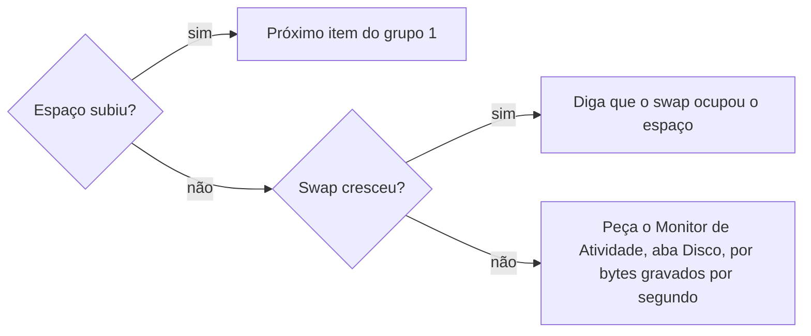

# Liberar espaço em disco

## Parâmetros de configuração

```yaml
"Modo de aprendizado": "perguntar"
```

## Instruções

### Passo 1

Meça o espaço livre e o swap antes de qualquer coisa. Esse número é a linha de base do Passo 5.

### Passo 2

Meça as pastas conhecidas da pessoa e as caches, uma por uma e em segundo plano. Depois abra as maiores um nível. Não procure no disco inteiro.

### Passo 3

Classifique cada item em um grupo:

1. Cache que se recria sozinho, como o cache do npm, os runtimes baixados, os navegadores de automação e o atualizador de um app.
2. Cache que o próprio app limpa melhor, como o do navegador e o do player de música. Diga onde fica a opção no app.
3. Arquivo da pessoa, como downloads, vídeos, música, projetos e dados de app. Mostre só o tamanho. Nunca apague.

Mostre uma tabela com tamanho, o que é e como limpar, do maior para o menor.

### Passo 4

Proponha só o grupo 1. Liste cada caminho e o total. Entregue o comando que apaga num bloco próprio, e a pessoa roda no terminal dela. Nunca apague por conta própria, nem depois do sim.

### Passo 5

Quando a pessoa disser que rodou, meça de novo o espaço livre e a pasta limpa. Diga quanto liberou, contra a linha de base. Se o espaço não subir, siga o fluxo.



### Passo 6

Ao terminar, siga `evoluir-habilidade` conforme `Modo de aprendizado`.

## Problemas comuns

### Limpeza de worktree como solução

Se você limpar os worktrees das sessões para liberar espaço, a conta raramente fecha: eles somam centenas de MB, e a limpeza do app só pega sessões paradas há 30 dias.

1. Meça o que os worktrees ocupam.
2. Compare com o espaço usado no disco.
3. Siga o Passo 2. Para remover as cópias de trabalho de uma sessão que terminou, siga `limpar-copias-de-trabalho`.

### Comando que não limpa

Se você deixar passar um comando que só lista, como a árvore de pacotes do npm numa pasta de cache, a pessoa acha que limpou e o espaço não muda.

1. Diga que o comando só lista.
2. Meça a pasta.
3. Entregue o comando que apaga.

### Apagar por conta própria

Se você rodar o comando que apaga, mesmo depois do sim, a pessoa perde o controle do que sai do disco.

1. Entregue o comando num bloco próprio.
2. Espere a pessoa dizer que rodou.
3. Meça de novo.

### Processo culpado pelo total gravado

Se você ler o Monitor de Atividade pela coluna de bytes gravados, culpa o processo errado: ela soma tudo desde que o computador ligou.

1. Leia os dados gravados por segundo, no rodapé.
2. Se a taxa for baixa, não há processo descontrolado.
3. Volte ao Passo 2.

## Exemplos de entrada e saída

Estes exemplos ilustram fatos. Eles podem não estar no data source.

### tem algum worktree que podemos limpar?

Os 9 worktrees do app somam 337 MB, e nenhuma sessão está parada há 30 dias. O disco tem 427 GB usados e 103 MB livres. As maiores pastas são Música, 56 GB, suporte de apps, 56 GB, e projetos, 30 GB. Nada foi apagado.

### verifica se mudou algo depois que eu limpei o npm

O espaço livre foi de 945 MB para 14 GB, e o cache do npm, de 9,3 GB para 1,5 GB. Os próximos do grupo 1 são o runtime do Codex, 1,5 GB, o Chrome do Puppeteer, 984 MB, e os binários do Prisma, 154 MB.

## Casos-limite

- O disco está tão cheio que o comando não grava a própria saída: entregue primeiro o comando que apaga o que você mesmo criou na sessão, como clones temporários, e meça de novo.
- Sobrou dado de um app que já foi desinstalado: mostre o que tem dentro e o que se perde. Entregue o comando só se a pessoa pedir.
- A pessoa apagou por conta própria: confira se a pasta sumiu e meça o espaço livre.
- O sistema bloqueia a medição de uma pasta, como a Lixeira: diga que não foi medida e peça para a pessoa ver no Finder.
- O app está aberto: peça para fechar antes de apagar o cache dele, ou limpe pelo próprio app.

## Pegadinhas

- O macOS não tem o comando de tempo limite do GNU. Com ele, cada medição volta vazia, sem erro.
- O espaço livre oscila com o swap. Uma medição que cai depois de uma limpeza não prova que algo grava sem parar.
- Uma medição de pasta grande passa de 2 minutos. Rode em segundo plano, ou a ferramenta corta o comando.
- O sistema bloqueia a medição de algumas pastas da pessoa sem dar erro. Ela parece pequena ou vazia.
- Sem espaço, o shell falha ao gravar a saída de qualquer comando, inclusive o da medição.

## Scripts disponíveis

- `df -h /System/Volumes/Data /System/Volumes/VM`: espaço livre e swap do Passo 1 e do Passo 5.
- `cd ~ && for d in Library/Developer Library/Caches "Library/Application Support" Library/Containers "Library/Mobile Documents" Downloads Documents Desktop Movies Pictures Music GitHub .npm .cache .docker; do [ -e "$d" ] && echo "$(du -sh "$d" 2>/dev/null | cut -f1)	$d"; done | sort -rh`: pastas do Passo 2.
- `du -sh <pasta>/* 2>/dev/null | sort -rh | head -20`: um nível dentro das maiores, no Passo 2.
- `npm cache clean --force`: cache do npm, do grupo 1.
- `rm -rf ~/.cache/codex-runtimes ~/.cache/puppeteer ~/.cache/prisma ~/Library/Caches/ms-playwright`: runtimes e navegadores baixados, do grupo 1.

1. Meça o espaço livre e as pastas, em segundo plano. Depois entregue o comando de um item do grupo 1 por vez e meça de novo quando a pessoa disser que rodou.
