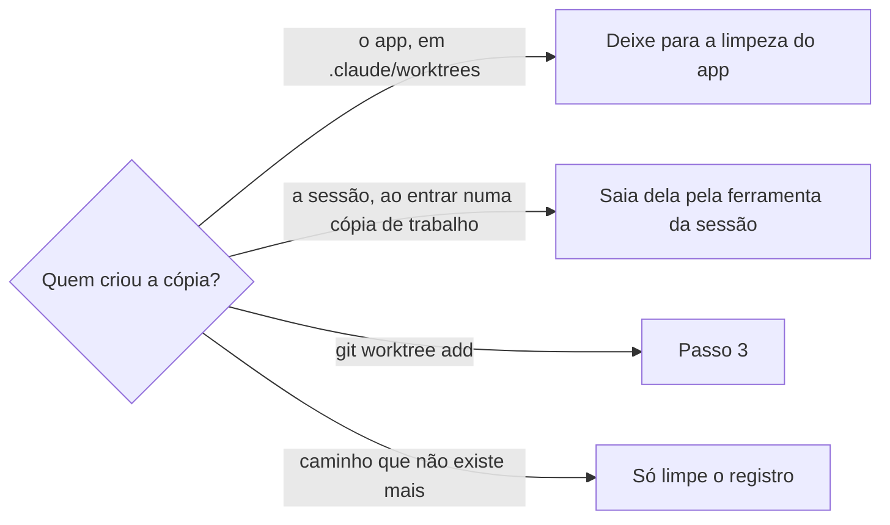

# Limpar cópias de trabalho

## Parâmetros de configuração

```yaml
"Modo de aprendizado": "perguntar"
```

## Instruções

### Passo 1

Rode no fim de toda sessão cujo trabalho já entrou: commit enviado, PR aberto ou mesclado. Liste as cópias de trabalho de cada repositório que a sessão usou, com a pasta, a branch, o commit e o tamanho, e meça o espaço livre do disco.

### Passo 2

Separe cada cópia pelo dono.



A limpeza do app fica em Ajustes › Armazenamento, em limpar sessões inativas. Ela pede aprovação num cartão e só pega sessões paradas há 30, 60 ou 90 dias. Não remova à mão uma cópia em `.claude/worktrees`.

### Passo 3

Monte o plano como uma tabela: cópia, cada conferência e decisão. Uma cópia só sai quando passa em todas:

1. Não é a cópia principal do repositório, nem a pasta de trabalho desta sessão, nem a pasta de outra sessão que ainda está aberta.
2. Não tem mudança fora do commit. Dependência instalada, como `node_modules` e `.venv`, não conta. Qualquer outro arquivo fora do git segura a cópia.
3. O trabalho já está no GitHub: o commit está numa branch remota, ou o PR da branch foi mesclado.
4. Foi criada nesta sessão, ou o PR dela foi mesclado e nenhuma sessão aberta usa a pasta.

Confira o plano contra o git e o GitHub antes de executar. Se uma conferência não tiver resposta, a cópia fica.

### Passo 4

Remova as cópias aprovadas no plano, sem pedir confirmação. As conferências são a segurança. Remova também a branch local de cada uma e limpe o registro das cópias cuja pasta já não existe. Meça o disco de novo.

### Passo 5

Responda com o espaço que voltou e uma tabela das cópias: removida ou mantida, e o motivo de cada uma que ficou, com o link do PR quando houver.

### Passo 6

Ao terminar, siga `evoluir-habilidade` conforme `Modo de aprendizado`.

## Problemas comuns

### Pedir para a pessoa rodar

Se você entregar os comandos para a pessoa rodar, cada limpeza vira mais uma interação que ela precisa confirmar.

1. Rode as conferências do Passo 3.
2. Remova o que passou, sem perguntar.
3. Conte no fim o que saiu e o que ficou.

### Cópia de outra sessão

Se você remover uma cópia que outra sessão ainda usa, essa sessão perde a pasta de trabalho no meio da tarefa.

1. Confira as pastas das sessões abertas.
2. Deixe a cópia que aparece nelas.
3. Na dúvida, deixe e diga por quê.

### Branch remota apagada

Se você tratar a falta da branch remota como trabalho perdido, mantém para sempre a cópia de um PR já mesclado.

1. Procure o PR da branch.
2. Mesclado: o trabalho está na base, e a cópia pode sair.
3. Sem PR e sem branch remota: a cópia fica.

## Exemplos de entrada e saída

Estes exemplos ilustram fatos. Eles podem não estar no data source.

### limpe as cópias de trabalho desta sessão

Dez cópias do core e de um harness de negócio passaram nas conferências e saíram, com as branches locais. Três não tinham branch remota, mas os PRs delas tinham sido mesclados com squash. Uma cópia ficou porque tinha arquivos de teste fora do git, de outra sessão. Voltaram cerca de 460 MB.

## Casos-limite

- O repositório só tem a cópia principal: não há o que remover. Diga isso numa linha.
- A sessão ainda não enviou o trabalho: a cópia fica até o commit chegar ao GitHub.
- A cópia está numa pasta temporária que já sumiu: limpe só o registro.
- A pessoa pede para liberar espaço em disco: siga `liberar-espaco-em-disco`. As cópias de trabalho raramente são o que enche o disco.

## Pegadinhas

- A remoção sem forçar recusa a cópia que tem `node_modules` ou `.venv` fora do git. Force só depois que o Passo 3 aprovou a cópia.
- Depois de um merge com squash, o GitHub apaga a branch remota e a branch local não aparece como mesclada. Só o estado do PR diz que o trabalho entrou.
- A remoção leve da branch local recusa a branch mesclada por squash. Remova forçando, só depois de conferir o PR.
- A pasta atual da sessão não pode ser removida: o shell perde o diretório de trabalho.

## Scripts disponíveis

- `git -C <repositório> worktree list --porcelain`: cópias, branches e commits do Passo 1.
- `du -sh <cópia>` e `df -h ~`: tamanho de cada cópia e espaço livre, no Passo 1 e no Passo 4.
- `git -C <cópia> status --porcelain | grep -vE '^\?\? (node_modules|\.venv)/'`: mudança fora do commit, no Passo 3. Saída vazia passa.
- `git -C <cópia> fetch -q origin && git -C <cópia> branch -r --contains HEAD`: commit numa branch remota, no Passo 3.
- `gh pr list --repo <dono>/<repositório> --head <branch> --state all --json number,state,url`: PR da branch, no Passo 3.
- `git -C <repositório> worktree remove --force <cópia> && git -C <repositório> branch -D <branch>`: remoção do Passo 4.
- `git -C <repositório> worktree prune`: registro das cópias cuja pasta sumiu, no Passo 4.

1. Liste e meça, separe pelo dono, confira cada cópia, remova as aprovadas, limpe o registro e meça de novo.
