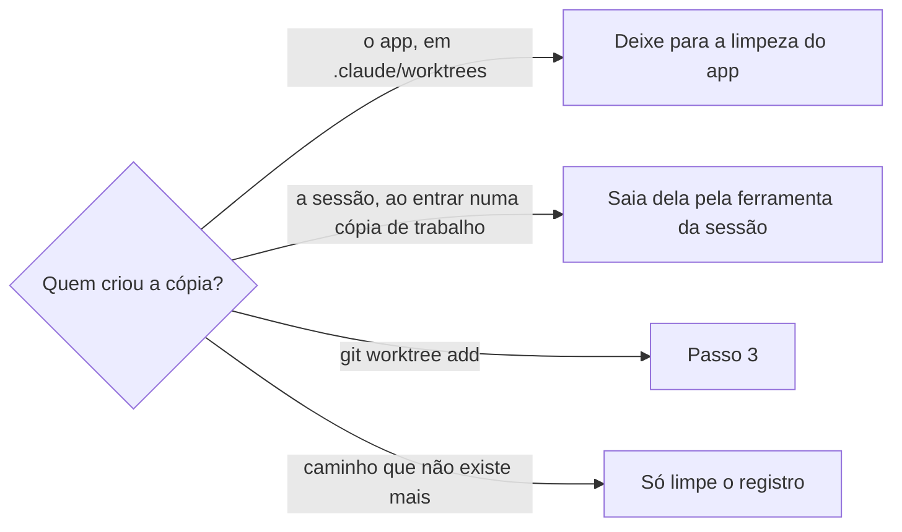

# Limpar cópias de trabalho

## Parâmetros de configuração

```yaml
"Modo de aprendizado": "perguntar"
```

## Instruções

### Passo 1

Rode no fim de toda sessão cujo trabalho já entrou: commit enviado, PR aberto ou mesclado. Liste as cópias de trabalho de cada repositório que a sessão usou, com a pasta, a branch, o commit e o tamanho, e meça o espaço livre do disco. Liste também as branches locais que nenhuma cópia de trabalho usa, com o commit de cada uma.

### Passo 2

Separe cada cópia pelo dono.



A limpeza do app fica em Ajustes › Armazenamento, em limpar sessões inativas. Ela pede aprovação num cartão e só pega sessões paradas há 30, 60 ou 90 dias. Não remova à mão uma cópia em `.claude/worktrees`.

### Passo 3

Monte o plano como uma tabela: cópia, cada conferência e decisão. Uma cópia só sai quando passa em todas:

1. Não é a cópia principal do repositório, nem a pasta de trabalho desta sessão, nem a pasta de outra sessão que ainda está aberta.
2. Não tem mudança fora do commit. Dependência instalada, como `node_modules` e `.venv`, não conta, seja pasta ou link para o clone. Qualquer outro arquivo fora do git segura a cópia.
3. O trabalho já está no GitHub: o commit está numa branch remota, ou a branch tem pull request aberto ou mesclado no remoto.
4. Nenhuma sessão aberta usa a pasta. Isso sai da lista de terminais e de workspaces, não de uma dúvida. O remoto foi consultado pelos pull requests abertos e pelos mesclados.

Uma branch local que nenhuma cópia usa entra no mesmo plano e só sai quando passa em todas:

1. Não é a branch de nenhuma cópia de trabalho, nem a base.
2. O commit dela está numa branch remota, ou é o mesmo commit do PR dela, mesclado ou fechado. O PR fechado guarda esse commit no GitHub, na referência do PR.

Antes de manter uma cópia, confira a sessão e o remoto. A sessão: leia o diretório de trabalho de cada terminal aberto e a pasta de cada workspace aberto. Se a cópia é essa pasta, está dentro dela ou a contém, outra sessão usa e a cópia fica. Se a lista existe e a cópia não aparece, nenhuma sessão aberta usa. O remoto: liste os pull requests abertos e os mesclados da branch e leia o estado de cada um. Aberto ou mesclado, com o commit no remoto ou no pull request, o trabalho está no GitHub e a cópia pode sair se as outras conferências passarem. Sem pull request aberto, sem pull request mesclado e sem branch remota, a cópia fica. Uma busca que não rodou não é conferência: rode antes de manter. Se a lista de sessões não puder ser lida, a conferência não tem resposta e a cópia fica. Confira o plano contra o git e o GitHub antes de executar.

### Passo 4

Remova as cópias aprovadas no plano, sem pedir confirmação. As conferências são a segurança. Remova também a branch local de cada uma, as branches locais aprovadas no plano, e limpe o registro das cópias cuja pasta já não existe. Meça o disco de novo.

### Passo 5

Responda com o espaço que voltou e uma tabela das cópias e das branches: removida ou mantida, e o motivo de cada uma, com o link do PR quando houver.

### Passo 6

Ao terminar, siga `evoluir-habilidade` conforme `Modo de aprendizado`.

## Problemas comuns

### Pedir para a pessoa rodar

Se você entregar os comandos para a pessoa rodar, cada limpeza vira mais uma interação que ela precisa confirmar.

1. Rode as conferências do Passo 3.
2. Remova o que passou, sem perguntar.
3. Conte no fim o que saiu e o que ficou.

### Cópia de outra sessão

Se você remover uma cópia que outra sessão ainda usa, essa sessão perde a pasta de trabalho no meio da tarefa.

1. Leia o diretório de cada terminal aberto e a pasta de cada workspace.
2. Deixe a cópia que aparece neles.
3. Se a lista existe e a pasta não está nela, não deixe por dúvida.
4. Se a lista não puder ser lida, a cópia fica e a resposta diz que a lista faltou.

### Cópia mantida sem conferir

Se você mantém a cópia dizendo que não conferiu a sessão ou o pull request, a limpeza para sem decisão.

1. Leia as sessões abertas.
2. Liste no remoto os pull requests abertos e os mesclados da branch.
3. Aí decida. Sessão usando a pasta: fica. Pull request aberto ou mesclado, sem sessão: pode sair, se as outras conferências passarem. Sem pull request e sem branch remota: fica.

### Branch remota apagada

Se você tratar a falta da branch remota como trabalho perdido, mantém para sempre a cópia de um PR já mesclado.

1. Liste os pull requests abertos e os mesclados da branch.
2. Mesclado, ou aberto com o commit no remoto: o trabalho está no GitHub, e a cópia pode sair se nenhuma sessão aberta usa a pasta.
3. Fechado sem merge, com o mesmo commit da branch local: o commit fica na referência do PR, e a branch pode sair.
4. Sem PR e sem branch remota: a cópia fica.

## Exemplos de entrada e saída

Estes exemplos ilustram fatos. Eles podem não estar no data source.

### limpe as cópias de trabalho desta sessão

Dez cópias do core e de um harness de negócio passaram nas conferências e saíram, com as branches locais. Três não tinham branch remota, mas os PRs delas tinham sido mesclados com squash. Uma cópia ficou porque tinha arquivos de teste fora do git, de outra sessão. Voltaram cerca de 460 MB.

### fila do Renovate terminada

Só a cópia principal existia, e sobraram quatro branches `renovate/*`. Três PRs tinham sido mesclados e um fechado, todos com o mesmo commit da branch local. As quatro saíram, e a resposta deu a tabela com o link de cada PR.

## Casos-limite

- O repositório só tem a cópia principal e nenhuma branch local sobrando: não há o que remover. Diga isso numa linha.
- A branch local tem commit além do commit do PR, ou nenhuma branch remota e nenhum PR a contêm: ela fica, porque o commit só existe nesta máquina.
- A sessão ainda não enviou o trabalho: a cópia fica até o commit chegar ao GitHub.
- Pull request aberto, commit no remoto e nenhuma sessão aberta usa a pasta: a cópia pode sair. O pull request continua no GitHub.
- A lista de sessões existe e a pasta não está nela: não mantenha a cópia por dúvida.
- A cópia está numa pasta temporária que já sumiu: limpe só o registro.
- A pessoa pede para liberar espaço em disco: siga `liberar-espaco-em-disco`. As cópias de trabalho raramente são o que enche o disco.

## Pegadinhas

- A remoção sem forçar recusa a cópia que tem `node_modules` ou `.venv` fora do git. Force só depois que o Passo 3 aprovou a cópia.
- O link de `node_modules` que `criar-copia-de-trabalho` faz aparece como `?? node_modules`, sem a barra final de uma pasta. O filtro da conferência aceita as duas formas.
- Depois de um merge com squash, o GitHub apaga a branch remota e a branch local não aparece como mesclada. Só o estado do PR diz que o trabalho entrou.
- A remoção leve da branch local recusa a branch mesclada por squash. Remova forçando, só depois de conferir o PR.
- A pasta atual da sessão não pode ser removida: o shell perde o diretório de trabalho.
- "Não conferi a sessão" ou "não achei o pull request" parece motivo para manter. Não é conferência. A conferência é a lista de sessões e a lista de pull requests abertos e mesclados.

## Scripts disponíveis

- `git -C <repositório> worktree list --porcelain`: cópias, branches e commits do Passo 1.
- `du -sh <cópia>` e `df -h ~`: tamanho de cada cópia e espaço livre, no Passo 1 e no Passo 4.
- `git -C <cópia> status --porcelain | grep -vE '^\?\? (node_modules|\.venv)/?$'`: mudança fora do commit, no Passo 3. Saída vazia passa.
- `git -C <cópia> fetch -q origin && git -C <cópia> branch -r --contains HEAD`: commit numa branch remota, no Passo 3.
- `git -C <repositório> for-each-ref --format='%(refname:short) %(objectname:short) %(worktreepath)' refs/heads`: branches locais do Passo 1. A que tem o caminho vazio não está em nenhuma cópia.
- `gh pr list --repo <dono>/<repositório> --head <branch> --state all --json number,state,headRefOid,url`: pull requests abertos e mesclados da branch, no Passo 3. Leia o `state` de cada um. A lista vazia só vale depois dessa consulta.
- O diretório de trabalho de cada terminal aberto e a pasta de cada workspace aberto: sessão que usa a cópia, no Passo 3. A cópia que é essa pasta, está dentro dela ou a contém está em uso.
- `gh pr list --repo <dono>/<repositório> --head <branch> --state all --json number,state,url`: PR da branch, no Passo 3.
- `git -C <repositório> worktree remove --force <cópia> && git -C <repositório> branch -D <branch>`: remoção do Passo 4. Para a branch sem cópia, só o `branch -D`.
- `git -C <repositório> worktree prune`: registro das cópias cuja pasta sumiu, no Passo 4.

1. Liste e meça, separe pelo dono, confira cada cópia e cada branch local, remova as aprovadas, limpe o registro e meça de novo.
