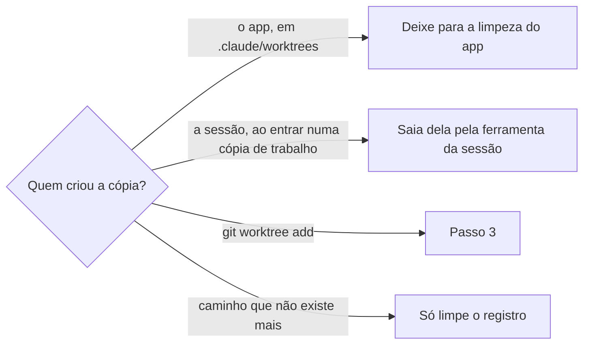

# Limpar cópias de trabalho

## Parâmetros de configuração

```yaml
"Modo de aprendizado": "perguntar"
```

## Instruções

### Passo 1

Rode no fim de toda sessão cujo trabalho já entrou: commit enviado, PR aberto ou mesclado. Liste as cópias de trabalho de cada repositório que a sessão usou, com a pasta, a branch, o commit e o tamanho, e meça o espaço livre do disco. Liste também todas as branches locais que nenhuma cópia de trabalho usa, com o commit de cada uma, inclusive as que outra sessão ou outra ferramenta criou. Toda branch local entra no plano: nenhuma fica de fora da conferência por não ser desta sessão.

### Passo 2

Separe cada cópia pelo dono.



A limpeza do app fica em Ajustes › Armazenamento, em limpar sessões inativas. Ela pede aprovação num cartão e só pega sessões paradas há 30, 60 ou 90 dias. Não remova à mão uma cópia em `.claude/worktrees`.

### Passo 3

Monte o plano como uma tabela: cópia, cada conferência e decisão. Uma cópia só sai quando passa em todas:

1. Não é a cópia principal do repositório, nem a pasta de trabalho desta sessão, nem a pasta de outra sessão que ainda está aberta.
2. Não tem mudança fora do commit. Dependência instalada, como `node_modules` e `.venv`, não conta, seja pasta ou link para o clone. Qualquer outro arquivo fora do git segura a cópia.
3. O trabalho já está no GitHub: o commit está numa branch remota, ou a branch tem pull request aberto ou mesclado no remoto.
4. Nenhuma sessão aberta usa a pasta. Isso sai da lista de terminais e de workspaces, não de uma dúvida. O remoto foi consultado pelos pull requests abertos e pelos mesclados.

Uma branch local que nenhuma cópia usa entra no mesmo plano e só sai quando passa em todas:

1. Não é a branch de nenhuma cópia de trabalho, nem a base.
2. O trabalho dela já está no GitHub, por um destes caminhos:
   - O commit está numa branch remota ou na base.
   - O commit é o mesmo do PR dela, mesclado ou fechado. O PR fechado guarda esse commit no GitHub, na referência do PR.
   - Sem PR, o conteúdo entrou na base por outro PR mesclado: os arquivos que a branch cria ou muda estão na base, e o PR que os levou está identificado pelo histórico desses arquivos.
   - O pull request foi mesclado e o commit da ponta local ainda está no GitHub, mesmo sem ser o commit do merge.
   - Checkout desta máquina na branch de outra pessoa não continua o trabalho dela.
   - A frase de produto informa a ação que ficou de fora.
   - Essa frase não segura a branch, salvo se a pessoa está continuando esse trabalho.

Sem nenhum desses caminhos, a branch fica, e a resposta diz que o commit só existe nesta máquina.

Antes de manter uma cópia, confira a sessão e o remoto. A sessão: leia o diretório de trabalho de cada terminal aberto e a pasta de cada workspace aberto. Se a cópia é essa pasta, está dentro dela ou a contém, outra sessão usa e a cópia fica. Se a lista existe e a cópia não aparece, nenhuma sessão aberta usa. O remoto: liste os pull requests abertos e os mesclados da branch e leia o estado de cada um. Aberto ou mesclado, com o commit no remoto ou no pull request, o trabalho está no GitHub e a cópia pode sair se as outras conferências passarem. Sem pull request aberto, sem pull request mesclado e sem branch remota, a cópia fica. Uma busca que não rodou não é conferência: rode antes de manter. Se a lista de sessões não puder ser lida, a conferência não tem resposta e a cópia fica. Confira o plano contra o git e o GitHub antes de executar.

### Passo 4

Remova as cópias aprovadas no plano, sem pedir confirmação. As conferências são a segurança. Remova também a branch local de cada uma, as branches locais aprovadas no plano, e limpe o registro das cópias cuja pasta já não existe. Meça o disco de novo.

Depois de remover, confira cada espaço de trabalho na mesma resposta, antes de dizer que a limpeza terminou.
Não suponha nenhum deles: o que um passo anterior deveria ter feito também se confere.

1. A cópia de trabalho do PR sumiu da lista de cópias do repositório.
2. A branch local sumiu da lista de branches.
3. A branch remota do PR mesclado sumiu depois de `fetch --prune`. O repositório pode apagá-la ao mesclar, e isso se confere, não se supõe.
4. O clone da pessoa ficou como estava: na mesma branch, sem arquivo novo nem alteração.

Confira também o que se acumulou no repositório, não só o PR atual, na mesma resposta.
Cruze `gh pr list --head <branch> --state all` com `fetch --prune` e liste, numa linha por categoria:

1. As branches remotas com PR mesclado ou fechado.
2. As branches locais com PR mesclado ou fechado.
3. As cópias de trabalho cuja branch tem PR mesclado ou fechado.
4. As branches, remotas e locais, sem PR e sem commit à frente da base.

Não suponha que a plataforma limpa: um repositório com a opção de apagar a branch ao mesclar ligada ainda pode ter branch de PR mesclado.
Uma conferência que falha não vira "limpo": a resposta lista o que sobrou, com o comando pronto.
Esta habilidade apaga só a cópia e a branch local que passaram no Passo 3.
A branch remota, e o que o resto da lista mostra, pode ser de outra sessão ou de outra pessoa: fica para a pessoa, como lista com o comando pronto.
O modo automático pode negar ação destrutiva, e a negação não se contorna.

### Passo 5

Responda com o espaço que voltou e uma tabela das cópias e das branches: removida ou mantida, e o motivo de cada uma, com o link do PR quando houver.
Cada branch é uma linha.
Depois da tabela, uma linha por conferência e por categoria do que se acumulou, como o Passo 4 manda, com o resultado de cada uma.
A que ficou porque o pull request mesclou outro commit diz se pode apagar.
Pode apagar quando o commit está no GitHub, mesmo com comportamento de produto que o resultado aprovado não tem.
Processo: o pull request chegou ao fim normal.
Num merge com squash, entra na base um commit só, e os commits de quem abriu a branch não entram na base.
Se esse commit está no GitHub, guardar a branch aqui não continua o trabalho de outra pessoa.
Produto: nomeie a tela e a ação de quem compra, diga de quem é o trabalho, e diga que é o produto.
Essa frase informa e não segura a branch, salvo se a pessoa está continuando esse trabalho.
Fica só quando o commit não está no GitHub.
Não use termos como "faz menos que".
Ao descrever o que uma branch ou um pull request faz, separe a explicação do produto da explicação sobre o processo que levou ao clone, ao commit ou ao merge.
Não troque o processo por "aceitou um commit", "apagou o nome" nem pelo título do commit.
Não liste, sem a pessoa pedir, todos os arquivos e commits envolvidos: a explicação fica longa.
Não junte o conjunto numa frase e não ofereça listá-lo num turno seguinte.

### Passo 6

Ao terminar, siga `evoluir-habilidade` conforme `Modo de aprendizado`.

## Problemas comuns

### Limpeza dada como feita sem conferir

Se você disser que a limpeza terminou sem conferir cada espaço de trabalho, a branch remota e o clone ficam sujos e a pessoa descobre depois.

1. Depois de remover, confira a cópia, a branch local, a branch remota, o clone e o que se acumulou no repositório, como o Passo 4 manda.
2. A branch remota só sumiu se o `fetch --prune` confirmar.
3. O que sobrou entra na resposta com o comando pronto, e a limpeza não é dada como terminada.

### Pedir para a pessoa rodar

Se você entregar os comandos para a pessoa rodar, cada limpeza vira mais uma interação que ela precisa confirmar.

1. Rode as conferências do Passo 3.
2. Remova a cópia e a branch local que passaram, sem perguntar.
3. Conte no fim o que saiu e o que ficou.

### Cópia de outra sessão

Se você remover uma cópia que outra sessão ainda usa, essa sessão perde a pasta de trabalho no meio da tarefa.

1. Leia o diretório de cada terminal aberto e a pasta de cada workspace.
2. Deixe a cópia que aparece neles.
3. Se a lista existe e a pasta não está nela, não deixe por dúvida.
4. Se a lista não puder ser lida, a cópia fica e a resposta diz que a lista faltou.

### Cópia mantida sem conferir

Se você mantém a cópia dizendo que não conferiu a sessão ou o pull request, a limpeza para sem decisão.

1. Leia as sessões abertas.
2. Liste no remoto os pull requests abertos e os mesclados da branch.
3. Aí decida. Sessão usando a pasta: fica. Pull request aberto ou mesclado, sem sessão: pode sair, se as outras conferências passarem. Sem pull request e sem branch remota: fica.

### Branch antiga listada sem conferir

Se você listar as branches locais de outras tarefas como "não toquei", a pessoa precisa pedir a conferência, e as branches se acumulam.

1. Confira toda branch local contra a base no fim de toda sessão, mesmo a que outra sessão criou.
2. Remova a que passou no Passo 3.
3. Na resposta, cada branch é uma linha da tabela, com a decisão e o link do PR quando houver. A que ficou porque o pull request mesclou outro commit entra do mesmo jeito: uma frase, pode apagar ou o comportamento que só existe nela.
4. Não liste, sem a pessoa pedir, todos os arquivos e commits: a explicação fica longa.
5. Não junte o conjunto numa frase e não ofereça listá-lo depois.

### Diff no lugar da decisão

Se você contar arquivo, commit e o que a base mudou depois, a pessoa não vê o que pode apagar.

1. Compare os arquivos que a branch mudou com o commit mesclado.
2. Sem comportamento só na branch: a linha diz que pode apagar.
3. Com comportamento só na branch: a linha diz qual, numa frase.

### Branch remota apagada

Se você tratar a falta da branch remota como trabalho perdido, mantém para sempre a cópia de um PR já mesclado.

1. Liste os pull requests abertos e os mesclados da branch.
2. Mesclado, ou aberto com o commit no remoto: o trabalho está no GitHub, e a cópia pode sair se nenhuma sessão aberta usa a pasta.
3. Fechado sem merge, com o mesmo commit da branch local: o commit fica na referência do PR, e a branch pode sair.
4. Sem PR e sem branch remota: a cópia fica.
5. Separe processo e produto.
6. No processo, diga que o pull request chegou ao fim normal.
7. Em squash, entra na base um commit só, e os commits de quem abriu a branch não entram na base.
8. Se o commit da ponta local está no GitHub, a branch pode sair.
9. No produto, nomeie a tela, a ação e de quem é o trabalho, e diga que é o produto.
10. Essa frase não segura a branch, salvo se a pessoa está continuando o trabalho.
11. Não use termos como "faz menos que".
12. Ao descrever o que uma branch ou um pull request faz, separe a explicação do produto da explicação sobre o processo que levou ao clone, ao commit ou ao merge.
13. Não troque o processo por "aceitou um commit", "apagou o nome" nem pelo título do commit.

## Exemplos de entrada e saída

Estes exemplos ilustram fatos. Eles podem não estar no data source.

### limpe as cópias de trabalho desta sessão

Dez cópias do core e de um harness de negócio passaram nas conferências e saíram, com as branches locais. Três não tinham branch remota, mas os PRs delas tinham sido mesclados com squash. Uma cópia ficou porque tinha arquivos de teste fora do git, de outra sessão. Voltaram cerca de 460 MB.

### branches antigas depois de voltar para a base

A cópia principal voltou para a `main`, e sobraram sete branches locais de tarefas antigas. Cinco tinham PR mesclado com o mesmo commit. Duas não tinham PR nem branch remota, mas o conteúdo delas tinha entrado na `main` por outros PRs mesclados. As sete saíram, e a tabela deu o PR de cada uma.

### fila do Renovate terminada

Só a cópia principal existia, e sobraram quatro branches `renovate/*`. Três PRs tinham sido mesclados e um fechado, todos com o mesmo commit da branch local. As quatro saíram, e a resposta deu a tabela com o link de cada PR.

## Casos-limite

- O repositório só tem a cópia principal e nenhuma branch local sobrando: não há o que remover. Diga isso numa linha.
- A branch remota do PR mesclado continua no remoto: a conferência 3 do Passo 4 falha, e a resposta traz o comando pronto para apagá-la.
- Há branches de PRs antigos, de outra sessão ou de outra pessoa: elas entram na lista do que se acumulou, com o comando pronto, e a habilidade não as apaga.
- O pull request mesclou outro commit e o commit da ponta local está no GitHub: pode apagar, salvo se a pessoa está continuando o trabalho.
- A frase de processo diz o fim normal.
- A frase de produto nomeia a tela, a ação e de quem é o trabalho.
- Ela informa e não segura a branch.
- Sem branch remota, sem PR e sem PR que levou o conteúdo: ela fica, porque o commit só existe nesta máquina, e a resposta traz uma linha com o link e esse motivo.
- A branch é de outra sessão ou de outra ferramenta: ela entra na conferência como qualquer outra.
- A sessão ainda não enviou o trabalho: a cópia fica até o commit chegar ao GitHub.
- Pull request aberto, commit no remoto e nenhuma sessão aberta usa a pasta: a cópia pode sair. O pull request continua no GitHub.
- A lista de sessões existe e a pasta não está nela: não mantenha a cópia por dúvida.
- A cópia está numa pasta temporária que já sumiu: limpe só o registro.
- A pessoa pede para liberar espaço em disco: siga `liberar-espaco-em-disco`. As cópias de trabalho raramente são o que enche o disco.

## Pegadinhas

- A remoção sem forçar recusa a cópia que tem `node_modules` ou `.venv` fora do git. Force só depois que o Passo 3 aprovou a cópia.
- O link de `node_modules` que `criar-copia-de-trabalho` faz aparece como `?? node_modules`, sem a barra final de uma pasta. O filtro da conferência aceita as duas formas.
- Depois de um merge com squash, a branch local não aparece como mesclada.
- Apagar a branch ao mesclar ligado no repositório não garante que ela sumiu: o merge pelo botão ou a opção desligada podem deixá-la. O `fetch --prune` diz se ela sumiu.
- Só o estado do PR diz que o trabalho entrou.
- Comportamento de produto que ficou de fora parece motivo para esta máquina guardar a branch de outra pessoa.
- Se o commit está no GitHub e a pessoa não está continuando o trabalho, pode apagar.
- "Faz menos" parece quantidade de commits ou de comportamento de produto. Não use termos como "faz menos que".
- A frase de processo fala dos commits.
- A frase de produto nomeia a tela, a ação e de quem é o trabalho.
- A remoção leve da branch local recusa a branch mesclada por squash. Remova forçando, só depois de conferir o PR.
- `git cherry` marca com `+` o commit de uma branch cujo conteúdo entrou por squash ou por outro PR, porque o patch não é o mesmo. Confira pelos arquivos e pelo histórico deles na base.
- A pasta atual da sessão não pode ser removida: o shell perde o diretório de trabalho.
- "Não conferi a sessão" ou "não achei o pull request" parece motivo para manter. Não é conferência. A conferência é a lista de sessões e a lista de pull requests abertos e mesclados.
- Um conjunto grande de branches mantidas parece caber numa frase, com a oferta de listar depois. Cada uma continua uma linha da tabela.
- Explicar o diff de cada branch parece completar a linha. A linha é a decisão: pode apagar, ou o comportamento que só existe na branch.

## Scripts disponíveis

- `git -C <repositório> worktree list --porcelain`: cópias, branches e commits do Passo 1.
- `du -sh <cópia>` e `df -h ~`: tamanho de cada cópia e espaço livre, no Passo 1 e no Passo 4.
- `git -C <cópia> status --porcelain | grep -vE '^\?\? (node_modules|\.venv)/?$'`: mudança fora do commit, no Passo 3. Saída vazia passa.
- `git -C <cópia> fetch -q origin && git -C <cópia> branch -r --contains HEAD`: commit numa branch remota, no Passo 3.
- `git -C <repositório> for-each-ref --format='%(refname:short) %(objectname:short) %(worktreepath)' refs/heads`: branches locais do Passo 1. A que tem o caminho vazio não está em nenhuma cópia.
- `gh pr list --repo <dono>/<repositório> --head <branch> --state all --json number,state,headRefOid,url`: pull requests abertos e mesclados da branch, no Passo 3. Leia o `state` de cada um. A lista vazia só vale depois dessa consulta.
- O diretório de trabalho de cada terminal aberto e a pasta de cada workspace aberto: sessão que usa a cópia, no Passo 3. A cópia que é essa pasta, está dentro dela ou a contém está em uso.
- `git -C <repositório> merge-base --is-ancestor <branch> origin/<base>`: commit da branch já na base, no Passo 3.
- `git -C <repositório> diff --stat $(git -C <repositório> merge-base origin/<base> <branch>) <branch>` e `git -C <repositório> log --oneline origin/<base> -- <arquivo>`: arquivos da branch sem PR e o PR que os levou à base, no Passo 3.
- `git -C <repositório> worktree remove --force <cópia> && git -C <repositório> branch -D <branch>`: remoção do Passo 4. Para a branch sem cópia, só o `branch -D`.
- `git -C <repositório> worktree prune`: registro das cópias cuja pasta sumiu, no Passo 4.
- `git -C <repositório> worktree list`, `git -C <repositório> branch --list <branch>` e `git -C <repositório> fetch --prune origin && git -C <repositório> branch -r --list origin/<branch>`: conferências 1, 2 e 3 do Passo 4. Saída vazia passa.
- `git -C <repositório> rev-list --count origin/<base>..origin/<branch>`: zero é sem commit à frente da base, para a categoria 4 do que se acumulou no Passo 4.
- `git -C <clone> status -sb`: conferência 4 do Passo 4. A branch é a de antes e não há arquivo novo.
- `git -C <repositório> push origin --delete <branch>`: comando que a resposta entrega para a branch remota que sobrou. A pessoa o roda.

1. Liste e meça, separe pelo dono, confira cada cópia e cada branch local, remova as aprovadas, limpe o registro e meça de novo.
