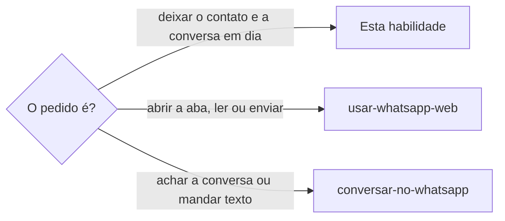

# Manter o contato no WhatsApp

## Parâmetros de configuração

Leia os valores nas instruções do projeto, na entrada desta habilidade. Na ausência, use os padrões abaixo.
```yaml
"Modo de aprendizado": "perguntar"
# `Salvar contato sem número salvo`: `sim` salva, na conta comercial, o número de uma conversa que ainda não está nos contatos. `não` deixa como está.
"Salvar contato sem número salvo": "não"
# `Padrão do nome do contato` é o formato do nome salvo. A organização é a empresa, o evento ou o lugar que liga a pessoa ao negócio.
"Padrão do nome do contato": "<nome> (<organização>)"
```

## Instruções

### Passo 1



Só a sessão dona do WhatsApp Web mexe no contato, porque só ela tem a aba. O acesso, a aba e a sessão dona seguem `usar-whatsapp-web`.

### Passo 2

A nota de todo contato abre com o link da página da pessoa no data source, e a página recebe o link da conversa, `https://wa.me/<número>`. A nota é a de `Notas de comunicação no contato`, de `usar-whatsapp-web`: leia o campo antes e acrescente, sem apagar.
Contato sem o link o recebe assim que a dona abre a conversa, sem pedir. A pessoa ou a empresa sem página é cadastrada por `definir-pessoa` ou `definir-empresa` na mesma rodada, sem perguntar à pessoa se pode.
Depois de enviar, a troca entra também num comentário datado na página da pessoa, com o que foi dito e combinado, para a página formar a linha do tempo da relação.

### Passo 3

Com `Salvar contato sem número salvo` em `sim`, salve o número de uma conversa que ainda não está nos contatos, no `Padrão do nome do contato`, com o nome e a organização lidos da página da pessoa ou da conversa.
O contato salvo sem a organização recebe-a no nome. Sem a organização, pergunte à pessoa.

### Passo 4

Depois de ler ou enviar numa conversa, inclusive num envio que outra sessão pediu, confira a lista antes de responder a quem pediu, uma vez:
- [ ] o rótulo de estado e o de contexto, por `rotular-item`;
- [ ] o nome do contato;
- [ ] a nota com o link da página;
- [ ] o perfil de tom, por `perfilar-tom-de-voz`;
- [ ] o registro no data source, por `definir-negociacao`;
- [ ] a reação ao áudio.

Diga o que mudou e o que falta.

### Passo 5

A leitura que outra sessão pediu, e a de um grupo, também fecha a lista: rotule toda conversa que abriu, com estado e contexto, e diga os rótulos que ficaram, sem esperar a pessoa cobrar.
Grupo não tem nota de contato, então o que a nota guardaria vai para o registro no data source.

### Passo 6

Ao terminar, siga `evoluir-habilidade` conforme `Modo de aprendizado`.

## Problemas comuns

### Nota sem o link da página

Se você gravar a nota só com o que a conversa ensinou, ninguém acha a página da pessoa a partir do contato, e a página não acha a conversa.

1. Abra a nota com o link da página no data source.
2. Grave na página o link `https://wa.me/<número>`.
3. Sem página, cadastre-a por `definir-pessoa` ou `definir-empresa` e volte.

### Conversa lida e deixada sem rótulo

Se você ler uma conversa a pedido de outra sessão e responder sem rotular, a pessoa descobre depois que a conversa ficou sem estado.

1. Rotule a conversa com estado e contexto antes de responder.
2. Diga os rótulos que ficaram.

### Contato salvo sem a organização

Se você salvar o número só com o nome, o contato não diz de onde a pessoa vem.

1. Leia a organização na página da pessoa ou na conversa.
2. Salve no `Padrão do nome do contato`.
3. Sem a organização, pergunte à pessoa.

## Exemplos de entrada e saída

Estes exemplos ilustram fatos. Eles podem não estar no data source.

### outra sessão pediu a leitura da conversa do Caio

Li a conversa e, antes de responder, conferi a lista: rotulei com estado e contexto, a nota do contato já abria com o link da página, o registro no data source estava feito. Disse à sessão que pediu os rótulos que ficaram.

### conversa com um número que não está nos contatos

Com `Salvar contato sem número salvo` em `sim`, salvei como "Caio (Casa Azul)", com a organização lida da página da pessoa, e gravei na página o link da conversa.

## Casos-limite

- A pessoa não tem página no data source: cadastre-a por `definir-pessoa` ou `definir-empresa` antes da nota, sem perguntar.
- A conversa é um grupo: sem nota de contato, o que ela guardaria vai para o registro no data source.
- `Salvar contato sem número salvo` em `não`: deixe o número como está e diga que não salvou.
- Sem a organização da pessoa, nem na página nem na conversa: pergunte uma vez e pare.

## Pegadinhas

- A sessão que pediu a leitura não vê o que a dona fez no contato: diga o que mudou.
- Senha, código e documento de pessoa nunca entram na nota.
- A nota tem um só campo: leia antes e acrescente, nunca substitua.

## Scripts disponíveis

- Nenhum.

1. Não há script para executar.
