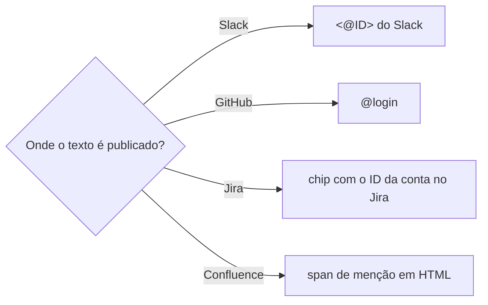

# Mencionar pessoa

## Parâmetros de configuração

Leia cada valor nas instruções do projeto: primeiro na entrada com o nome desta habilidade, depois na entrada `Global`. Quando um valor não estiver lá, use o padrão abaixo.

```yaml
# `Modo de aprendizado` diz se a habilidade pergunta antes de evoluir ou evolui sozinha.
"Modo de aprendizado": "perguntar"
```

## Instruções

### Passo 1

O registro da pessoa vem de `definir-pessoa`. Sem registro, cadastre-a antes.

Quem cita uma pessoa num texto publicado, em qualquer plataforma, marca a pessoa com menção real e não com o nome em texto.
Ache o ID no registro da pessoa e escreva a menção como a plataforma pede:



- No Confluence, a menção é `<span data-type="mention" data-user-id="ID">@Nome</span>`, com o ID da conta no Jira.
- No Confluence, o corpo da página vai em HTML ao criar e ao atualizar, porque o markdown não gera menção.
- O login do GitHub vem do registro da pessoa ou do autor de pull requests recentes.
- Sem o ID no registro, procure pelo e-mail na plataforma e use só um resultado único.
- Grave o ID que achou no registro.
- Sem e-mail e com mais de um resultado, ou com dois registros de nome parecido, pergunte.
- Confira pelo assunto da fala quem é a pessoa e nunca escolha o primeiro resultado.
- A menção notifica a pessoa.
- Acrescentar menções a um texto já publicado há tempo pede o sim de quem escreve.

### Passo 2

Ao terminar, siga `evoluir-habilidade` conforme `Modo de aprendizado`.

## Problemas comuns

### Nome em texto onde cabia menção

Se você escrever o nome de quem participou ou de quem responde por uma ação só como texto, a pessoa não é notificada e o texto não leva até ela.

1. Ache o ID no registro, como o Passo 4 manda.
2. Escreva a menção real da plataforma.
3. Sem o ID, procure pelo e-mail.
4. Sem resultado único, pergunte.

## Exemplos de entrada e saída

Estes exemplos ilustram fatos. Eles podem não estar no data source.

### cite a Ana Souza no comentário do pull request

Achei o login no registro da pessoa e escrevi `@login`. Conferi pelo assunto do pull request quem era e não escolhi o primeiro resultado da busca.

## Casos-limite

- O texto já foi publicado há tempo: acrescentar a menção pede o sim de quem escreve.
- A plataforma não tem o ID no registro e há dois registros de nome parecido: pergunte.

## Pegadinhas

- O markdown não gera menção no Confluence: o texto sai com o nome puro e ninguém é notificado. Use HTML.
- Uma menção parece só um jeito de escrever o nome. Ela notifica a pessoa.

## Scripts disponíveis

- Nenhum.

1. Não há script para executar.
