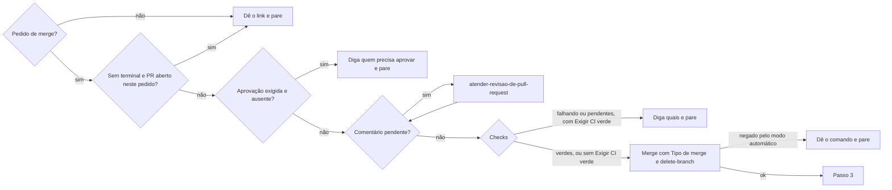

# Mesclar pull request

## Parâmetros de configuração

Leia cada valor nas instruções do projeto: primeiro na entrada com o nome desta habilidade, depois na entrada `Global` ou no primeiro nível do bloco. Quando um valor não estiver lá, use o padrão abaixo. `Repositório` vem do remoto `origin` quando as instruções não dizem.

```yaml
"Repositório": ""
"Tipo de merge": "squash"
"Exigir CI verde": "sim"
# `Exigir aprovação de outra pessoa`: `nunca`, `só sem terminal` ou `sempre`.
"Exigir aprovação de outra pessoa": "só sem terminal"
"Comunicar novidade após o merge": "sim"
"Modo de aprendizado": "perguntar"
```

## Instruções

### Passo 1

Leia o estado do PR agora: aberto, mesclado ou fechado, rascunho ou pronto.
Se a pessoa avisou que mesclou, confirme o estado MERGED e o hash e vá para o Passo 3.
Se ele já foi mesclado sem aviso, diga isso e vá para o Passo 3.
Fechado sem merge: diga isso e pare.

### Passo 2

Mescle só com pedido explícito, como "mescla", "coloca na main" ou "pode mesclar".
Abrir o PR, "faça o PR" e "sobe isso" não pedem merge.



A aprovação de `Exigir aprovação de outra pessoa` é de outra pessoa no PR: check verde não conta, e ser dona do repositório não dispensa.
Comentário pendente é thread de revisão sem resolver, revisão que pede mudança ou comentário da conversa sem resposta, de pessoa ou de bot. Aviso de bot que só informa, como link de preview, não conta. Thread que espera decisão da pessoa segura o merge até ela decidir.
Leia os checks uma vez. Pendentes: diga quais faltam e pare, sem esperar em loop. Com `Exigir CI verde` em `não`, mescle e diga quais não passaram.
Se o modo automático negar o merge, não tente de outro jeito: nada de auto-merge, API ou outra ferramenta. Entregue o comando pronto e diga que a decisão é da pessoa.

### Passo 3

Depois do merge, feito aqui ou avisado pela pessoa, faça tudo isto na mesma resposta, antes de responder:

- [ ] Confirme o estado MERGED e o hash do commit na base.
- [ ] Siga `sincronizar-status-da-tarefa` para cada tarefa, card ou issue ligada ao PR. Sem tarefa ligada, diga isso.
- [ ] Se o projeto sincroniza o repositório com outra ferramenta, como as páginas de habilidade no Notion, confira a sincronização.
- [ ] Com `Comunicar novidade após o merge` em `sim`, siga `comunicar-novidade-do-produto` para o PR.
- [ ] Siga `limpar-copias-de-trabalho` para a cópia de trabalho e a branch local do PR.

A tarefa do PR nunca fica no status de antes do merge.

### Passo 4

Se perguntarem "já mesclou?", responda primeiro sim ou não e depois o que falta.
Abra a resposta com o link do PR, `[#123](url)`, e diga o hash, o estado de cada item do Passo 3 e, se houver, quem precisa aprovar ou mesclar.
Cada PR, issue e commit citado vai como link clicável em markdown.

### Passo 5

Ao terminar, siga `evoluir-habilidade` conforme `Modo de aprendizado`.

## Problemas comuns

### Merge negado

Se você repetir o merge por outro caminho depois que o modo automático negou, está contornando a decisão.

1. Pare.
2. Entregue o comando de merge pronto.
3. Diga que a pessoa pode mesclar pelo botão do PR ou liberar o comando nas permissões.

### Aviso de merge tratado como informação

Se você só agradece quando a pessoa diz que mesclou, a tarefa fica no status de antes e a cópia de trabalho sobra.

1. Confirme o estado MERGED.
2. Faça o checklist do Passo 3 inteiro na mesma resposta.

### Merge com conversa aberta

Se você mesclar com thread sem resolver ou comentário sem resposta, a revisão se perde depois do merge.

1. Leia as threads e a conversa antes do merge.
2. Siga `atender-revisao-de-pull-request` e volte.
3. Thread que espera a pessoa segura o merge.

## Exemplos de entrada e saída

Estes exemplos ilustram fatos. Eles podem não estar no data source.

### Só coloca isso na main

O pedido autoriza o merge. Sem PR aberto, `criar-pull-request` abre antes. Sem comentário pendente e com checks verdes, mesclei com `Tipo de merge`, confirmei MERGED, sincronizei a issue ligada e limpei a cópia de trabalho.

### PR #42 mesclado

Confirmei MERGED e o hash. A issue ligada foi para concluído. Nenhum comunicado: a mudança não aparece para quem usa.

## Casos-limite

- O PR está em rascunho: diga isso e pergunte se tira do rascunho antes. O merge não tira sozinho.
- A pessoa pede para mesclar a base na branch: isso é `atualizar-branch-do-pull-request`, que usa rebase.
- O PR é de release, como o do Release Please: depois do merge, a tag sai pelo CI. Atualize o plugin instalado quando as instruções do projeto mandarem.
- Vários PRs: mescle na ordem de dependência e faça o Passo 3 para cada um.

## Pegadinhas

- Depois do squash, a branch local não aparece como mesclada. Só o estado do PR diz que o trabalho entrou.
- `mergeStateStatus` `BLOCKED` com checks verdes costuma ser aprovação ou check exigido que ainda não rodou. Leia os dois antes de dizer por quê.
- O aviso "mesclado" parece encerrar o assunto. É o gatilho do Passo 3.

## Scripts disponíveis

- Nenhum.

1. Estado: `gh pr view <número> --repo <Repositório> --json state,isDraft,mergeCommit,mergeStateStatus,reviewDecision,closingIssuesReferences`.
2. Threads: `gh api graphql -f query='query{repository(owner:"<dono>",name:"<nome>"){pullRequest(number:<número>){reviewDecision reviewThreads(first:100){nodes{isResolved}}}}}'`.
3. Checks: `gh pr checks <número> --repo <Repositório>`.
4. Merge: `gh pr merge <número> --repo <Repositório> --<Tipo de merge> --delete-branch`.
