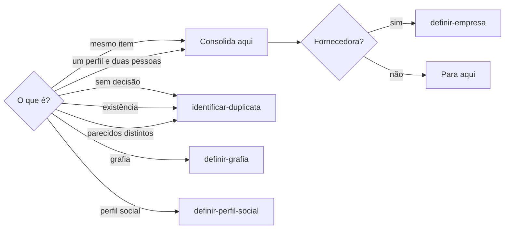
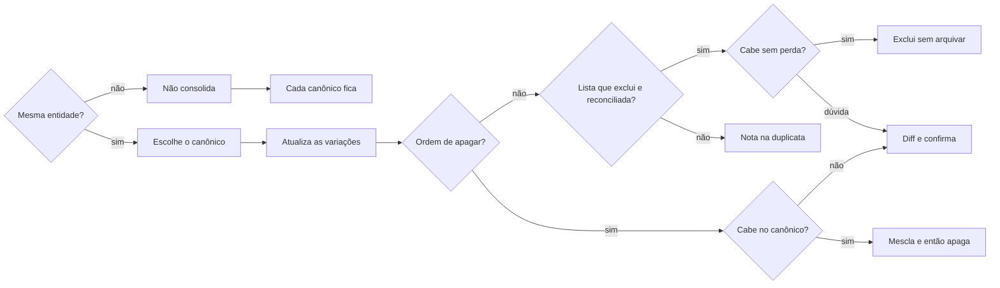

# Mesclar registro

## Parâmetros de configuração

Leia cada valor nas instruções do projeto: primeiro na entrada com o nome desta habilidade, depois na entrada `Global` ou no primeiro nível do bloco. Quando um valor não estiver lá, use o padrão abaixo. `Listas que excluem a duplicata reconciliada` nomeia as listas em que a duplicata, depois de reconciliada no canônico, é excluída sem ordem da pessoa. Vazia quer dizer que nenhuma lista exclui sem ordem.

```yaml
"Listas que excluem a duplicata reconciliada": []
```

## Instruções

### Passo 1

Consolidar registros que já são o mesmo item é esta habilidade. A pessoa informa o data source na execução. Quando o mapeamento de dados do projeto descreve essa lista, o nome de cada propriedade vem dele. Se o data source não estiver no workspace conectado, pare. Não use a lista de outro workspace. Empresa fornecedora consolidada: a pessoa responsável segue o flowchart, em `definir-empresa`. Não encerre essa fornecedora com a pessoa só na nota ou só na relação de donos.



Não escolha entre parecidos. Não consolide conceitos diferentes. Ao comparar parecidos, diga se Não confundir com existe, mesmo sem a pessoa perguntar o esquema. Sem a propriedade, proponha a relação. A criação e o vínculo seguem o flowchart. Variação, grafia, observação e corpo não substituem a relação. Não confundir com não separa a pessoa duplicada de um perfil só.

### Passo 2

Escolha um registro como canônico. Prefira o que tem o link oficial correto. Empate no link: prefira o que tem mais dados preenchidos. Se o link e a quantidade apontarem registros diferentes, nomeie cada um e pergunte. Não escolha. Antes de copiar, a resposta traz o diff: o que a canônica traz, e o que cada duplicata traz. O que só uma traz fica marcado. Conflito fica marcado. Campo vazio de um lado entra no diff.

### Passo 3

No canônico, o título permanece o nome canônico. Renomear ou consolidar esse nome guarda a forma anterior quando ela ainda ajuda a busca, o histórico, a dedupe ou evita confusão. Entram o nome anterior, o apelido, a grafia incorreta, a grafia ambígua e a variação. Use a propriedade de variações que o mapeamento indica para a lista. Sem mapeamento, use a propriedade de variações que a lista já tem, como Variações de nome, ou outro campo de grafias. Quando a propriedade é Variações de nome, use uma lista de bullets, um nome alternativo por item, e termine cada item com ponto e vírgula. Mantenha as grafias úteis para a busca, com e sem sigla e com e sem ano, quando forem do mesmo registro canônico. Não apague as variações que já estão. Forma que já está na lista não entra de novo. A forma igual ao título canônico não entra. Forma diferente que veio da duplicata entra. Não troque o título do canônico pela forma da duplicata. Grafia de pessoa ou de empresa segue o flowchart do Passo 1. Sem a propriedade, avise e proponha a criação. Não dê a renomeação por concluída para a dedupe. Não crie a propriedade antes do sim. Renomeação recente com a variação antiga vazia: acrescente o nome anterior. Diferença permanente entre registros não entra na variação. A variação recebe só nome, grafia, apelido, transcrição incorreta e forma alternativa do mesmo canônico. O contexto permanente e o vínculo de parecidos seguem o flowchart do Passo 1. Contato, preço, disponibilidade, resposta, decisão, status, prazo e mudança operacional vão em comentário datado.

### Passo 4

No registro duplicado, acrescente uma nota curta de que ele é duplicata do canônico. Antes dessa nota, copie para o canônico a propriedade e a relação que só a duplicata tem e que não conflitam. Conflito não copia: nomeie na resposta. Sem ordem para apagar, pare aqui, salvo nas listas de `Listas que excluem a duplicata reconciliada`. Nessas listas, a duplicata cujos dados úteis e relações já estão no canônico segue o Passo 5. Não arquive. Não use a duplicata como referência futura.

### Passo 5

Apagar só com ordem da pessoa, salvo a duplicata já reconciliada numa lista de `Listas que excluem a duplicata reconciliada`. Nessas listas, ao finalizar a reconciliação, confirme que os dados úteis e as relações estão no canônico e exclua a duplicata. Não arquive. Duplicata arquivada não resolve governança, busca nem reconciliação. Se a exclusão puder perder informação, ou houver dúvida sobre a duplicidade, peça confirmação antes de excluir. Nas outras listas, antes de apagar, grave o plano: cada propriedade e cada relação da duplicata, e se cabe no canônico. Valide o plano nas duas páginas. Se couber com segurança, mescle tudo no canônico e só então apague. Se houver conflito, devolva o diff do que está inconsistente e confirme qual valor é canônico. Não apague antes da confirmação. Valor que sai do canônico fica na propriedade que a lista já tem para valor morto. Sem essa propriedade, fica no corpo da página. Não crie a propriedade.



## Problemas comuns

### Duplicata reconciliada arquivada

Se você arquivar a duplicata de uma lista que exclui depois de consolidar, a busca e a reconciliação continuam achando o registro.

1. Confirme que os dados úteis e as relações estão no canônico.
2. Exclua a duplicata. Não arquive.
3. Se a exclusão puder perder informação, ou a duplicidade estiver em dúvida, peça confirmação antes de excluir.

### Nome parecido consolidado

Se você consolidar nomes parecidos que são outra entidade, duas entidades viram uma.

1. Pare. Não consolide.
2. Cada entidade permanece com o seu registro canônico.
3. A correção não fica só no chat. O vínculo fica com `identificar-duplicata`. No perfil social, fica com `definir-perfil-social`.

### Variação antiga apagada

Se você substituir a lista de variações pela forma nova, o nome anterior some da busca.

1. Mantenha os itens que já estão.
2. Acrescente a forma anterior que ainda não está, um item por variação.
3. O título permanece o nome canônico.

### Renomeação sem a forma anterior

Se você concluir a renomeação com a variação vazia, a dedupe perde o nome antigo.

1. Acrescente o nome anterior na propriedade de variações.
2. Sem a propriedade, avise e proponha a criação.
3. Não dê por concluída para a dedupe. Não crie a propriedade antes do sim.

### Resposta sem o diff

Se você só disser qual é a canônica, a localidade de uma página e o perfil da outra somem na frase.

1. Separe o que a canônica traz.
2. Separe o que cada duplicata traz.
3. Marque o que só uma traz e o que conflita.

### Canônico pelo título mais curto

Se você escolher o canônico pelo título mais curto, o link oficial correto fica na duplicata.

1. Prefira o link oficial correto.
2. Empate no link: prefira mais dados preenchidos.
3. Se os dois critérios divergirem, pergunte. Não escolha.

### Variação no formato errado

Se você colar as formas em texto corrido, ou criar o campo que a lista não tem, a busca seguinte perde a variação.

1. Use o campo de variação que a lista já tem.
2. Siga o formato que esse campo já exige.
3. Inclua a forma diferente que veio da duplicata. A forma igual ao título do canônico não entra.

### Dado só na duplicata

Se você marcar a duplicata como fora de referência e deixar nela a localidade ou o perfil que o canônico não tem, esse dado sai de uso.

1. Copie para o canônico o que só a duplicata tem e não conflita.
2. A forma igual ao título do canônico não entra na variação.
3. Sem ordem, não apague.

### Apagar com conflito

Se você apagar a duplicata com propriedade ou relação em conflito, o valor some.

1. Confira cada propriedade e cada relação antes de apagar.
2. O que cabe com segurança vai para o canônico. Só então apague.
3. Conflito vira diff. Confirme o valor canônico. O valor que sai fica na propriedade de valor morto, ou no corpo da página.

## Exemplos de entrada e saída

Estes exemplos ilustram fatos. Eles podem não estar no data source.

### A duplicata, numa lista que exclui a duplicata reconciliada, já teve os dados úteis consolidados no canônico.

Confirmei que os dados úteis e as relações estavam no canônico. Excluí a duplicata. Não arquivei.

### Estes nomes parecem e são entidades diferentes.

Não consolidei. Cada entidade permaneceu com o seu registro canônico.

### Estes dois registros são o mesmo item. Consolidar.

O diff separou o que a canônica traz e o que a duplicata traz. O canônico ficou o que tinha o link oficial correto. As formas diferentes entraram em Variações de nome no formato do campo. A outra página ganhou a nota de que é duplicata do canônico. Não apaguei.

### Apague a duplicata. Uma data não bate com o canônico.

Conferi propriedades e relações. A data em conflito virou diff. Perguntei qual valor é canônico. Não apaguei. O valor que sairia do canônico ficou no corpo da página.

## Casos-limite

- Nomes parecidos que não são a mesma entidade: não consolide. Cada registro canônico permanece.
- Não confundir com já liga os dois: pare. São entidades diferentes.
- Ainda não está decidido que são o mesmo item: pare e siga `identificar-duplicata`.
- O diff da canônica e de cada duplicata vem antes de copiar.
- Link oficial e quantidade de dados apontam registros diferentes: pergunte. Não escolha.
- A lista não tem propriedade de variações: avise, proponha a criação e não dê a renomeação por concluída para a dedupe. Não crie a propriedade antes do sim.
- Renomeação recente com a variação antiga vazia: acrescente o nome anterior. Não apague as variações que já estão.
- Sem ordem para apagar: copie o que não conflita, note a duplicata e não a use como referência.
- Ordem para apagar e tudo cabe: mescle e só então apague.
- Ordem para apagar e há conflito: diff, confirmação, e o valor morto na propriedade que existir, ou no corpo.
- Duplicata numa lista de `Listas que excluem a duplicata reconciliada` com os dados úteis já no canônico: exclua. Não arquive.
- Exclusão com risco de perda, ou dúvida sobre a duplicidade: peça confirmação. Não exclua nessa passada.
- O data source não está no workspace conectado: pare.

## Pegadinhas

- Nome parecido parece o mesmo item. Sem essa decisão, cada canônico permanece e a consolidação não começa.
- Um perfil só parece pessoa única. Dois registros da mesma pessoa na lista de pessoas, com um perfil só, são o mesmo item. Não confundir com não separa essa duplicata.
- O título mais curto parece o canônico. O link oficial correto vem antes. A quantidade de dados preenchidos desempatam.
- Variações de nome é uma lista de bullets, um nome por item, com ponto e vírgula no fim. Os aliases de um grupo são um nome por linha.
- Apagar parece o jeito de consolidar. Sem ordem, a duplicata fica, com a nota, e sai das referências futuras. Nas listas de `Listas que excluem a duplicata reconciliada`, a duplicata já reconciliada é excluída. Arquivar não resolve governança, busca nem reconciliação.
- Uma frase só parece bastar. O diff separa o que a canônica traz e o que cada duplicata traz.
- Uma propriedade de valor morto parece obrigatória. Ela só recebe o valor se a lista já a tiver. Sem ela, o corpo da página recebe.

## Scripts disponíveis

- Nenhum.

1. Não há script para executar.
