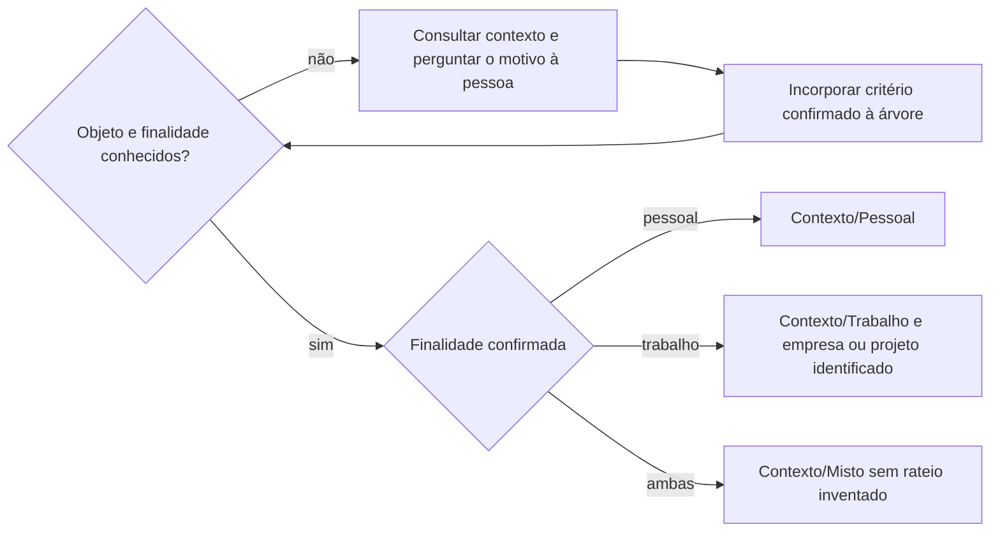
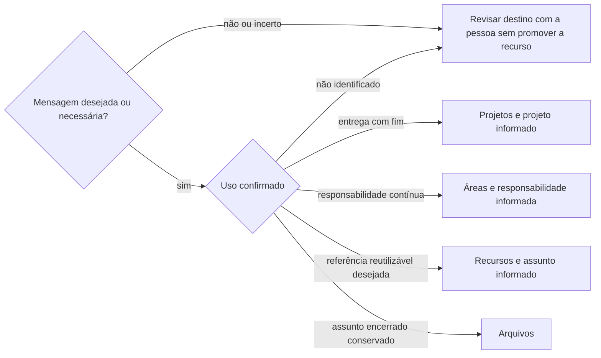
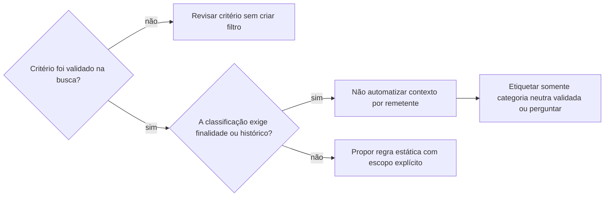

# Organizar e-mails

## Parâmetros de configuração

Leia os valores nas instruções do projeto, na entrada desta habilidade. Na ausência, use os padrões abaixo.

```yaml
"Contas": []
"Comunicações indesejadas": []
"Etiqueta de segurança": "Áreas/Segurança digital"
"Modo de aprendizado": "perguntar"
```

## Instruções

### Passo 1

Confirme a conta solicitada e suas permissões. Leia as etiquetas e os filtros existentes antes de propor uma estrutura ou escrever. Consulte a finalidade desejada em `Contas`, sem tratar essa intenção como classificação do histórico. Não troque por outra conta conectada. Siga `procurar-email` para recuperar e ler as mensagens, e retome aqui a organização.

### Passo 2

Use uma amostra descrita com transparência: mensagens recentes não são sorteio nem representam a caixa inteira. Apresente os casos à pessoa separadamente, com assunto, remetente, data, resumo mínimo e link. Pergunte a classificação e o motivo; incorpore o critério à árvore antes de seguir. Não substitua esse aprendizado por perguntas genéricas sobre todos os remetentes.

Não copie corpo integral, documento, placa, código, valor financeiro ou link com token para a habilidade ou para o repositório. Conserve a evidência na conta de origem. Diferencie hipótese, resposta da pessoa e ação executada. Leia todas as mensagens de uma conversa antes de uma ação no nível da conversa. Separe eventos diferentes: reconhecer uma autorização não reconhece outro login reunido no mesmo assunto.

### Passo 3

Identifique o objeto real da mensagem. Em segurança, leia qual conta é protegida: a caixa pode receber cópia por recuperação de outra conta. Em finanças, diferencie comprovante de pagamento de cobrança, e a data da mensagem da data da despesa. Um comprovante quita os itens descritos, não demonstra ausência de outras pendências nem saldo atual.

Preserve uma classificação explicitamente confirmada para aquele caso e seu motivo; não faça a mesma pergunta novamente só porque o aplicativo também serve ao trabalho. Diferencie essa confirmação de uma intenção geral para a caixa. Contexto pessoal ou profissional não atesta a legitimidade de um login. Etiquetar segurança não exige que a pessoa já tenha reconhecido todos os eventos.

Use a finalidade original da viagem, compra ou obrigação. A separação financeira atual não transforma uma dívida histórica mista em pessoal. Uma intenção de abrir conta PJ não é conta criada. O remetente e a titularidade PF/PJ, isoladamente, não determinam o uso.



### Passo 4

Mantenha contexto e destino PARA como eixos independentes de BASB. Preserve etiquetas válidas; não transforme toda newsletter em referência. Consulte `Comunicações indesejadas` para reconhecer assinaturas que a pessoa já rejeitou, sem repetir cancelamento ou criar bloqueio por esse relato sozinho.



Use `Etiqueta de segurança` para alertas de conta. Etiquetar não valida a autenticidade do remetente nem reconhece um acesso. Para mensagens que chegam à entrada, não retire o alerta antes de a pessoa vê-lo, e preserve a leitura. Não devolva mensagens antigas já arquivadas à entrada nem redefina leitura por suposição. A leitura pelo agente ou a marca de lido não prova leitura humana. O arquivamento posterior pela pessoa conserva a mensagem para investigação; não crie promessa de arquivamento automático após leitura. Arquivar no Gmail retira da entrada e não muda, por si só, a classificação PARA para Arquivos.

### Passo 5

Teste cada critério de filtro na conta exata e examine também correspondências inesperadas. Separe o que é regra estática do que depende de contexto.



Para segurança, mantenha a etiqueta temática independente do contexto da conta protegida. Não encaminhe e-mails entre contas para resolver a classificação. Não use a categoria automática de promoções como autorização para esconder avisos financeiros. Confirme a capacidade real da integração; uma proposta não é filtro instalado, e filtro de entrada não observa uma leitura futura.

### Passo 6

Antes de alterações em lote ou de filtros, grave um plano estruturado com conta, evidência, classificação, critérios, etiquetas, mensagens atingidas, efeito futuro e preservação de leitura e entrada. Valide contra a mensagem, a resposta da pessoa e os filtros existentes. Execute apenas ações autorizadas; mantenha os casos não resolvidos fora do lote.

Reutilize etiquetas existentes pelo nome e pelo identificador retornado. Crie somente as necessárias. Use os identificadores opacos completos das conversas na conta correspondente. Não aplique um filtro novo ao histórico inteiro sem escopo autorizado. Um piloto em uma conversa não autoriza outras da mesma instituição.

### Passo 7

Leia o filtro criado e a conversa alterada. Confira etiquetas, conta e permanência na entrada; preserve o estado de leitura anterior. Não deduza o nome de uma etiqueta a partir de identificadores diferentes. Registre separadamente o filtro armazenado, as etiquetas verificadas na conversa atual e a aplicação automática futura. Sem correspondência fornecida pela integração entre o identificador interno e o nativo, declare a validação do nome no filtro limitada. Uma conversa antiga sem etiqueta não testa um filtro criado depois. Relate o que foi aplicado, o que continua proposto e quais decisões faltam. Sem fonte oficial atual, não declare pendência financeira, de veículo ou de habilitação regularizada.

Checklist de conclusão:
- [ ] Conta, permissões, etiquetas e filtros conferidos.
- [ ] Critérios aprendidos com os casos e motivos da pessoa.
- [ ] Contexto separado do destino PARA e das datas da obrigação.
- [ ] Plano validado antes das alterações autorizadas.
- [ ] Resultado lido de volta, sem arquivamento ou leitura indevidos.

### Passo 8

Ao terminar, siga `evoluir-habilidade` conforme `Modo de aprendizado`.

## Problemas comuns

### Filtro esconde a exceção

Se você encontrar uma cópia de segurança sobre outra conta entre os resultados, a caixa de chegada não basta para definir o contexto.

1. Leia a conta protegida no corpo.
2. Mantenha a etiqueta temática neutra no filtro.
3. Classifique pessoal ou trabalho apenas com contexto confirmado.

### Critério sem finalidade

Se você classificar um banco ou uma concessionária inteira como pessoal, a próxima obrigação de trabalho recebe o contexto errado.

1. Volte à obrigação ou viagem da mensagem analisada.
2. Pergunte o motivo que sustenta a classificação.
3. Tire a generalização do filtro e preserve a decisão apenas no caso confirmado.

## Exemplos de entrada e saída

Estes exemplos ilustram fatos. Eles podem não estar no data source.

### Comprovante de pedágio de uma viagem confirmada como pessoal

A conversa recebe contexto pessoal. O critério é a viagem; não nasce um filtro pessoal para toda mensagem da concessionária. O comprovante não é apresentado como cobrança ainda aberta.

### Empréstimo usado para despesas pessoais e da empresa antes da separação financeira

A obrigação continua mista. A intenção de contratar pela PJ no futuro não muda o histórico nem autoriza ratear valores.

### Alerta de segurança cuja pessoa pede etiqueta e revisão antes de arquivar

A conversa recebe a etiqueta de segurança e permanece na entrada, sem mudança de leitura. A pessoa pode arquivar após ler; o agente não promete observar esse momento automaticamente.

## Casos-limite

- Uma conversa mistura finalidades: conserve o contexto misto sem repartir valores sem fonte.
- A busca traz resultados fora da amostra: não os altere só por terem aparecido.
- A assinatura já foi cancelada: o relato não autoriza apagar mensagens antigas nem bloquear todo o domínio.

## Pegadinhas

- A caixa pessoal pode ser recuperação de conta de trabalho; um alerta recebido nela pode proteger outra identidade.
- A data do comprovante pode ser posterior à viagem, inclusive em outro ano.
- A consulta pode devolver a mensagem já lida antes de qualquer ação do agente; não atribua essa leitura à pessoa nem a desfaça por suposição.
- A ferramenta de etiqueta e a leitura do filtro podem mostrar identificadores distintos; a lista disponível pode não expor a correspondência necessária para verificar o nome no filtro.
- Criar um filtro não classifica retroativamente todas as conversas nem agenda uma ação depois que alguém lê.

## Scripts disponíveis

- Nenhum.

1. Não há script para executar.
