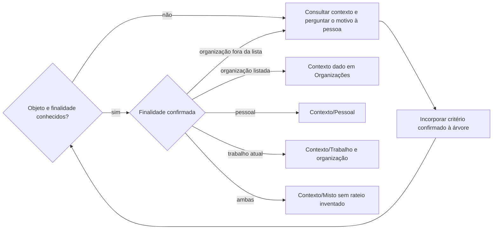
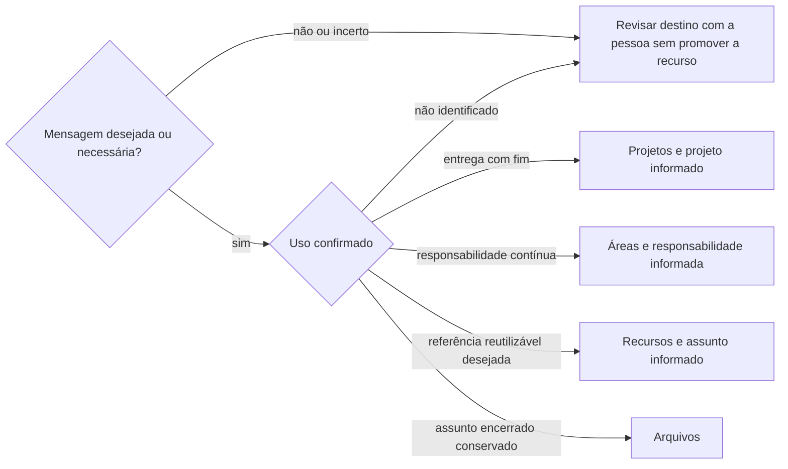
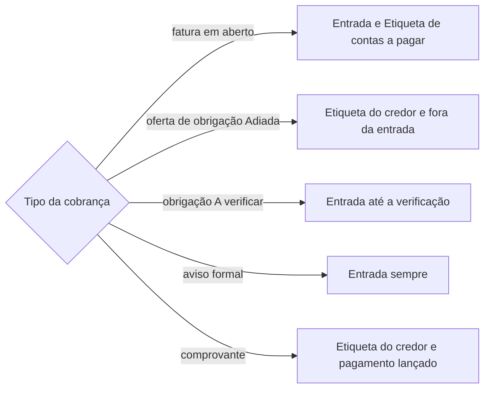
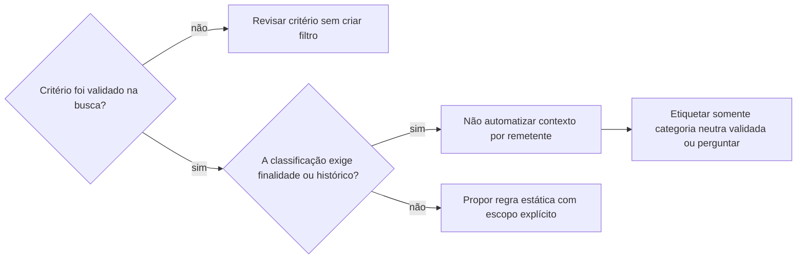
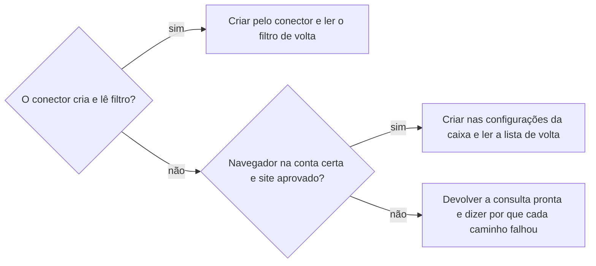

# Organizar e-mails

## Parâmetros de configuração

Leia os valores nas instruções do projeto, na entrada desta habilidade. Na ausência, use os padrões abaixo.

```yaml
"Contas": []
"Contextos":
  - "Pessoal"
  - "Trabalho"
  - "Misto"
"Organizações": []
"Comunicações indesejadas": []
"Pasta de segurança por ferramenta": "Recursos/{ferramenta}/Segurança"
"Destino de confirmações automáticas": "Arquivos/{tipo}"
"Etiqueta de contas a pagar": "Áreas/Finanças/A pagar"
"Etiqueta de contas pagas": "Áreas/Finanças/Pago"
"Termos de aviso formal":
  - "protesto"
  - "negativação"
  - "negativado"
  - "ação judicial"
  - "citação"
  - "execução"
"Consulta de e-mails sem etiqueta": "has:nouserlabels"
"Aplicar filtro ao histórico": "sim"
"Ler o assunto de todas as conversas antes de arquivar um lote": "sim"
"Etiquetar também mensagem enviada do mesmo tema": "sim"
"Caminhos para criar filtro":
  - "conector"
  - "navegador"
  - "devolver a consulta"
"Navegador para criar filtro": "navegador conectado, na conta da caixa"
"Navegador do aplicativo para criar filtro": "só se a pessoa pedir"
"Árvore de decisão": ""
"Ordem de avaliação da árvore": "de cima para baixo"
"Critério de parada da árvore": "a primeira pergunta que bater decide"
"Quando nenhuma pergunta da árvore bate": "perguntar à pessoa"
"Registrar a regra nova na árvore": "sim"
"Modo de aprendizado": "perguntar"
```

## Instruções

### Passo 1

Confirme a conta solicitada e suas permissões. Leia as etiquetas e os filtros existentes antes de propor uma estrutura ou escrever. Consulte a finalidade desejada em `Contas`, sem tratar essa intenção como classificação do histórico. Não troque por outra conta conectada. Siga `procurar-email` para recuperar e ler as mensagens, e retome aqui a organização.

### Passo 2

Use uma amostra descrita com transparência: mensagens recentes não são sorteio nem representam a caixa inteira. Apresente os casos à pessoa separadamente, com assunto, remetente, data, resumo mínimo e link. Pergunte a classificação e o motivo; incorpore o critério à árvore antes de seguir. Não substitua esse aprendizado por perguntas genéricas sobre todos os remetentes.

Não copie corpo integral, documento, placa, código, valor financeiro ou link com token para a habilidade ou para o repositório. Conserve a evidência na conta de origem. Diferencie hipótese, resposta da pessoa e ação executada. Leia todas as mensagens de uma conversa antes de uma ação no nível da conversa. Separe eventos diferentes: reconhecer uma autorização não reconhece outro login reunido no mesmo assunto.

### Passo 3

Identifique o objeto real da mensagem. Em segurança, leia qual conta é protegida: a caixa pode receber cópia por recuperação de outra conta. Em finanças, diferencie comprovante de pagamento de cobrança, e a data da mensagem da data da despesa. Um comprovante quita os itens descritos, não demonstra ausência de outras pendências nem saldo atual.

Preserve uma classificação explicitamente confirmada para aquele caso e seu motivo; não faça a mesma pergunta novamente só porque o aplicativo também serve ao trabalho. Diferencie essa confirmação de uma intenção geral para a caixa. Contexto pessoal ou profissional não atesta a legitimidade de um login. Etiquetar segurança não exige que a pessoa já tenha reconhecido todos os eventos.

Use a finalidade original da viagem, compra ou obrigação. A separação financeira atual não transforma uma dívida histórica mista em pessoal. Uma intenção de abrir conta PJ não é conta criada. O remetente e a titularidade PF/PJ, isoladamente, não determinam o uso.

O contexto é um dos `Contextos`. `Organizações` diz o contexto de cada organização. `Trabalho` é só o trabalho atual: atividade profissional antiga ou parada recebe o contexto que `Organizações` dá a ela. Uma organização ausente de `Organizações` não vira `Trabalho` por padrão; pergunte. A finalidade de uma caixa em `Contas` também não decide o contexto da mensagem.



Com `Árvore de decisão` definida, percorra-a antes de perguntar, na `Ordem de avaliação da árvore`: o `Critério de parada da árvore` diz qual pergunta decide. Quando nenhuma pergunta bate, siga `Quando nenhuma pergunta da árvore bate`. Com `Registrar a regra nova na árvore` em `sim`, acrescente na árvore a regra que a pessoa confirmou, no mesmo arquivo, para o próximo caso igual não voltar a perguntar. Sem `Árvore de decisão`, a confirmação vale só para aquele caso.

### Passo 4

Mantenha contexto e destino PARA como eixos independentes de BASB. Preserve etiquetas válidas; não transforme toda newsletter em referência. Consulte `Comunicações indesejadas` para reconhecer assinaturas que a pessoa já rejeitou, sem repetir cancelamento ou criar bloqueio por esse relato sozinho.

Confirmação automática sem ação pendente, como descadastro ou inscrição em lista, vai para `Destino de confirmações automáticas`, com o tipo no lugar de `{tipo}`, no plural: `Arquivos/Descadastros`. Não pergunte se vale conservá-la. Pergunte o contexto só quando a resposta mudar o que a pessoa faz depois.

Com `Etiquetar também mensagem enviada do mesmo tema` em `sim`, a mensagem que a própria pessoa enviou sobre o tema recebe a mesma etiqueta do tema, sem mudar entrada nem leitura.



Alerta de segurança de uma ferramenta vai para a pasta dela, dada por `Pasta de segurança por ferramenta`, com o nome da ferramenta no lugar de `{ferramenta}`: `Recursos/Editor de planilhas/Segurança`. Cada ferramenta tem a própria pasta, em vez de uma etiqueta única de segurança. Etiquetar não valida a autenticidade do remetente nem reconhece um acesso. Para mensagens que chegam à entrada, não retire o alerta antes de a pessoa vê-lo, e preserve a leitura. Não devolva mensagens antigas já arquivadas à entrada nem redefina leitura por suposição. A leitura pelo agente ou a marca de lido não prova leitura humana. O arquivamento posterior pela pessoa conserva a mensagem para investigação; não crie promessa de arquivamento automático após leitura. Arquivar no Gmail retira da entrada e não muda, por si só, a classificação PARA para Arquivos.

### Passo 5

Cobrança é mensagem de um credor ou de uma empresa que cobra em nome dele. Procure a obrigação pelo remetente na lista de obrigações do mapeamento de dados do projeto. Sem obrigação cadastrada, proponha o cadastro por `definir-obrigacao-financeira`. Leia o corpo para saber o tipo: fatura com vencimento, oferta de negociação, aviso formal ou comprovante. Assunto como "seu CPF foi notificado" não prova aviso formal. Aviso formal é protesto, negativação ou ação judicial já tomada, e contém um dos `Termos de aviso formal`.



Fatura em aberto recebe `Etiqueta de contas a pagar` e fica na entrada. A resposta diz o vencimento e o valor. Sem o valor, como num PDF protegido por senha, diga que falta e onde a pessoa o encontra. Ofereça lançar a fatura por `lancar-despesa-pessoal` ou `lancar-despesa-da-empresa`, conforme o contexto da obrigação. Quando o pagamento estiver lançado com comprovante, a conversa da fatura perde `Etiqueta de contas a pagar` e recebe `Etiqueta de contas pagas`, mantendo a etiqueta do credor. Segundo boleto da mesma parcela, reemitido com outro valor ou vencimento, recebe a mesma troca quando a parcela é quitada por um deles; diga qual foi pago, para não pagar em dobro. Filtro que tira oferta de negociação da entrada usa só remetentes que, na amostra, enviaram apenas ofertas, e exclui os `Termos de aviso formal`. Não esconda cobrança de obrigação `A verificar`. Empresa de cobrança não confirma a dívida: não use os links nem os boletos dela.

Empresa de cobrança recebe a própria etiqueta, porque pode cobrar por vários credores. A etiqueta do credor só entra quando o corpo o identifica. Essa é a regra da classificação: o filtro combina o remetente com o nome do credor em qualquer parte da mensagem, porque não busca só no corpo. Mensagem sem credor identificado fica com a etiqueta da empresa e na entrada. Assunto alarmante, como interdição, bloqueio, CPF sob impedimento ou valor retido, só vira aviso formal se o corpo descrever a medida já tomada; a pessoa confere a medida real no banco, no cadastro de proteção ao crédito, no relatório oficial de dívidas e na consulta processual. "Pagamento aprovado" ou "parcela vence hoje" de uma plataforma de negociação não é pagamento nem parcela de acordo.

### Passo 6

Teste cada critério de filtro na conta exata e examine também correspondências inesperadas. Separe o que é regra estática do que depende de contexto.



Para segurança, mantenha a etiqueta temática independente do contexto da conta protegida. Não encaminhe e-mails entre contas para resolver a classificação. Não use a categoria automática de promoções como autorização para esconder avisos financeiros. Filtro de entrada não observa uma leitura futura.

Para criar o filtro, tente os `Caminhos para criar filtro` na ordem e registre qual funcionou. Confirme a capacidade real de cada caminho antes de prometer o filtro: uma proposta não é filtro instalado.



Use o `Navegador para criar filtro`; o `Navegador do aplicativo para criar filtro` diz quando o navegador do próprio aplicativo entra. No navegador, confirme que a conta é a de `Contas` antes de salvar e peça a aprovação do site quando ela ainda não existir. A consulta devolvida traz o critério, a etiqueta e as ações do plano: pular a entrada e marcar como lido, quando o plano manda.

### Passo 7

Antes de alterações em lote ou de filtros, grave um plano estruturado com conta, evidência, classificação, critérios, etiquetas, mensagens atingidas, efeito futuro e preservação de leitura e entrada. Valide contra a mensagem, a resposta da pessoa e os filtros existentes. Execute apenas ações autorizadas; mantenha os casos não resolvidos fora do lote de ações, sem arquivar nem marcar como lido, e apresente cada um à pessoa com a pergunta. Toda conversa que a habilidade processa recebe ao menos uma etiqueta de usuário, mesmo a arquivada ou a de confirmação automática: nenhuma sai sem etiqueta.

Reutilize etiquetas existentes pelo nome e pelo identificador retornado. Crie somente as necessárias. Use os identificadores opacos completos das conversas na conta correspondente. Com `Aplicar filtro ao histórico` em `sim`, o filtro novo vale também para as conversas antigas que ele atinge; com `não`, vale só para as próximas mensagens. Antes de arquivar ou marcar como lido um lote, e antes de aplicar ao histórico, leia o assunto de todas as conversas atingidas quando `Ler o assunto de todas as conversas antes de arquivar um lote` for `sim`: remetente igual não prova assunto igual, e o que não for do tipo confirmado fica fora do lote. Um piloto em uma conversa não autoriza outras da mesma instituição.

### Passo 8

Leia o filtro criado e a conversa alterada. Confira etiquetas, conta e permanência na entrada; preserve o estado de leitura anterior. Não deduza o nome de uma etiqueta a partir de identificadores diferentes. Registre separadamente o caminho que criou o filtro, ou que nenhum criou, o filtro armazenado, as etiquetas verificadas na conversa atual e a aplicação automática futura. Sem correspondência fornecida pela integração entre o identificador interno e o nativo, declare a validação do nome no filtro limitada. Uma conversa antiga sem etiqueta não testa um filtro criado depois. Uma ação em lote pode ser aplicada só em parte: compare a leitura de volta com o plano, refaça apenas o que faltou e leia de novo. Conversa que saiu da entrada entre a alteração e a leitura de volta pode ter sido arquivada pela pessoa, que usa a caixa ao mesmo tempo: pergunte antes de devolvê-la. Relate o que foi aplicado, cada chamada que falhou e como foi resolvida, o que continua proposto e quais decisões faltam. Sem fonte oficial atual, não declare pendência financeira, de veículo ou de habilitação regularizada.

Antes de relatar, rode a `Consulta de e-mails sem etiqueta` na conta. Ela só pode trazer conversas que a pessoa ainda não decidiu, e cada uma aparece na resposta com a pergunta. Conversa que a habilidade processou e aparece nessa consulta volta ao plano para receber etiqueta.

Checklist de conclusão:
- [ ] Conta, permissões, etiquetas e filtros conferidos.
- [ ] Critérios aprendidos com os casos e motivos da pessoa.
- [ ] Contexto separado do destino PARA e das datas da obrigação.
- [ ] Plano validado antes das alterações autorizadas.
- [ ] Resultado lido de volta, sem arquivamento ou leitura indevidos.
- [ ] Nenhuma conversa processada sem etiqueta de usuário, conferido na `Consulta de e-mails sem etiqueta`.

### Passo 9

Ao terminar, siga `evoluir-habilidade` conforme `Modo de aprendizado`.

## Problemas comuns

### Filtro esconde a exceção

Se você encontrar uma cópia de segurança sobre outra conta entre os resultados, a caixa de chegada não basta para definir o contexto.

1. Leia a conta protegida no corpo.
2. Mantenha a etiqueta temática neutra no filtro.
3. Classifique pessoal ou trabalho apenas com contexto confirmado.

### Critério sem finalidade

Se você classificar um banco ou uma concessionária inteira como pessoal, a próxima obrigação de trabalho recebe o contexto errado.

1. Volte à obrigação ou viagem da mensagem analisada.
2. Pergunte o motivo que sustenta a classificação.
3. Tire a generalização do filtro e preserve a decisão apenas no caso confirmado.

### Conversa processada sem etiqueta

Se você arquivar ou marcar como lida uma conversa e não etiquetar, ela some da entrada e da organização, e só uma busca por conversas sem etiqueta a acha.

1. Etiquete toda conversa que processar, também a de confirmação automática, com o destino que a árvore ou `Destino de confirmações automáticas` manda.
2. Rode a `Consulta de e-mails sem etiqueta` antes de relatar.
3. Conversa que a consulta traz e que você não decidiu fica fora do lote e vai à pessoa com a pergunta.

### Atividade antiga como trabalho

Se você classificar como `Trabalho` uma mensagem de atividade profissional antiga, o trabalho atual se mistura com o histórico.

1. Leia o contexto da organização em `Organizações`.
2. Organização fora da lista: pergunte, sem presumir `Trabalho`.
3. Registre a correção da pessoa como critério do caso.

## Exemplos de entrada e saída

Estes exemplos ilustram fatos. Eles podem não estar no data source.

### Comprovante de pedágio de uma viagem confirmada como pessoal

A conversa recebe contexto pessoal. O critério é a viagem; não nasce um filtro pessoal para toda mensagem da concessionária. O comprovante não é apresentado como cobrança ainda aberta.

### Empréstimo usado para despesas pessoais e da empresa antes da separação financeira

A obrigação continua mista. A intenção de contratar pela PJ no futuro não muda o histórico nem autoriza ratear valores.

### Alerta de segurança cuja pessoa pede etiqueta e revisão antes de arquivar

A conversa recebe a etiqueta de segurança da ferramenta e permanece na entrada, sem mudança de leitura. A pessoa pode arquivar após ler; o agente não promete observar esse momento automaticamente.

### Confirmação de descadastro de um software que a pessoa buscava para um escritório que já fechou

O contexto é o que `Organizações` dá ao antigo escritório, não `Trabalho`. O destino é `Arquivos/Descadastros`, sem perguntar se vale conservar. O descadastro não é repetido.

### Fatura de uma parcela do consórcio do carro pessoal, com o PDF anexo

A fatura fica na entrada com a etiqueta de contas a pagar e a etiqueta do credor. A resposta diz o vencimento, o valor e a parcela, e oferece lançar a despesa ligada à obrigação. "Recibo do pagador" no boleto não vira comprovante.

### Ofertas de negociação de uma dívida que a pessoa adiou

As ofertas recebem a etiqueta do credor e saem da entrada por filtro dos remetentes que só enviaram ofertas. O filtro exclui os termos de aviso formal, que continuam na entrada.

## Casos-limite

- Uma conversa mistura finalidades: conserve o contexto misto sem repartir valores sem fonte.
- A busca traz resultados fora da amostra: não os altere só por terem aparecido.
- A assinatura já foi cancelada: o relato não autoriza apagar mensagens antigas nem bloquear todo o domínio.

## Pegadinhas

- A caixa pessoal pode ser recuperação de conta de trabalho; um alerta recebido nela pode proteger outra identidade.
- A data do comprovante pode ser posterior à viagem, inclusive em outro ano.
- A consulta pode devolver a mensagem já lida antes de qualquer ação do agente; não atribua essa leitura à pessoa nem a desfaça por suposição.
- A ferramenta de etiqueta e a leitura do filtro podem mostrar identificadores distintos; a lista disponível pode não expor a correspondência necessária para verificar o nome no filtro.
- Criar um filtro não classifica retroativamente todas as conversas nem agenda uma ação depois que alguém lê.
- Uma caixa de uma atividade antiga pode ter finalidade de trabalho em `Contas` e, mesmo assim, não ser o trabalho atual. `Organizações` decide o contexto.
- Empresa de cobrança escreve em nome do credor com assunto alarmante, como "seu CPF foi notificado", e o corpo traz só uma proposta de acordo.
- Uma fatura de cartão no rotativo pode ter pagamento mínimo igual ao total.
- A ação em lote e a criação de filtro podem falhar só em parte e devolver sucesso no conjunto. A leitura de volta mostra o que faltou.
- O filtro do Gmail busca no texto todo, não só no corpo, e aplica uma etiqueta de usuário por filtro: uma regra com duas etiquetas vira dois filtros com o mesmo critério.
- A `Consulta de e-mails sem etiqueta` pode voltar vazia no conector do Gmail e mostrar conversas no navegador. Zero no conector não prova que não há conversa sem etiqueta: repita a busca no navegador, na conta de `Contas`.
- A contagem do navegador pode ser de mensagens e não de conversas, e o contador da barra lateral pode não ser esse número. Conte as linhas listadas.

## Scripts disponíveis

- Nenhum.

1. Não há script para executar.
