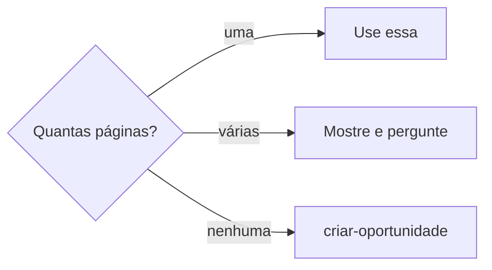
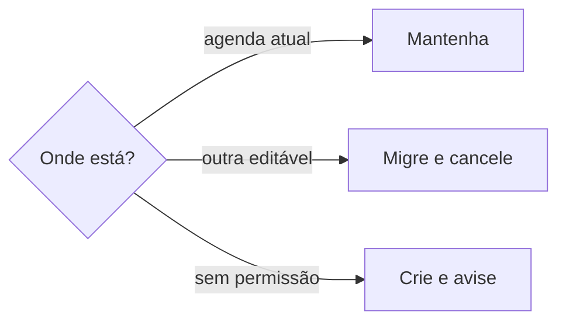
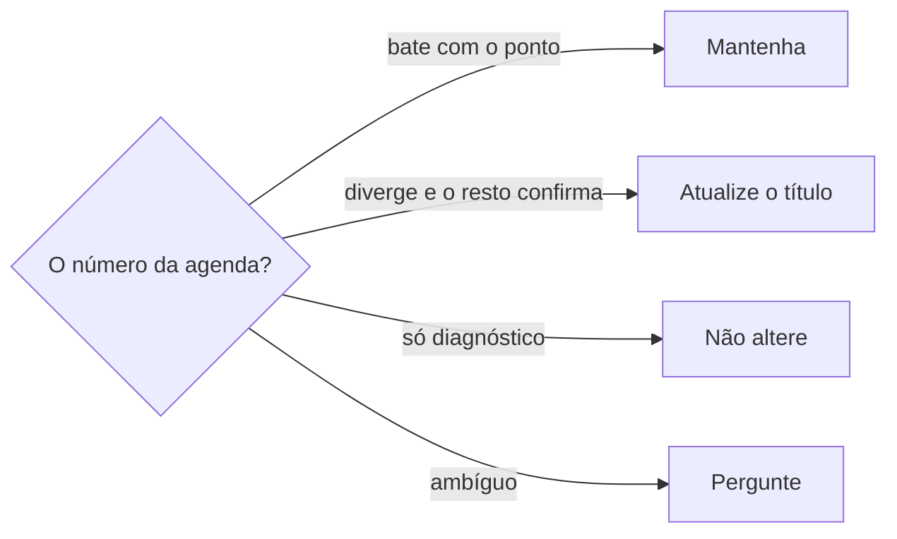
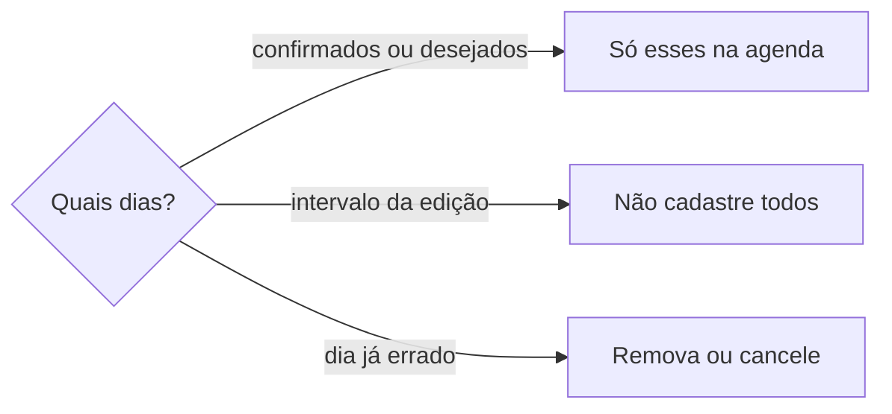
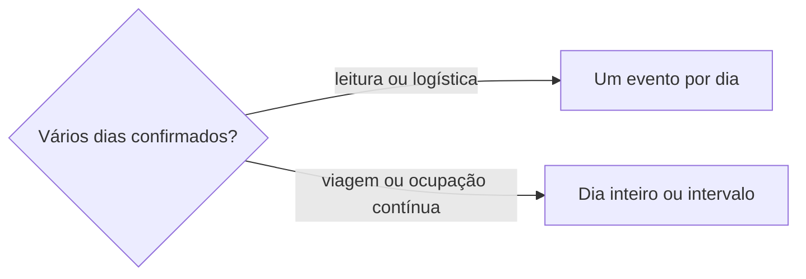

# Organizar ponto de contato

## Parâmetros de configuração

Leia cada valor nas instruções do projeto: primeiro na entrada com o nome desta habilidade, depois na entrada `Global` ou no primeiro nível do bloco. Quando um valor não estiver lá, use o padrão abaixo.
```yaml
"Formato da data com dia da semana": "terça-feira, 01/09/2026"
# `Agendas` lista cada agenda pelo `"Nome"` e, quando houver, pelo `"ID"`, com o `"Uso"`: `padrão` recebe o evento novo; `em uso` é lida e gravada quando o pedido a nomeia; `só leitura` é lida e nunca gravada; `aposentada` é um produto que não se usa mais, lido só para achar o evento que ficou lá; `ignorada` não é lida nem gravada, mesmo que exista ou que o histórico a cite. `"Finalidade"`, quando houver, diz o tipo de evento que vai para aquela agenda. Case a agenda pelo ID; sem ID, pelo nome do calendário, que contém o nome da lista. Sem agenda `padrão` na lista, a agenda padrão é a principal da conta. A agenda do ponto de contato é a de `Agendas` com a finalidade pontos de contato. Sem ela, é a agenda padrão.
"Agendas": []
```
## Instruções

### Passo 1

As listas e o nome de cada propriedade vêm do mapeamento de dados do projeto. O trabalho é planejar e organizar o ponto de contato físico da empresa, inclusive a pop-up store. Uma feira entra quando é a execução real da participação. Organizar a viagem segue `definir-viagem`. Reunião ou resenha com uma organização não é este trabalho: pare e siga `definir-agenda`, porque isso é negócio. A oportunidade aprovada sem os dias em que a empresa participa não vira ponto de contato na agenda. Pergunte esses dias. Não invente. A gravação na agenda fica com `definir-agenda`, no destino do Passo 7.
Peça o que será organizado, ou o lembrete que já cita esse ponto ou uma oportunidade. Se a pessoa passou o link, essa é a página. Se a lista não vier, as listas são a lista de pontos de contato e a lista de oportunidades, no workspace conectado. Se uma delas não estiver nessa conexão, pare. Não use a lista de outro workspace. O texto, o prazo e a definição de concluído da tarefa ficam com `definir-tarefa`.

### Passo 2

Busque o nome que a pessoa disse nas duas listas, pelo pedaço, em consulta direta e em busca semântica. Não exija o nome inteiro. Não busque no workspace inteiro. Uma variação em Variações de nome conta como a mesma oportunidade. Pergunta só de existência fica com `procurar-oportunidade`.

### Passo 3



Não invente a página. Não crie outra com o mesmo nome.

Na tarefa, grave a lista de pontos de contato relacionados e a lista de oportunidades relacionadas. Não deixe as duas vazias quando o pedido nomeia o ponto. Não chame o lembrete de pronto com elas vazias.

No ponto de contato, a oportunidade cabe uma página. Na oportunidade, o mesmo vínculo é os pontos de contato da oportunidade. Não grave o ponto de contato nem a oportunidade no corpo da página.

Não preencha fórmula, rollup nem botão. Não copie o dia do lembrete para o início da execução, o fim da execução nem a data e hora. Sem data dita para o ponto de contato ou a oportunidade, pergunte. Não invente.

### Passo 4

Cadastrar a oportunidade fica com `criar-oportunidade`. Não crie a página aqui.

Ao criar um ponto de contato, o título vai em Nome. O status começa em Não iniciada, salvo se a pessoa disser outro que a lista já tem.

Mostre o nome, o status e o link do que ligou. Não marque a tarefa como concluída.

### Passo 5

Se a pessoa perguntar o que falta organizar, não crie tarefa nessa passada. Abra o ponto de contato e a oportunidade do nome. Leia o status do ponto, a data e hora, as passagens compradas, as tarefas e ações e a lista de inscrições. Liste cada tarefa aberta com o que ainda está nela, e diga se os responsáveis ou Prazo está vazio. Separe o que a página já registra e ainda não tem tarefa vinculada. Não invente pendência. Use a data do evento para propor uma ordem. Não preencha responsável, prazo nem status. Não altere inscrição. Se a inscrição já está confirmada ou o ingresso já foi retirado, diga isso. Não diga que o evento inteiro está confirmado. A resposta não pede para nomear a habilidade nem fala de créditos.

### Passo 6

A data de evento, compromisso, prazo, viagem, reserva, lançamento, entrega ou outro marco, na resposta, no resumo, na tabela ou em outro texto, sai no formato da data com dia da semana. Calcule e confira o dia com a data, o horário e o fuso do evento antes de responder. Sem horário ou sem fuso, e se o dia puder mudar, peça. Não invente. Intervalo ou vários dias: o dia da semana em cada data. Se a fonte trouxer um dia da semana incompatível com a data, sinalize a divergência. Não copie esse dia para o início da execução, o fim da execução nem a data e hora.

### Passo 7

Criar, recriar, migrar ou revisar o evento deste ponto usa a agenda do ponto de contato, a agenda em que há permissão efetiva de escrita. Não use a agenda ignorada como destino nem como referência operacional. Se o histórico, uma descrição antiga ou um resultado de agenda citar essa agenda ignorada, ignore-a e use a agenda do ponto de contato.
Crie ou mantenha o evento nessa agenda. Na descrição, registre que o evento pertence ao escopo de Pontos de contato e inclua o link da página canônica no Notion.



O evento deste ponto em outra agenda editável: migre para a agenda do ponto de contato e cancele ou remova o antigo quando houver permissão. Sem permissão para editar o antigo: crie o equivalente na agenda do ponto de contato e avise que a remoção do duplicado antigo é manual. A gravação continua com `definir-agenda`, neste destino.

### Passo 8

Pop-up, corner, feira, evento comercial ou ativação ligados a um ponto de contato físico usam Pontos de contato como fonte da ordenação e da numeração. A ordem é a que a página já tem na ordem visual. O número é o que o Nome do ponto já mostra. Não invente outro. Sem número na página, pare. Não crie a propriedade.



O título da agenda pode estar desatualizado, porque data e participação mudam sem correção manual do nome. Número diferente não torna os dois eventos distintos. Antes de decidir, cruze data, horário, nome da feira ou do evento, local, cidade, grupo de oportunidades, oportunidade relacionada e o contexto da descrição. Correspondência confirmada: atualize o título da agenda para a numeração canônica do ponto. A gravação segue `definir-agenda`. Pedido só de diagnóstico: explique e não altere. Correspondência ambígua: diga o que bate e o que diverge e peça confirmação antes de renomear, criar ou alterar.

### Passo 9

A oportunidade com mais de um dia entra na agenda só nos dias de participação confirmados ou desejados pela pessoa. O intervalo da edição não cadastra os outros dias. Se a pessoa disser que participa só num dia, a agenda mantém só esse dia. O evento já criado no dia errado: quando a pessoa corrigir, remova ou cancele o incorreto. A gravação e a remoção seguem `definir-agenda`.



### Passo 10

Mais de um dia confirmado da mesma oportunidade vira um evento por dia quando isso melhora a leitura, a busca, a logística ou a alteração. O título indica «Dia 1/2», «Dia 2/2» ou o equivalente. Compromisso contínuo de viagem ou ocupação de longa duração pode usar dia inteiro ou intervalo quando isso representa melhor a operação. Item com data e sem início e fim confirmados segue `sincronizar-cronograma`. A gravação segue `definir-agenda`.



## Problemas comuns

### Agenda dedicada

Se você gravar o ponto na agenda ignorada, ou deixar o evento antigo sem migração, o ponto fica fora da agenda editável.

1. Use a agenda do ponto de contato.
2. Em outra agenda editável, migre e cancele o antigo se houver permissão.
3. Sem permissão no antigo, crie na agenda editável e avise a remoção manual. Na descrição, registre o escopo Pontos de contato e a página canônica.

### Reunião que vira ponto

Se você tratar reunião ou resenha como ponto de contato, ou gravar a oportunidade aprovada na agenda sem os dias de participação, a execução nasce antes da participação real.

1. Reunião ou resenha segue `definir-agenda`, como negócio.
2. Sem os dias em que a empresa participa, pergunte.
3. Não invente os dias. Não grave o ponto na agenda.

### Edição inteira na agenda

Se você cadastrar todos os dias da edição porque a oportunidade tem intervalo, a agenda ganha dia em que a empresa não participa.

1. Crie ou mantenha só os dias confirmados ou desejados.
2. Não use o intervalo como lista de participação.
3. Dia já errado: quando a pessoa corrigir, remova ou cancele. A gravação segue `definir-agenda`.

### Vários dias num bloco só

Se você juntar dois dias confirmados de participação num intervalo, a busca e a alteração perdem o dia.

1. Prefira um evento por dia quando isso melhora leitura, busca, logística ou alteração.
2. O título indica «Dia 1/2», «Dia 2/2» ou o equivalente.
3. A viagem ou ocupação contínua pode usar dia inteiro ou intervalo quando isso representa melhor a operação.

### Relação vazia

Se você criar o lembrete e deixar a lista de pontos de contato relacionados ou a lista de oportunidades relacionadas vazias, a pessoa cadastra as duas à mão.

1. Pergunte as duas páginas quando o pedido nomear o ponto.
2. Grave nas propriedades. Não chame de pronto com elas vazias.

### Página repetida

Se você criar outro ponto de contato ou outra oportunidade com o mesmo nome, a lista ganha a edição duas vezes.

1. Busque o pedaço nas duas listas antes de criar.
2. Se já existe, use essa página.
3. Se houver várias, pergunte. Não invente.

### Data do lembrete

Se você copiar o dia do lembrete para o ponto de contato ou a oportunidade, a execução ganha a data da mala.

1. O dia do lembrete fica no Prazo da tarefa, com `definir-tarefa`.
2. O ponto de contato usa o início da execução e o fim da execução. A oportunidade usa a data e hora.
3. Sem essa data dita, pergunte. Não invente.

### Nome de propriedade

Se você gravar na lista de oportunidades, o vínculo não entra na lista.

1. Na tarefa, use a lista de oportunidades relacionadas e a lista de pontos de contato relacionados.
2. No ponto de contato, use a oportunidade, no singular.
3. Na oportunidade, use os pontos de contato da oportunidade.

### Número que parece outro evento

Se você tratar o número diferente no título da agenda como outro evento, ou renomear com a correspondência ambígua, a participação se parte ou o título muda sem confirmação.

1. Use a ordenação e a numeração que Pontos de contato já tem.
2. Cruze data, horário, nome, local, cidade, grupo, oportunidade e descrição antes de decidir.
3. Confirmado, atualize o título da agenda. Só diagnóstico: não altere. Ambíguo: pergunte antes de renomear, criar ou alterar.

### Relatório que cria

Se você criar as tarefas que faltam quando a pessoa só perguntou o que falta, a lista ganha item sem aceite.

1. Liste as tarefas abertas e o que ainda não tem tarefa.
2. Não crie nessa passada.
3. Não invente pendência que a página não registra.

### Pedido para nomear

Se você fechar pedindo para mencionar a habilidade na próxima vez, a pessoa recebe um aviso que não pediu.

1. Feche com as pendências e a ordem.
2. Não peça para nomear a habilidade.
3. Não fale de créditos.

### Data sem o dia da semana

Se você escrever a data numérica sem o dia da semana, ou repetir um dia da semana que não bate com a data, a pessoa lê o evento errado.

1. Calcule o dia com a data, o horário e o fuso.
2. Escreva no formato da data com dia da semana em cada data.
3. Se divergir, sinalize. Não copie o dia para o campo do ponto de contato nem da oportunidade.

## Exemplos de entrada e saída

Estes exemplos ilustram fatos. Eles podem não estar no data source.

### Adiciona um lembrete pra eu colocar na mala que vai para Minas Moda Autoral hoje o alfinete e o steamer para a gente finalizar a montagem hoje.

perguntei qual página da lista de pontos de contato e qual da lista de oportunidades. Não deixei as duas relações vazias. Não inventei a página. O texto e o prazo da tarefa ficam com `definir-tarefa`.

### organizar a pop-up e já existem duas páginas com o nome Minas Moda.

mostrei o nome e o link de cada uma e perguntei qual entra. Tratei as duas como ponto de contato. Não criei uma terceira.

### O que falta organizarmos para o festival?

abri o Pop-up #34 — Festival de Verão, em Pré-produção, e sábado, 17/10/2026. Listei as tarefas abertas, com responsável e prazo vazios quando estavam vazios, e separei o que ainda não tem tarefa. Não criei tarefa. Não pedi para nomear a habilidade.

### crie o evento do ponto de contato na agenda dedicada

Usei a agenda do ponto de contato. Não usei a agenda ignorada, mesmo citada no histórico. Na descrição, registrei o escopo Pontos de contato e a página canônica.

### o evento antigo está numa agenda que não consigo editar

Criei o equivalente na agenda do ponto de contato e avisei que a remoção do duplicado antigo é manual.

### a agenda está como Pop-up #30 e o ponto é o #34

Cruzei data, horário, feira, local, cidade, grupo, oportunidade e descrição. Bateu com Pop-up #34 — Festival de Verão. Atualizei o título da agenda para a numeração do ponto. Não tratei como outro evento.

### só me diga se o número da agenda está errado

O título da agenda divergia do número em Pontos de contato. Expliquei. Não alterei o evento.

### A empresa participa nos dois dias

Criei um evento por dia. Os títulos ficaram com «Dia 1/2» e «Dia 2/2». Não juntei os dois num intervalo.

### a ocupação é contínua

Usei o intervalo, porque a ocupação contínua representa melhor a operação do que um corte por dia.

### a pessoa só participa no domingo

A oportunidade dura mais de um dia. A agenda ficou só com o domingo. Não cadastrei os outros dias da edição.

### já tinha evento na sexta e a participação é no domingo

Removi o evento da sexta. A agenda manteve o domingo.

### a fonte diz segunda-feira, 01/09/2026

01/09/2026 é terça-feira. Sinalizei a divergência. Na resposta, usei o formato da data com dia da semana. Não copiei o dia para o campo do ponto de contato nem da oportunidade.

## Casos-limite

- A lista não está no workspace conectado: pare. Não use a lista de outro workspace.
- O pedido só nomeia o ponto e não diz a página: pergunte. Não crie com as relações vazias.
- Várias páginas com o mesmo pedaço: pergunte. Não escolha sozinho.
- Nenhuma página: não crie aqui. Cadastrar fica com `criar-oportunidade`.
- A pessoa não deu a data do ponto de contato nem da oportunidade: pergunte. O dia do lembrete não preenche esses campos.
- Grupo de oportunidade não veio: fica com `definir-grupo-de-oportunidades`. Não invente.
- A pergunta é o que falta: relate o que as páginas já registram. Não crie tarefa. Não peça para nomear a habilidade.
- O dia da semana da fonte não bate com a data: sinalize. Não grave esse dia no campo do ponto de contato nem da oportunidade.
- O pedido é organizar a viagem: siga `definir-viagem`.
- O pedido é reunião ou resenha com uma organização: pare e siga `definir-agenda`. Não crie o ponto de contato.
- A oportunidade aprovada sem os dias de participação da empresa: pergunte. Não grave o ponto na agenda. Não invente os dias.
- A oportunidade de vários dias e participação em parte deles: a agenda fica só com os dias confirmados ou desejados. Dia já errado: remova ou cancele quando a pessoa corrigir.
- Mais de um dia confirmado: um evento por dia, com «Dia 1/2» e «Dia 2/2» ou o equivalente. A viagem ou ocupação contínua pode usar dia inteiro ou intervalo.
- O evento de ponto de contato: use a agenda do ponto de contato. Ignore a agenda ignorada, mesmo citada no histórico. Em outra agenda editável, migre e cancele. Sem permissão no antigo, crie na atual e avise a remoção manual.
- O número do título da agenda diverge do ponto: Pontos de contato é a fonte. Não trate como outro evento só por isso. Ambíguo: pergunte. Só diagnóstico: não altere.

## Pegadinhas

- Feira parece o nome do trabalho. O trabalho é planejar e organizar o ponto de contato físico, inclusive a pop-up store. Feira entra quando é a participação real. A lista continua a lista de pontos de contato.
- O nome da feira numa reunião ou numa oportunidade aprovada parece este ponto. Reunião ou resenha é negócio. Sem os dias de participação, a oportunidade não vira ponto de contato na agenda.
- O intervalo da edição parece a lista de dias na agenda. A agenda fica só com os dias em que a empresa participa.
- Dois dias confirmados parecem um evento só. Um evento por dia facilita busca e alteração. O intervalo fica para viagem ou ocupação contínua.
- Organizar a viagem parece este trabalho. A viagem segue `definir-viagem`.
- Feira e ponto de contato parecem duas listas. São a mesma: A lista de pontos de contato. A lista de oportunidades é outra.
- A propriedade da tarefa parece se chamar a lista de oportunidades. O nome é a lista de oportunidades relacionadas.
- A oportunidade no ponto de contato cabe uma página. Várias parecem caber. Não cabem.
- O "hoje" do lembrete parece a data do ponto de contato. É o prazo da tarefa.
- A data numérica parece bastar. A resposta leva o dia da semana, calculado com a data, o horário e o fuso.
- Uma página com o nome parecido parece outro ponto. Busque o pedaço e as Variações de nome antes de criar.
- Fechar com "mencione a habilidade na próxima vez" parece cuidar dos créditos. A resposta não pede isso.
- A agenda ignorada parece destino porque o histórico ainda a cita. Ela não é referência operacional. O evento fica na agenda do ponto de contato.
- O número no título da agenda parece provar que é outro evento. A data e participação mudam sem correção manual do nome. A numeração canônica é a do ponto de contato.
- O endereço da agenda no meio do passo parece o lugar da edição. O valor mora no bloco `yaml` de `Parâmetros de configuração`.

## Scripts disponíveis

- Nenhum.

1. Não há script para executar.
