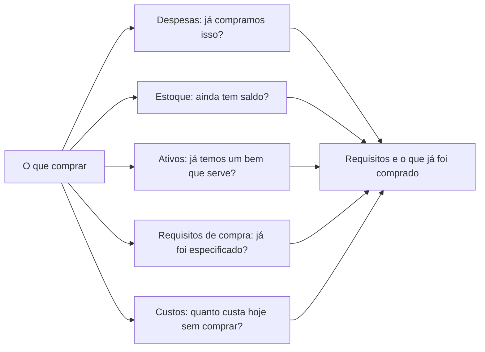
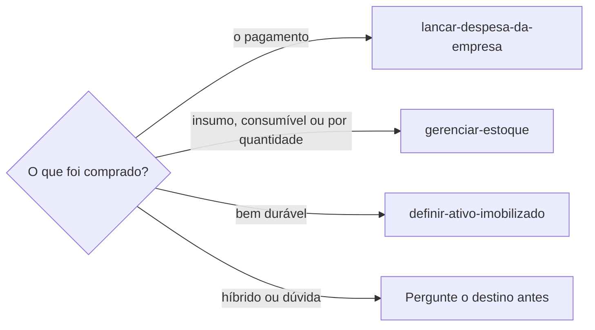

# Pesquisar compra

## Parâmetros de configuração

Leia cada valor nas instruções do projeto: primeiro na entrada com o nome desta habilidade, depois na entrada `Global` ou no primeiro nível do bloco. Quando um valor não estiver lá, use o padrão abaixo.

```yaml
# `Quantidade de opções` é quantas opções a resposta recomenda. Menos de duas não dá o que comparar.
"Quantidade de opções": 3
"Modo de aprendizado": "perguntar"
```

## Instruções

### Passo 1

Entenda o que a pessoa precisa comprar e para que vai usar. O uso decide os requisitos, e o requisito decide a opção.
Use o que a pessoa já disse. Pergunte, uma vez, só o que muda a recomendação: o uso, o orçamento, a voltagem ou o prazo.
Não pare numa pergunta que a pesquisa responde. Comece e leve a dúvida junto com as primeiras opções.

### Passo 2

Antes de pesquisar na web, veja o que já temos. Só leia, sem gravar nada.



A lista de despesas, a de estoque e a de ativos imobilizados vêm do mapeamento de dados do projeto.
Quando o projeto tem uma lista de requisitos de compra ou de custos de produção, leia as duas também.
O requisito já escrito evita perguntar de novo, e o custo de hoje, como um serviço de terceiro que a compra substitui, mostra em quanto tempo ela se paga. Siga `lancar-despesa-da-empresa`, `gerenciar-estoque` e `definir-ativo-imobilizado` para ler cada uma, e `identificar-duplicata` para o item que parece o mesmo com outro nome.
Leia também a viagem ativa ou a próxima, seguindo `definir-viagem`: onde a pessoa vai estar, em que dias e horas, e onde ficam os itens que ela precisa. A busca de empresas começa pelas dos lugares e dos horários em que a pessoa estará. Uma empresa de onde ela só volta depois do prazo fica para depois, e a resposta diz a cidade de cada empresa.
Se a lista não estiver no workspace conectado, diga qual faltou e siga com as outras. Não use a lista de outro workspace.
Um bem ou um saldo que já serve responde a pergunta: mostre o que achou e pergunte se a pessoa ainda quer comprar.
Uma compra anterior vale como fonte do requisito. O insumo que já foi comprado diz o que o equipamento precisa aguentar.
Não conclua onde o insumo está, nem se a pessoa o tem, por uma frase solta da conversa. Confira a compra anterior e o estoque e, na dúvida, pergunte antes de mudar o que se procura.
O comprovante da compra anterior diz o vendedor, como o recebedor do pagamento. Guarde o nome para o Passo 4.
Um insumo que está nas despesas e falta no estoque fica no fim da resposta, com a sugestão de `gerenciar-estoque`. Não grave.

### Passo 3

Escreva os requisitos antes das opções. Cada requisito diz de onde veio: do que a pessoa disse, de um registro nosso, da ficha técnica do fabricante ou de um anúncio.
O requisito que ninguém confirmou fica marcado como não confirmado. Não complete com o que o modelo supõe.

### Passo 4

Pesquise na web, uma busca por opção, e prefira nesta ordem: o fabricante, a loja que vende, o guia ou a avaliação.
Para o insumo já comprado, busque também a loja própria do vendedor pelo nome do Passo 2. Ela costuma abrir quando o marketplace bloqueia e traz a ficha.
Guia de melhores e página de afiliado indicam o que olhar, não provam compatibilidade.
Anote o preço com a loja e a data da consulta. O preço de uma busca ou de um cache pode ser antigo.
Diga quando o preço veio só do resultado da busca, sem a página aberta. Página esgotada não tem preço atual: diga que está esgotada.
A loja que bloqueia leitura automática não se contorna. Use o que a busca mostrou, diga que a página não abriu e peça que a pessoa cole a descrição ou o link, ou pergunte ao vendedor.

### Passo 5

Responda com `Quantidade de opções` opções, a recomendada primeiro. Para cada uma: o que atende, o que não está confirmado, o preço com fonte e data, e o link.
Diga também a opção descartada e o motivo, para a pessoa não pesquisar de novo.
Uma empresa só vale como descartada com a resposta dela. Sem resposta, diga que ela não foi contatada ou que está sem resposta, e liste quem foi contatada, quem respondeu e quem falta.
Com o custo de hoje do Passo 2, mostre a conta de quando a compra se paga e marque o que é estimativa.
Termine com a pergunta que ainda falta ao fabricante ou ao vendedor, quando houver, e com a decisão que cabe à pessoa.
Não compre, não ponha no carrinho e não preencha dado de pagamento.

### Passo 6

Cadastre na lista de empresas do mapeamento de dados do projeto cada empresa que apareceu como opção, recomendada ou descartada: a loja que vende, a gráfica, a prestadora do serviço. Não espere a pessoa decidir nem comprar. Assim a empresa se acha depois, sem pesquisar de novo.
Siga `definir-empresa`, que busca antes por nome, variações e CNPJ e reaproveita a empresa que já existe. Grave só o que a página da própria empresa mostrou, como contato, endereço, horário e CNPJ. O que ficou sem confirmação, como se ela atende o que a pessoa precisa, vai nas notas, não nos campos de contato.
Marketplace e loja grande entram como empresa quando o vendedor é a opção. O vendedor do anúncio é a empresa, não a plataforma.
Abra o site da empresa e leia os links da página, como WhatsApp, telefone e redes, antes de dizer que não achou o contato. O trecho que a busca mostrou não basta.
Antes de recomendar o contato com a empresa, veja se já houve conversa com ela, seguindo `conversar-no-whatsapp`. Diga o que o histórico já responde.
Quando a compra é um serviço de terceiro e nenhuma empresa achada atende, não responda que não há opção. Siga para a próxima: a da lista de empresas, a que um contato indicou, a da web. Cadastre cada uma, veja se há conversa e, sem conversa, prepare o primeiro contato pelo WhatsApp, com o texto pronto e o sim da pessoa. Só pare quando uma empresa confirmar que atende ou a pessoa mandar parar.
O primeiro contato é por mensagem, pelo WhatsApp, pelo e-mail ou pelo formulário da empresa, e sai em qualquer hora: a loja fechada não adia a mensagem. Ligação é o último recurso, só quando a empresa não tem canal de texto. Prepare a mensagem para cada empresa de uma vez e peça o sim da pessoa a todas.
A primeira mensagem já traz o que a empresa vai perguntar: o material, o formato, a quantidade e o prazo. Antes de enviar, confira nos registros o que já se sabe de cada um e pergunte à pessoa só o que falta, como a quantidade. A resposta da empresa não deve abrir uma segunda rodada de perguntas que a primeira mensagem já podia responder.
Quando a empresa responde, leia a resposta e responda com os fatos que já se sabe, sem pedir à pessoa o que a conversa já tem. Delegue a leitura e a resposta à habilidade de conversa. Só leve à pessoa a decisão que é dela: aceitar preço ou orçamento, pagar, combinar data e hora de retirada ou entrega, e passar dado pessoal ou fiscal. Nesses casos, diga as palavras da empresa e a opção que você recomenda.
Na resposta, leve o link da página de cada empresa cadastrada.

### Passo 7

O registro da compra só acontece depois que a pessoa disser que comprou.



Do registro da compra, esta habilidade não grava nada. Ela encaminha, e cada habilidade acima grava o que é dela.

### Passo 8

Ao terminar, siga `evoluir-habilidade` conforme `Modo de aprendizado`.

## Problemas comuns

### Pesquisa sem olhar o que já temos

Se você for direto à web, a resposta recomenda comprar algo que já está no estoque ou nos bens.

1. Leia despesas, estoque, ativos, requisitos de compra e custos pelo Passo 2.
2. Mostre o que já serve antes de qualquer opção.
3. Pergunte se a pessoa ainda quer comprar.

### Compatibilidade inventada

Se você disser que um modelo serve porque um guia o recomenda, a pessoa compra sem a confirmação que importava.

1. Marque o requisito como não confirmado.
2. Diga de onde veio cada afirmação.
3. Traga a pergunta que o fabricante ou o vendedor responde.

### Preço sem data

Se você citar o preço sem a loja e a data, a pessoa não sabe se ele ainda vale.

1. Anote a loja e a data da consulta.
2. Diga que o preço muda.
3. Prefira a página da loja ao resultado de uma busca.

### Loja que não abre

Se você tentar outro caminho depois que a loja bloqueia a leitura, a resposta passa a depender de uma página que ela não quis entregar.

1. Use o trecho que a busca mostrou.
2. Diga que a página não abriu.
3. Peça a descrição colada ou o link, ou a pergunta ao vendedor.

### Empresa pesquisada sem cadastro

Se você recomendar ou descartar uma empresa e não a cadastrar, na próxima busca ninguém a acha e a pessoa pesquisa de novo.

1. Cadastre cada empresa que apareceu como opção, pelo Passo 6.
2. Não espere a pessoa decidir nem comprar.
3. Leve o link da página na resposta.

### Contato dado como não achado

Se você parar no trecho que a busca mostrou e disser que não achou o contato, a pessoa vai procurar o que estava na página da empresa.

1. Abra o site da empresa.
2. Leia os links da página, como WhatsApp, telefone e redes.
3. Só então diga que o contato falta.

### Compra feita pela pesquisa

Se você ficar no carrinho ou na tela de pagamento, a pessoa perde a decisão que era dela.

1. Pare na recomendação.
2. Entregue os links.
3. Registre só depois que a pessoa disser que comprou.

## Exemplos de entrada e saída

Estes exemplos ilustram fatos. Eles podem não estar no data source.

### preciso de uma impressora laser que imprima as folhas A4 de etiqueta de composição que já compramos

Li as despesas e achei a compra das folhas, com o modelo, a quantidade, o valor e o vendedor pelo comprovante. Não há impressora nos ativos, e as folhas não estão no estoque. Os custos de produção dizem quanto custa hoje imprimir a página fora. O marketplace bloqueou, e a loja própria do vendedor deu o material e as medidas, sem citar impressora. A entrada que aceita etiqueta veio da ficha de cada fabricante de impressora. Recomendo três laser monocromáticas, com preço, loja e data de cada uma. Falta saber, com o vendedor das folhas, qual impressora ele indica e se a folha pode passar pela frente e verso automático.

### quero um tecido de algodão cru

Li o estoque e achei um rolo do mesmo tecido com saldo. Mostrei o saldo e perguntei se ainda quer comprar. Não pesquisei na web antes da resposta.

## Casos-limite

- O item já existe no estoque ou nos ativos: mostre-o primeiro e pergunte se ainda quer comprar.
- A pessoa não diz o uso: pergunte uma vez e leve as primeiras opções junto.
- Uma lista de dados não está no workspace conectado: diga qual e siga com as outras.
- A loja bloqueia a leitura: use o que a busca mostrou e peça a descrição.
- Só existe uma opção que atende: diga isso e não complete a lista com opção que não atende.
- A pessoa diz que comprou: encaminhe pelo Passo 7 e não grave aqui.
- A empresa já está na lista: reaproveite a página e complete só o que faltava. Não crie outra.
- A lista de empresas não está no workspace conectado: diga isso e siga com a resposta. Não cadastre em outra lista.
- O item é híbrido, entre estoque e bem durável: pergunte o destino antes de encaminhar.
- É um serviço, não um produto: use os mesmos passos, com o escopo e o prazo no lugar dos requisitos do item.

## Pegadinhas

- A empresa descartada parece não merecer cadastro. Ela volta numa próxima compra, e o motivo do descarte nas notas poupa a pesquisa.
- A busca na web só abre página que apareceu num resultado. Um link que a pessoa colou ou que vem de um registro nosso pode falhar até ser achado numa busca.
- Marketplace e loja grande costumam bloquear a leitura automática. A listagem de busca ainda mostra título e preço, mas não a ficha.
- O mesmo modelo existe em voltagens e códigos diferentes, e o preço muda entre eles. Confirme o código completo e a voltagem antes de recomendar.
- Uma oferta de loja pode ser antiga. A data da página ou a da oferta fica na resposta.
- A lista de despesas guarda o que foi pago, não a ficha do que foi comprado. A compatibilidade vem do fabricante.
- O vendedor do insumo raramente cita modelo de equipamento. Ele diz a tecnologia, como "só laser". O fabricante do equipamento diz se aceita aquele tipo de mídia e por qual entrada.
- A ficha de outro vendedor do mesmo insumo, como a gramatura, não vale para o insumo comprado. Marque como não confirmado.

## Scripts disponíveis

- Nenhum.

1. Não há script para executar.
