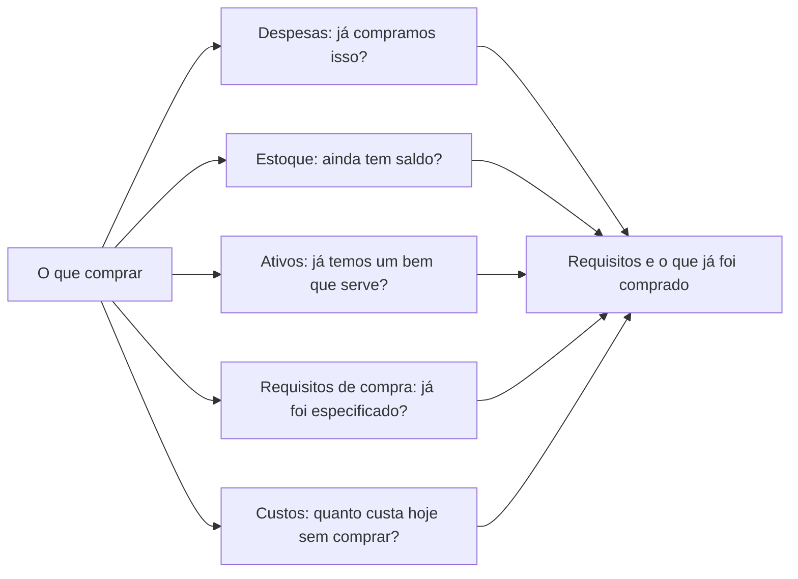
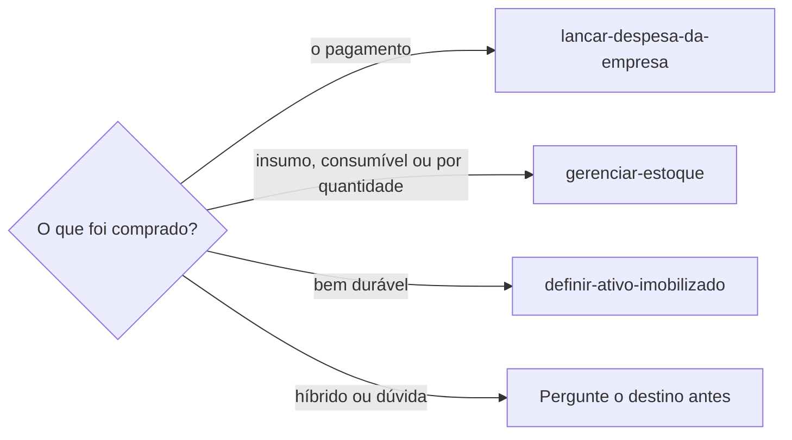

# Pesquisar compra

## Parâmetros de configuração

Leia cada valor nas instruções do projeto: primeiro na entrada com o nome desta habilidade, depois na entrada `Global` ou no primeiro nível do bloco. Quando um valor não estiver lá, use o padrão abaixo.

```yaml
# `Quantidade de opções` é quantas opções a resposta recomenda. Menos de duas não dá o que comparar.
"Quantidade de opções": 3
"Modo de aprendizado": "perguntar"
```

## Instruções

### Passo 1

Entenda o que a pessoa precisa comprar e para que vai usar. O uso decide os requisitos, e o requisito decide a opção.
Use o que a pessoa já disse. Pergunte, uma vez, só o que muda a recomendação: o uso, o orçamento, a voltagem ou o prazo.
Não pare numa pergunta que a pesquisa responde. Comece e leve a dúvida junto com as primeiras opções.

### Passo 2

Antes de pesquisar na web, veja o que já temos. Só leia, sem gravar nada.



A lista de despesas, a de estoque e a de ativos imobilizados vêm do mapeamento de dados do projeto.
Quando o projeto tem uma lista de requisitos de compra ou de custos de produção, leia as duas também.
O requisito já escrito evita perguntar de novo, e o custo de hoje, como um serviço de terceiro que a compra substitui, mostra em quanto tempo ela se paga. Siga `lancar-despesa-da-empresa`, `gerenciar-estoque` e `definir-ativo-imobilizado` para ler cada uma, e `identificar-duplicata` para o item que parece o mesmo com outro nome.
Se a lista não estiver no workspace conectado, diga qual faltou e siga com as outras. Não use a lista de outro workspace.
Um bem ou um saldo que já serve responde a pergunta: mostre o que achou e pergunte se a pessoa ainda quer comprar.
Uma compra anterior vale como fonte do requisito. O insumo que já foi comprado diz o que o equipamento precisa aguentar.
O comprovante da compra anterior diz o vendedor, como o recebedor do pagamento. Guarde o nome para o Passo 4.
Um insumo que está nas despesas e falta no estoque fica no fim da resposta, com a sugestão de `gerenciar-estoque`. Não grave.

### Passo 3

Escreva os requisitos antes das opções. Cada requisito diz de onde veio: do que a pessoa disse, de um registro nosso, da ficha técnica do fabricante ou de um anúncio.
O requisito que ninguém confirmou fica marcado como não confirmado. Não complete com o que o modelo supõe.

### Passo 4

Pesquise na web, uma busca por opção, e prefira nesta ordem: o fabricante, a loja que vende, o guia ou a avaliação.
Para o insumo já comprado, busque também a loja própria do vendedor pelo nome do Passo 2. Ela costuma abrir quando o marketplace bloqueia e traz a ficha.
Guia de melhores e página de afiliado indicam o que olhar, não provam compatibilidade.
Anote o preço com a loja e a data da consulta. O preço de uma busca ou de um cache pode ser antigo.
Diga quando o preço veio só do resultado da busca, sem a página aberta. Página esgotada não tem preço atual: diga que está esgotada.
A loja que bloqueia leitura automática não se contorna. Use o que a busca mostrou, diga que a página não abriu e peça que a pessoa cole a descrição ou o link, ou pergunte ao vendedor.

### Passo 5

Responda com `Quantidade de opções` opções, a recomendada primeiro. Para cada uma: o que atende, o que não está confirmado, o preço com fonte e data, e o link.
Diga também a opção descartada e o motivo, para a pessoa não pesquisar de novo.
Com o custo de hoje do Passo 2, mostre a conta de quando a compra se paga e marque o que é estimativa.
Termine com a pergunta que ainda falta ao fabricante ou ao vendedor, quando houver, e com a decisão que cabe à pessoa.
Não compre, não ponha no carrinho e não preencha dado de pagamento.

### Passo 6

O registro da compra só acontece depois que a pessoa disser que comprou.



Esta habilidade não grava nada. Ela encaminha, e cada habilidade acima grava o que é dela.

### Passo 7

Ao terminar, siga `evoluir-habilidade` conforme `Modo de aprendizado`.

## Problemas comuns

### Pesquisa sem olhar o que já temos

Se você for direto à web, a resposta recomenda comprar algo que já está no estoque ou nos bens.

1. Leia despesas, estoque, ativos, requisitos de compra e custos pelo Passo 2.
2. Mostre o que já serve antes de qualquer opção.
3. Pergunte se a pessoa ainda quer comprar.

### Compatibilidade inventada

Se você disser que um modelo serve porque um guia o recomenda, a pessoa compra sem a confirmação que importava.

1. Marque o requisito como não confirmado.
2. Diga de onde veio cada afirmação.
3. Traga a pergunta que o fabricante ou o vendedor responde.

### Preço sem data

Se você citar o preço sem a loja e a data, a pessoa não sabe se ele ainda vale.

1. Anote a loja e a data da consulta.
2. Diga que o preço muda.
3. Prefira a página da loja ao resultado de uma busca.

### Loja que não abre

Se você tentar outro caminho depois que a loja bloqueia a leitura, a resposta passa a depender de uma página que ela não quis entregar.

1. Use o trecho que a busca mostrou.
2. Diga que a página não abriu.
3. Peça a descrição colada ou o link, ou a pergunta ao vendedor.

### Compra feita pela pesquisa

Se você ficar no carrinho ou na tela de pagamento, a pessoa perde a decisão que era dela.

1. Pare na recomendação.
2. Entregue os links.
3. Registre só depois que a pessoa disser que comprou.

## Exemplos de entrada e saída

Estes exemplos ilustram fatos. Eles podem não estar no data source.

### preciso de uma impressora laser que imprima as folhas A4 de etiqueta de composição que já compramos

Li as despesas e achei a compra das folhas, com o modelo, a quantidade, o valor e o vendedor pelo comprovante. Não há impressora nos ativos, e as folhas não estão no estoque. Os custos de produção dizem quanto custa hoje imprimir a página fora. O marketplace bloqueou, e a loja própria do vendedor deu o material e as medidas, sem citar impressora. A entrada que aceita etiqueta veio da ficha de cada fabricante de impressora. Recomendo três laser monocromáticas, com preço, loja e data de cada uma. Falta saber, com o vendedor das folhas, qual impressora ele indica e se a folha pode passar pela frente e verso automático.

### quero um tecido de algodão cru

Li o estoque e achei um rolo do mesmo tecido com saldo. Mostrei o saldo e perguntei se ainda quer comprar. Não pesquisei na web antes da resposta.

## Casos-limite

- O item já existe no estoque ou nos ativos: mostre-o primeiro e pergunte se ainda quer comprar.
- A pessoa não diz o uso: pergunte uma vez e leve as primeiras opções junto.
- Uma lista de dados não está no workspace conectado: diga qual e siga com as outras.
- A loja bloqueia a leitura: use o que a busca mostrou e peça a descrição.
- Só existe uma opção que atende: diga isso e não complete a lista com opção que não atende.
- A pessoa diz que comprou: encaminhe pelo Passo 6 e não grave aqui.
- O item é híbrido, entre estoque e bem durável: pergunte o destino antes de encaminhar.
- É um serviço, não um produto: use os mesmos passos, com o escopo e o prazo no lugar dos requisitos do item.

## Pegadinhas

- A busca na web só abre página que apareceu num resultado. Um link que a pessoa colou ou que vem de um registro nosso pode falhar até ser achado numa busca.
- Marketplace e loja grande costumam bloquear a leitura automática. A listagem de busca ainda mostra título e preço, mas não a ficha.
- O mesmo modelo existe em voltagens e códigos diferentes, e o preço muda entre eles. Confirme o código completo e a voltagem antes de recomendar.
- Uma oferta de loja pode ser antiga. A data da página ou a da oferta fica na resposta.
- A lista de despesas guarda o que foi pago, não a ficha do que foi comprado. A compatibilidade vem do fabricante.
- O vendedor do insumo raramente cita modelo de equipamento. Ele diz a tecnologia, como "só laser". O fabricante do equipamento diz se aceita aquele tipo de mídia e por qual entrada.
- A ficha de outro vendedor do mesmo insumo, como a gramatura, não vale para o insumo comprado. Marque como não confirmado.

## Scripts disponíveis

- Nenhum.

1. Não há script para executar.
