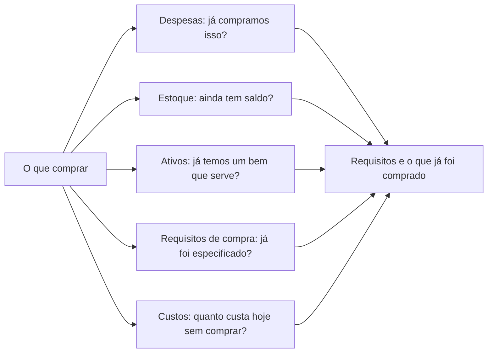
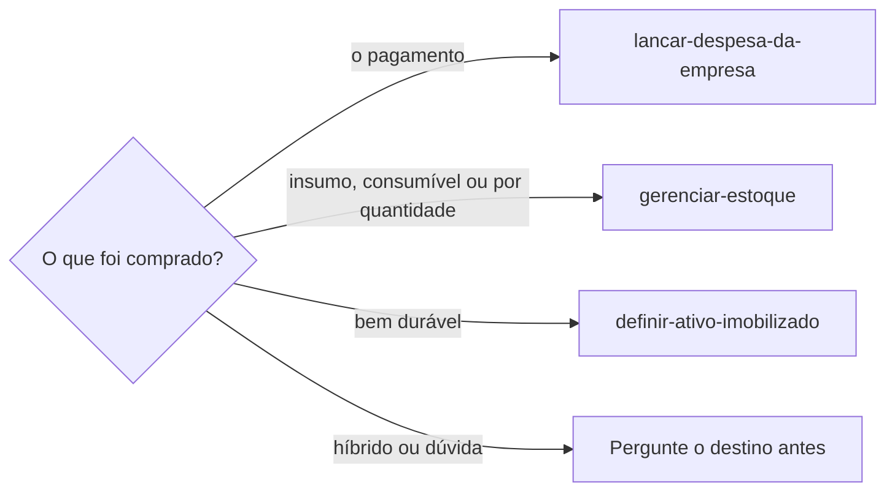

# Pesquisar compra

## Parâmetros de configuração

Leia cada valor nas instruções do projeto: primeiro na entrada com o nome desta habilidade, depois na entrada `Global` ou no primeiro nível do bloco. Quando um valor não estiver lá, use o padrão abaixo.

```yaml
# `Quantidade de opções` é quantas opções a resposta recomenda. Menos de duas não dá o que comparar.
"Quantidade de opções": 3
"Modo de aprendizado": "perguntar"
```

## Instruções

### Passo 1

Entenda o que a pessoa precisa comprar e para que vai usar. O uso decide os requisitos, e o requisito decide a opção.
Use o que a pessoa já disse. Pergunte, uma vez, só o que muda a recomendação: o uso, o orçamento, a voltagem ou o prazo.
Não pare numa pergunta que a pesquisa responde. Comece e leve a dúvida junto com as primeiras opções. A especificação do que vai ser comprado é a exceção: sem ela, o Passo 3 manda parar e entrevistar a pessoa antes de pesquisar empresas.
Quando o pedido cita um lugar que pode ter mais de um alcance, como um nome que é ao mesmo tempo o da cidade e o do estado, confirme com a pessoa o alcance antes de pesquisar e antes de cadastrar. Diga o que entendeu e espere a resposta. Esta é a pergunta que a pesquisa não responde, então ela vem antes das primeiras opções.

Para uma compra específica, o padrão é só a cidade nomeada, e cidade não é região metropolitana nem estado. O mesmo vale para o lugar onde a pessoa está: se ela está numa cidade, é essa cidade. Só quando a pesquisa não achar nada na cidade, sugira por conta própria ampliar para a região metropolitana, dizendo qual serviço existe e em que cidade vizinha, e espere o sim.

Quando o pedido de um serviço ou de uma loja local não cita o lugar, resolva-o antes da primeira busca: leia a viagem ativa ou a próxima, seguindo `definir-viagem`, e, sem viagem, a sede do negócio nos dados do projeto. Diga a cidade que usou e pesquise só nela. Pergunte à pessoa só quando os dados não responderem. Uma busca sem cidade traz empresas de qualquer lugar: não as apresente como opção, nem peça a cidade depois de listá-las.

### Passo 2

Antes de pesquisar na web, veja o que já temos. Só leia, sem gravar nada.



A lista de despesas, a de estoque e a de ativos imobilizados vêm do mapeamento de dados do projeto. Leia também a de requisitos de compra e a de custos de produção. Sem elas no mapeamento, procure-as pelo nome no workspace antes de dizer que faltam.
O requisito já escrito evita perguntar de novo, e o custo de hoje, como um serviço de terceiro que a compra substitui, mostra em quanto tempo ela se paga. Siga `lancar-despesa-da-empresa`, `gerenciar-estoque` e `definir-ativo-imobilizado` para ler cada uma, e `identificar-duplicata` para o item que parece o mesmo com outro nome.
Leia também a viagem ativa ou a próxima, seguindo `definir-viagem`: onde a pessoa vai estar, em que dias e horas, e onde ficam os itens que ela precisa. A busca de empresas começa pelas dos lugares e dos horários em que a pessoa estará. Uma empresa de onde ela só volta depois do prazo fica para depois, e a resposta diz a cidade de cada empresa.
Se a lista não estiver no workspace conectado, diga qual faltou e siga com as outras. Não use a lista de outro workspace.
Um bem ou um saldo que já serve responde a pergunta: mostre o que achou e pergunte se a pessoa ainda quer comprar.
Uma compra anterior vale como fonte do requisito. O insumo que já foi comprado diz o que o equipamento precisa aguentar.
Não conclua onde o insumo está, nem se a pessoa o tem, por uma frase solta: confira a compra anterior e o estoque e, na dúvida, pergunte.
O comprovante da compra anterior diz o vendedor, como o recebedor do pagamento. Guarde o nome para o Passo 4.
Um insumo que está nas despesas e falta no estoque fica no fim da resposta, com a sugestão de `gerenciar-estoque`. Não grave.

### Passo 3

Escreva os requisitos antes das opções. Cada requisito diz de onde veio: do que a pessoa disse, de um registro nosso, da ficha técnica do fabricante ou de um anúncio.

Procure o requisito do que vai ser comprado e, sem ele, siga `definir-requisito-de-compra` antes de pesquisar empresas e de escrever a qualquer uma: ele entrevista a pessoa, fecha a especificação e a grava como requisito. A compra de um item pronto da empresa tem um requisito só, e o requisito de um item parecido não vale para este.

O requisito que ninguém confirmou fica marcado como não confirmado. Não complete com o que o modelo supõe.

### Passo 4

Pesquise na web, uma busca por opção, e prefira nesta ordem: o fabricante, a loja que vende, o guia ou a avaliação.
Do insumo já comprado, busque também a loja do vendedor pelo nome do Passo 2: ela traz a ficha.
Guia e página de afiliado indicam o que olhar, não provam compatibilidade.
Anote o preço com a loja e a data da consulta. O preço de uma busca ou de um cache pode ser antigo.
Diga quando o preço veio só da busca. Página esgotada não tem preço.
O 403 da ferramenta de busca é falha técnica: abra a página no navegador embutido e, se falhar, no Claude in Chrome, e diga qual abriu.
Captcha e login não se contornam: use o que a busca mostrou, diga que a página não abriu e peça a descrição ou o link, ou pergunte ao vendedor.
Abra a página de cada opção e use como link o endereço que o navegador mostrou. Nunca monte um endereço nem aponte para a página inicial da loja. Sem página aberta, a opção vai sem link, e a resposta diz onde ela apareceu.
De cada equipamento, confirme na página do fabricante ou da loja o que acompanha a caixa, como o rolo e o tamanho dele, a bateria, o aplicativo e os aparelhos compatíveis. O que a página não traz fica como não confirmado, com a pergunta ao vendedor.

Para achar empresas que prestam um serviço, a fonte é a listagem local: trabalho acadêmico e diretório do estado só ensinam os sinônimos do serviço. Na cidade do Passo 1, busque o serviço e os sinônimos, quem o faz dentro do próprio negócio e as listagens locais, como o mapa e o diretório do sindicato. Sem empresa achada, faça a próxima busca do Passo 6, sem perguntar se deve seguir.

### Passo 5

Responda com `Quantidade de opções` opções, a recomendada primeiro. Para cada uma: o que atende, o que não está confirmado, o preço com fonte e data, e o link que o Passo 4 guardou.
A que exige equipamento que a pessoa não tem, como o rolo térmico, ou não tem a forma pedida, como o rolo no lugar da folha A4, fica descartada, com o motivo.
Diga também a opção descartada e o motivo, para a pessoa não pesquisar de novo.
Uma empresa só vale como descartada com a resposta dela. Sem resposta, diga que ela não foi contatada ou que está sem resposta, e liste quem foi contatada, quem respondeu e quem falta.
Com o custo de hoje do Passo 2, mostre a conta de quando a compra se paga e marque o que é estimativa.
Termine com a pergunta que ainda falta ao fabricante ou ao vendedor, quando houver, e com a decisão que cabe à pessoa.
Sem o pedido da pessoa para comprar, não compre, não ponha no carrinho e não preencha pagamento. Com o pedido, siga `realizar-compra`.
Ao responder, acrescente ao requisito a entrada desta pesquisa, seguindo `definir-requisito-de-compra` e a seção `Histórico da pesquisa` do modelo `briefing-de-especificacao-de-compra`.

### Passo 6

Cadastre na lista de empresas do mapeamento de dados do projeto cada empresa que apareceu como opção, recomendada ou descartada: a loja que vende, a gráfica, a prestadora do serviço. Não espere a pessoa decidir nem comprar. Assim a empresa se acha depois, sem pesquisar de novo.
Siga `definir-empresa`, que busca antes por nome, variações e CNPJ e reaproveita a empresa que já existe. Grave só o que a página da própria empresa mostrou, como contato, endereço, horário e CNPJ. O que ficou sem confirmação, como se ela atende o que a pessoa precisa, vai nas notas, não nos campos de contato.
Marketplace e loja grande entram como empresa quando o vendedor é a opção. O vendedor do anúncio é a empresa, não a plataforma.
A empresa que a busca trouxe de fora do alcance confirmado no Passo 1 não é opção: não a cadastre nem a contate. Cite-a, no máximo, como fora do alcance, com a cidade, e deixe a pessoa decidir se o alcance cresce, como o Passo 1 manda.
Abra o site da empresa e leia os links da página, como WhatsApp, telefone e redes, antes de dizer que não achou o contato. O trecho que a busca mostrou não basta.
Antes de recomendar o contato com a empresa, veja se já houve conversa com ela, seguindo `conversar-no-whatsapp`. Diga o que o histórico já responde.
Quando a compra é um serviço de terceiro e nenhuma empresa achada atende, não responda que não há opção. Siga para a próxima: a da lista de empresas, a que um contato indicou, a da web. Cadastre cada uma, veja se há conversa e, sem conversa, prepare o primeiro contato pelo WhatsApp, com o texto pronto e o sim da pessoa. Só pare quando uma empresa confirmar que atende ou a pessoa mandar parar.
O primeiro contato com cada empresa, a mensagem de cotação e a leitura das respostas seguem `pedir-cotacao-ao-fornecedor`.
A recusa de uma empresa se registra como `definir-negociacao` manda, no mesmo turno, e o Passo 5 a trata como descartada, com o motivo.
Na resposta, leve o link da página de cada empresa cadastrada.

### Passo 7

O registro da compra só acontece depois do pagamento, que a pessoa avisa ou que `realizar-compra` confirma. O pagamento se registra sem perguntar, e o insumo e o bem durável esperam a entrega.



Ela não registra a compra, só encaminha. O que ela grava é o rastro da pesquisa: requisito, histórico e empresas.

### Passo 8

Ao terminar, siga `evoluir-habilidade` conforme `Modo de aprendizado`.

## Problemas comuns

### Pesquisa sem olhar o que já temos

Se você for direto à web, a resposta recomenda comprar algo que já está no estoque ou nos bens.

1. Leia despesas, estoque, ativos, requisitos de compra e custos pelo Passo 2.
2. Mostre o que já serve antes de qualquer opção.
3. Pergunte se a pessoa ainda quer comprar.

### Compatibilidade inventada

Se você disser que um modelo serve porque um guia o recomenda, a pessoa compra sem a confirmação que importava.

1. Marque o requisito como não confirmado.
2. Diga de onde veio cada afirmação.
3. Traga a pergunta que o fabricante ou o vendedor responde.

### Preço sem data

Se você citar o preço sem a loja e a data, a pessoa não sabe se ele ainda vale.

1. Anote a loja e a data da consulta.
2. Diga que o preço muda.
3. Prefira a página da loja ao resultado de uma busca.

### Loja que não abre

Se você parar no 403 sem abrir o navegador, o preço vem só da busca. Se insistir após um captcha, a resposta depende de uma página que não abriu.

1. No 403, abra a página no navegador embutido e, se falhar, no Claude in Chrome.
2. Diante de captcha ou login, pare e diga que a página não abriu.
3. Peça a descrição ou o link, ou pergunte ao vendedor.

### Empresa pesquisada sem cadastro

Se você recomendar ou descartar uma empresa e não a cadastrar, na próxima busca ninguém a acha e a pessoa pesquisa de novo.

1. Cadastre cada empresa que apareceu como opção, pelo Passo 6, sem esperar a decisão nem a compra.
2. Leve o link da página na resposta.

### Empresa deixada sem contato por ter só telefone fixo

Se você deixar sem mensagem a empresa cujo site traz só telefone fixo, ela fica fora da rodada embora tenha e-mail ou formulário, e a pessoa descobre depois.

1. Procure o e-mail e o formulário no site, como `pedir-cotacao-ao-fornecedor` manda.
2. Prepare a mensagem para esse canal, com o mesmo texto das outras e o sim da pessoa.
3. Só sem nenhum canal de texto a ligação entra, como último recurso, e a resposta diz isso.

### Lugar tomado pelo alcance mais amplo

Se você ler como a região metropolitana ou como o estado inteiro um pedido que diz só o nome de uma cidade, a pesquisa traz e a lista cadastra empresas de cidades onde a pessoa nunca quis ir, e a primeira mensagem sai para quem ela não pretendia procurar.

1. Confirme o alcance antes de pesquisar. Numa compra específica, o padrão é só a cidade nomeada.
2. Pesquise e cadastre só dentro do alcance confirmado. Sem achar nada na cidade, sugira a região metropolitana, com o serviço e a cidade vizinha.
3. Diga a cidade de cada empresa na resposta, e deixe a de fora do alcance como fora do alcance.

### Empresa consultada sem a especificação

Se você escrever às empresas antes de fechar a especificação, elas pedem a arte, a quantidade e o acabamento, e a pessoa responde o que devia ter fechado antes.

1. Procure o requisito no Passo 3.
2. Sem ele, siga `definir-requisito-de-compra` antes de pesquisar e de escrever.

### Mínimo de uma empresa tomado como quantidade

Se você sugerir à pessoa a quantidade que uma empresa aceita como mínimo, passar um número de costume, ou usar o mínimo de uma na mensagem a outra, a quantidade sai sem base e a pessoa decide com um número que não é dela.

1. Pergunte o MOQ a cada empresa, na primeira mensagem, como o Passo 6 manda.
2. Grave o que cada uma respondeu nas notas da página dela, com a data.
3. A quantidade vem das unidades das peças, como o Passo 6 manda, e a pessoa a confirma: leve a ela esse total e o mínimo de cada empresa.

### Compra feita pela pesquisa

Se você ficar no carrinho ou na tela de pagamento sem a pessoa ter pedido a compra, ela perde a decisão que era dela.

1. Sem o pedido de compra, pare na recomendação e entregue os links.
2. Com o pedido, siga `realizar-compra`.
3. Registre só depois do pagamento confirmado.

## Exemplos de entrada e saída

Estes exemplos ilustram fatos. Eles podem não estar no data source.

### preciso de uma impressora laser que imprima as folhas A4 de etiqueta de composição que já compramos

Li as despesas e achei a compra das folhas, com o modelo, o valor e o vendedor pelo comprovante. Não há impressora nos ativos, e as folhas não estão no estoque. O marketplace devolveu 403, o navegador abriu a página, e a loja do vendedor deu o material e as medidas, sem citar impressora.

A entrada que aceita etiqueta veio da ficha de cada fabricante. Recomendo três laser monocromáticas, com preço, loja e data de cada uma. Falta saber, com o vendedor das folhas, qual impressora ele indica e se a folha passa pelo verso automático.

### quero um tecido de algodão cru

Li o estoque e achei um rolo do mesmo tecido com saldo. Mostrei o saldo e perguntei se ainda quer comprar. Não pesquisei na web antes da resposta.

## Casos-limite

- O item já existe no estoque ou nos ativos: mostre-o primeiro e pergunte se ainda quer comprar.
- A pessoa não diz o uso: pergunte uma vez e leve as primeiras opções junto.
- Uma lista de dados não está no workspace conectado: diga qual e siga com as outras.
- Só existe uma opção que atende: diga isso e não complete a lista com opção que não atende.
- A pessoa diz que comprou, ou o checkout confirma: encaminhe pelo Passo 7.
- A empresa já está na lista: reaproveite a página e complete só o que faltava. Não crie outra.
- A lista de empresas não está no workspace conectado: diga isso e siga com a resposta. Não cadastre em outra lista.
- O item é híbrido, entre estoque e bem durável: pergunte o destino antes de encaminhar.
- É um serviço, não um produto: use os mesmos passos, com o escopo e o prazo no lugar dos requisitos do item.
- O pedido cita um lugar sem dizer o alcance, como o nome de uma cidade que também é o do estado: confirme o alcance antes de pesquisar, e numa compra específica use só a cidade. Uma empresa fora dele fica de fora do cadastro e do contato.
- A pesquisa não achou nada na cidade: sugira por conta própria a região metropolitana, com o serviço e a cidade vizinha, e espere o sim antes de cadastrar ou contatar.

## Pegadinhas

- A empresa descartada parece não merecer cadastro. Ela volta numa próxima compra, e o motivo do descarte nas notas poupa a pesquisa.
- A busca na web só abre página que apareceu num resultado. Um link que a pessoa colou ou que vem de um registro nosso pode falhar até ser achado numa busca.
- O mesmo modelo existe em voltagens e códigos diferentes, e o preço muda entre eles. Confirme o código completo e a voltagem antes de recomendar.
- Uma oferta de loja pode ser antiga. A data da página ou a da oferta fica na resposta.
- A lista de despesas guarda o que foi pago, não a ficha do que foi comprado. A compatibilidade vem do fabricante.
- O vendedor do insumo raramente cita modelo de equipamento. Ele diz a tecnologia, como "só laser". O fabricante do equipamento diz se aceita aquele tipo de mídia e por qual entrada.
- A ficha de outro vendedor do mesmo insumo, como a gramatura, não vale para o insumo comprado. Marque como não confirmado.
- A cidade vizinha parece parte da cidade. Guarulhos não é São Paulo, e Contagem e Betim não são Belo Horizonte: a região metropolitana só entra depois que a cidade não deu resultado.

## Scripts disponíveis

- Nenhum.

1. Não há script para executar.
