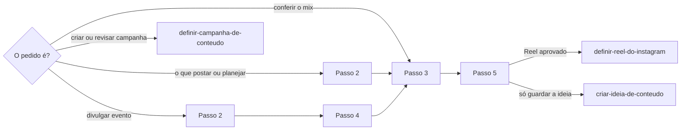

# Planejar calendário de conteúdo

## Parâmetros de configuração

Leia cada valor nas instruções do projeto: primeiro na entrada com o nome desta habilidade, depois na entrada `Global` ou no primeiro nível do bloco. Quando um valor não estiver lá, use o padrão abaixo. `Empresa do negócio` é o nome do registro do próprio negócio na lista de empresas. Os perfis padrão, um por canal, saem dos perfis sociais dessa empresa. `Perfis por praça` com `sim` quer dizer que a marca tem um perfil por praça: o perfil sai da lista de perfis sociais, pela praça, conforme o mapeamento de dados do projeto.

```yaml
"Formato da data com dia da semana": "terça-feira, 01/09/2026"
"Empresa do negócio": ""
"Perfis por praça": "não"
"Modo de aprendizado": "perguntar"
```

## Instruções

### Passo 1

As listas e o nome de cada propriedade vêm do mapeamento de dados do projeto, no workspace conectado. A lista de posts, a lista de formatos de conteúdo e a lista de eixos narrativos são obrigatórias. Se uma delas não estiver nessa conexão, pare. As fontes que sustentam a pauta entram quando o mapeamento as tem: campanhas de conteúdo, ideias de conteúdo, oportunidades, pontos de contato, datas significativas, viagens, peças e feedbacks.



### Passo 2

Planejamento não é improviso. Antes de sugerir pauta nova, levante na janela pedida:

1. O que já existe na lista de posts e em que status.
2. O que dá para reaproveitar: ideia de conteúdo guardada, post em design existente ou em rascunho.
3. O que sustenta a decisão: datas significativas, pontos de contato, viagens, coleções, drops, peças e feedbacks.

Cada sugestão cita a página que a sustenta. Só o status publicado, ou a URL da postagem, prova que o post saiu. Agendado tem data e hora. Planejado, design existente e rascunho são intenção. Registro sem status não conta como publicado.

### Passo 3

Monte o mix da janela numa tabela.

- Por formato: a contagem contra a meta mínima e a máxima de 7 dias da página do formato.
- Por eixo narrativo: os eixos e sub-eixos presentes, o eixo que falta e os posts sem eixo.
- Por narrativa: a campanha ou o evento que já ocupa cada semana. A campanha ocupa a janela entre o início e o fim, mesmo antes de ter posts. Um post é da campanha pela relação com ela, quando o mapeamento a tem, ou pela data dentro da janela. Uma semana ocupada por uma narrativa não recebe outra de imediato. Sugira outra janela.

As datas saem no `Formato da data com dia da semana`.

### Passo 4

Para divulgar um evento, os fatos vêm da página do evento na lista de oportunidades ou de pontos de contato: nome, data, horário e endereço. Sem essa página, pergunte. Não invente nenhum desses fatos.

1. Monte a sequência de posts antes do evento. Cada post tem formato, data sugerida, objetivo e CTA. Cada um diz sozinho o que vai acontecer, a data, o horário, o endereço, por que vale ir e a ação, sem depender de outro post nem dos comentários.
2. A data de cada post é anterior ao evento e não colide com a narrativa que ocupa a semana.
3. Só entram peças prontas para venda segundo a lista de peças.

### Passo 5

Mostre a janela e os posts propostos, cada um com formato, eixo, perfil autor, data, objetivo e fonte. O perfil autor padrão é o perfil da `Empresa do negócio` no canal do formato. Com `Perfis por praça` em `sim`, ele vem da praça do post ou do evento. Não crie nada antes do sim da pessoa.

Com o sim, cada Reel segue `definir-reel-do-instagram`. Outro formato entra na lista de posts como rascunho, com assunto, formato, eixo, perfil autor, data aprovada e observações editoriais. Não escreva a legenda desse post.

### Passo 6

Valide antes de mostrar. Corrija e repita até passar.

- [ ] Cada sugestão cita a fonte.
- [ ] Nenhum rascunho, planejado ou design existente foi contado como publicado.
- [ ] A contagem por formato foi comparada com as metas.
- [ ] O eixo que falta e os posts sem eixo foram ditos.
- [ ] Nenhuma semana recebeu duas narrativas.
- [ ] Os fatos do evento vieram da página do evento.

### Passo 7

Ao terminar, siga `evoluir-habilidade` conforme `Modo de aprendizado`.

## Problemas comuns

### Pauta improvisada

Se você sugerir um tema novo sem olhar a lista de posts e as fontes, o calendário repete o que já existe e perde o que já estava pronto.

1. Levante o que existe, o que está planejado e o que dá para reaproveitar.
2. Cite a fonte de cada sugestão.

### Rascunho contado como publicado

Se você contar rascunho, planejado ou design existente como post que saiu, o mix parece cheio e a semana fica vazia.

1. Conte como publicado só o status publicado ou a URL da postagem.
2. Separe intenção de agendado e de publicado na tabela.

### Narrativas misturadas

Se você encaixar uma campanha nova numa semana que já tem outra narrativa, as duas competem e nenhuma fica clara.

1. Veja a narrativa de cada semana.
2. Sugira a próxima janela livre e espere o sim.

### Post criado sem aprovação

Se você criar os posts antes do sim, a lista de posts ganha datas que a pessoa não aprovou.

1. Mostre a proposta.
2. Crie só depois do sim.

## Exemplos de entrada e saída

Estes exemplos ilustram fatos. Eles podem não estar no data source.

### o que a gente posta essa semana?

A tabela mostrou 0 Reels na semana, abaixo da meta mínima de 1, e nenhum post no eixo de produto. A sugestão reaproveita uma ideia de conteúdo guardada e um design existente, cada um com o link da página. Nada foi criado antes do sim.

### quero divulgar as peças para quem vai a este evento

Os fatos vieram da página do evento. A semana atual já tinha outra narrativa, então a sequência começou na semana seguinte: um Reel de looks, stories de conversa e um carrossel, todos antes do evento, só com peças prontas para venda. A pessoa aprovou a janela, e o Reel seguiu para a habilidade do Reel.

## Casos-limite

- A lista de posts está quase vazia ou foi pouco usada: o levantamento diz isso e parte das fontes.
- O evento não tem página: pergunte antes de montar a sequência.
- A pessoa pede para encaixar já, mesmo com outra narrativa na semana: mostre o conflito e siga a escolha dela.
- O post não tem eixo: liste na tabela e sugira o eixo.
- A janela não foi dada: use os próximos 7 dias, a janela das metas do formato.

## Pegadinhas

- A lista de posts pode guardar registros antigos ou de planos futuros. Só o status publicado, ou a URL, prova que saiu.
- Uma semana sem Reels parece livre. Ela pode já estar ocupada por outra narrativa em outro formato.
- Um evento aprovado parece pedir post imediato. A janela respeita a narrativa que já ocupa a semana.
- Eixo e sub-eixo estão na mesma lista. O sub-eixo complementa um eixo.
- Uma campanha planejada ainda sem posts parece deixar a semana livre. A janela dela já está ocupada.

## Scripts disponíveis

- Nenhum.

1. Não há script para executar.
