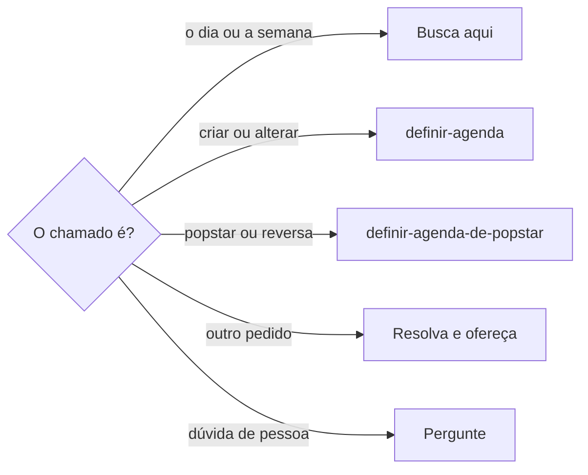
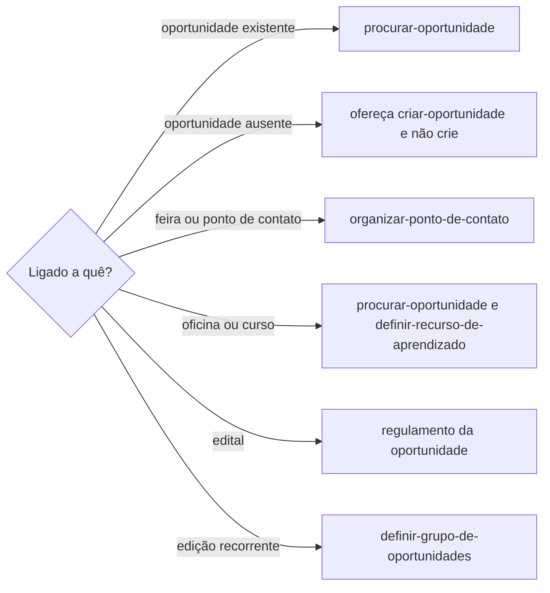

# Procurar agenda

## Parâmetros de configuração

Leia cada valor nas instruções do projeto: primeiro na entrada com o nome desta habilidade, depois na entrada `Global` ou no primeiro nível do bloco. Quando um valor não estiver lá, use o padrão abaixo. `Apelidos da agenda` lista os nomes pelos quais a pessoa chama a agenda, como o nome de uma secretária. Vazia quer dizer que a agenda não tem apelido. `Agendas` lista cada agenda pelo `"Nome"` e, quando houver, pelo `"ID"`, com o `"Uso"`: `padrão` recebe o evento novo; `em uso` é lida e gravada quando o pedido a nomeia; `só leitura` é lida e nunca gravada; `aposentada` é um produto que não se usa mais, lido só para achar o evento que ficou lá; `ignorada` não é lida nem gravada, mesmo que exista ou que o histórico a cite. `"Finalidade"`, quando houver, diz o tipo de evento que vai para aquela agenda. Case a agenda pelo ID; sem ID, pelo nome do calendário, que contém o nome da lista. Sem agenda `padrão` na lista, a agenda padrão é a principal da conta.

```yaml
"Formato da data com dia da semana": "terça-feira, 01/09/2026"
"Agendas": []
"Apelidos da agenda": []
```

## Instruções

### Passo 1

As listas e o nome de cada propriedade vêm do mapeamento de dados do projeto. Perguntar como está o dia, qual é a agenda hoje, o que tem hoje ou o que já está no dia ou na semana é esta habilidade. O mesmo vale quando o pedido traz um nome de `Apelidos da agenda`, ou uma grafia parecida, em vocativo, apelido, terceira pessoa ou referência indireta, mesmo sem dizer agenda, calendário, evento, compromisso ou horário. A menção basta. Não peça para nomear a habilidade de novo. Com apelido, a resposta fala como a secretária da agenda, no gênero do apelido. A regra desta busca não afrouxa.

Antes de tratar o nome como a secretária, confira o contexto. Cliente, fornecedora, marca ou pessoa na lista de pessoas não é esse chamado. Dúvida real: pergunte. Não escolha. Se o pedido não for de agenda, resolva o que foi pedido e ofereça ajuda com a agenda. Não ignore o chamado.



Agenda de popstar, agenda reversa e proteção de vida ficam com `definir-agenda-de-popstar` na hora. Auditar o uso do tempo fica com `revisar-uso-do-tempo`. Reserva, criar, revisar e alterar o evento ficam com `definir-agenda` na hora. A data na lista de datas significativas fica com `definir-data-significativa`. A página da aula, da formação ou do recurso de aprendizado fica com `definir-recurso-de-aprendizado`. Saber se vai ter aula no dia continua aqui. Se o pedido for planejamento ou a página, pare.

### Passo 2

A agenda operacional é o Google Agenda, no período que a pessoa pediu. Ela provavelmente está conectada ao Notion Calendar. Criar, revisar e alterar o evento nesse Google Agenda ficam com `definir-agenda`. Antes de concluir que não consegue, confira Calendar Tools, Google Agenda, Notion Calendar ou equivalente nesta sessão. Não afirme que não há ferramenta sem essa checagem. Não pronta: inicie a conexão. Não responda só com instrução manual. Ativa: confirme e siga a busca original. Não peça para repetir o pedido. Falhou, indisponível ou ação fora do chat: explique o bloqueio e só então dê a alternativa manual. Não invente data, horário nem duração. Se o horário não estiver na fonte, diga isso.

As agendas de uso `aposentada` em `Agendas` são produtos que não se usam mais. Sem período no pedido, ou quando a pessoa pede qualquer dia ou para procurar de novo, a busca cobre essa agenda, não só o dia de hoje. Case o calendário. Não case o título do evento. Não percorra mês a mês nem decodifique a URL do evento para achar o calendário.

### Passo 3

Responda com o compromisso e o horário que a fonte já mostra nesse período. Não acrescente carreira, lançamento, saúde, descanso nem outro bloco que a fonte não traz. Não crie, não altere e não confirme reserva. Se o evento estiver ligado a outro contexto, diga o compromisso e siga a árvore.



### Passo 4

Mostre os compromissos achados e o período. Se não houver nenhum, diga isso. A resposta não pede para nomear a habilidade. Se uma agenda de uso `aposentada` tiver evento, avise que o produto não é mais usado, mostre cada compromisso no formato da data com dia da semana, com o horário da fonte, e sugira mover para a agenda padrão. Não pergunte qual agenda. A mudança segue `definir-agenda`. Sem evento nesse calendário, diga isso. O silêncio do dia de hoje não esconde evento de outro dia.

### Passo 5

A data de evento, compromisso, prazo, viagem, reserva, lançamento, entrega ou outro marco, na resposta, no resumo, na tabela ou em outro texto, sai no formato da data com dia da semana. Calcule e confira o dia com a data, o horário e o fuso do evento antes de responder. Sem horário ou sem fuso, e se o dia puder mudar, peça. Não invente. Intervalo ou vários dias: o dia da semana em cada data. Se a fonte trouxer um dia da semana incompatível com a data, sinalize a divergência. Não crie nem altere.

## Problemas comuns

### Agenda sem checagem

Se você disser que não há ferramenta de agenda, ou só passar instrução manual, a busca morre com a ferramenta disponível.

1. Confira Calendar Tools, Google Agenda, Notion Calendar ou equivalente nesta sessão.
2. Não pronta: inicie a conexão. Ativa: confirme e siga a busca. Não peça para repetir.
3. Falhou ou ação fora do chat: explique o bloqueio e só então dê a alternativa manual.

### Consulta que vira plano

Se você aplicar a agenda de popstar, montar a agenda reversa, proteger a vida, auditar a semana ou reservar um evento, a pergunta cotidiana vira planejamento.

1. Pare.
2. Agenda de popstar, agenda reversa ou proteção de vida segue `definir-agenda-de-popstar`. Uso do tempo segue `revisar-uso-do-tempo`. Reserva ou evento segue `definir-agenda`.
3. Não grave compromisso.

### Horário inventado

Se você preencher hora que a agenda não mostra, o dia nasce falso.

1. Deixe o horário como a fonte trouxe.
2. Se a fonte não tem horário, diga isso.
3. Não estime a duração.

### Agenda aposentada lida só hoje

Se você disser que a agenda aposentada está vazia porque o dia de hoje não tem evento, o compromisso de outro dia fica escondido.

1. Case o calendário, não o título do evento.
2. Sem período, em qualquer dia ou ao procurar de novo, cubra a agenda.
3. Se houver evento, avise que o produto não é mais usado, mostre data e horário e sugira mover para a agenda padrão. A mudança segue `definir-agenda`. Sem evento, diga isso.

### Data sem o dia da semana

Se você escrever a data numérica sem o dia da semana, ou repetir um dia da semana que não bate com a data, a pessoa lê o dia errado.

1. Calcule o dia com a data, o horário e o fuso.
2. Escreva no formato da data com dia da semana em cada data.
3. Se divergir, sinalize. Não crie nem altere.

## Exemplos de entrada e saída

Estes exemplos ilustram fatos. Eles podem não estar no data source.

### Secretária, cancela os eventos do dia?

O nome bastou, sem a palavra agenda. O cancelamento seguiu `definir-agenda` na hora. Não pedi para citar a habilidade de novo.

### Chama a secretária

Li o dia. A menção bastou. Não pedi para repetir o chamado.

### Secretária, separa isso pra mim

O pedido não era a agenda. Resolvi o que foi pedido e ofereci ajuda com a agenda. Não ignorei o chamado.

### o que tenho hoje?

Li o dia. Se não havia compromisso, disse isso. Não inventei horário.

### o que eu tenho na agenda esta semana?

Li a semana no Google Agenda. Listei o que ele mostra. Não auditei nem planejei.

### Tem algum compromisso na agenda aposentada?

A agenda está em `Agendas`, com uso aposentada. Sem dia no pedido, cobri a agenda, não só hoje. Casei o calendário, não o título. Havia a reunião de pesquisa na quinta-feira, 01/10/2026, das 18h às 19h. Avisei que o produto não é mais usado. Sugeri mover para a agenda padrão e deixei a mudança com `definir-agenda`.

### a fonte diz segunda-feira, 01/09/2026

01/09/2026 é terça-feira. Sinalizei a divergência. Na resposta, usei o formato da data com dia da semana. Não criei nem alterei.

## Casos-limite

- O pedido é agenda de popstar, agenda reversa ou proteção de vida: pare e siga `definir-agenda-de-popstar`. Uso do tempo: pare e siga `revisar-uso-do-tempo`. Reserva, criar, revisar ou alterar o evento: pare e siga `definir-agenda`.
- O pedido é data na lista de datas significativas: pare e siga `definir-data-significativa`.
- Ferramenta de agenda não pronta: conecte, confirme e siga a busca. Falhou: explique o bloqueio e só então dê a alternativa manual. Não afirme que não há ferramenta sem checar a sessão. Não invente o dia.
- O pedido é gerenciar viagem: siga `definir-viagem`.
- O nome pode ser cliente, fornecedora, marca ou pessoa na lista de pessoas: confira o contexto. Dúvida real: pergunte. Não escolha.
- O pedido não é agenda: resolva e ofereça ajuda com a agenda. Não ignore o chamado.
- O dia da semana da fonte não bate com a data: sinalize. Não grave.
- O pedido nomeia uma agenda aposentada, pede qualquer dia ou pede para procurar de novo: cubra a agenda. Case o calendário. Se houver evento, avise. Não pare no dia de hoje.

## Pegadinhas

- O nome parece pessoa da lista de pessoas, cliente, fornecedora ou marca. O contexto vem antes. Dúvida real pergunta. A menção da secretária basta e não pede a habilidade de novo.
- Um horário vazio parece convite para completar. O horário sai do Google Agenda. Se não estiver lá, diga isso.
- O Notion Calendar parece outra agenda. A agenda operacional é o Google Agenda. O Notion Calendar é a conexão provável. Afirmar que não há ferramenta parece fato. A checagem desta sessão vem antes.
- A data numérica parece bastar. A resposta leva o dia da semana, calculado com a data, o horário e o fuso.
- O título que cita o nome de uma agenda aposentada parece o evento dessa agenda. O aviso usa o calendário. O dia de hoje vazio não esconde o evento de outro dia.

## Scripts disponíveis

- Nenhum.

1. Não há script para executar.
