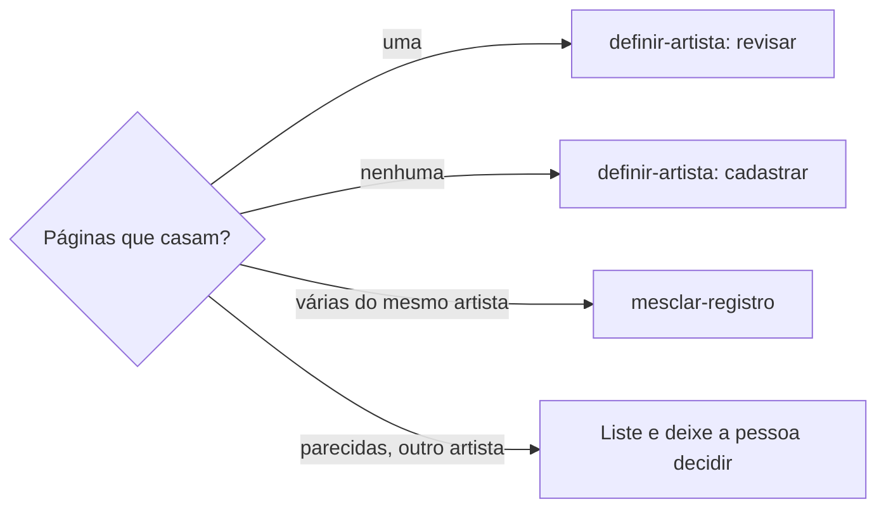

# Procurar artista

## Parâmetros de configuração

Leia cada valor nas instruções do projeto: primeiro na entrada com o nome desta habilidade, depois na entrada `Global` ou no primeiro nível do bloco. Quando um valor não estiver lá, use o padrão abaixo.

```yaml
"Nome do data source de artistas": ""
"Nome do data source de eventos": ""
"Data sources relacionados": []
"Campos da base de artistas":
  "nome": ""
  "grafias": ""
  "e-mail": ""
  "Spotify": ""
  "ID do Spotify": ""
  "YouTube": ""
  "Instagram": ""
  "line-ups": ""
"Modo de aprendizado": "perguntar"
```

## Instruções

### Passo 1

Receba o material: e-mail, anexo, link, vídeo, print ou só um nome. Procure no workspace conectado o data source com o nome `Nome do data source de artistas` e use-o sem perguntar: busque um termo da base e tome o data source de origem dos resultados cujo caminho tem esse nome. Abra o data source para ler o esquema. Só peça o link se a busca não achar nenhum ou achar mais de um. Não use um banco de outro workspace. Se `Campos da base de artistas` estiver vazio, pergunte uma vez e pare.
Se o material é um e-mail que a pessoa só apontou, ache a mensagem na caixa e confirme com ela qual é antes de seguir.

### Passo 2

Antes de buscar, liste os identificadores que o material traz, cada um com a origem e a data da fonte. "Atual" no material vale para a data do documento, não para hoje:

- [ ] nome artístico, siglas e nome civil
- [ ] e-mails e telefones
- [ ] links de Spotify, YouTube, Instagram e site
- [ ] músicas citadas e parceiros creditados
- [ ] cidade, evento ou edição que o artista diz ter feito, com a data do material

Leia cada link de Spotify e YouTube pela versão simplificada da página, que traz os dados como texto. Um link de faixa dá o ID de cada artista creditado. Um vídeo de uma playlist abre os títulos dos outros vídeos, que costumam citar evento, casa e parceiro.
Busque também o nome na web, junto de uma música ou projeto do artista. Matéria de imprensa costuma trazer origem, banda e palcos em que ele já tocou.
Para as redes, leia antes a página "sobre" do canal do YouTube e o press kit, que costumam listar os links. Sem eles, busque na web o nome com a rede e as formas do handle: junto, com ponto, com sublinhado e com prefixo, como `o` ou `a` antes do nome.
Busque o nome também nos arquivos do Drive conectado. Planilhas de programação guardam line-ups de edições anteriores à base.

### Passo 3

Busque no data source de artistas, um identificador por vez. O `e-mail`, o `ID do Spotify` e os links vão por consulta exata nas propriedades. O `nome` e as variações nas `grafias` vão pela busca restrita a esse data source e também pela consulta exata, sem diferenciar maiúsculas. Depois, repita em cada um de `Data sources relacionados`. Registre cada busca e o que ela devolveu, inclusive o vazio.

### Passo 4

Se o artista diz que já tocou, consulte em `Nome do data source de eventos`, por consulta exata de cidade e data, os eventos anteriores à data do material, e abra o line-up de cada um. Abra também a página de artista ligada a cada vaga do line-up. A declaração do artista é evidência, não confirmação.

### Passo 5

Confirme que os perfis são da mesma pessoa: o ID do artista na faixa é o mesmo do perfil, e as músicas e os parceiros do Spotify aparecem nos títulos do YouTube. Grafia igual sozinha é hipótese.



### Passo 6

Entregue sem escrever nada no Notion: a tabela de cada data source buscado, com o identificador e o resultado; os fatos confirmados, com a origem; as contradições; as hipóteses, marcadas como hipótese; e os identificadores prontos para `definir-artista`.

### Passo 7

Ao terminar, siga `evoluir-habilidade` conforme `Modo de aprendizado`.

## Problemas comuns

### Link do e-mail não abre

Se você passar o código do endereço do Gmail como ID da mensagem, a leitura falha com ID inválido.

1. Busque na caixa pelo remetente, pelo assunto ou pelo que a pessoa contou.
2. Leia as mensagens que casam.
3. Mostre o remetente, o assunto e a data, e confirme com a pessoa antes de seguir.

### Busca cheia de homônimos

Se você buscar no workspace inteiro, voltam pessoas com o mesmo sobrenome, inscrições e transações, e o artista certo some no meio.

1. Restrinja a busca ao data source de artistas.
2. Busque um identificador por vez.
3. Trate sobrenome igual como outra pessoa até um identificador forte casar.

### Página do Spotify ou do YouTube vazia

Se você abrir o endereço normal do perfil, a resposta vem só com cabeçalho e rodapé.

1. Leia o link pela versão simplificada da página.
2. Se ela também vier vazia, peça à pessoa o nome, as músicas e os créditos que a página mostra.

### Artista diz que tocou e não aparece

Se você procurar o nome nos line-ups e não achar, pode ser que o line-up não leve o nome dele no título.

1. Ache os eventos da cidade antes da data do material.
2. Abra cada line-up e a página de artista de cada vaga.
3. Se nenhuma for dele, registre a contradição: o vídeo ou a declaração existem e o line-up não.

## Exemplos de entrada e saída

Estes exemplos ilustram fatos. Eles podem não estar no data source.

### Este artista está na base? O e-mail é "Material Artista Exemplo", com press kit e um vídeo no canal do evento.

Busquei nome, e-mail, ID do Spotify e canal na base de artistas e nos data sources relacionados: nada. O line-up da cidade na data que ele cita tem outro artista na vaga, não ele. A faixa ao vivo credita o mesmo ID do perfil, e uma música com uma parceira aparece no Spotify e no YouTube. Contradição: três vídeos dele no canal do evento e nenhum line-up. Segue para `definir-artista`, cadastrar.

### Confira se este Spotify é o mesmo artista do canal.

O perfil e o canal têm o mesmo nome. As faixas mais tocadas e os títulos da playlist dividem quatro músicas e um parceiro. É o mesmo artista.

## Casos-limite

- O material é só um nome, sem link: busque o nome e as variações, e diga que a confirmação depende de um identificador forte.
- A busca acha uma página criada por IA a partir de uma reunião, sem line-up nem contato: não é evidência de que o artista tocou.
- Um parceiro creditado aparece como inscrito ou como outro artista: registre, mas não conclua que é a mesma pessoa.
- O evento que o artista cita é anterior à base: diga que o registro pode não existir e aponte onde mais procurar.
- O artista é banda: busque também os integrantes que o material nomeia.

## Pegadinhas

- O código no endereço do Gmail, como `FMfcgz...`, não é o ID da mensagem na API. Ache a mensagem pela busca.
- Buscar o nome da base devolve páginas, não o data source. O data source vem como origem de cada resultado.
- A base de eventos pode começar depois das primeiras edições. Um line-up mais antigo só existe na planilha de programação, e a vaga pode ter só o nome do formato, como uma linha com o título da vaga e o artista embaixo.
- O handle de uma rede nem sempre é o nome artístico junto. Um prefixo como `o` antes do nome é comum, e a busca pelo nome exato não acha.
- A busca do workspace é semântica. Com um ID ou um e-mail, ela devolve página que casa só um pedaço, como um CNPJ que começa com os mesmos dígitos. Zero linhas na consulta exata é o que confirma a ausência.
- O endereço normal do Spotify e do YouTube volta vazio, porque a página se monta com programação. A versão simplificada, feita para outros sites mostrarem o player, traz o nome, as músicas e os créditos como texto, sem login.
- O canal e a playlist do YouTube não têm versão simplificada sem script. O título de cada vídeo tem, e cita o canal.
- A faixa mais conhecida do artista pode não estar entre as mais tocadas do perfil. Um link de faixa resolve.
- O line-up de um formato pode se chamar só pelo formato, a data e a UF. A busca pelo nome do artista não acha: abra a vaga.
- Um nome que a IA citou numa reunião pode ter página de artista sem nenhum dado. Grafia parecida com a de um parceiro não liga as duas.

## Scripts disponíveis

- `read-profile.py` lê links de artista e faixa do Spotify e de vídeo, canal e playlist do YouTube, e imprime um JSON por link.

1. Com o repositório: `python3 -I read-profile.py <link> [<link> ...]`. Sai com código 1 se algum link falhar, e o JSON diz qual.
2. No Notion, sem o script, abra direto pela busca na web: para artista ou faixa do Spotify, `https://open.spotify.com/embed/artist/<ID>` ou `https://open.spotify.com/embed/track/<ID>`, com o ID do link; para vídeo do YouTube, `https://www.youtube.com/oembed?format=json&url=<link do vídeo>`. Canal e playlist não abrem assim: peça à pessoa o link de um vídeo ou os títulos.
