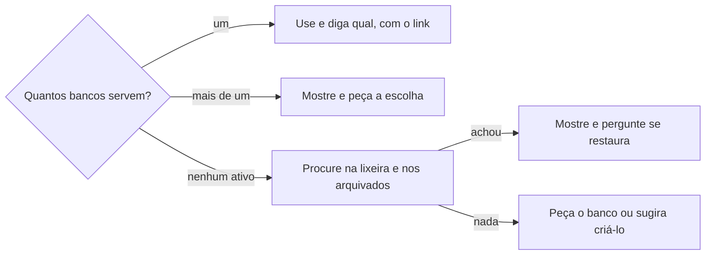

# Procurar banco de dados

## Parâmetros de configuração

Leia cada valor nas instruções do projeto: primeiro na entrada com o nome desta habilidade, depois na entrada `Global` ou no primeiro nível do bloco. Quando um valor não estiver lá, use o padrão abaixo.

```yaml
"Modo de aprendizado": "perguntar"
```

## Instruções

### Passo 1

Quem chamou diz o nome do parâmetro vazio, para que serve o banco e as propriedades que ele precisa ter. Sem isso, peça a quem chamou. Se as instruções do projeto já definem o banco, ele vale: não procure.

### Passo 2

Procure só entre bancos, pelo nome do parâmetro e por sinônimos curtos. Não varra o conteúdo das páginas nem o workspace inteiro: essa busca gasta mais créditos. Procure primeiro entre os bancos ativos.

Leia a estrutura de cada candidato e compare com as propriedades que quem chamou pediu. O nome parecido não basta: um banco sem as propriedades essenciais fica fora. Não use o banco de outro workspace.

### Passo 3



Um só: devolva-o com o link e diga qual usou, sem perguntar o nome. Mais de um de nome igual ou parecido: mostre cada um, com o nome, o link e as propriedades, e peça a escolha. Nenhum ativo: procure então na lixeira e entre os arquivados, pelo mesmo nome. Um banco achado ali pode ter sido apagado ou arquivado por engano: mostre-o, com o link e onde está, diga isso e pergunte se a pessoa o restaura. Não o restaure nem o use sem o sim.

Se a ferramenta não alcança a lixeira nem os arquivados, pergunte se o banco foi arquivado ou apagado. Nada, nem ali: peça que a pessoa informe o banco e sugira criá-lo, com o nome e as propriedades esperadas. Não crie sem o sim.

### Passo 4

Um campo dentro do banco segue o mesmo caminho, no banco já conhecido: um só do tipo esperado, devolva; mais de um, peça a escolha; nenhum, sugira criar o campo e não crie sem o sim.

Devolva a quem chamou o banco ou o campo, com o link, ou a pendência que espera a pessoa. Diga o valor achado para ela poder fixá-lo nas instruções do projeto. Não o grave sozinha.

### Passo 5

Ao terminar, siga `evoluir-habilidade` conforme `Modo de aprendizado`.

## Problemas comuns

### Busca no workspace inteiro

Se você varrer o conteúdo do workspace atrás do banco, a busca gasta créditos e traz páginas no lugar de bancos.

1. Busque só entre bancos, pelo nome.
2. Use poucos sinônimos curtos.

### Nome parecido aceito

Se você devolver um banco só porque o nome lembra o pedido, a escrita cai num banco que não tem as propriedades.

1. Leia a estrutura de cada candidato.
2. Compare com as propriedades pedidas.
3. Descarte o que não tem as essenciais.

### Lixeira e arquivados ignorados

Se você sugerir criar um banco sem olhar a lixeira e os arquivados, o banco apagado ou arquivado por engano fica perdido e o workspace ganha um repetido.

1. Sem banco ativo, procure na lixeira e entre os arquivados.
2. Se a ferramenta não alcança, pergunte à pessoa se o banco foi arquivado ou apagado.
3. Restaure só com o sim.

### Banco criado sem o sim

Se você criar o banco ou o campo quando nada serve, o workspace ganha uma estrutura que ninguém pediu.

1. Sugira a criação, com o nome e as propriedades.
2. Espere o sim.

### Parâmetro preenchido ignorado

Se você procurar mesmo com o banco definido nas instruções do projeto, a busca troca o banco que a pessoa fixou.

1. Leia o parâmetro antes.
2. Preenchido, use-o e não procure.

## Exemplos de entrada e saída

Estes exemplos ilustram fatos. Eles podem não estar no data source.

### O banco de estampas está vazio e o workspace tem um banco de estampas

Busquei entre os bancos pelo nome e li a estrutura do candidato: tinha o nome e o motivo. Devolvi o banco com o link, disse qual usei e sugeri fixar o valor nas instruções do projeto.

### Há dois bancos de tecidos no workspace

Mostrei os dois, com o link e as propriedades de cada um, e pedi que a pessoa escolhesse. Não escolhi sozinha.

### Nenhum banco de textos de etiqueta

Não achei candidato entre os ativos e procurei na lixeira e nos arquivados. Nada. Pedi que a pessoa informasse o banco e sugeri criá-lo, com o nome e as propriedades. Não criei antes do sim.

### O banco de tecidos não está entre os ativos

Achei um banco com esse nome na lixeira, com as propriedades certas. Mostrei o link, disse que pode ter sido apagado por engano e perguntei se a pessoa o restaura. Não o restaurei antes do sim.

## Casos-limite

- Não há workspace conectado: diga isso e peça o banco à pessoa.
- Um banco que serve está em outro workspace: não o use.
- Um banco ativo e outro igual na lixeira: use o ativo e não procure na lixeira.
- O campo do tipo esperado não existe no banco: sugira criá-lo e espere o sim.
- Quem chamou não disse as propriedades esperadas: peça a ela antes de comparar.

## Pegadinhas

- O banco achado parece o banco certo pelo nome. Só as propriedades dizem.
- A falta de banco ativo parece provar que ele não existe. Ele pode estar na lixeira ou arquivado por engano.
- Procurar parece grátis. A busca no workspace inteiro gasta créditos.
- O valor achado parece poder ser gravado para a próxima vez. Quem fixa o parâmetro é a pessoa.
- Dois bancos parecidos parecem pedir que se escolha o mais novo. A escolha é da pessoa.

## Scripts disponíveis

- Nenhum.

1. Não há script para executar.
