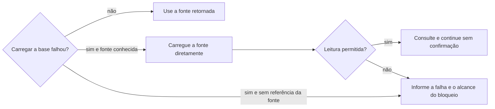

# Procurar oportunidade

## Parâmetros de configuração

Leia cada valor nas instruções do projeto: primeiro na entrada com o nome desta habilidade, depois na entrada `Global` ou no primeiro nível do bloco. Quando um valor não estiver lá, use o padrão abaixo.

```yaml
"Formato da data com dia da semana": "terça-feira, 01/09/2026"
```

## Instruções

### Passo 1

Peça o nome, ou use o texto que a pessoa já passou. O nome da edição e a data são o que se busca. A frase da legenda não é o nome. A lista de oportunidades e o nome de cada propriedade vêm do mapeamento de dados do projeto. Este texto usa os conceitos: o título da edição, as variações de nome e a data da edição. Se a pessoa não indicar outra lista, use a do mapeamento, no workspace conectado. Não peça a lista nesse caso. Se essa lista não estiver nessa conexão, pare. Não use a lista de outro workspace.

### Passo 2

Carregue o esquema da fonte de dados antes da consulta direta e use os identificadores e as propriedades retornados. Não construa o endereço de uma base a partir do identificador de uma fonte de dados: eles não são intercambiáveis. Use a referência da fonte que o mapeamento ou uma resposta estruturada trouxe.



Uma chamada negada não prova perda de acesso à lista inteira. Não peça mudança de permissões nem diga que a lista está inacessível antes de verificar a leitura permitida da fonte conhecida, na mesma conexão. Não troque de workspace, não eleve privilégios e não repita uma chamada negada sem informação nova. Busca parcial ou só semântica não prova ausência da edição.

Nessa lista, busque o pedaço do nome no título da edição e nas variações de nome, por consulta direta e por busca semântica. Não exija o título inteiro. Não busque no workspace inteiro. Uma palavra igual não é a edição. Uma palavra comum no texto de outra página não é o nome.

### Passo 3

Leia cada página encontrada. A mesma edição tem o nome, ou uma variação, e a mesma data. A data é a data da edição. Outro mês ou outro ano é outra edição. Se a data da página estiver vazia, mostre a página e diga que a data está vazia. Não invente a data. Não invente o grupo.

### Passo 4

Uma edição com o mesmo nome e a mesma data: ela existe. Mostre o título, a data, o status atual e o link. O status vem da propriedade de status da lista do projeto, com o valor que a página tem. Sem status na página, diga que está vazio. Não invente. Se entrou por uma variação, diga qual. Na mesma resposta, diga o pedaço buscado e que usou as duas buscas. Se o texto é um pedido realizado ou confirmado, siga `definir-inscricao` nessa mesma resposta. Não pare na edição.

Várias que podem ser a edição: mostre título, data, status atual e link de cada uma, inclusive as possíveis duplicatas. Não escolha. Não responda sim.

Edição achada com data, ou intervalo, anterior a hoje: antes de qualquer alteração, pergunte quais foram aproveitadas e quais foram perdidas, listando cada uma com título, data e status atual. Só depois da resposta, atualize o status de cada uma para o valor da lista que corresponde a aproveitada ou a perdida. Sem resposta, não altere o status. Um intervalo conta como anterior a hoje quando o último dia já passou.

Outra data do mesmo nome é outra edição. Antes de alterar uma edição existente, compare a data da página com a do pedido. Se o pedido se refere a outra data, não atualize a existente: trate como edição nova, e o cadastro dela segue `criar-oportunidade`. Sem data clara no pedido, peça a confirmação da data ou trate como edição nova. Não altere a existente no escuro.

A pessoa diz que duas edições que parecem a mesma são coisas diferentes, por exemplo mesmo dia, mesmo tema ou mesmo organizador: a desambiguação é a relação Não confundir com entre elas, feita por `identificar-duplicata` e `mesclar-registro`. Oriente isso e não consolide as duas.

Nenhuma: diga que ela não existe na lista de oportunidades. Mostre o link da lista. Repita o nome, a data e o lugar buscados, e que usou as duas buscas. Não organize a participação. Não crie tarefa. A resposta não pede para nomear a habilidade.

A entrada é o texto de um comunicado ou convite de evento, colado ou encaminhado, com nome e data, e a edição não existe: siga `criar-oportunidade` na mesma resposta, sem perguntar o que fazer. A chamada cadastra a edição e, se faltar o grupo, passa por `definir-grupo-de-oportunidades`, e nunca cria o grupo dentro da edição. Só pergunte se faltar o nome ou a data, e só o que falta. Quem manda ou encaminha o texto não é, por isso, a organização: pode estar só divulgando outra feira. Não grave quem encaminhou como organizador.

A entrada é a pergunta se a oportunidade existe, sem o texto de um comunicado: pare na resposta e não crie.

Com o nome da edição e a data na mão, ela existindo ou não, renomeie a sessão de conversa com a IA, o nome da conversa na lista do app, para o nome da edição e a data no formato da data com dia da semana, sem o grupo e sem a cidade. Só renomeie quando a sessão ainda leva o nome padrão do app: um nome que a pessoa deu fica como está. Não pergunte.

### Passo 5

Data de evento, compromisso, prazo, viagem, reserva, lançamento, entrega ou outro marco, na resposta, no resumo, na tabela ou em outro texto, sai no formato da data com dia da semana. Calcule o dia da semana com a data, o horário e o fuso do evento, como a regra do dia da semana manda, antes de responder. Sem horário ou sem fuso, e se o dia puder mudar, peça. Não invente. Intervalo ou vários dias: o dia da semana em cada data.

Se a fonte trouxer um dia da semana incompatível com a data, sinalize a divergência. Na consulta pura, não crie nem altere, a não ser o status de uma edição passada, e só depois da resposta da pessoa sobre quais foram aproveitadas e quais foram perdidas.

## Problemas comuns

### Palavra em comum

Se você citar uma página que só compartilha uma palavra com o nome, a resposta fala de outra edição.

1. Leia o título da edição e a data.
2. Deixe de fora a página de outro nome.
3. Conte o pedaço buscado e as duas buscas.

### Data de outra edição

Se você tratar o mesmo nome em outro mês ou outro ano como esta edição, duas edições viram uma.

1. Compare com a data da edição.
2. Outra data é outra edição. Mostre as duas se as duas aparecerem.
3. Data vazia: mostre a página e diga que a data está vazia. Não invente.

### Variação ignorada

Se você exigir o título inteiro e ignorar as variações de nome, a edição que já está na lista parece nova.

1. Busque o pedaço também nas variações de nome.
2. Uma variação é a mesma oportunidade.
3. Diga qual variação entrou.

### Legenda como nome

Se você buscar a frase da legenda, a lista não tem a edição e o nome certo fica de fora.

1. O nome é o da edição.
2. A data é a do evento.
3. A frase que convida o público não é o título.

### Cadastrar nesta habilidade ou perguntar à toa

Se você cadastrar aqui a oportunidade que não achou, ou perguntar o que fazer diante de um comunicado de evento com nome e data, a verificação vira criação sem a regra do cadastro, ou a pessoa precisa repetir o pedido.

1. Diga que ela não existe na lista de oportunidades.
2. Comunicado ou convite com nome e data: siga `criar-oportunidade` na mesma resposta, sem perguntar. O cadastro fica com ela, nunca com esta habilidade.
3. Só a pergunta se existe: pare. Falta o nome ou a data: pergunte só o que falta.
4. Não grave quem encaminhou o texto como organizador.

### Lista pedida à toa

Se você pedir a lista quando a pessoa não passou outra, a busca não acontece.

1. Use a lista do mapeamento, no workspace conectado.
2. Busque o pedaço nessa lista.
3. Peça a lista só quando a pessoa indicou outra e ela não está na conexão.

### Busca fora da lista

Se você buscar no workspace inteiro, uma tarefa, uma nota ou outra lista entra no lugar da oportunidade.

1. Busque só na lista de oportunidades.
2. Ignore página que não é dessa lista.

### Data sem o dia da semana

Se você escrever a data numérica sem o dia da semana, ou repetir um dia da semana que não bate com a data, a pessoa lê outra edição.

1. Calcule o dia como a regra do dia da semana manda, com a data, o horário e o fuso.
2. Escreva no formato da data com dia da semana em cada data.
3. Se divergir, sinalize. Não crie nem altere.

### Sessão com o nome padrão

Se você achar ou não achar a edição e deixar a sessão com o nome padrão do app, a pessoa não acha a conversa pela oportunidade, e o PR de uma lição que sai dela passa a dar o nome.

1. Renomeie a sessão para o nome da edição e a data com dia da semana, sem o grupo e sem a cidade.
2. Só renomeie se a sessão ainda leva o nome padrão. Um nome dado pela pessoa fica.
3. Não pergunte.

## Exemplos de entrada e saída

Estes exemplos ilustram fatos. Eles podem não estar no data source.

### Festival Rota Sul, entrada gratuita, 29 e 30 de setembro de 2026, 09h às 19h, Centro de Eventos Aurora, Rua das Flores, 100, Cidade Exemplo.

a oportunidade não existe na lista de oportunidades. Mostrei o link da lista. Busquei o pedaço "Rota Sul" e as datas terça-feira, 29/09/2026 e quarta-feira, 30/09/2026, 09h às 19h, no Centro de Eventos Aurora, Rua das Flores, 100, Cidade Exemplo, por consulta direta e por busca semântica. Como o texto é um comunicado com nome e data, segui `criar-oportunidade` na mesma resposta, sem perguntar, e não gravei quem encaminhou como organizador.

### já temos a oportunidade Festival Rota Sul?

Não existe na lista de oportunidades. Mostrei o link da lista e o que busquei. Como é só a pergunta, sem o texto de um comunicado, não cadastrei.

### a fonte diz segunda-feira, 01/09/2026

01/09/2026 é terça-feira. Sinalizei a divergência. Na resposta, usei o formato da data com dia da semana. Não cadastrei até a pessoa confirmar a data.

### o print de um comunicado chega numa sessão que ainda se chama New session

A edição não existia. A sessão passou a se chamar Festival Rota Sul — terça-feira, 29/09/2026, sem o grupo e sem a cidade, e o cadastro seguiu `criar-oportunidade`. Se a pessoa já tivesse dado um nome à sessão, ele ficaria.

## Casos-limite

- A sessão ainda leva o nome padrão do app e há nome e data: renomeie para o nome da edição e a data com dia da semana. Nome dado pela pessoa fica.
- A mensagem fala de uma feira no mesmo lugar, mas de quem a propõe é outro grupo, ou o formato é outro: é outra oferta. Compare quem organiza e o formato com a edição antes de ligar. Sem data definida, ela não é uma edição: leve só o que falta ao relatório.
- Várias páginas podem ser a edição: mostre título, data e link de cada uma. Não escolha. Não responda sim.
- O nome bate e a data é outro mês ou outro ano: é outra edição.
- A data da página está vazia: mostre a página e diga que a data está vazia. Não invente.
- O nome está só nas variações de nome: é a mesma oportunidade. Diga a variação.
- A pessoa não diz "oportunidade": o texto com o nome da edição e a data basta.
- A pessoa não passa a lista: use a do mapeamento, no workspace conectado. Não peça.
- A pessoa indicou outra lista e ela não está no workspace conectado: pare e peça a lista certa.
- Nada igual nessa lista e a entrada é um comunicado ou convite com nome e data: diga que não existe e siga `criar-oportunidade` na mesma resposta, sem perguntar.
- Nada igual nessa lista e a entrada é só a pergunta se existe: diga que não existe. Não crie. Não busque o workspace inteiro.
- O comunicado não traz o nome ou a data: pergunte só o que falta.
- Quem encaminhou o comunicado não é a organização: não grave quem encaminhou como organizador.
- O dia da semana da fonte não bate com a data: sinalize. Não grave.
- A edição achada é anterior a hoje: pergunte quais foram aproveitadas e quais foram perdidas antes de mudar o status.
- O pedido tem outra data que a da página, com o mesmo nome: é outra edição. Não atualize a existente.
- A pessoa diz que duas edições parecidas são diferentes: oriente a relação Não confundir com, por `identificar-duplicata` e `mesclar-registro`.

## Pegadinhas

- Uma palavra do nome, usada como verbo ou adjetivo no texto de outra página, parece o nome. Não é. Outro nome com a mesma palavra é outra oportunidade.
- Outro evento na mesma cidade, no mesmo lugar ou no mesmo mês parece esta edição. O nome, a data e quem organiza decidem: a proposta que um grupo de marcas faz ao dono do espaço, no mesmo lugar e perto da mesma data, é outra oferta, e não a edição da organização.
- "Uma oportunidade para conhecer novidades" parece o título. É a legenda.
- Uma variação nas variações de nome parece apelido solto. É a mesma oportunidade.
- Não achar um comunicado com nome e data parece pedir uma pergunta à pessoa. Siga `criar-oportunidade` na mesma resposta. Quem manda o comunicado parece ser a organização. Pode ser só quem divulga.
- Não achar na pergunta se existe parece licença para cadastrar. Sem o texto de um comunicado, a habilidade para na resposta. O cadastro fica com `criar-oportunidade`.
- Achar a edição parece o fim de um pedido confirmado. A inscrição segue `definir-inscricao` na mesma resposta.
- Grupo vazio parece pendência desta busca. Esta habilidade não pede o grupo e não preenche.
- A data numérica parece bastar. A resposta leva o dia da semana, calculado com a data, o horário e o fuso.
- O nome padrão da sessão parece inofensivo. A pessoa procura a conversa pela oportunidade, então ela leva o nome da edição e a data.

## Scripts disponíveis

- Nenhum.

1. Não há script para executar.
