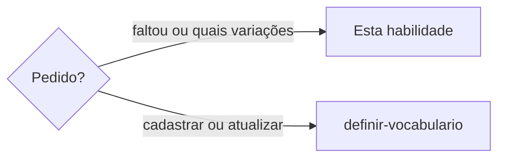

# Procurar variação de termo

## Parâmetros de configuração

```yaml
"Modo de aprendizado": "perguntar"
```

## Instruções

### Passo 1

A pessoa quer saber se um termo faltou, ou quais formas de um termo já estão no vocabulário. Sem idioma ou sem termo, pare e peça. Esta habilidade só lê. O cadastro segue `definir-vocabulario`.



### Passo 2

Liste as formas a pesquisar. Para a pergunta se um termo faltou, a forma é esse termo. Para as variações de um termo, as formas são plural, singular, feminino, masculino e outra grafia, quando a palavra tiver. Pontuação e emoji não têm essa variação.

### Passo 3

Pesquise cada forma com a consulta de Scripts disponíveis. Com terminal, rode o comando. Sem terminal, chame a ferramenta do servidor `vocabulary`. Sem os dois, como num agente do Notion, pare. Diga que a consulta roda numa ferramenta de código com o projeto aberto. Não leia o vocabulário de memória.

Outra caixa é o mesmo termo. Acento, plural, gênero e outra palavra do mesmo assunto são linhas próprias, cada uma com o próprio estado.

### Passo 4

Responda forma por forma. Diga quais estão cadastradas, com o estado, e quais não estão. Se a ausente é variação de um termo que já está, diga isso também.

Sugira o cadastro das ausentes e pergunte o estado de cada uma. Não grave nessa resposta. Não copie o estado do termo vizinho. Quando a pessoa escolher, o cadastro e o `related` entre as linhas seguem `definir-vocabulario`.

### Passo 5

Ao terminar, siga `evoluir-habilidade` conforme `Modo de aprendizado`.

## Problemas comuns

### Variação sem dizer quais faltam

Se você disser que todas as formas entraram, ou gravar as ausentes com o estado do termo novo, a pessoa não escolhe o estado.

1. Pesquise cada forma de gênero, número e grafia.
2. Diga quais estão cadastradas e quais não estão.
3. Sugira o cadastro das ausentes e pergunte o estado de cada uma. Não grave nessa resposta.

### Variação que faltou

Se você disser que a variação já está, ou gravar o ponteiro para um termo ausente, a pessoa não escolhe o estado dessa forma.

1. Diga que o termo não existe.
2. Sugira o cadastro, com o estado que ela escolher.
3. Só depois do cadastro o `related` aponta de uma linha para a outra.

## Exemplos de entrada e saída

Estes exemplos ilustram fatos. Eles podem não estar no data source.

### Quais variações de casa e moradias?

Casa e moradias acabaram de entrar. Pesquisei casas e moradia. Nenhuma das duas estava. Disse isso e perguntei o estado de cada uma. Não gravei.

### Faltou casas?

A busca não achou casas. Casa já estava. Disse que casas não existe, que é o plural de casa, e sugeri o cadastro. Não gravei.

## Casos-limite

- A pessoa pergunta se um termo faltou e ele não existe: diga isso e sugira o cadastro.
- A pessoa pergunta as variações de um termo que acabou de entrar: diga quais estão e quais não estão. Sugira o cadastro das ausentes e pergunte o estado.
- A forma só muda a caixa: é o mesmo termo. Diga que ele já está.
- A forma só muda o acento: é outro termo. Pesquise e diga se ele está.
- A pessoa responde o estado das formas ausentes: siga `definir-vocabulario`.
- Sem terminal e sem o servidor `vocabulary`: pare. Não responda de memória.

## Pegadinhas

- Uma variação ausente parece já ligada pela palavra vizinha. Ela não existe até ser cadastrada. `related` não a cria.
- O termo que acabou de entrar parece levar as variações junto. Cada forma só está se a consulta achar a linha dela. A ausente espera o estado.
- Roles e rolês parecem a mesma palavra sem acento. O acento muda a palavra, como o cedilha muda casa e caça. São duas linhas.

## Scripts disponíveis

- `node node_modules/vocabulary/dist/cli.js lookup --language <idioma> --term <termo>` lê um termo e devolve se ele existe e a linha guardada.
- `--glossary`, antes do comando, aponta outro vocabulário.
- `lookup_term`, no servidor `vocabulary`, faz a mesma consulta quando não há terminal.

1. Com terminal, rode `lookup` para cada forma.
2. Sem terminal, chame `lookup_term` com os mesmos campos.
3. Sem terminal e sem o servidor `vocabulary`, pare.
