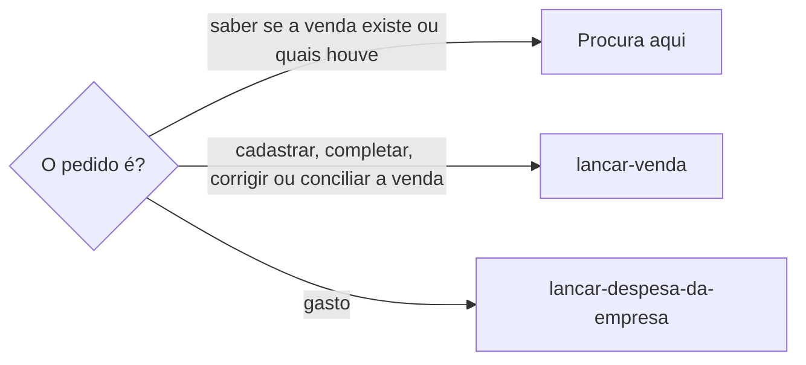
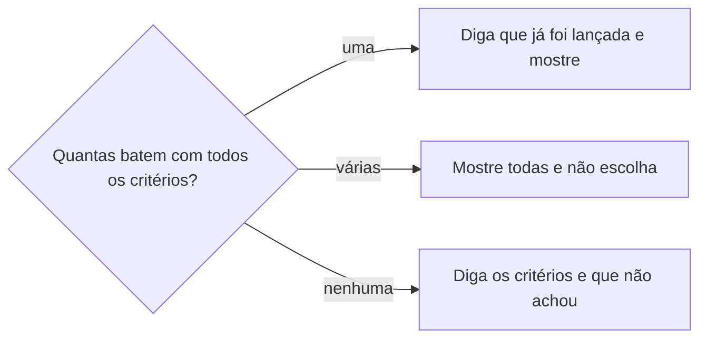

# Procurar venda

## Parâmetros de configuração

Leia cada valor nas instruções do projeto: primeiro na entrada com o nome desta habilidade, depois na entrada `Global` ou no primeiro nível do bloco. Quando um valor não estiver lá, use o padrão abaixo.

```yaml
# `Banco de vendas` é o mesmo de `lancar-venda`: sem valor aqui nem na `Global`, vale o da entrada dela. Os nomes das propriedades vêm do mapeamento de dados do projeto.
"Banco de vendas": ""
"Modo de aprendizado": "perguntar"
```

## Instruções

### Passo 1

Saber se uma venda já foi lançada, ou quais vendas houve, é esta habilidade. Ela só lê: não cria, não completa e não corrige a página.



As vendas ficam em `Banco de vendas`. Com ele vazio, siga `procurar-banco-de-dados`, dizendo que o banco guarda as vendas e tem a data e a hora da venda, o valor e a pessoa cliente. Não use a lista de outro workspace.

Este texto usa conceitos, e o mapeamento de dados do projeto diz o nome de cada propriedade: a data e a hora da venda, o valor pago pelos produtos, o valor com frete, o valor recebido, o status do pagamento, a pessoa cliente, o ponto de contato, as unidades, o produto, o número do pedido, o link do pedido e o identificador da transação.

### Passo 2

Use todo critério que a pessoa deu, ou que a habilidade que chamou passou. Um só basta: não peça os outros. Sem nenhum, pergunte uma vez qual usar e não liste o banco inteiro.

- Data ou período: o dia inteiro, no fuso da pessoa. A data é a da venda real, não a do lançamento na loja.
- Produto ou variante: ache antes a página do produto ou da unidade e busque as vendas ligadas a ela. A variante, como o tamanho, está na unidade.
- Pessoa cliente: ache antes a página da pessoa e busque as vendas ligadas a ela. Siga `definir-grafia` e busque cada forma do nome.
- Ponto de contato: ache antes a página do ponto, como a feira ou a loja virtual, e busque as vendas ligadas a ela.
- Número do pedido, link do pedido e identificador da transação: são três dados. Busque cada um na propriedade dele, pelo valor exato.
- Valor: compare com o valor pago pelos produtos, com o valor com frete e com o valor recebido, e diga com qual bateu.

### Passo 3

Carregue o esquema da fonte de dados antes de consultar e use as propriedades que ele traz. Faça a consulta direta com todos os critérios juntos. A busca semântica serve só para achar a página de uma pessoa, de um produto ou de um ponto pelo nome. Não busque no workspace inteiro.

Com mais de um critério e nenhuma venda que bata com todos, consulte de novo com cada critério sozinho. Uma venda que bate só em parte entra na resposta com o critério que bate e o que diverge. Ela não é a venda pedida.

### Passo 4

Leia cada página achada. Para cada venda, mostre o link da página, o pedido, a data e a hora no fuso da pessoa, o valor, o status do pagamento, a pessoa cliente, as variantes e as unidades ligadas. Com mais de uma venda, use uma tabela, uma linha por venda.

Um dado vazio na página sai como vazio. Não invente e não complete com o que a pessoa contou. Um valor calculado sai como a página mostra.

### Passo 5



Várias: mostre todas e diga o que distingue cada uma, como a hora, o valor ou a pessoa. Não escolha e não responda sim.

Nenhuma: diga cada critério usado, com o valor buscado, e que não achou nesse banco, com o link dele. Mostre as que batem em parte, se houver. Não crie a venda. Se a pessoa quer lançá-la, o pedido segue `lancar-venda`.

Quando outra habilidade chamou, devolva a ela as vendas achadas ou a falta delas. Atualizar, confirmar ou criar é decisão dela.

### Passo 6

Ao terminar, siga `evoluir-habilidade` conforme `Modo de aprendizado`.

## Problemas comuns

### Venda criada na busca

Se você lançar a venda que não achou, a verificação vira cadastro sem as regras do cadastro.

1. Diga os critérios usados e que não achou.
2. Pare. Lançar a venda segue `lancar-venda`, com o pedido da pessoa.

### Escolha entre parecidas

Se você responder sim com a primeira venda parecida, duas vendas do mesmo dia ou do mesmo valor viram uma.

1. Mostre todas as que batem.
2. Diga o que distingue cada uma.
3. Deixe a escolha com a pessoa.

### Valor como identidade

Se você tratar o valor igual como prova de que é a mesma venda, a venda de outra pessoa pelo mesmo preço responde à pergunta.

1. Diga com qual valor bateu: o pago pelos produtos, o com frete ou o recebido.
2. Mostre a data, a pessoa cliente e as unidades de cada venda achada.
3. Não responda sim só pelo valor.

### Produto buscado pelo texto

Se você buscar o nome do produto no título da venda, a venda que não cita o produto no título fica de fora.

1. Ache a página do produto ou da unidade.
2. Busque as vendas ligadas a essa página.

### Resultado parcial calado

Se você disser só que não achou quando uma venda bate com o dia e diverge no valor, a pessoa lança a mesma venda de novo.

1. Consulte cada critério sozinho.
2. Mostre a venda que bate em parte, com o que bate e o que diverge.
3. Não diga que ela é a venda pedida.

### Nome de banco inventado

Se você escolher um banco ou uma propriedade que o projeto não definiu, a busca lê a lista errada e diz que a venda não existe.

1. Leia o parâmetro e o mapeamento de dados do projeto.
2. Banco vazio: siga `procurar-banco-de-dados`.
3. Não escreva nome de banco nesta habilidade.

## Exemplos de entrada e saída

Estes exemplos ilustram fatos. Eles podem não estar no data source.

### a venda de hoje na feira já tá lançada?

Sim. Busquei as vendas de 20/11/2026 no ponto de contato da feira e achei uma: mostrei o link, o pedido vazio, 15h40, R$ 180,00, pagamento pago, a cliente Ana Souza e a unidade de tamanho M. Não alterei a página.

### quais vendas a Ana Souza já fez?

Achei a página da pessoa, busquei também a forma Ana Sousa e mostrei as três vendas ligadas a ela numa tabela, com link, pedido, data e hora, valor, status do pagamento, variantes e unidades.

### tem venda de R$ 250 ontem?

Não achei venda de 19/11/2026 com R$ 250,00 no valor pago, no valor com frete nem no valor recebido. Mostrei a única venda desse dia, de R$ 230,00, e disse que o dia bate e o valor diverge. Não criei a venda.

### já lançamos o pedido 1042?

Duas páginas têm o pedido 1042. Mostrei as duas, com a data, o valor e a cliente de cada uma, e não escolhi.

## Casos-limite

- A pessoa não diz "venda": perguntar se o pedido de alguém já entrou, ou o que saiu num dia, basta.
- Nenhum critério: pergunte uma vez qual usar. Não liste o banco inteiro.
- O período é longo e traz muitas vendas: mostre a tabela e diga quantas são.
- A página da pessoa, do produto ou do ponto não existe: diga isso e que, por esse critério, não há venda ligada. Não cadastre.
- Duas páginas da mesma pessoa: busque as vendas das duas e diga que há duas páginas.
- A venda existe sem pedido, sem pessoa cliente ou sem unidade: mostre e diga o que está vazio.
- O pedido da loja chegou depois da venda real: a data buscada é a da venda. Sem resultado, busque também pela data do lançamento na loja e diga qual das duas bateu.
- O banco de vendas não está no workspace conectado: pare. Não use outra lista.
- O pedido é completar ou corrigir a venda achada: siga `lancar-venda`.

## Pegadinhas

- O dia gravado parece o dia da venda. A hora pode estar gravada em outro fuso, e a venda da noite cai no dia seguinte: filtre pelo dia no fuso da pessoa.
- O número do pedido parece identificar a transação. Pedido, link do pedido e identificador da transação ficam em propriedades separadas.
- O valor da pergunta parece o valor pago. A pessoa pode dizer o valor com frete ou o que caiu na conta.
- A venda parece ter o produto no título. O produto e a variante estão nas unidades ligadas.
- Não achar parece provar que a venda não existe. Ela pode estar com outro valor, outra data ou sem a pessoa cliente: a busca por um critério só mostra.
- A venda achada com um campo vazio parece pedir o preenchimento. Esta habilidade não escreve.

## Scripts disponíveis

- Nenhum.

1. Não há script para executar.
