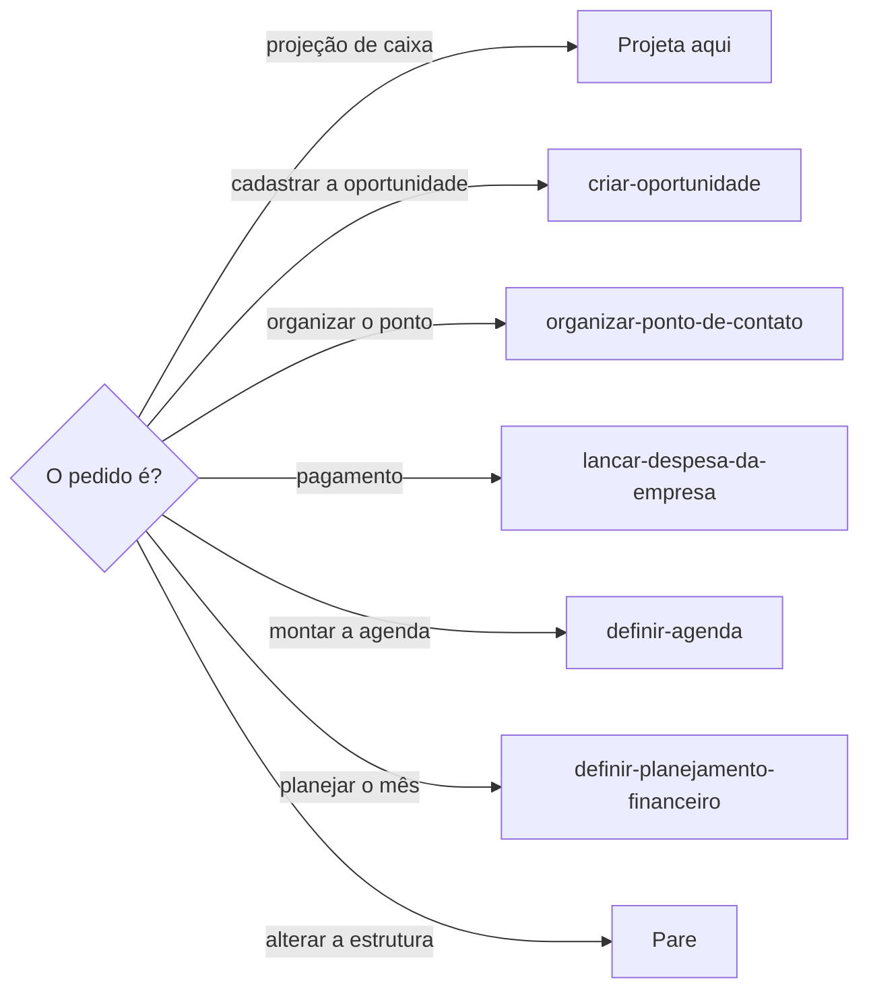
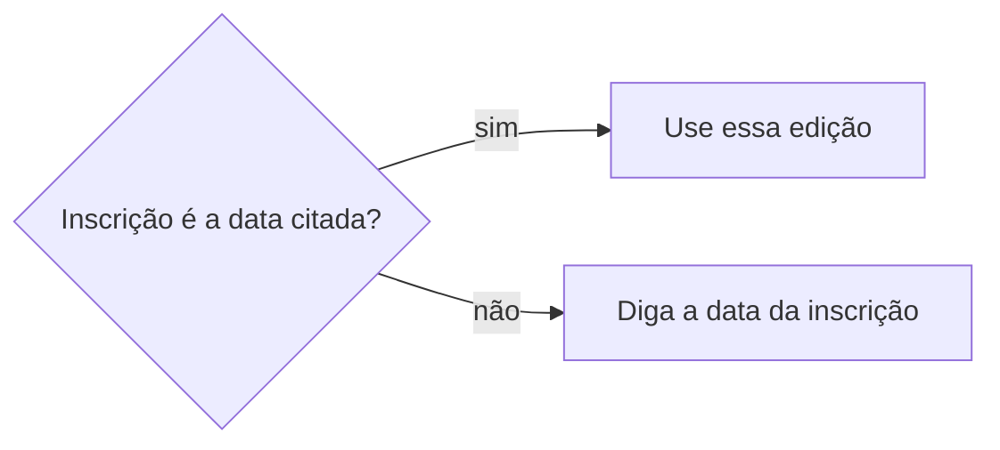
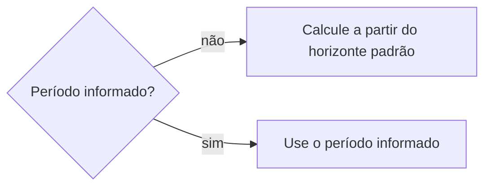
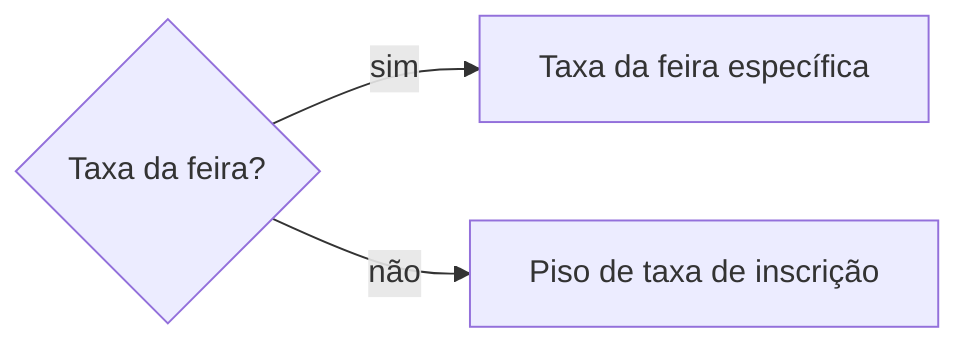
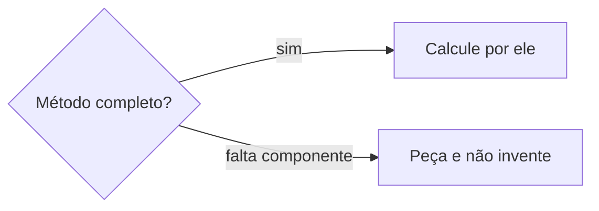
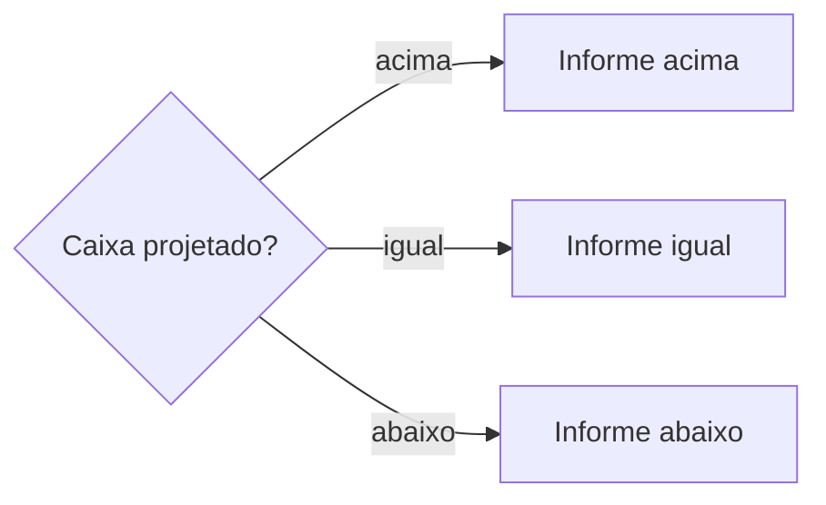

# Projetar caixa

## Parâmetros de configuração

Leia cada valor nas instruções do projeto: primeiro na entrada com o nome desta habilidade, depois na entrada `Global` ou no primeiro nível do bloco. Quando um valor não estiver lá, use o padrão abaixo.

```yaml
"Modo de aprendizado": "perguntar"
"Formato do período de referência": "DD/MM/AAAA a DD/MM/AAAA"
"Método de custo de participação": "taxa de inscrição + custo operacional complementar médio + contingência"
# Nomes de banco: o projeto define. Vazios, use `procurar-banco-de-dados` antes de perguntar.
"Banco de oportunidades": ""
"Banco de localidades": ""
"Banco de pontos de contato": ""
# Valores do negócio: o projeto define. Vazios, pergunte uma vez e não invente.
"Caixa seguro recomendado": ""
"Contingência usada": ""
"Custo mínimo para ponto menor quando não informado": ""
"Horizonte padrão": ""
# Colunas que a tabela da resposta não mostra, como notas internas de curadoria.
"Colunas omitidas na tabela da projeção": ""
```

## Instruções

### Passo 1

Projetar o caixa das próximas feiras e das outras oportunidades é esta habilidade. A projeção tem duas partes: a reserva de cada feira, que é quanto a participação deve custar, e o caixa do período, que compara essas reservas com o `Caixa seguro recomendado`.

A análise lê, calcula e decide na resposta. A resposta não pede para nomear a habilidade.



### Passo 2

Consulte `Banco de oportunidades` e, para os pisos, `Banco de localidades`. Os nomes das propriedades vêm do mapeamento de dados do projeto. Banco vazio: use `procurar-banco-de-dados`, dizendo que um guarda as oportunidades e o outro os pisos por localidade. Não use o banco de outro espaço.

Nem toda oportunidade é feira efetiva. A feira efetiva é a participação em `Banco de pontos de contato`, off-line ou on-line, em que o negócio realiza vendas. Não trate a oportunidade como participação confirmada.

### Passo 3

A data citada pela pessoa escolhe a edição. Se a inscrição registrada está em outra data, diga isso e não use o orçamento dessa outra data.



Sem período informado, o período de referência vai do dia da projeção até esse dia mais o `Horizonte padrão`. Com período informado, use esse. `Horizonte padrão` vazio e sem período informado: pergunte uma vez.

A resposta sempre informa o período no `Formato do período de referência`, com as datas desta execução. Não copie as datas do parâmetro.



### Passo 4

Reserva da feira, taxa. A taxa de inscrição da feira específica, informada pela pessoa ou encontrada em `Banco de oportunidades`, é a referência principal. Não a troque pelo piso nem por outra estimativa.

Sem ela, use o piso de taxa de inscrição da localidade como taxa segura provisória, e a resposta diz que a taxa é provisória e veio desse piso. Taxa desconhecida, ausente ou insuficiente não é R$ 0,00. Sem o piso, peça. Formato não identificado: mostre cada taxa e marque a projeção como provisória.



### Passo 5

Reserva da feira, custo de participação. Use o `Método de custo de participação`. O custo complementar é a média do grupo. Sem ela, é o piso de custo complementar da localidade, que uma média histórica não substitui.

Ponto menor sem custo informado usa o `Custo mínimo para ponto menor quando não informado`. A contingência é sempre o valor vigente de `Contingência usada`. Ela absorve alimentação, deslocamento, estacionamento, estrutura e custo não previsto, que não viram quantia à parte.

Meta de receita, produção, passagem e hospedagem não entram. O repasse de faturamento fica à parte e não multiplica pela contingência.



### Passo 6

Reserva da feira, caixa seguro. O caixa seguro projetado é o maior valor entre os custos operacionais já lançados e a taxa segura mais o custo complementar, multiplicado por um mais a contingência usada.

O caixa seguro final, que é a reserva, é o maior valor entre o projetado e o piso mínimo do grupo. Sem o piso do grupo, use o piso mínimo recomendado da localidade.

Os três pisos vêm de `Banco de localidades`. Sem um deles, peça. Não troque um piso pelo caixa seguro recomendado, pela contingência nem pelo custo do ponto menor.

### Passo 7

Caixa do período. Diga se o caixa projetado do período fica acima, igual ou abaixo do valor vigente de `Caixa seguro recomendado`.



Todo número vem da fonte ou dos parâmetros. Não fixe outro número no lugar de um parâmetro. Número que falta, peça, uma vez.

### Passo 8

Quando a projeção usa dado histórico para taxa, custo complementar, piso ou premissa, liste cada referência: oportunidade, ponto de contato, grupo, localidade, período ou registro.

Separe referência histórica, período de referência projetado e parâmetro atual. Premissa que veio só dos parâmetros não ganha histórico. Não invente referência. A tabela da resposta omite as `Colunas omitidas na tabela da projeção`.

### Passo 9

Ao terminar, siga `evoluir-habilidade` conforme `Modo de aprendizado`.

## Problemas comuns

### Taxa zerada

Se você usar R$ 0,00 quando a taxa da feira é desconhecida, a participação nasce gratuita.

1. Use o piso de taxa de inscrição da localidade como taxa segura provisória e diga isso.
2. Sem o piso, peça.

### Piso trocado

Se você preencher um piso vazio com um parâmetro ou com uma média histórica, a localidade ganha um número que ela não tem.

1. Leia os três pisos em `Banco de localidades`.
2. Sem um deles, peça.

### Data trocada por orçamento

Se você responder a data pedida com a meta de um debriefing ou com os custos de outra data, o caixa deixa de ser o da edição citada.

1. Use a edição da data citada e diga se a inscrição está em outra data.
2. Deixe meta, produção, passagem, hospedagem e repasse fora do caixa seguro projetado.

### Variação fora da contingência

Se você estimar estacionamento, alimentação ou deslocamento como quantia à parte, a variação entra duas vezes.

1. Deixe essas variações na contingência vigente.
2. Não fixe outro número.

### Caixa seguro final abaixo do piso

Se você encerrar no caixa seguro projetado, a reserva fica abaixo do piso.

1. Compare o projetado com o piso mínimo do grupo e fique com o maior.
2. Sem o piso do grupo, use o piso mínimo recomendado da localidade.

## Exemplos de entrada e saída

Estes exemplos ilustram fatos. Eles podem não estar no data source.

### estime o custo. Não há base confiável para a taxa.

A feira específica não tinha taxa e a localidade não tinha piso de taxa de inscrição. Pedi o piso. Não assumi R$ 0,00.

### estime o estacionamento da próxima feira

A contingência vigente absorve o estacionamento. Não estimei quantia à parte.

### projete o caixa deste ponto menor. O custo não veio na página.

Usei o custo mínimo para ponto menor quando não informado, o caixa seguro recomendado e a contingência usada. Não inventei outra quantia.

### quanto de caixa para a feira nesta data

A inscrição registrada está em outra data. Disse isso. Não usei a meta de receita, a produção nem o repasse como caixa dessa edição.

### projete o caixa de 01/07 a 30/09

Usei o período informado no lugar do horizonte padrão e o informei no formato do período de referência.

## Casos-limite

- Inscrição em andamento: a reserva aparece, e a participação fica como não confirmada.
- Pedido de cadastrar a oportunidade, organizar o ponto de contato, registrar o pagamento ou montar a agenda: pare e siga a habilidade de cada um.
- Um campo ou banco falta: diga a limitação ou recomende o campo na resposta, sem criar, renomear, excluir nem reconfigurar a estrutura.

## Pegadinhas

- O número do parâmetro parece o valor da edição. O valor vigente mora nas instruções do projeto.
- Caixa seguro projetado parece o caixa seguro recomendado. O projetado multiplica por um mais a contingência usada. O recomendado é só a referência da comparação.
- Caixa seguro final parece o projetado. O final é o maior entre o projetado e o piso mínimo.
- O piso da localidade parece o custo mínimo do ponto menor. Os pisos vêm de `Banco de localidades`.
- Piso parece melhor que a taxa da feira. A taxa da feira específica é a referência quando existe.
- Meta de receita parece o caixa da feira. O caixa segue o caixa seguro projetado.
- O par de datas do formato do período de referência parece o período de toda projeção. Ele mostra o formato. O período é o desta execução.

## Scripts disponíveis

- Nenhum.

1. Não há script para executar.
