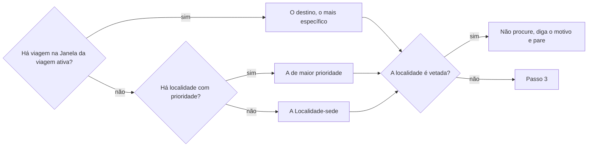

# Prospectar oportunidades

## Parâmetros de configuração

Leia cada valor nas instruções do projeto: primeiro na entrada com o nome desta habilidade, depois na entrada `Global` ou no primeiro nível do bloco. Quando um valor não estiver lá, use o padrão abaixo.

```yaml
# `Business Model Canvas` é a página do modelo de negócio. Vale para mais de uma habilidade, por isso fica em `Global`.
"Business Model Canvas": ""
# `Playbook de oportunidades` é a página que diz quais oportunidades fazem sentido e quais não.
"Playbook de oportunidades": ""
# `Localidade-sede` é a localidade usada quando não há viagem ativa nem localidade prioritária.
"Localidade-sede": ""
"Janela da viagem ativa": "7 dias"
# `Registrar a programação da oportunidade` é `automático`, que segue o Passo 6, `sempre`, `perguntar` ou `nunca`.
"Registrar a programação da oportunidade": "automático"
"Máximo de candidatos por execução": 5
"Máximo de buscas na web por execução": 10
"Formato da data com dia da semana": "terça-feira, 01/09/2026"
"Modo de aprendizado": "perguntar"
```

## Instruções

### Passo 1

Leia o `Business Model Canvas` e o `Playbook de oportunidades`.

O retorno da empresa sobre uma participação fica na própria página da edição, quase sempre no bloco de notas de reunião, como uma retrospectiva, com resumo, notas, transcrição e comentários. Antes de avaliar o fit, abra cada edição anterior do mesmo grupo e leia esse bloco inteiro, com a transcrição quando o resumo não diz se valeu a pena. Leia também o retorno do ponto de contato realizado. Sem retorno registrado, diga isso. Não deduza o retorno da decisão humana nem do status.

Quando um dos dois não está nos parâmetros, procure no workspace conectado uma página que faça esse papel e sugira o que achou, com o link. Use-a só com o sim da pessoa. Se não achar, proponha criar a página: entreviste a pessoa sobre o modelo de negócio ou sobre as oportunidades que fazem sentido e as que não, e grave as respostas numa página do workspace só com o sim dela. Peça que a página entre no parâmetro. Rodando por rotina, não há quem entreviste: não prospecte e deixe a falta no resumo. Sem as duas páginas, não prospecte.

As listas e as propriedades vêm do mapeamento de dados do projeto, no workspace conectado: oportunidades, grupos, localidades, viagens e pontos de contato. Se uma lista não estiver nessa conexão, pare. Não use a lista de outro workspace.

A execução parte de uma busca ou de um candidato que a pessoa trouxe, como um print, um link ou uma edição já cadastrada. Com candidato trazido, não escolha localidade nem pesquise grupos: vá ao Passo 5 só com ele, e o teto de candidatos não vale. A edição já cadastrada que a pessoa cita, ou que a consulta mostra sem leitura de fit, também é candidato trazido. A data vem do candidato. Sem data ou sem ano em fonte confiável, pergunte.

A pergunta por uma data e uma cidade, como "que oportunidades há neste fim de semana em Belo Horizonte", é uma busca com localidade e datas dadas: pule a escolha do Passo 2. Consulte primeiro o banco, pelas datas que cruzam o período e pela localidade, com toda decisão humana, inclusive as vetadas, e pelas edições sem data ou recorrentes da cidade.

Depois pesquise sempre na web, também quando o banco trouxe uma edição, porque ele só tem o que já foi cadastrado. Leia as páginas de agenda e de feiras do portal da cidade, a venda de ingressos e a imprensa local, com um subagente de leitura quando houver muitas páginas. Confira o ano de cada evento: guia de outro ano não vale.

Responda com cada oportunidade do período, a do banco e a da web: nome, data e horário com dia da semana, local, entrada, se há expositores e como se inscrever, e o link da fonte. Diga o que foi pesquisado, onde, e o que a fonte não informa. Dizer só que não achou no banco não responde.

### Passo 2

Escolha a localidade-alvo.



Várias viagens na janela: use a mais próxima e cite as outras. Uma localidade de prioridade baixa entra como quando der, e a de maior prioridade aprofunda a curadoria. A localidade que falta na lista não se substitui pelo estado: pergunte a prioridade e peça `criar-oportunidade` só depois que ela existir.

### Passo 3

Ordene os grupos pela prioridade de busca, do menor número para o maior. Prioridade vazia é sem prioridade, nunca alta. Comece pelos menores e só expanda quando esgotar ou justificar os prioritários. Resultado recente, calendário ou sugestão da busca não furam a fila. Candidato sem grupo: identifique o grupo canônico com `definir-grupo-de-oportunidades` e confira a prioridade antes de tratá-lo como prioritário.

### Passo 4

Pesquise na web as edições futuras do grupo na localidade-alvo, até o `Máximo de buscas na web por execução`. Abra a página inteira, não só o trecho da busca. A data com dia, mês e ano vem de uma fonte confiável, nunca do título nem de uma temporada, como "Resort 26". Fonte única que sumiu e link de outra cidade ou de outro evento não valem como evidência. Sem evidência, não cadastre: cite o que faltou.

Leia também a bio dos perfis sociais oficiais do grupo e o evento ou o destaque que ela fixa, porque a organização costuma anunciar ali a data da próxima edição antes de abrir a inscrição. Bio com data, mas sem o ano, o local ou o link da inscrição, é pista e não evidência: não cadastre, e leve a data ao Passo 7 como o motivo de perguntar à organização quando abre a curadoria. Perfil sem data na bio e sem edição não vale como evidência.

### Passo 5

Para cada candidato, até o `Máximo de candidatos por execução`, compare com o playbook e com o canvas. O que o playbook veta cai fora, com o motivo na resposta. Antes de cadastrar, siga `procurar-oportunidade`: se a edição existe, complemente o que faltar sem criar outra, e outra data do mesmo grupo é outra edição. Se não existe, siga `criar-oportunidade`. A decisão humana não é sua: deixe o valor inicial da lista.

Grave a leitura de fit de cada candidato que passou nas notas de curadoria da edição, como síntese permanente: o que combina e o que não combina com o playbook, com o canvas e com o retorno das edições anteriores do grupo, sem checklist. Edição que ainda não existe é cadastrada antes, por `criar-oportunidade`. Candidato trazido que o playbook veta: diga o motivo, grave-o nas notas se a edição já existe e não cadastre sem pedido da pessoa.

A avaliação do fit é sua e não espera a pessoa pedir: compare com o posicionamento da marca no canvas e no playbook e grave a leitura nas notas de curadoria da edição no mesmo turno, junto com a curadoria por IA, aprovada, vetada ou aguardando revisão humana. Não pergunte se deve avaliar nem se deve registrar. A pergunta fica para a decisão humana, a participação e o contato.

Cada critério do playbook, como o custo de participação, a curadoria e o público, é conferido numa fonte antes de a leitura de fit ir às notas. Critério sem evidência fica nas notas como pendência, com o que faltou e o canal para perguntar, e a edição não é marcada como pronta para a decisão humana. Não deixe a lista do que verificar no corpo da edição.

### Passo 6

Siga `Registrar a programação da oportunidade`. Com `sempre`, registre toda a programação publicada de qualquer oportunidade, com ou sem viagem. Com `perguntar`, pergunte antes de registrar a de cada uma. Com `nunca`, não registre programação. Com `automático`, siga as regras abaixo.

Quando a oportunidade é uma visita em avaliação, como uma semana de moda, registre toda a programação publicada, cada sessão como marco do cronograma ligado à oportunidade, seguindo `definir-cronograma`, haja ou não viagem decidida. A programação inteira ajuda a decidir se vale ir e em quais dias. Não escolha sessão nem bloqueie a agenda.

Quando a localidade-alvo veio de uma viagem e a oportunidade é outra, de vários dias, calcule as datas em comum com a viagem. Tire os dias de feira dessa viagem, que ficam no cronograma e nos pontos de contato. Registre só as atividades dessas datas. Sem data em comum, diga que a edição cai fora da viagem e não registre programação.

### Passo 7

Responda com uma linha por candidato: título, datas com dia da semana, o que cai na viagem, por que combina com o negócio, o que o retorno das edições anteriores disse, com o link da nota de reunião, e o que falta para decidir.

Cada candidato que combina leva também o caminho para participar: o link do edital ou do formulário, o prazo e, com o prazo vencido ou sem link, os canais para perguntar à organização se ainda aceita, ou quando abre a curadoria, todos os que o Notion e o perfil mostram, como o e-mail, o WhatsApp, o produtor da página do evento e a mensagem direta de quem orienta o grupo, cada um com a fonte. Dos canais que a organização atende, a pessoa escolhe por qual escrever.

Quando a oportunidade é uma visita, como a de uma semana de moda, o caminho para participar diz como entrar: se a entrada é livre, se pede ingresso, convite ou credencial, onde se retira, até quando e o que a fonte não diz. Cada trecho do playbook que a resposta cita, como o foco atual ou o prazo mínimo, vem com o que ele quer dizer em palavras simples e com o limite do que a página afirma.

Leva ainda quem a empresa já conhece, achado no Notion: pessoas, negociações e edições anteriores do mesmo grupo ou de eventos parecidos em que alguém da empresa atuou, como apresentadora ou expositora. Isso serve de abertura na mensagem.

Pergunte se a pessoa topa e se escreve à organização. Com o sim ao contato, o rascunho segue `consultar-responsavel-pela-oportunidade`, e nada é enviado antes do sim ao texto.

Com o sim da pessoa a participar, ofereça `criar-ideia-de-conteudo` para o que produzir no evento, `definir-tarefa` para cada pendência com ação e `definir-inscricao` para inscrever. Rodando por rotina, não pergunte no meio: cadastre o que passou, deixe a decisão para a pessoa e entregue o resumo. Diga o que ficou de fora por causa dos tetos.

### Passo 8

Ao terminar, siga `evoluir-habilidade` conforme `Modo de aprendizado`.

## Problemas comuns

### Canvas ausente e a skill parou

Se você parar só porque o parâmetro do canvas ou do playbook está vazio, a página que já existe no workspace fica sem uso e a pessoa não sabe o que falta.

1. Procure no workspace conectado uma página que faça esse papel e sugira-a, com o link.
2. Sem nada, proponha criar a página com uma entrevista e grave só com o sim.

### Retorno da edição anterior ignorado

Se você avaliar o fit sem ler a nota de reunião das edições anteriores, a pessoa repete uma participação que já disse não ter dado venda, ou perde a que valeu pelas conexões.

1. Abra cada edição anterior do grupo e leia o bloco de notas de reunião inteiro.
2. Cite o que funcionou e o que não funcionou, com o link.
3. Sem retorno, diga isso.

### Edição cadastrada sem avaliação e a pessoa perguntada

Se você responder só o que existe sobre uma edição cadastrada e perguntar se a pessoa quer que avalie, a leitura de fit não chega ao Notion e a pessoa precisa pedir o que já era seu.

1. Compare a edição com o canvas e com o playbook na hora.
2. Grave a leitura nas notas de curadoria e marque a curadoria por IA.
3. Deixe a decisão humana como está e pergunte só se a pessoa topa participar.

### Visita sem caminho de entrada

Se você avaliar uma visita só pelo fit e deixar de dizer como entrar, a pessoa precisa perguntar se há ingresso e como visitar, e a resposta chega depois da decisão.

1. Pesquise na página oficial e na imprensa se a entrada exige ingresso, convite ou credencial, onde retirar e o prazo.
2. Diga o que a fonte não informa e proponha perguntar à organização.
3. Explique em palavras simples cada trecho do playbook que você citar, sem o jargão da página.

### Fim de semana respondido só com o banco

Se você responder a pergunta por um fim de semana numa cidade só com o que o banco já tem, a pessoa decide a viagem sem ver as feiras que ninguém cadastrou.

1. Consulte o banco pelo período e pela localidade, com toda decisão humana.
2. Pesquise na web as agendas e os portais da cidade do período, com um subagente de leitura se houver muitas páginas.
3. Liste cada oportunidade com data, horário, local, entrada, expositores, inscrição e link, e diga o que a fonte não informa.

### Busca sem teto

Se você pesquisar sem parar até achar tudo, a execução gasta mais do que o resultado vale.

1. Pare ao atingir o máximo de buscas ou de candidatos.
2. Diga na resposta o que ficou para a próxima execução.

### Prioridade vazia tratada como alta

Se você tratar um grupo sem prioridade como importante por parecer relevante, a fila perde a ordem.

1. Trate como sem prioridade.
2. Registre na resposta quando isso pesar.

### Candidato trazido tratado como busca

Se você pesquisar localidade e grupos quando a pessoa trouxe uma feira e perguntou se combina, a execução gasta buscas e devolve outros candidatos no lugar da resposta.

1. Pule os Passos 2 a 4 e compare só esse candidato com o playbook e com o canvas.
2. Grave a leitura de fit nas notas de curadoria da edição.
3. Deixe a decisão humana com a pessoa.

### Candidato que combina sem caminho para participar

Se você disser só "falta decidir", a pessoa descobre sozinha que a inscrição fechou e ninguém procura a organização.

1. Ache o edital, o prazo e o canal de contato da organização.
2. Com o prazo vencido, proponha perguntar se ainda aceita, usando quem a empresa já conhece.
3. Não mande nada sem o sim ao texto.

### Data na bio deixada de fora

Se você olhar só a página do evento e ignorar a bio do perfil da organização, a data da próxima edição, como a de Natal, passa despercebida e ninguém pergunta quando a curadoria abre.

1. Leia a bio e o destaque fixado dos perfis oficiais do grupo em cada busca.
2. Data sem ano, local ou link de inscrição é pista: não cadastre.
3. Leve a pista ao Passo 7 e proponha perguntar à organização por todos os canais conhecidos.

### Programação da edição inteira

Se você registrar a programação de todos os dias de uma edição que não é uma visita em avaliação, o cronograma enche de atividades a que ninguém vai. Se, ao contrário, cortar a programação de uma visita em avaliação pelos dias da viagem, a pessoa perde a base para decidir se vai e em quais dias.

1. Visita em avaliação: registre toda a programação publicada, haja ou não viagem decidida.
2. Outra oportunidade, com viagem: calcule as datas em comum e tire os dias de feira.
3. Registre só o que sobrou nesse segundo caso.

## Exemplos de entrada e saída

Estes exemplos ilustram fatos. Eles podem não estar no data source.

### procure oportunidades para a viagem a São Paulo, de 12 a 22 de novembro, com feira de 14 a 16.

A localidade-alvo é São Paulo, porque a viagem está na janela. O festival de 12 a 22 de novembro foi cadastrado, e a programação só dos dias 12, 13 e de 17 a 22 foi para o cronograma, sem os dias de feira. A resposta listou cada candidato com as datas em comum e perguntou se a pessoa topa.

### a pessoa manda o print de uma feira do bairro e pergunta se combina com a oRnii

Não escolhi localidade nem pesquisei grupos. A feira já estava cadastrada. Comparei com o playbook e com o canvas e gravei a leitura de fit nas notas de curadoria da edição. A resposta trouxe uma linha com as datas com dia da semana, por que combina e o que falta para decidir. A decisão humana ficou com a pessoa.

## Casos-limite

- A pessoa trouxe uma feira, um edital ou um evento e quer saber se combina: avalie só esse candidato, sem busca, e grave a leitura nas notas de curadoria.
- A pessoa pergunta se já prospectamos uma edição que existe sem leitura de fit: avalie e grave agora, sem perguntar.
- O candidato trazido não tem data ou ano em fonte confiável: pergunte antes de avaliar.

- A localidade-alvo é vetada: não procure, diga o motivo e pare.
- A oportunidade é vetada por falta de fit: as conversas dela, com a organização e com o grupo, ganham o estado `Sem fit`, por `rotular-item`.
- Sem viagem e sem localidade prioritária: use a `Localidade-sede`.
- O canvas ou o playbook não está nas instruções do projeto: procure no workspace e sugira o que achou. Sem nada, proponha criar a página e entreviste a pessoa.
- Rotina sem canvas ou sem playbook: não prospecte e deixe a falta no resumo.
- A edição já existe: complemente sem criar outra.
- A data vem sem o ano em fonte confiável: não cadastre e peça a confirmação.
- A pessoa pergunta o que há num fim de semana ou num período de uma cidade: consulte o banco e pesquise na web, e liste tudo do período, sem esperar a pergunta de fit.
- Pedido para saber se uma oportunidade já existe: use `procurar-oportunidade`.
- Pedido só para cadastrar uma edição já conhecida, sem perguntar se combina: use `criar-oportunidade`.

## Pegadinhas

- A viagem ativa parece só um aviso. Ela decide a localidade-alvo e as datas em comum.
- A prioridade da localidade e a prioridade de busca do grupo são duas. A primeira diz se procura ali, a segunda diz por onde começar.
- O resultado mais recente da busca parece o mais importante. A fila é a prioridade do grupo.
- Os dias de feira parecem tempo livre. Eles ficam fora da programação registrada.
- Candidato que combina parece pronto quando está cadastrado. Falta o caminho para participar e quem escreve à organização.
- A bio do perfil parece só apresentação. Ela é onde a organização anuncia a data antes de abrir a inscrição, e a data dela é pista até a organização confirmar.
- O banco sem nada no período parece resposta pronta. Ele só tem o que já foi cadastrado: pesquise na web antes de dizer que não há nada.
- A pergunta "combina com o negócio?" parece pedir uma busca nova. Com o candidato na mão, a skill só o compara com o playbook e com o canvas.

## Scripts disponíveis

- Nenhum.

1. Não há script para executar.
