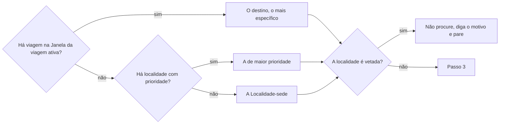

# Prospectar oportunidades

## Parâmetros de configuração

Leia cada valor nas instruções do projeto: primeiro na entrada com o nome desta habilidade, depois na entrada `Global` ou no primeiro nível do bloco. Quando um valor não estiver lá, use o padrão abaixo.

```yaml
# `Business Model Canvas` é a página do modelo de negócio. Vale para mais de uma habilidade, por isso fica em `Global`.
"Business Model Canvas": ""
# `Playbook de oportunidades` é a página que diz quais oportunidades fazem sentido e quais não.
"Playbook de oportunidades": ""
# `Localidade-sede` é a localidade usada quando não há viagem ativa nem localidade prioritária.
"Localidade-sede": ""
"Janela da viagem ativa": "7 dias"
"Máximo de candidatos por execução": 5
"Máximo de buscas na web por execução": 10
"Formato da data com dia da semana": "terça-feira, 01/09/2026"
"Modo de aprendizado": "perguntar"
```

## Instruções

### Passo 1

Leia o `Business Model Canvas` e o `Playbook de oportunidades`, e os retornos já registrados dos pontos de contato realizados.

Quando um dos dois não está nos parâmetros, procure no workspace conectado uma página que faça esse papel e sugira o que achou, com o link. Use-a só com o sim da pessoa. Se não achar, proponha criar a página: entreviste a pessoa sobre o modelo de negócio ou sobre as oportunidades que fazem sentido e as que não, e grave as respostas numa página do workspace só com o sim dela. Peça que a página entre no parâmetro. Rodando por rotina, não há quem entreviste: não prospecte e deixe a falta no resumo. Sem as duas páginas, não prospecte.

As listas e as propriedades vêm do mapeamento de dados do projeto, no workspace conectado: oportunidades, grupos, localidades, viagens e pontos de contato. Se uma lista não estiver nessa conexão, pare. Não use a lista de outro workspace.

### Passo 2

Escolha a localidade-alvo.



Várias viagens na janela: use a mais próxima e cite as outras. Uma localidade de prioridade baixa entra como quando der, e a de maior prioridade aprofunda a curadoria. A localidade que falta na lista não se substitui pelo estado: pergunte a prioridade e peça `criar-oportunidade` só depois que ela existir.

### Passo 3

Ordene os grupos pela prioridade de busca, do menor número para o maior. Prioridade vazia é sem prioridade, nunca alta. Comece pelos menores e só expanda quando esgotar ou justificar os prioritários. Resultado recente, calendário ou sugestão da busca não furam a fila. Candidato sem grupo: identifique o grupo canônico com `definir-grupo-de-oportunidades` e confira a prioridade antes de tratá-lo como prioritário.

### Passo 4

Pesquise na web as edições futuras do grupo na localidade-alvo, até o `Máximo de buscas na web por execução`. Abra a página inteira, não só o trecho da busca. A data com dia, mês e ano vem de uma fonte confiável, nunca do título nem de uma temporada, como "Resort 26". Fonte única que sumiu, perfil social sem edição nem data e link de outra cidade ou de outro evento não valem como evidência. Sem evidência, não cadastre: cite o que faltou.

### Passo 5

Para cada candidato, até o `Máximo de candidatos por execução`, compare com o playbook e com o canvas. O que o playbook veta cai fora, com o motivo na resposta. Antes de cadastrar, siga `procurar-oportunidade`: se a edição existe, complemente o que faltar sem criar outra, e outra data do mesmo grupo é outra edição. Se não existe, siga `criar-oportunidade`. A decisão humana não é sua: deixe o valor inicial da lista.

### Passo 6

Quando a localidade-alvo veio de uma viagem e a oportunidade tem vários dias, calcule as datas em comum com a viagem. Tire os dias de feira dessa viagem, que ficam no cronograma e nos pontos de contato. Registre só as atividades dessas datas, cada uma como marco do cronograma ligado à oportunidade, seguindo `sincronizar-cronograma`. Sem data em comum, diga que a edição cai fora da viagem e não registre programação.

### Passo 7

Responda com uma linha por candidato: título, datas com dia da semana, o que cai na viagem, por que combina com o negócio e o que falta para decidir. Pergunte se a pessoa topa. Com o sim, ofereça `criar-ideia-de-conteudo` para o que produzir no evento, `definir-tarefa` para cada pendência com ação e `definir-inscricao` para inscrever. Rodando por rotina, não pergunte no meio: cadastre o que passou, deixe a decisão para a pessoa e entregue o resumo. Diga o que ficou de fora por causa dos tetos.

### Passo 8

Ao terminar, siga `evoluir-habilidade` conforme `Modo de aprendizado`.

## Problemas comuns

### Canvas ausente e a skill parou

Se você parar só porque o parâmetro do canvas ou do playbook está vazio, a página que já existe no workspace fica sem uso e a pessoa não sabe o que falta.

1. Procure no workspace conectado uma página que faça esse papel e sugira-a, com o link.
2. Sem nada, proponha criar a página com uma entrevista e grave só com o sim.

### Busca sem teto

Se você pesquisar sem parar até achar tudo, a execução gasta mais do que o resultado vale.

1. Pare ao atingir o máximo de buscas ou de candidatos.
2. Diga na resposta o que ficou para a próxima execução.

### Prioridade vazia tratada como alta

Se você tratar um grupo sem prioridade como importante por parecer relevante, a fila perde a ordem.

1. Trate como sem prioridade.
2. Registre na resposta quando isso pesar.

### Programação da edição inteira

Se você registrar a programação de todos os dias de uma edição de vários dias, o cronograma enche de atividades a que ninguém vai.

1. Calcule as datas em comum com a viagem.
2. Tire os dias de feira.
3. Registre só o que sobrou.

## Exemplos de entrada e saída

Estes exemplos ilustram fatos. Eles podem não estar no data source.

### procure oportunidades para a viagem a São Paulo, de 12 a 22 de novembro, com feira de 14 a 16.

A localidade-alvo é São Paulo, porque a viagem está na janela. O festival de 12 a 22 de novembro foi cadastrado, e a programação só dos dias 12, 13 e de 17 a 22 foi para o cronograma, sem os dias de feira. A resposta listou cada candidato com as datas em comum e perguntou se a pessoa topa.

## Casos-limite

- A localidade-alvo é vetada: não procure, diga o motivo e pare.
- Sem viagem e sem localidade prioritária: use a `Localidade-sede`.
- O canvas ou o playbook não está nas instruções do projeto: procure no workspace e sugira o que achou. Sem nada, proponha criar a página e entreviste a pessoa.
- Rotina sem canvas ou sem playbook: não prospecte e deixe a falta no resumo.
- A edição já existe: complemente sem criar outra.
- A data vem sem o ano em fonte confiável: não cadastre e peça a confirmação.
- Pedido para saber se uma oportunidade já existe: use `procurar-oportunidade`.
- Pedido para cadastrar uma edição já conhecida: use `criar-oportunidade`.

## Pegadinhas

- A viagem ativa parece só um aviso. Ela decide a localidade-alvo e as datas em comum.
- A prioridade da localidade e a prioridade de busca do grupo são duas. A primeira diz se procura ali, a segunda diz por onde começar.
- O resultado mais recente da busca parece o mais importante. A fila é a prioridade do grupo.
- Os dias de feira parecem tempo livre. Eles ficam fora da programação registrada.

## Scripts disponíveis

- Nenhum.

1. Não há script para executar.
