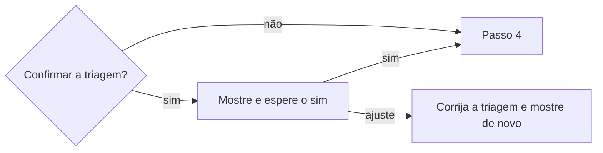

# Publicar ata de reunião

## Parâmetros de configuração

Leia cada valor nas instruções do projeto: primeiro na entrada com o nome desta habilidade, depois na entrada `Global` ou no primeiro nível do bloco. Quando um valor não estiver lá, use o padrão abaixo.

```yaml
# `Destino da ata` é a página ou pasta compartilhada onde a ata pública fica. Vazio, a habilidade não publica.
"Destino da ata": ""
# `Destino da ata privada` é a página ou pasta de acesso restrito da ata que a triagem marca como privada. Vazio, a ata privada não é publicada.
"Destino da ata privada": ""
# `Árvore da triagem da ata` é o arquivo `.mmd` com as perguntas da triagem, lido de cima para baixo. Vazio, cada reunião é uma pergunta à pessoa.
"Árvore da triagem da ata": ""
# `Confirmar a triagem antes de publicar` em `sim` mostra a triagem à pessoa e espera o sim dela.
"Confirmar a triagem antes de publicar": "sim"
"Modo de aprendizado": "perguntar"
```

## Instruções

### Passo 1

Parta do registro que `definir-registro-de-reuniao` guarda. Sem registro, pare e peça.
Sem `Destino da ata`, pare e diga que a publicação não está configurada.
Procure a ata no destino público e no privado, pelo título e pela data. Se já existe, corrija essa página e não crie outra.

### Passo 2

Faça a triagem lendo o resumo e a transcrição inteira, não só o resumo. O resumo já saiu filtrado, e a transcrição guarda o que o filtro tirou.
Siga a `Árvore da triagem da ata`, de cima para baixo. A primeira pergunta que bater decide se a ata é pública ou privada.
Sem árvore, ou quando nenhuma pergunta bate, mostre o trecho à pessoa, pergunte e acrescente a regra à árvore na mesma hora.
Numa ata pública, marque também cada trecho sensível: ele fica fora do texto.
Os assuntos que o registro deixa fora do resumo valem para a ata.

### Passo 3



Com `Confirmar a triagem antes de publicar` em `sim`, mostre numa só mensagem o destino escolhido, a pergunta da árvore que decidiu, cada trecho sensível com a fala como saiu e o que fica fora, e o texto da ata.
Diga que as menções notificam as pessoas.
Espere o sim da pessoa para essa ata e para esse destino. O sim a uma ata não vale para outra.

### Passo 4

A ata leva o resumo, as ações, os participantes e a fonte. Nunca leva a transcrição bruta nem um trecho dela.
O título e a data são os do registro. Participantes e responsáveis vão com menção real da plataforma, como manda `definir-pessoa`.
Publique no destino escolhido. Releia a página publicada e confira que nenhum trecho sensível entrou.
Grave o link da ata no registro e entregue à pessoa o link com o título da página, o destino e o que ficou fora.

### Passo 5

Ao terminar, siga `evoluir-habilidade` conforme `Modo de aprendizado`.

## Problemas comuns

### Triagem só no resumo

Se você triar só o resumo, o trecho sensível que a transcrição guarda não aparece, e a ata pública pode citar o que não devia.

1. Leia a transcrição inteira.
2. Marque o trecho sensível e deixe-o fora da ata.
3. Mostre o trecho à pessoa com a fala como saiu.

### Sim de uma ata usado em outra

Se você publicar a segunda ata porque a pessoa disse sim à primeira, o trecho sensível da segunda sai sem ninguém ter visto.

1. Mostre a triagem de cada ata.
2. Espere o sim daquela ata e daquele destino.

### Transcrição que sobe junto

Se você publicar a transcrição ou um trecho dela para a ata ficar completa, o acervo sensível chega a quem só devia ler o resumo.

1. Publique só o resumo, as ações, os participantes e a fonte.
2. A transcrição fica no registro.

### Reunião de dois tratada como do time

Se você publicar a ata de um one-on-one no destino do time, o assunto pessoal fica visível a todos.

1. Siga a árvore antes de escolher o destino.
2. Com dúvida, mostre à pessoa e pergunte.

## Exemplos de entrada e saída

Estes exemplos ilustram fatos. Eles podem não estar no data source.

### a pessoa pede a ata de uma reunião de refinamento do time.

Li o resumo e a transcrição, e a árvore marcou a reunião como pública. Dois trechos de conversa pessoal ficaram fora, e mostrei os dois com a fala como saiu, junto do texto da ata. Publiquei no destino do time depois do sim e entreguei o link.

### a pessoa pede a ata de uma conversa de dois.

A primeira pergunta da árvore bateu: só duas pessoas, e uma é quem pediu. A ata é privada. Mostrei o destino privado e o texto, e publiquei lá depois do sim.

## Casos-limite

- O `Destino da ata privada` está vazio e a ata é privada: não publique e diga que o destino não está configurado.
- Nenhuma pergunta da árvore bate: pergunte à pessoa e acrescente a regra.
- A ata já existe e o registro mudou: corrija a página e mostre de novo o que mudou, porque a triagem pode ter mudado.
- Os convidados do evento não são os presentes: use quem a transcrição mostra que falou, e diga a divergência.
- A pessoa recusa a publicação: não publique, e a ata fica só no registro.

## Pegadinhas

- O título de uma reunião recorrente do time parece provar que ela é do time. A conversa pode ter sido só entre duas pessoas.
- A lista de convidados parece a lista de participantes. Confira com quem falou.
- Uma menção parece só um jeito de escrever o nome. Ela notifica a pessoa assim que a página sai.
- O resumo parece já seguro. Ele só é tão seguro quanto o filtro que o gerou, e a transcrição guarda o resto.

## Scripts disponíveis

- Nenhum.

1. Não há script para executar.
