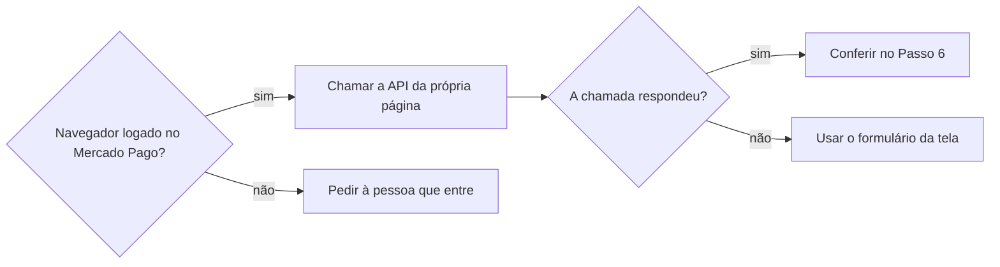

# Publicar produto físico no Mercado Pago

## Parâmetros de configuração

Leia cada valor nas instruções do projeto: primeiro na entrada com o nome desta habilidade, depois na entrada `Global` ou no primeiro nível do bloco. Quando um valor não estiver lá, use o padrão abaixo. Valor vazio: pergunte uma vez e não escolha.
```yaml
# `Fonte da verdade das fotos` é o lugar de onde a foto do produto sai, como a loja virtual. O catálogo não guarda a foto original: ela é copiada de lá, nunca baixada e subida à mão.
"Fonte da verdade das fotos": ""
"Modo de aprendizado": "perguntar"
```

## Instruções

### Passo 1

O registro de produtos do projeto manda: nome, descrição, preço, custo, SKU e estoque saem dele, e o catálogo do Mercado Pago é o destino. Sem o registro do produto, pergunte uma vez. Não invente nome, tamanho, preço, custo, SKU nem quantidade. Produto sem custo no registro entra com o custo vazio, e a resposta diz que falta.

O catálogo pede, de cada produto: nome (até 60 caracteres, obrigatório), descrição (até 2500), preço de venda (obrigatório), unidade de medida (unidade, metro, litro ou quilograma), custo, SKU, código de barras (GTIN), categoria, estoque atual e alerta de estoque mínimo. Aceita uma foto só.

Diga ao fim o que o registro não tem e o catálogo aceita, como o GTIN, o alerta de estoque mínimo e a categoria. Não crie propriedade no registro para isso: informe a limitação e recomende o campo.

### Passo 2

A foto vem de `Fonte da verdade das fotos`. O catálogo aceita uma foto por produto, em jpeg, png, jpg ou webp, e não aceita mais de uma. Com várias fotos na fonte, use a principal e diga qual usou. Sem foto na fonte, cadastre sem foto e diga que falta.

O catálogo guarda cópia da foto. Foto trocada na fonte depois não chega ao catálogo sozinha: diga isso e regrave a foto quando a pessoa pedir.

### Passo 3

O formato é sempre o cadastro com variações, mesmo para um produto de uma variante só, para que uma variação nova entre depois sem refazer o produto. O produto único nunca se usa: ele não vira produto com variações, e o catálogo recusa um SKU repetido, então refazer pede excluir o produto único antes, com o sim da pessoa.

O nome do produto é o do registro, sem o tamanho. O tamanho entra como o atributo da variação, e o catálogo compõe o título de cada variante com o nome e o valor, como "Colete Asa Curta 16-bit P". Cada variante do registro que tem unidade em estoque é uma variação, com o SKU, o preço, o custo e o estoque dela. Variante prevista e ainda não produzida fica de fora: o catálogo cobra o que existe, e a loja virtual pode mostrar a variante prevista com estoque zero sem que o catálogo a tenha. O cadastro aceita até 3 atributos entre tamanho, peso, cor, sabor, voltagem, material e personalizado.

Cadastro por planilha e por XML também existem e não foram exploradas.

### Passo 4



O catálogo não tem API pública com credencial: o painel chama endpoints do próprio domínio, autorizados pela sessão da pessoa. Chame-os de dentro da página do painel, sem clicar nem tirar captura de tela. Não leia nem copie o cookie da sessão para chamar de fora do navegador.

Os endpoints, todos no domínio do painel e com a sessão: ler uma variante com `GET /products/api/products/{id}`, atualizar com `PUT /products/api/products/{id}`, listar com `POST /products/list/api/list/v1`, excluir com `DELETE /products/list/api/single-actions/products/{id}/delete` e subir a foto com `POST /products/api/file-upload`, em multipart com o campo `file`, que devolve o id da foto. A exclusão responde 202 e conclui em alguns segundos.

A lista e a leitura devolvem cada variante como um item: `type` variante, `attributes` com o tamanho, `family_id`, `family_name` com o nome do produto, `picture_id`, preço, custo, descrição, SKU, quantidade, `unit_measure` e `segment` varejo. A atualização com o mesmo corpo foi validada.

A criação do produto com variações é pelo formulário. Uma chamada de criação com o tipo variante e o tamanho respondeu 400, e o endpoint do formulário de variações não foi achado. A criação por `POST /products/api/products` serve ao produto único, que não se usa.

O catálogo normaliza o título: o nome "aGue’i" voltou como "Aguei", sem o apóstrofo e com a maiúscula no começo. O cadastro com variações manteve as quebras de parágrafo da descrição. Releia o título e a descrição e diga o que foi gravado.

### Passo 5

Antes de criar, liste o catálogo e procure o SKU do produto. Achou: é atualização, mostre a diferença campo a campo e grave só o que a pessoa pediu. Não achou: crie, com variações. O catálogo recusa um SKU repetido, e nunca se cria um segundo produto com o mesmo SKU.

O preço do catálogo é o preço de etiqueta, o cheio a prazo, e nunca o preço à vista que a equipe dá na hora. Quando o registro, a loja virtual e o que a pessoa disse divergem, pergunte qual vale antes de gravar. Mudança de preço segue `registrar-preco-de-produto-fisico`.

O catálogo também tem listas de preços. Cada lista guarda, por produto, um preço na lista, com atualização em massa por porcentagem, para mais ou para menos, e arredondamento para inteiros. A opção "Preços sincronizados" muda o preço da lista na mesma proporção quando o preço base muda: um preço com final fixo deixa de terminar assim depois de uma mudança de preço.

Como a lista entra na cobrança não foi validado. Não crie lista sem pedido da pessoa, e diga que o preço à vista dela pode sair do final combinado quando o preço base mudar.

### Passo 6

Depois de gravar, releia o produto e compare cada campo com o registro. Confira a foto pelo endereço que a leitura devolve e confira o título e a descrição, porque o catálogo os normaliza. Mostre o que gravou, com o link da lista de produtos do painel.

O estoque do catálogo é um número próprio. Ele não acompanha o registro nem a loja virtual: diga que pode divergir e que o movimento segue `gerenciar-estoque`. Venda cobrada na maquininha segue `lancar-venda`.

### Passo 7

Ao terminar, siga `evoluir-habilidade` conforme `Modo de aprendizado`.

## Problemas comuns

### Foto baixada e subida à mão

Se você baixar a foto, abrir o seletor de arquivos e subir de novo, a pessoa tem trabalho que a fonte de verdade já resolvia.

1. Copie a foto direto da fonte para o catálogo, pelo endpoint de envio.
2. Diga qual foto usou quando a fonte tem várias.

### Produto único criado

Se você criar o produto único, ele não vira produto com variações, e o SKU dele bloqueia o produto certo.

1. Crie sempre com variações, mesmo com uma variação só.
2. Refazer pede excluir o produto único, e a exclusão é permanente: peça o sim da pessoa e diga o que sai.

### Produto duplicado

Se você criar sem procurar o SKU, o ponto de venda mostra dois produtos iguais, com estoques diferentes.

1. Liste o catálogo e procure o SKU antes de criar.
2. Achou: atualize e mostre a diferença.

### Cookie lido para chamar de fora

Se você copiar o cookie da sessão para chamar a API fora do navegador, expõe uma credencial que a pessoa não entregou.

1. Chame de dentro da página do painel.
2. Sem navegador logado, peça à pessoa que entre.

### Preço escolhido em silêncio

Se você grava o primeiro preço que achou, a maquininha cobra um valor que a pessoa não decidiu.

1. Compare o registro, a loja virtual e o que a pessoa disse.
2. Divergiu: pergunte qual vale.

## Exemplos de entrada e saída

Estes exemplos ilustram fatos. Eles podem não estar no data source.

### lance o Colete Asa Curta 16-bit P no Mercado Pago, com a foto do Shopify

Procurei o SKU no catálogo e não achei. Copiei a única foto da loja virtual e criei, com variações, o produto "Colete Asa Curta 16-bit" com a variação de tamanho P, com a descrição, o preço, o custo, o SKU e 1 unidade em estoque, e reli a variante. Disse que o catálogo aceita uma foto só e que o registro não tem GTIN nem alerta de estoque mínimo.

## Casos-limite

- O produto tem várias fotos na fonte: use a principal e diga qual. O catálogo não aceita mais de uma.
- O nome passa de 60 caracteres: mostre o nome encurtado proposto e espere o sim. Não corte em silêncio.
- A descrição passa de 2500 caracteres: pergunte o que cortar.
- O SKU já existe no catálogo: atualize e mostre a diferença.
- Sem navegador logado: peça à pessoa que entre no painel.
- A pessoa pede planilha ou XML: diga que não foram validados e peça o sim.
- Um produto único já existe com o SKU: exclua-o antes, com o sim da pessoa, porque o catálogo recusa o SKU repetido.
- A variante está prevista no registro e não foi produzida: não entra no catálogo. Diga que ela entra quando houver uma unidade.
- O produto ainda não está no catálogo quando o preço muda: diga e pergunte se o lança, com o preço de etiqueta.

## Pegadinhas

- O catálogo parece guardar várias fotos. Ele guarda uma só, e o seletor de arquivo não aceita mais de um.
- A variante prevista parece pedir um lugar no catálogo, como na loja virtual. O catálogo cobra na hora, então só entra o que tem unidade em estoque.
- O campo de preço do formulário parece aceitar o valor escrito de fora. Ele só aceita o que é digitado na tela, e a chamada de API não tem esse limite.
- A lista de preços parece o lugar do preço à vista. Com os preços sincronizados, ela segue o preço base na mesma proporção, e o final combinado se perde.
- O painel parece ter API pública para o catálogo. A documentação pública não traz um endpoint de produtos, e o painel usa endpoints do próprio domínio.
- A descrição do produto único perdeu a quebra de parágrafo, e a do cadastro com variações a manteve.
- O título volta normalizado: o apóstrofo some e a maiúscula muda.
- A categoria não vem pronta: a pessoa cria as categorias no painel.

## Scripts disponíveis

- Nenhum.

1. Não há script para executar.
