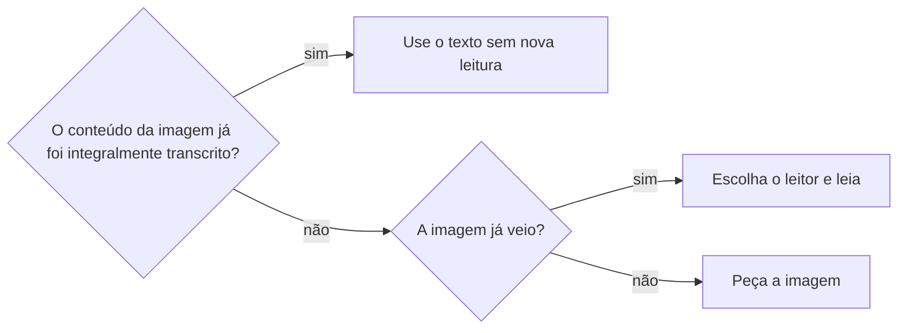
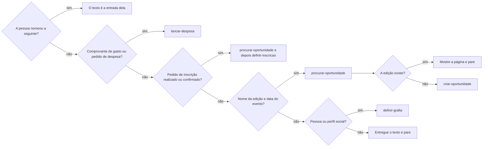

# Reconhecer imagem

## Parâmetros de configuração

Leia cada valor nas instruções do projeto: primeiro na entrada com o nome desta habilidade, depois na entrada `Global` ou no primeiro nível do bloco. Quando um valor não estiver lá, use o padrão abaixo.

```yaml
"Idiomas do reconhecimento":
  - "pt-BR"
  - "en-US"
```

## Instruções

### Passo 1

Carregue esta habilidade antes de interpretar a imagem ou gravar dados extraídos dela. Use a imagem já anexada. O comando escrito ou ditado que acompanha o comprovante não é a transcrição dele. Preserve esse comando como a intenção da operação.



### Passo 2

Escolha o leitor no primeiro passo. Não procure o script no disco. Ele só está com o repositório. Se estiver, rode só ele. Não leia o arquivo. A primeira vez prepara o leitor. As seguintes reaproveitam o que já foi preparado. Não usa a rede.
Se o script não estiver, ou se falhar, leia a imagem. Não rode de novo. Não rode o leitor do sistema para conferir. No Notion ele não está. Não instale. Não peça para a pessoa digitar o cartaz.
Use só o que a leitura trouxe como evidência da imagem. Não peça a outro agente ou ao workspace conectado que refaça a leitura. A habilidade de destino pode anexar o comprovante como evidência, na propriedade adequada; isso não é uma segunda leitura.

### Passo 3

Tire o que é do aparelho ou do anúncio em volta: a hora da tela, a bateria, as curtidas, "Patrocinado", "Há N horas" e os botões de navegação. Mantenha o conteúdo e a legenda. Em comprovante, mantenha a data e a hora da transação, os itens, os valores e os descontos; o relógio do aparelho não é a hora da compra. Uma sílaba que não forma palavra não é fato. Não invente o que a leitura não trouxe.

### Passo 4

Entregue a leitura e o comando original à habilidade seguinte, indicando que o reconhecimento terminou. Ela retoma a operação sem repetir a leitura. Não faça o trabalho dela aqui.



A operação que a pessoa já pediu não exige que ela diga o nome da habilidade. Siga a responsável quando puder carregá-la. Se não puder, entregue a leitura e diga o bloqueio, sem improvisar o lançamento. Sem pedido da operação, quando a seguinte não veio na lista, entregue o texto e pergunte se a pessoa quer chamá-la; não diga que ela não existe.

Chame a busca sem perguntar. Se ela não achar a edição, siga `criar-oportunidade` na mesma resposta. O cadastro é dela, não desta habilidade. Não grave a inscrição nesta habilidade. Não escolha organizar o ponto de contato nem criar a tarefa. A resposta não pede para nomear a habilidade nem fala de créditos.

## Problemas comuns

### Imagem enviada adiante

Se você pedir ao workspace conectado para reler a imagem, a leitura gasta o crédito de lá.

1. Não procure o script no disco. Com o repositório, rode o script. Não leia o arquivo.
2. Sem o script, leia a imagem.
3. Não rode o leitor do sistema para conferir. Não instale. Não peça para digitar o cartaz.

### Chrome como fato

Se você tratar a hora da tela, "Patrocinado" ou "Há N horas" como dado do evento, a data e o nome saem errados.

1. Tire o que é do aparelho e do anúncio em volta.
2. Mantenha o cartaz e a legenda.
3. Uma sílaba solta não vira nome.

### Habilidade seguinte no lugar

Se você cadastrar a oportunidade sem a busca, ou parar no texto quando ele já tem nome da edição e data, a pessoa ou ganha uma duplicata ou fica sem a busca e sem o cadastro.

1. Esse texto entra em `procurar-oportunidade`, sem perguntar. Se a edição não existe, siga `criar-oportunidade`. Se existe, mostre a página e pare.
2. Pedido de inscrição realizado ou confirmado segue `definir-inscricao` depois da edição. Não grave a inscrição aqui.
3. Use o destino do fluxograma, inclusive para comprovante financeiro sem nome de habilidade no comando.

### Leitor inventado

Se você procurar outro leitor ou vários modos porque o script não apareceu, a execução gasta o tempo antes de ler.

1. Não procure o script no disco. Com o repositório, rode o script. Não leia o arquivo.
2. Sem o script, leia a imagem.
3. Não rode o leitor do sistema para conferir. Não instale. Não procure outro modo.

### Habilidade seguinte fora da lista

Se você exigir o nome da habilidade quando a pessoa já pediu a operação, a leitura não chega ao trabalho solicitado.

1. Preserve a operação pedida no comando.
2. Siga a habilidade responsável quando puder carregá-la.
3. Sem acesso às instruções dela, diga o bloqueio e não grave por conta própria.

### Pedido para nomear

Se você fechar pedindo para mencionar a habilidade na próxima vez, a pessoa recebe um aviso que não pediu.

1. Feche com o texto.
2. Não peça para nomear a habilidade.
3. Não fale de créditos.

## Exemplos de entrada e saída

Estes exemplos ilustram fatos. Eles podem não estar no data source.

### a imagem do post de uma feira do setor, com participação gratuita para lojistas.

o texto saiu do script de reconhecimento: 29 e 30 de setembro de 2026, 09h às 19h, o local e o endereço do evento, o CNPJ e o CNAE exigidos, e o credenciamento no link da bio ou no local. Saíram a hora da tela, "Há 18 horas" e "Patrocinado". A imagem não seguiu. O texto entrou em `procurar-oportunidade`. Nenhuma oportunidade foi cadastrada. Não pedi para nomear a habilidade.

### eu enviei a imagem anexa, com o post de uma oficina num museu, e procurar-oportunidade não veio na lista.

li a imagem. Saíram a hora da tela, as curtidas e "Há 3 horas". O texto trouxe a oficina com o coletivo que a conduz, 24 de outubro, sábado, das 14h às 18h, maiores de 16 anos e inscrição gratuita por formulário. Perguntei se a pessoa quer procurar essa oportunidade com `procurar-oportunidade`. Não disse que a habilidade não está disponível. Nada foi cadastrado.

### a imagem do post de uma feira do setor, sem texto, e o script de reconhecimento não roda.

o script não estava neste ambiente. Não rodei o leitor do sistema. Li a imagem. Saíram a hora da tela, "Há 18 horas" e "Patrocinado". O texto entrou em `procurar-oportunidade`. Não pedi para nomear a habilidade.

## Casos-limite

- Não há imagem: peça. Não invente o texto.
- Comando escrito junto da imagem não é transcrição do comprovante: leia a evidência antes de gravar.
- O script não está neste ambiente: leia a imagem. Não rode o leitor do sistema para conferir. Não instale.
- O script está neste ambiente: rode o script. Não leia o arquivo.
- O script falhou: leia a imagem. Não rode de novo, não instale e não conserte o script.
- A pessoa não nomeou a habilidade seguinte e o texto tem nome da edição e data: o texto entra em `procurar-oportunidade`. Se a edição não existe, siga `criar-oportunidade`. Se existe, mostre a página e não crie outra.
- A leitura é um pedido de inscrição realizado ou confirmado: depois da edição, siga `definir-inscricao`. Não pare na oportunidade.
- A leitura é uma pessoa ou um perfil social: siga `definir-grafia`. Não pare no texto.
- A pessoa pediu uma despesa e anexou comprovante: siga `lancar-despesa`, mesmo sem nomear a habilidade. A leitura concluída acompanha o comando.
- Sem pedido de operação e sem a seguinte na lista, entregue o texto e pergunte se a pessoa quer chamá-la. Com a operação pedida, não exija o nome da habilidade.
- A pessoa nomeou a habilidade seguinte: o texto é a entrada dela. O trabalho dela não é feito aqui.

## Pegadinhas

- "Há 18 horas" parece a data do evento. É a idade do post.
- "Patrocinado" e o relógio do celular parecem parte do cartaz. Não são.
- Reler a imagem no workspace gasta o crédito de lá. Anexar o comprovante como evidência da operação não é reler.
- Instalar o leitor parece cuidado. Neste ambiente o instalador não existe. A imagem é a leitura que resta.
- Procurar o script no disco parece conferir. Ele só está com o repositório.
- O leitor do sistema parece estar no Notion. O comando não existe. Leia a imagem. Não rode para conferir.
- Pedir para digitar o cartaz parece um fim limpo. A execução sem essa ordem já tinha o texto.
- O script está neste ambiente. Ler o arquivo parece mais rápido. Um número do cartaz sai outro. O script é quem lê.
- Uma sílaba solta, como a que o script leu no logo, parece um nome. Não é.
- Parar no texto parece obedecer. Com nome da edição e data, a busca de existência é o passo seguinte. Sem a edição na lista, o cadastro vem depois, com `criar-oportunidade`.
- Perguntar antes da busca parece cuidado. A busca só lê. Chame sem perguntar.
- Parar na oportunidade parece o fim de um pedido de inscrição confirmado. A inscrição segue `definir-inscricao`.
- Parar no texto parece o fim de um print de perfil. Pessoa ou perfil segue `definir-grafia`.
- O comando pode pedir a operação sem citar a habilidade. A responsável recebe leitura e intenção; não precisa de novo pedido pelo nome.
- Vários modos de leitura parecem cuidado. Um uso basta.
- Fechar com "mencione a habilidade na próxima vez" parece cuidar dos créditos. A resposta não pede isso.

## Scripts disponíveis

- `recognize.py` imprime as linhas da imagem. Chama `read.swift` quando `swiftc` existe.
- `read.swift` é compilado por `recognize.py`. Não rode este arquivo direto.

1. No Mac, no Cursor ou no Cloud, com o repositório: `python3 recognize.py <imagem>`.
2. A primeira execução compila com `swiftc` e guarda o binário. Não usa rede. Precisa ler a imagem e gravar o cache. As seguintes usam o cache.
3. No Notion, sem o script: não rode `tesseract`. Ele não está. O passo lê a imagem.
4. Quando o script imprimir, use só essa saída.
