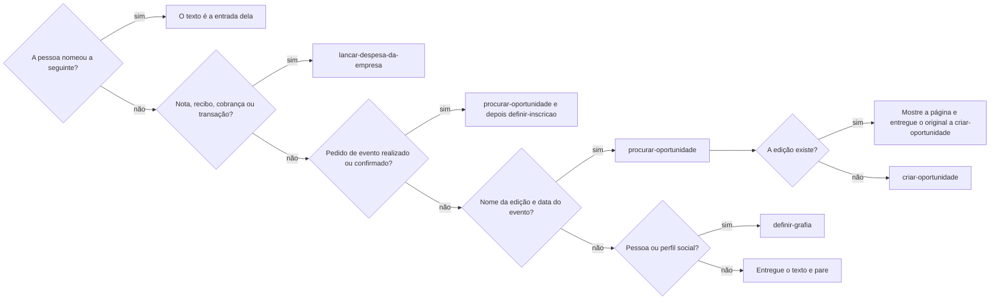
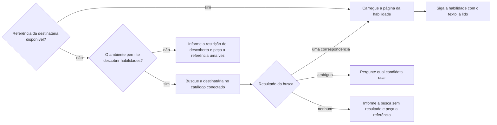

# Reconhecer imagem

## Parâmetros de configuração

Leia cada valor nas instruções do projeto: primeiro na entrada com o nome desta habilidade, depois na entrada `Global` ou no primeiro nível do bloco. Quando um valor não estiver lá, use o padrão abaixo.

```yaml
"Idiomas do reconhecimento":
  - "pt-BR"
  - "en-US"
```

## Instruções

### Passo 1

Peça a imagem. Se o texto dela já estiver escrito na mensagem, como um comunicado colado junto do cartaz, não leia a imagem: o texto escrito é a leitura. Pule para o passo 4 com esse texto e a imagem como original. Não pergunte o que fazer com ele.
O comando escrito ou ditado que acompanha a imagem não é a transcrição dela. Preserve esse comando como a intenção da operação.

### Passo 2

Escolha o leitor no primeiro passo. Não procure o script no disco. Ele só está com o repositório. Se estiver, rode só ele. Não leia o arquivo. A primeira vez prepara o leitor. As seguintes reaproveitam o que já foi preparado. Não usa a rede.
Se o script não estiver, ou se falhar, leia a imagem. Não rode de novo. Não rode o leitor do sistema para conferir. No Notion ele não está. Não instale. Não peça para a pessoa digitar o cartaz.
Use só o que a leitura trouxe. Encaminhe o texto para a próxima habilidade, sem novo reconhecimento. Preserve o original como evidência para anexar ao lançamento financeiro ou à edição da oportunidade; não o envie para outra leitura.

### Passo 3

Tire o que é do aparelho ou do anúncio em volta: a hora da tela, a bateria, as curtidas, "Patrocinado", "Há N horas" e os botões de navegação. Mantenha o cartaz, a legenda e os dados do documento ou da transação. A hora da transação não é o relógio da tela. Uma sílaba que não forma palavra não é fato. Não invente o que a leitura não trouxe.

### Passo 4

Entregue a leitura, o comando original e a imagem original à habilidade seguinte, indicando que o reconhecimento terminou. Ela retoma a operação sem repetir a leitura. Não faça o trabalho dela aqui.



Resolva a referência da destinatária antes de encaminhar o texto. A lista inicial da conversa não é prova de ausência no catálogo do projeto. No Notion, carregue a página pela menção ou URL fornecida; para descoberta permitida, consulte o catálogo informado ou a busca de páginas do workspace conectado pelo nome e pelos aliases. Não procure em outro workspace.



Não peça autorização para uma leitura permitida nem prometa uma chamada que ainda depende de referência. Uma confirmação como "sim" não substitui a menção ou URL exigida pelo ambiente. Não conclua que a habilidade não existe quando a busca estiver bloqueada; respeite a restrição, sem tentar contorná-la.

A destinatária financeira cuida da busca e do lançamento, sem duplicar a compra. Não faça esse trabalho aqui.

Chame a busca sem perguntar. Se ela não achar a edição, siga `criar-oportunidade` na mesma resposta. O cadastro é dela, não desta habilidade. Não grave a inscrição nesta habilidade. Não escolha organizar o ponto de contato nem criar a tarefa. A resposta não pede para nomear a habilidade nem fala de créditos.

## Problemas comuns

### Imagem enviada adiante

Se você mandar a imagem ao workspace conectado para ler, a leitura gasta o crédito de lá.

1. Não procure o script no disco. Com o repositório, rode o script. Não leia o arquivo.
2. Sem o script, leia a imagem.
3. Não rode o leitor do sistema para conferir. Não instale. Não peça para digitar o cartaz.

### Chrome como fato

Se você tratar a hora da tela, "Patrocinado" ou "Há N horas" como dado do evento, a data e o nome saem errados.

1. Tire o que é do aparelho e do anúncio em volta.
2. Mantenha o cartaz e a legenda.
3. Uma sílaba solta não vira nome.

### Texto já escrito parado

Se você parar porque o texto da imagem já veio escrito, ou perguntar o que fazer com ele, a pessoa repete o pedido e o cartaz fica fora da edição.

1. Use o texto escrito como a leitura. Não leia a imagem.
2. Siga o encaminhamento do passo 4, sem perguntar.
3. Entregue a imagem como original à habilidade seguinte.

### Habilidade seguinte no lugar

Se você cadastrar a oportunidade sem a busca, ou parar no texto quando ele já tem nome da edição e data, a pessoa ou ganha uma duplicata ou fica sem a busca e sem o cadastro.

1. Esse texto entra em `procurar-oportunidade`, sem perguntar. Se a edição não existe, siga `criar-oportunidade`. Se existe, mostre a página e entregue o original a `criar-oportunidade`, que decide o anexo.
2. Pedido de evento realizado ou confirmado segue `definir-inscricao` depois da edição. Não grave a inscrição aqui.
3. Não trate uma nota ou transação de compra como inscrição em evento. O fluxo tem uma destinatária financeira.

### Leitor inventado

Se você procurar outro leitor ou vários modos porque o script não apareceu, a execução gasta o tempo antes de ler.

1. Não procure o script no disco. Com o repositório, rode o script. Não leia o arquivo.
2. Sem o script, leia a imagem.
3. Não rode o leitor do sistema para conferir. Não instale. Não procure outro modo.

### Habilidade seguinte fora da lista

Se você pedir confirmação para chamar uma habilidade que ainda não localizou, a resposta "sim" não resolve a referência e a pessoa precisa repetir o pedido.

1. Resolva a referência pelo fluxo do passo 4, sem tratar a lista inicial como catálogo completo.
2. Carregue a página encontrada antes de seguir suas instruções.
3. Distinga busca sem resultado de descoberta bloqueada pelo ambiente; não declare inexistência nem prometa que uma confirmação remove a restrição.

### Pedido para nomear

Se você fechar pedindo para mencionar a habilidade na próxima vez, a pessoa recebe um aviso que não pediu.

1. Feche com o texto.
2. Não peça para nomear a habilidade.
3. Não fale de créditos.

### Despesa parada no texto

Se você só transcrever uma nota ou transação, a pessoa pode achar que a despesa já foi lançada.

1. Entregue o texto à destinatária financeira do fluxo.
2. Não diga que lançou antes da gravação confirmada.
3. Não mande o original para outra leitura; preserve-o como evidência.

## Exemplos de entrada e saída

Estes exemplos ilustram fatos. Eles podem não estar no data source.

### a imagem do post de uma feira do setor, com participação gratuita para lojistas.

o texto saiu do script de reconhecimento: 29 e 30 de setembro de 2026, 09h às 19h, o local e o endereço do evento, o CNPJ e o CNAE exigidos, e o credenciamento no link da bio ou no local. Saíram a hora da tela, "Há 18 horas" e "Patrocinado". A imagem não foi para outra leitura. O texto entrou em `procurar-oportunidade`. Nenhuma oportunidade foi cadastrada. Não pedi para nomear a habilidade.

### eu enviei a imagem anexa, com o post de uma oficina num museu, e procurar-oportunidade não veio na lista.

Li a imagem. Saíram a hora da tela, as curtidas e "Há 3 horas". O texto trouxe a oficina com o coletivo que a conduz, 24 de outubro, sábado, das 14h às 18h, maiores de 16 anos e inscrição gratuita por formulário. Como o ambiente permitia a descoberta, busquei `procurar-oportunidade` no catálogo conectado, carreguei a página encontrada e segui suas instruções com o texto já lido. Não pedi confirmação só para localizar a habilidade.

### a imagem do post de uma feira do setor, sem texto, e o script de reconhecimento não roda.

o script não estava neste ambiente. Não rodei o leitor do sistema. Li a imagem. Saíram a hora da tela, "Há 18 horas" e "Patrocinado". O texto entrou em `procurar-oportunidade`. Não pedi para nomear a habilidade.

### o comunicado de uma feira colado na mensagem, com horários, montagem e estacionamento, e o cartaz da mesma edição.

Não li a imagem: o comunicado já era o texto. Com nome da edição e data, o texto entrou em `procurar-oportunidade` sem perguntar o que fazer. A edição não existia, e `criar-oportunidade` recebeu o texto e o cartaz como original para os anexos da edição.

### a foto de uma nota de tecido e o print da mesma compra no cartão, sem pedido escrito.

Li os dados e entreguei o texto a `lancar-despesa-da-empresa`, que busca o gasto antes de criar. Os originais ficaram como evidências da mesma compra, sem novo reconhecimento. Não parei na transcrição nem tratei a compra como inscrição.

## Casos-limite

- Não há imagem: peça. Não invente o texto.
- O texto já está escrito e veio com a imagem: não leia a imagem. Encaminhe o texto e entregue a imagem como original.
- O texto já está escrito e não há imagem: esta habilidade não entra.
- O script não está neste ambiente: leia a imagem. Não rode o leitor do sistema para conferir. Não instale.
- O script está neste ambiente: rode o script. Não leia o arquivo.
- O script falhou: leia a imagem. Não rode de novo, não instale e não conserte o script.
- A pessoa não nomeou a habilidade seguinte e o texto tem nome da edição e data: o texto entra em `procurar-oportunidade`. Se a edição não existe, siga `criar-oportunidade`. Se existe, mostre a página, não crie outra e entregue o original a `criar-oportunidade`.
- A leitura é um pedido de evento realizado ou confirmado: depois da edição, siga `definir-inscricao`. Não confunda com compra em nota ou transação.
- A leitura é uma pessoa ou um perfil social: siga `definir-grafia`. Não pare no texto.
- Não há destinatária no fluxo e a pessoa não nomeou a seguinte: entregue o texto e pare.
- A habilidade seguinte não veio na lista inicial: resolva a referência pelo fluxo do passo 4. Não transforme uma restrição de descoberta em afirmação de inexistência.
- A pessoa nomeou a habilidade seguinte: o texto é a entrada dela. O trabalho dela não é feito aqui.

## Pegadinhas

- "Há 18 horas" parece a data do evento. É a idade do post.
- "Patrocinado" e o relógio do celular parecem parte do cartaz. Não são.
- Anexar o original a um lançamento ou a uma edição não é pedir novo reconhecimento. Para leitura, segue só o texto.
- O texto já escrito parece dispensar a habilidade. Dispensa só a leitura. O encaminhamento e o original seguem.
- Instalar o leitor parece cuidado. Neste ambiente o instalador não existe. A imagem é a leitura que resta.
- Procurar o script no disco parece conferir. Ele só está com o repositório.
- O leitor do sistema parece estar no Notion. O comando não existe. Leia a imagem. Não rode para conferir.
- Pedir para digitar o cartaz parece um fim limpo. A execução sem essa ordem já tinha o texto.
- O script está neste ambiente. Ler o arquivo parece mais rápido. Um número do cartaz sai outro. O script é quem lê.
- Uma sílaba solta, como a que o script leu no logo, parece um nome. Não é.
- Parar no texto parece obedecer. Com nome da edição e data, a busca de existência é o passo seguinte. Sem a edição na lista, o cadastro vem depois, com `criar-oportunidade`.
- Perguntar antes da busca parece cuidado. A busca só lê. Chame sem perguntar.
- Parar na oportunidade parece o fim de um pedido de evento confirmado. A inscrição segue `definir-inscricao`.
- Parar no texto parece o fim de um print de perfil. Pessoa ou perfil segue `definir-grafia`.
- Uma habilidade fora da lista inicial parece ausente do catálogo. A lista não prova isso; resolva a referência sem pedir uma confirmação que não a fornece.
- Vários modos de leitura parecem cuidado. Um uso basta.
- Fechar com "mencione a habilidade na próxima vez" parece cuidar dos créditos. A resposta não pede isso.

## Scripts disponíveis

- `recognize.py` imprime as linhas da imagem. Chama `read.swift` quando `swiftc` existe.
- `read.swift` é compilado por `recognize.py`. Não rode este arquivo direto.

1. No Mac, no Cursor ou no Cloud, com o repositório: `python3 recognize.py <imagem>`.
2. A primeira execução compila com `swiftc` e guarda o binário. Não usa rede. Precisa ler a imagem e gravar o cache. As seguintes usam o cache.
3. No Notion, sem o script: não rode `tesseract`. Ele não está. O passo lê a imagem.
4. Quando o script imprimir, use só essa saída.
