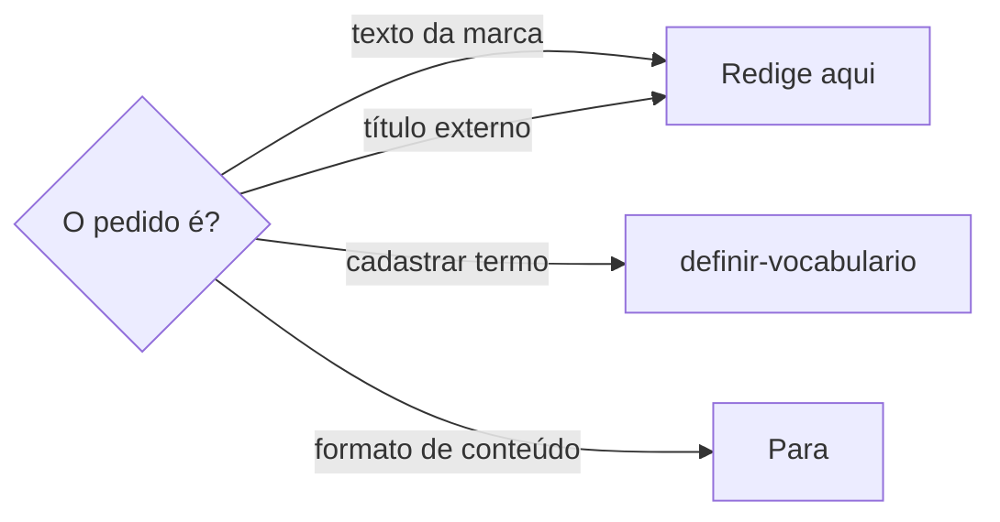
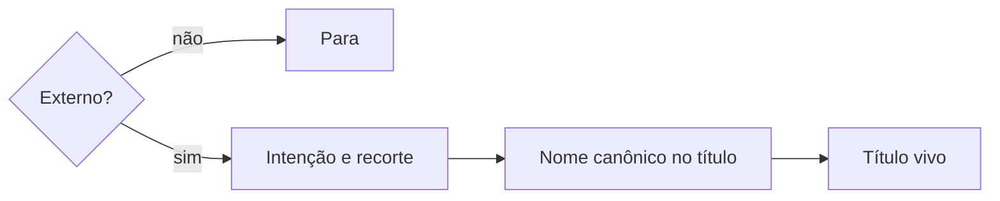

# Redigir com tom de voz

## Parâmetros de configuração

```yaml
"Modo de aprendizado": "perguntar"
```

## Instruções

### Passo 1

Escrever, sugerir, revisar e reescrever palavra, termo, expressão, frase e texto longo no tom de voz do projeto é esta habilidade. Entra slogan, headline, legenda, descrição de produto, bio, assunto e prévia de e-mail, WhatsApp, resposta a cliente, campanha, apresentação, inscrição, abordagem comercial, CTA, nome, microcopy e comunicação institucional. A copy segue a linguagem de marca, a identidade verbal, a intenção criativa e a consistência que as instruções do projeto e o vocabulário registram. O título de evento externo entra quando a pessoa pede o tom de voz para esse título. Esta habilidade não grava o evento, não cria a página e não crava a grafia. A grafia que a pessoa ou as instruções do projeto já fecharam entra pronta. O formato de conteúdo que a pessoa apontou permanece. O cadastro de um termo segue `definir-vocabulario`.



### Passo 2

Antes de escrever ou aprovar, o texto tem contexto, canal, público, as fontes da marca que as instruções do projeto nomeiam, o vocabulário e a intenção criativa. Falta algum: pare e peça. Não aprove. Não invente persona, posicionamento, vocabulário nem termo proibido. A pessoa informa a fonte. Se ela não estiver no workspace conectado, pare.

Consulte o vocabulário com Scripts disponíveis, com `tags` de quem fala, do evento, do canal e do formato do texto, como `maria-silva`, `festival-de-verao`, `palco` ou `whatsapp`. Use a tag que o vocabulário já tem para esse contexto. A consulta com tags deixa de fora o termo de outra pessoa, de outro evento ou de outro canal. Sem saber quem fala no texto, pergunte. Com terminal e a CLI instalada, rode o comando. Sem terminal, ou sem a CLI, chame a ferramenta do servidor `vocabulary`. Sem os dois, como num agente do Notion, o vocabulário vem de uma fonte do workspace conectado que as instruções do projeto nomeiam. Sem essa fonte, pare e diga que a consulta roda numa ferramenta de código com o projeto aberto. Não leia o vocabulário de memória.

Intenção clara, recorte específico e conexão humana. O que a pessoa precisa entender para agir. Como o texto se conecta com ela. Se faz ela sentir algo. Não fale para todo mundo. Não escreva fórmula genérica, ritmo previsível nem chamada vazia.

### Passo 3

A copy respeita o tom de voz e o vocabulário, como a fonte diz. Termo proibido, frase genérica, texto com cara de IA e linguagem desalinhada ficam de fora, inclusive a pontuação e o diminutivo que o vocabulário proíbe. Escolha que enfraquece desejo, clareza, personalidade ou potência comercial fica de fora. Revisar e reescrever passam pelo mesmo portão.

Cada termo tem um de cinco níveis:

- `forbidden` nunca entra.
- `strongly_discouraged` sai. Entra só se a pessoa pedir o termo ou se valer a exceção do `when`. No lugar, use a `substitution` ou um termo de `alternatives`.
- `discouraged` entra só com a cena e o contexto que o `when` descreve. Sem essa cena no texto, troque.
- `allowed_with_care` entra como o `when` diz.
- `allowed` entra.

Com as tags do canal e do formato, a consulta já devolve o nível que `allowed_in` e `forbidden_in` mudam. Linha antiga com `situationally_allowed` vale como `allowed_with_care`. Linha sem `description`, `when` ou `substitution` vale pelo nível: infira o uso pelo nível e pelos exemplos, sem criar regra nova. Na dúvida, pergunte.

Termo com tags entra só no texto desse contexto. A fala em primeira pessoa de uma pessoa não vai para o texto de outra. O grito de um evento não vai para outro evento. O `when` da linha continua valendo.

Emoji, combinação de emojis e uso simbólico fazem parte do vocabulário e da identidade verbal. Não são decoração livre. O nível da linha vale como para a palavra. A combinação junta é um termo. Sem essa linha, pare. Não invente a regra de usar ou evitar. O cadastro segue `definir-vocabulario`.

Emoji marcado como evitar, proibido, ruim, desalinhado ou restrito não entra na versão final. Se ele aparecer, diga que é exemplo ruim, restrição ou referência negativa. Dúvida: consulte o vocabulário e pergunte antes de aprovar. Não troque a regra por gosto, tendência de rede ou estética genérica.

Termo da categoria `cliche` não entra como palavra final. A descrição pede imagem, cena, ação, efeito ou situação com a mesma sensação. Use isso. Não troque o clichê por sinônimo. A frase em `rejected` e o termo ligado em `related` também ficam de fora.

Frase que sugere perda consumada, cobrança agressiva, exclusão, capacitismo, ameaça real, culpa ou sensação incompatível com o tom sai do texto. A alternativa mantém desejo, urgência e conversa natural, sem dizer que a pessoa já perdeu a chance. O motivo dessa rejeição fica na descrição do termo no vocabulário. Sem essa linha, não invente o termo.

Mensagem para uma pessoa não revela contexto interno que ela não precisa saber e que pode deixá-la desconfortável, como a troca frequente de pessoas no papel que ela assume. O motivo neutro entra no lugar, como uma mudança na padronização. A mensagem abre pelo que muda para ela.

O fechamento diz o próximo passo concreto, como a reunião já marcada, ou o canal de dúvidas que as instruções do projeto ou a pessoa indicam. Fechamento genérico que oferece quem escreve, como "qualquer dúvida, me chama", é clichê de IA e não entra. Sem canal indicado, pergunte.

Assunto, prévia, cabeçalho ou chamada inicial de e-mail, quando a pessoa provavelmente vê o texto como banner no celular, fica curto, pessoal, específico e chamativo. Verbo no imperativo pode faltar. O texto gera gatilho de ação ou de curiosidade. Essa curiosidade não diz que a chance já passou. Clickbait vazio fica de fora.

### Passo 4

Cliente, peça, oportunidade e histórico comercial vêm da fonte que a pessoa indicar. Sem essa consulta, pare. Não assuma o dado na copy.

### Passo 5



Evento com convidada, convidado ou organização de fora, quando a pessoa pede o título: o título é vivo, específico e útil para a busca. Guarda o nome canônico que a pessoa ou a fonte já deram. Quando couber, leva edição, data, cidade e contexto curto. Título só com «Reservado», «Evento», «Reunião» ou «Feira», sem qualificador, não entra. Provisório pode começar com «Reservado para» ou «A confirmar» e leva o nome canônico do contexto. Horário, convidados, link e página não entram no título. Se o título criativo dificultar a busca, mantenha o nome canônico e diga isso.

### Passo 6

Ao terminar, siga `evoluir-habilidade` conforme `Modo de aprendizado`.

## Problemas comuns

### Copy sem fonte

Se você escrever ou aprovar sem contexto, canal, público, fonte da marca, vocabulário ou intenção criativa, a copy sai genérica.

1. Pare e peça o que falta.
2. Não invente persona, posicionamento, vocabulário nem termo proibido.
3. Não aprove antes da fonte.

### Texto que enfraquece

Se você deixar termo proibido, frase genérica, cara de IA ou linguagem desalinhada, o texto perde desejo, clareza, personalidade ou potência comercial.

1. Tire o que o vocabulário proíbe, o genérico, a cara de IA e o desalinhado.
2. Tire a pontuação e o diminutivo que o vocabulário proíbe.
3. Mantenha a intenção, o recorte e a conexão.

### Clichê trocado por sinônimo

Se você manter a palavra clichê, ou trocar por outro termo da mesma fórmula, o texto continua genérico.

1. Tire a palavra literal e a frase em `rejected`.
2. Escreva imagem, cena, ação, efeito ou situação com a mesma sensação.
3. O termo ligado em `related` também fica de fora.

### Fala de outra pessoa

Se você consultar o vocabulário sem as tags do texto, a fala em primeira pessoa de uma pessoa, ou o grito de um evento, entra no texto de outro contexto.

1. Diga quem fala, o evento e o canal do texto.
2. Consulte com essas tags.
3. Use só o que a consulta devolver, e respeite o `when` da linha.

### Emoji de enfeite

Se você espalhar emoji sem a linha do vocabulário, o texto ganha um símbolo que a marca não definiu.

1. Consulte o vocabulário.
2. Siga o nível da linha, como para a palavra.
3. Sem linha, pare. Não invente se o emoji pode.

### Emoji a evitar

Se você aprovar um emoji que o vocabulário manda evitar, a versão final carrega um símbolo restrito.

1. Tire o emoji da versão final.
2. Se ele aparecer, diga que é exemplo ruim, restrição ou referência negativa.
3. Na dúvida, consulte o vocabulário e pergunte. Não use gosto, tendência de rede nem estética genérica.

### Dado comercial assumido

Se você preencher cliente, peça, oportunidade ou histórico comercial de memória, a copy afirma um fato que a fonte não confirmou.

1. Consulte a fonte que a pessoa indicou.
2. Sem ela, pare.
3. Não assuma o dado.

### Formato de conteúdo alterado

Se você alterar o formato de conteúdo que a pessoa apontou, o formato muda junto com a copy.

1. Redija a copy.
2. Deixe o formato como está.
3. Não o altere.

### Título que parece anúncio

Se você escrever um título publicitário e tirar o nome canônico, a busca deixa de achar o compromisso.

1. Guarde o nome canônico mais buscável que a pessoa ou a fonte já deram.
2. Deixe o título específico, sem publicidade exagerada.
3. Quando couber, leve edição, data, cidade e contexto curto. Horário, convidados, link e página continuam fora do título.

### Assunto de e-mail longo

Se você escrever o assunto como parágrafo, ou com clickbait vazio, a notificação no celular perde o gancho.

1. Encurte. Deixe pessoal, específico e chamativo.
2. Gere ação ou curiosidade.
3. Não diga que a chance já passou. Clickbait vazio fica de fora.

### Fórmula genérica

Se você gravar "Reunião com X" ou uma frase que agrada todo mundo, o título não tem recorte.

1. Responda o que a pessoa precisa entender, como o texto se conecta e se faz sentir algo, antes de escrever.
2. Recorte para essa pessoa e esse encontro.
3. Se o título vivo criar ambiguidade, mantenha o nome canônico.

## Exemplos de entrada e saída

Estes exemplos ilustram fatos. Eles podem não estar no data source.

### Lapide esta legenda. O público e o canal ainda não estão no pedido.

Pedi contexto, canal, público, as fontes da marca, o vocabulário e a intenção. Não aprovei. Não assumi cliente, peça, oportunidade nem histórico. O formato de conteúdo ficou como está.

### Escreva a abertura de outra pessoa no palco do Festival de Verão.

Consultei o vocabulário com as tags de quem fala, do festival e do palco. As falas de Maria Silva em primeira pessoa ficaram de fora. O grito VERÃO! (CHEGOU!) entrou, com a plateia, como o when diz.

### A legenda fecha com um emoji que o vocabulário manda evitar.

Consultei o vocabulário. O emoji saiu da versão final. Onde ele aparecia, ficou marcado como exemplo ruim. Não aprovei por gosto nem por tendência.

### Escreva o assunto do e-mail. A pessoa vê isso no celular.

O assunto ficou curto, pessoal e específico. Sem verbo no imperativo. O gancho gera curiosidade. Não disse que a chance já passou. Clickbait vazio ficou de fora.

### Escreva o título do encontro com a organização de fora.

O título ficou específico, com o nome canônico que a fonte já tinha. Não virou anúncio. Horário e convidado ficaram fora do título.

## Casos-limite

- Falta contexto, canal, público, fonte da marca, vocabulário ou intenção criativa: pare e peça. Não aprove.
- A fonte da persona, do posicionamento, do vocabulário ou do termo proibido não está no workspace conectado: pare. Não invente.
- Sem a CLI e sem o servidor `vocabulary`, como num agente do Notion, e sem fonte do vocabulário no workspace: pare. Não aprove.
- A copy depende de cliente, peça, oportunidade ou histórico comercial: consulte a fonte que a pessoa indicou. Não assuma.
- O pedido altera um formato de conteúdo: pare. A copy não muda esse formato.
- O pedido é gravar o evento, e não o título: pare. Esta habilidade não grava o evento.
- Título só «Reservado», «Evento», «Reunião» ou «Feira»: leve o nome canônico. Provisório pode abrir com «Reservado para» ou «A confirmar».
- O título vivo cria ambiguidade na busca: mantenha o nome canônico.
- A grafia ainda não foi conferida: pare. Use a grafia que a pessoa ou as instruções do projeto já fecharam. Não grave a forma do pedido.
- O texto tem quem fala, evento ou canal: consulte com essas tags. Termo de outro contexto fica de fora. Sem saber quem fala, pergunte.
- O texto traz emoji, combinação ou uso simbólico: o estado vem do vocabulário. Sem a linha, pare. Não invente. O cadastro segue `definir-vocabulario`.
- Emoji marcado como evitar, proibido, ruim, desalinhado ou restrito: sai da versão final. Na dúvida, pergunte. Não aprove por gosto ou tendência.
- Termo `cliche`: a palavra literal sai. Entra imagem, cena, ação, efeito ou situação. Frase em `rejected` e termo em `related` também saem.
- Frase com perda consumada, cobrança agressiva, exclusão, capacitismo, ameaça real, culpa ou sensação incompatível com o tom: sai. A alternativa mantém desejo, urgência e conversa natural, sem dizer que a chance já passou.
- Assunto, prévia, cabeçalho ou chamada inicial de e-mail visto como banner no celular: curto, pessoal, específico e chamativo. O gatilho é ação ou curiosidade. A curiosidade não vira perda consumada. Clickbait vazio fica de fora.

## Pegadinhas

- Texto fluido parece aprovado. Sem contexto, canal, público, fonte da marca, vocabulário e intenção, a copy espera.
- Pontuação e diminutivo parecem neutros. Os que o vocabulário proíbe saem quando enfraquecem desejo, clareza, personalidade ou potência comercial.
- Evitável parece permitido com moderação. Sem a cena do `when`, ele sai.
- Uma frase cadastrada parece valer para qualquer texto. A fala em primeira pessoa de uma pessoa só entra no texto dela.
- Emoji parece enfeite de legenda. Ele é vocabulário. O nível vem da linha. Sem linha, a copy espera.
- Um emoji na moda parece melhor que a regra. Evitar, proibido, ruim, desalinhado e restrito saem da versão final.
- Um sinônimo parece resolver o clichê. A troca é imagem, cena, ação, efeito ou situação. A palavra literal, a frase rejeitada e o termo ligado ficam de fora.
- Avisar que a chance já passou parece urgência. A alternativa mantém desejo, urgência e conversa natural sem essa perda consumada.
- O motivo verdadeiro de uma mudança parece transparência. Contado a quem chega, como a troca frequente de pessoas no papel, ele é contexto interno e gera desconforto. O motivo neutro entra no lugar.
- Assunto de e-mail parece legenda. No celular ele é notificação: curto, pessoal e com curiosidade, sem clickbait vazio e sem dizer que a chance já passou.
- O dado que a conversa já citou parece confirmado. Cliente, peça, oportunidade e histórico comercial vêm da fonte que a pessoa indicou.
- Título publicitário parece o tom de voz. O texto pede intenção, recorte e conexão, e recusa a fórmula genérica. A busca precisa continuar achando o nome canônico.
- "Reunião com X" parece claro. Em evento externo, o título diz o encontro e guarda o nome mais buscável.
- Guardar o comando da CLI numa variável de shell parece encurtar a chamada. O zsh não separa as palavras da variável e a chamada falha. Escreva o comando inteiro.
- Criatividade parece substituir o campo estruturado. Edição, data, cidade e contexto curto podem entrar no título quando ajudam a busca. Horário, convidados, link e página continuam fora do título.

## Scripts disponíveis

- `node node_modules/vocabulary/dist/cli.js lookup --language <idioma> --term <termo> --tags <tag>` lê um termo e devolve se ele existe e a linha guardada.
- `node node_modules/vocabulary/dist/cli.js exists --language <idioma> --text <trecho> --tags <tag>` devolve só o registro de cada token do trecho para se ele existe.
- Com `case_matches` falso, a caixa do texto não é a guardada. Escreva a grafia de `term`.
- `--tags` repete, um valor por vez. Termo sem tag vale em qualquer texto. Termo com tag só volta quando uma tag dele está na consulta.
- `lookup_term` e `exists_in_text`, no servidor `vocabulary`, fazem a mesma consulta quando não há terminal ou quando a CLI não está disponível, com o mesmo campo `tags`.

1. Com terminal e a CLI instalada, rode `exists` com o texto e `lookup` para cada termo que precisar da linha inteira, com as tags de quem fala, do evento e do canal. Escreva o comando inteiro em cada chamada.
2. Sem terminal, ou quando a CLI não está disponível, chame `exists_in_text` e `lookup_term` com os mesmos campos.
3. Sem a CLI e sem o servidor `vocabulary`, use a fonte do vocabulário que as instruções do projeto nomeiam. Sem ela, pare.
