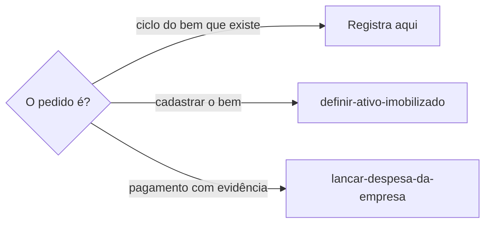
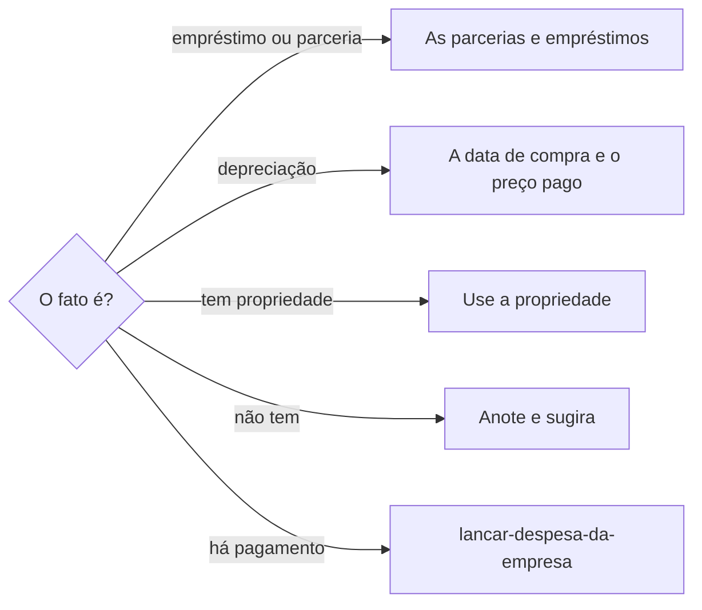

# Registrar ciclo do ativo

## Parâmetros de configuração

```yaml
{}
```

## Instruções

### Passo 1

Estado, manutenção, conserto, empréstimo, parceria, baixa, descarte, venda, perda, troca ou depreciação de um bem durável que já existe é esta habilidade. A pessoa informa o data source na execução. Sem essa indicação, use a lista do mapeamento de dados do projeto. O nome de cada propriedade vem desse mapeamento. Se a lista de ativos imobilizados não estiver no workspace conectado, pare. Não use a lista de outro workspace. Cadastrar ou atualizar o bem segue `definir-ativo-imobilizado`. Não crie a página aqui. Pagamento com evidência financeira segue `lancar-despesa-da-empresa`. Sem essa evidência, não crie despesa.



### Passo 2

Ache o bem que já existe com `identificar-duplicata`. Use o nome, o modelo, a marca e o SKU. Sem página, pare e passe o cadastro para `definir-ativo-imobilizado`. Não crie o bem aqui. Dois registros do mesmo bem seguem `mesclar-registro`. Não escolha o canônico.

### Passo 3

Empréstimo e parceria entram nas parcerias e empréstimos. Depreciação usa a data de compra e o preço pago. Não crie propriedade de depreciação e não invente o método. Estado, manutenção, conserto, baixa, descarte, venda, perda e troca usam a propriedade estruturada que já existir. Sem ela, anote nas observações patrimoniais e sugira a propriedade. Não crie antes do sim. Não crie propriedade de status. Não apague a página. Sem evidência financeira, não crie despesa. Com comprovante do conserto ou da baixa, o pagamento segue `lancar-despesa-da-empresa`.



## Problemas comuns

### Ciclo que cria o bem

Se você criar a página ao registrar baixa, manutenção ou empréstimo, o ciclo vira cadastro.

1. Ache o bem que já existe.
2. Sem página, passe para `definir-ativo-imobilizado`.
3. Não crie o bem aqui.

### Depreciação inventada

Se você criar uma propriedade de depreciação ou calcular um método que a fonte não tem, o bem ganha um número que ela não guarda.

1. Use a data de compra e o preço pago.
2. Não crie propriedade de depreciação.
3. Não invente o método.

### Baixa que apaga

Se você apagar a página na baixa, na venda, no descarte, na perda ou na troca, o histórico do bem some.

1. Anote o fato nas observações patrimoniais quando não houver propriedade.
2. Não apague a página.
3. Não crie propriedade de status.

### Ciclo que vira despesa

Se você criar uma despesa porque houve conserto, baixa ou perda, sem evidência financeira, o ciclo vira lançamento.

1. Anote o fato no bem.
2. Sem comprovante, não crie despesa.
3. Com comprovante, passe o pagamento para `lancar-despesa-da-empresa`.

## Exemplos de entrada e saída

Estes exemplos ilustram fatos. Eles podem não estar no data source.

### dê baixa nesta máquina

Anotei a baixa nas observações patrimoniais. Não apaguei a página. Não criei propriedade de status.

### essa máquina foi emprestada

O empréstimo entrou nas parcerias e empréstimos. Não criei outra página.

### registre a depreciação desta máquina

Usei a data de compra e o preço pago. Não criei propriedade de depreciação. Não inventei o método.

### o conserto não tem comprovante

Anotei o conserto nas observações patrimoniais. Não criei despesa.

## Casos-limite

- A lista de ativos imobilizados não está no workspace conectado: pare.
- O bem ainda não existe: `definir-ativo-imobilizado`. Não crie a página aqui.
- Empréstimo ou parceria: As parcerias e empréstimos.
- Depreciação: A data de compra e o preço pago. Não crie propriedade nem invente o método.
- Sem propriedade adequada: As observações patrimoniais, e sugira a propriedade. Não crie antes do sim. Não crie propriedade de status.
- Baixa, descarte, venda, perda ou troca: anote. Não apague a página.
- Sem evidência financeira: não crie despesa. Com comprovante, `lancar-despesa-da-empresa`.

## Pegadinhas

- Baixa parece página nova. O registro fica no bem que já existe.
- Depreciação parece campo novo. A data de compra e o preço pago já estão no bem.
- Conserto parece despesa. Sem comprovante, é ciclo do bem. Com comprovante, o pagamento segue `lancar-despesa-da-empresa`.
- Sugerir uma propriedade parece criá-la. A criação espera o sim.

## Scripts disponíveis

- Nenhum.

1. Não há script para executar.
