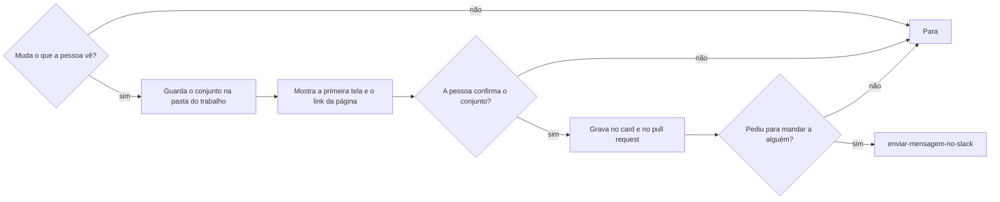

# Registrar evidência visual

## Parâmetros de configuração

```yaml
"Confirmação antes de gravar": "sim"
"Fuso da legenda": "America/Sao_Paulo"
"Pasta das evidências": "~/evidencias-visuais"
```

## Instruções

### Passo 1

Decida se o trabalho terminado muda o que uma pessoa vê.
Atualização de dependência, documentação e mudança técnica sem diferença na tela ficam de fora.
Diga que não há evidência visual e pare.
Medir se algo ficou mais rápido é outra evidência.
Não substitua essa medida por um print.

### Passo 2

Liste só a superfície que este trabalho realmente tem.
A ordem é o ambiente local, o Storybook, a pré-produção e a produção.
A pré-produção só entra se o repositório ou a pessoa já tiver o endereço.
A produção só entra se a mudança já estiver no ar e a página tiver sido aberta.
Não invente endereço de pré-produção.
Não diga que está em produção sem ter aberto a página.



### Passo 3

Capture cada superfície que foi aberta.
A evidência guarda a página inteira e o que cabe na primeira tela, sem rolar.
Quando a mudança não aparece nessa primeira tela, guarde também um recorte com altura perto da largura, com o bloco novo e o que está em volta.
O componente isolado pode ir na pasta, com a legenda de que é só o bloco.
Ele não substitui a página.
No Storybook, ache a story da tela e a porta no script do projeto.
Abra a story sem a barra do Storybook.
Se a página disser que não há preview, espere o bundle e leia o texto de novo.
Capture a largura do layout.
Não fotografe só o painel visível.
Guarde os arquivos em `Pasta das evidências`, numa subpasta deste trabalho.
O nome da subpasta é a chave do card ou o número do pull request.
Sem os dois, use o dia e um nome curto do trabalho.
Diga o caminho absoluto da subpasta.
Não deixe arquivo solto na área de trabalho.
Não faça commit da imagem.

### Passo 4

Cada print leva uma legenda no idioma do destino.
A legenda diz o lugar e o dia, no `Fuso da legenda`.
No Storybook, a legenda também diz o branch e se aquele commit está no branch principal.
Se a story trava o relógio ou usa produto de fixture, a legenda diz isso.
Não guarde no conjunto, nem mostre para confirmação, o print cujo contador ou dado vem de uma data de fixture distante do dia.
Prefira a story cujo relógio fica perto de um intervalo real.
Sem essa story, diga que essa superfície ficou sem evidência.

### Passo 5

O card recebe a evidência, porque quem é de produto pode não ter acesso ao GitHub nem ao Figma.
No texto do card, mostre só a primeira tela, ou o recorte com altura perto da largura quando a mudança fica abaixo dela.
A página inteira entra como link para o arquivo anexado, não como imagem dentro do texto.
Uma imagem muito alta alonga o card e atrapalha a leitura.
O pull request segue a mesma regra, na seção de imagens que o modelo do repositório já tem.
Não abra outra seção.
Se o corpo do card não aceitar arquivo, o recorte vai num comentário e a página inteira continua como link.
Comentário numa issue do GitHub só entra se a pessoa pedir.
Esse comentário leva o link do pull request.
A descrição do pull request é o lugar melhor para o recorte.
Com `Confirmação antes de gravar` em `sim`, mostre a subpasta, o recorte que entra no texto, o link da página inteira e as legendas, e espere um sim para esse conjunto.
Um sim vale para esse conjunto.
Outro destino pede outro sim.

### Passo 6

Mandar a imagem para uma pessoa segue `enviar-mensagem-no-slack`, depois do sim dela a esse texto.
O que vai na mensagem é o mesmo recorte do card, mais o link da página inteira.
Não mande o print da data de fixture distante.
Não abra o Slack nem o Figma no lugar da captura.
`reconhecer-imagem` lê texto que já está numa imagem.
Ela não tira o print.

## Problemas comuns

### Só o componente

Se você publicar só a story do componente, a pessoa de produto não vê como o bloco fica no resto da tela.

1. Capture a página inteira e a primeira tela.
2. O componente isolado pode ir na pasta, com a legenda de que é só o bloco.
3. Não use o componente isolado como única evidência.

### Print com o relógio da fixture

Se você publicar o print da story cuja data está anos à frente, o contador mostra dezenas de milhares de dias e a pessoa entende que a tela está assim.

1. Troque pela story que trava o relógio perto de um intervalo real.
2. Deixe o print da data distante fora da pasta e fora do conjunto mostrado.
3. Sem essa story, diga que a superfície ficou sem evidência.

### Arquivo solto na área de trabalho

Se você salvar cada print na área de trabalho, o próximo arquivo se mistura com o resto e o conjunto se separa.

1. Guarde tudo em `Pasta das evidências`.
2. Use uma subpasta por trabalho.
3. Diga o caminho absoluto dessa subpasta.

### Página inteira dentro do texto

Se você colocar a página inteira como imagem no card ou no pull request, a altura alonga a leitura e o resto do texto se perde.

1. Mostre no texto a primeira tela, ou o recorte com altura perto da largura.
2. Mantenha a página inteira na subpasta e anexe o arquivo.
3. Aponte para ela com um link, não com uma imagem no texto.

### Painel corta a página

Se você fotografar só o painel do navegador, o contador à direita some e o resto da página fica de fora.

1. Capture a largura do layout e a altura da página.
2. Confira que o bloco novo e o que está em volta entraram no arquivo da página.
3. Só então use o arquivo.

### Preview que não existe

Se você montar um endereço de pré-produção ou disser que a tela está em produção, a evidência afirma um ambiente que não foi aberto.

1. Use só o endereço que o repositório ou a pessoa já passou.
2. Abra a página antes de dizer que ela está no ar.
3. Sem o endereço, a legenda fica no Storybook ou no ambiente local.

### Card sem a imagem

Se você escrever no card só uma frase, quem não tem GitHub continua sem ver a tela.

1. Mostre no texto a primeira tela ou o recorte.
2. Coloque o link da página inteira no mesmo lugar.
3. Não feche sem esses dois no card.

## Exemplos de entrada e saída

Estes exemplos ilustram fatos. Eles podem não estar no data source.

### A pessoa de produto pediu o print e não tem acesso ao repositório

A página, com o bloco novo no meio do resto da tela e o relógio travado em 1 dia, fica na subpasta do trabalho. O card mostra a primeira tela e um link para a página inteira. O print só do componente, com o contador em dezenas de milhares de dias, fica fora do conjunto.

## Casos-limite

- A mudança não altera o que a pessoa vê: pare e diga que não há evidência visual.
- A evidência pedida é tempo de carregamento: não tire print.
- Existe story do componente e story da tela: a evidência principal é a tela.
- O contador mostra dezenas de milhares de dias: esse arquivo não entra na pasta nem no conjunto.
- A página inteira é muito alta: o texto leva o recorte, e a página inteira vai como link.
- A pessoa pede para mandar o arquivo a alguém: siga `enviar-mensagem-no-slack` depois do sim, com o recorte e o link.
- O repositório não tem pré-produção: não invente o endereço.
- A story ainda mostra "No Preview": espere e leia o texto de novo.
- A descrição do card não aceita imagem: o recorte vai num comentário e a página inteira continua como link.
- Não há chave de card nem número de pull request: a subpasta leva o dia e um nome curto do trabalho.
- A pessoa não confirma o conjunto: não grave no card nem no pull request.

## Pegadinhas

- A story do componente parece a tela e esconde o que fica em volta.
- A área de trabalho parece um lugar à mão e espalha um arquivo por captura.
- A página inteira dentro do texto parece completa e alonga o card.
- Uma legenda não conserta o contador de dezenas de milhares de dias. A pessoa lê o número, não a legenda.
- O iframe do Storybook responde que não há preview enquanto o bundle da preview ainda compila. O id da story pode estar certo.
- O print do painel do navegador é mais estreito que o layout. O contador fica à direita da faixa e sai cortado.
- Uma data de fixture anos à frente faz o contador mostrar dezenas de milhares de dias. Esse arquivo não é a tela.
- O atalho do pnpm pede `pnpm.cjs`. O arquivo no cache do Corepack é `pnpm.mjs`.
- A seção de imagens é a que o modelo do repositório já tem. Não abra outra.
- A porta do Storybook está no script daquele projeto. Não reaproveite a porta de outro app.

## Scripts disponíveis

- Nenhum.

1. Não há script para executar.
