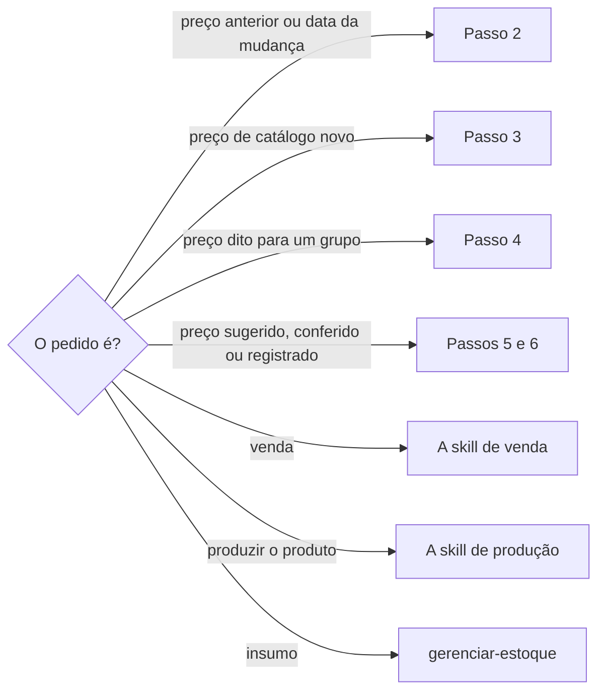

# Registrar preço de produto físico

## Parâmetros de configuração

Leia cada valor nas instruções do projeto: primeiro na entrada com o nome desta habilidade, depois na entrada `Global` ou no primeiro nível do bloco. Quando um valor não estiver lá, use o padrão abaixo.

```yaml
"Modo de aprendizado": "perguntar"
# Opções: `banco do Notion`, `Shopify` e `banco do Notion e Shopify`.
"Fonte do histórico de preços": "banco do Notion"
# Opções: `sempre`, `nunca`, `perguntar` e `automático`. `automático` lê as versões só quando a fonte do histórico não responde. O Notion não garante guardar as versões, então diga até onde chegam.
"Leitura do histórico de versões da página": "perguntar"
"Banco de variações": ""
# Nomes de banco e de registro: o projeto define. Banco vazio: use `procurar-banco-de-dados` antes de perguntar. Registro vazio: pergunte uma vez e não escolha.
"Banco de produtos": ""
"Banco do histórico de preços": ""
"Registro de mudança de preço no Shopify": ""
# Vazios: sem valor, pergunte à pessoa e não escolha.
"Destino do preço de um ponto de venda": ""
"Fonte do estoque por local": ""
# Canais de venda que mostram o preço do registro, como a loja virtual e o catálogo de produtos da maquininha. Vazio: pergunte uma vez em quais canais o preço aparece.
"Canais que repetem o preço": []
# O que pesa na justificativa do preço, como o programa de mentoria, a pirâmide de mix, a curva de preço e o posicionamento da marca. Vazio: justifique só com o que a pessoa e as fontes do projeto disseram, sem inventar critério.
"Fontes da justificativa do preço": []
```

## Instruções

### Passo 1

O produto fica em `Banco de produtos`. Os nomes das propriedades vêm do mapeamento de dados do projeto. `Banco de produtos` vazio: use `procurar-banco-de-dados`, dizendo que o banco guarda os produtos e seus preços.



### Passo 2

Antes de perguntar um preço anterior ou a data da mudança, leia a fonte do histórico, conforme `Fonte do histórico de preços`.

O que for anterior às linhas dessa fonte pode estar no histórico de versões da página, conforme `Leitura do histórico de versões da página`:

- `sempre`: leia a fonte e as versões da página.
- `automático`: leia as versões só quando a fonte não responde.
- `perguntar`: quando a fonte não responde, pergunte se lê as versões e espere.
- `nunca`: não leia as versões.

Leia as versões da página do produto e, quando as variantes têm preços diferentes por outro motivo que o tamanho, as da variante pedida. `Banco de variações` vazio: use `procurar-banco-de-dados`. Não leia as da unidade.

O Notion não garante guardar as versões, e o plano limita o prazo, como os cerca de 30 dias vistos num caso. Diga a partir de que data a página tem versões. Pergunte só o que nada respondeu e diga qual fonte consultou.

A loja virtual pode ter uma ferramenta de sugestão de preço por IA. O histórico de publicações dela mostra, por produto, o preço antigo, o preço novo, a data e hora e o tipo, como redução. Ele só se lê no painel da loja, porque não há API, e alcança mudanças que as versões da página já não guardam. Leia-o quando a fonte do histórico não responde e a loja usa a ferramenta.

### Passo 3

Ao registrar uma mudança de preço de catálogo, acrescente uma linha na fonte do histórico. No banco do Notion, é uma linha em `Banco do histórico de preços`. No Shopify, é o `Registro de mudança de preço no Shopify` do produto. Com `Banco do histórico de preços` vazio, use `procurar-banco-de-dados`. Com o registro do Shopify vazio, pergunte onde acrescentar.

Nunca edite nem apague uma linha antiga: a correção vai numa linha nova.

Produto sem nenhuma linha no histórico: antes de registrar a mudança, acrescente a linha de carga inicial. Ela leva o preço de hoje como preço novo, o preço anterior vazio, motivo e origem de carga inicial, a vigência da data mais antiga que uma fonte prova e a fonte na justificativa.

Sem fonte para o que veio antes, não invente preço nem data: a carga inicial leva o preço atual e a data da fonte, e a resposta diz que o histórico anterior não existe. Uma mudança mais antiga que uma fonte mostrar depois, como a publicação da ferramenta de sugestão, entra como linha própria, na ordem da vigência.

A remarcação publicada pela ferramenta de sugestão entra com a data e hora da publicação. Quem decidiu é quem aceitou a sugestão, e a ferramenta não é quem decidiu.

Campos da linha, ligados às propriedades pelo mapeamento de dados do projeto:

- o produto, as variantes que a mudança cobre, e o canal, varejo ou atacado. Variantes que só diferem pelo tamanho têm sempre o mesmo preço e entram na mesma linha;
- o motivo, obrigatório, e quem decidiu, obrigatório;
- o preço anterior e o novo;
- a vigência, a partir de que data;
- o custo na data, copiado no dia e nunca recalculado;
- o preço de comparação, que não passa do menor preço praticado nos 30 dias anteriores à redução.

Falta motivo ou quem decidiu: pergunte antes de acrescentar. Preço de comparação acima do menor preço provado dos 30 dias: mostre esse preço e não acrescente.

Sem venda nem linha que prove o preço de comparação nesse prazo, grave o que a loja mostra e escreva na justificativa que ele não pôde ser provado.

Com a linha acrescentada, leve o preço novo aos canais, como o Passo 8 manda.

### Passo 4

Um preço dito para um grupo, como "o grupo ficou por 250 no local", vale só para os produtos que estavam naquele local e ainda tinham estoque. O grupo é definido pelo estoque do local, não pelo nome.

Liste os produtos pela `Fonte do estoque por local` e tire os vendidos antes. Mostre a lista e espere a confirmação da pessoa. Produto que não foi ao local, ou que já saiu do estoque, não muda de preço.

Para listar o estoque, o banco de unidades precisa dar as unidades de um local e a finalidade de cada uma. Piloto, figurino e acervo não contam como estoque de venda.

### Passo 5

Ao sugerir, conferir, validar ou registrar um preço de venda, o formato do preço, redondo ou quebrado, e a terminação seguem `definir-formato-do-preco`, antes de dar o número.

### Passo 6

Justifique todo preço que sugerir, conferir, validar ou registrar, na resposta e antes de atualizar o banco de produtos. Escreva como uma pessoa mentora, que orienta a decisão com senso crítico, clareza e visão de negócio, e não só devolve um número.

A justificativa explica por que o preço faz sentido para a peça, com os critérios que você de fato usou, como custo, markup, curva de preço, posição da peça na coleção, pirâmide de mix, complexidade produtiva, valor percebido, coerência comercial e posicionamento da marca. Leia o conhecimento de `Fontes da justificativa do preço`. Não cite como usado um critério que você não consultou, nem invente um que a fonte não traz.

Diga quais critérios pesaram mais. Não valide um preço sem isso.

### Passo 7

Onde registrar o preço de um ponto de venda é `Destino do preço de um ponto de venda`. Com ele vazio, pergunte à pessoa onde registrar e não escolha. `Fonte do estoque por local` vazia também se pergunta.

Não invente nome de banco nem de propriedade para o que o projeto não definiu: nenhum nome de banco entra nesta skill.

### Passo 8

O preço novo vale em cada canal de `Canais que repetem o preço`, na mesma passada. O preço que vai aos canais é o de etiqueta, o cheio a prazo, e nunca o preço à vista. Antes de gravar, leia o produto em cada canal e mostre o preço que ele tem lá. A loja virtual segue `publicar-produto-fisico-na-loja-virtual`.

Produto que falta num canal é cadastrado nele sempre como produto com variações, uma variação por variante do registro, mesmo quando só uma existe. Cadastre só as variantes que já foram produzidas, com o preço do registro. Não invente custo, estoque nem SKU: o campo que o registro não traz fica vazio, e a resposta diz o que faltou.

Todo produto cadastrado num canal leva foto. Use a foto do produto isolado, de frente, do registro de fotos do produto. Sem essa foto no registro, diga que falta.

Envie a foto pela ferramenta de envio de arquivo do navegador, com o caminho do arquivo, numa sessão que tem o arquivo e o navegador no mesmo computador. Sem essa ferramenta na sessão, abra uma no computador da pessoa antes de desistir. Não preencha o campo de arquivo com script na página: a checagem de permissões bloqueia. Só sem nenhum desses meios, entregue a foto à pessoa e diga onde clicar.

Depois de salvar, releia o nome no canal. Um canal pode trocar as maiúsculas, como "beRá" por "Berá", e recusar o nome que só difere nelas, dizendo que ele já existe. Tente a correção uma vez, no produto que agrupa as variações, e releia depois de recarregar a página. Se o canal voltar a trocar, deixe o nome dele e diga isso na resposta. Não use nome provisório para contornar.

A resposta diz, por canal, o preço antes e depois, ou que o produto foi cadastrado.

### Passo 9

Ao terminar, siga `evoluir-habilidade` conforme `Modo de aprendizado`.

## Problemas comuns

### Preço do grupo aplicado ao nome

Se você mudar o preço de todos os produtos com o nome citado, os que não estavam no local ou já tinham sido vendidos ficam com um preço que ninguém disse.

1. Liste os produtos pelo estoque do local.
2. Tire os vendidos antes.
3. Mostre a lista e espere a confirmação.

### Pergunta que a fonte respondia

Se você perguntar o preço anterior sem ler a fonte do histórico, a pessoa repete o que o registro já guarda.

1. Leia a fonte do histórico de preços.
2. Para o que vem antes dela, siga `Leitura do histórico de versões da página` e leia o histórico de publicações da ferramenta de sugestão de preço da loja, quando ela existe.
3. Responda com o que achou e diga qual fonte consultou.
4. Pergunte só o que nenhuma responde.

### Linha antiga editada

Se você editar ou apagar uma linha do histórico, o registro deixa de provar o que mudou.

1. Acrescente uma linha nova com a correção.
2. Deixe a linha antiga como está.

### Tamanhos com preços diferentes

Se você achar preços diferentes entre variantes que só diferem pelo tamanho, trata como mudança de preço o que é erro de cadastro, e o histórico guarda o erro como se fosse decisão.

1. Mostre a diferença e não a grave como mudança.
2. Pergunte qual preço vale.
3. Corrija com uma linha de correção de cadastro, que cobre todas as variantes de tamanho.

### Histórico começado pela mudança

Se você registrar a mudança de um produto sem nenhuma linha, o histórico começa com um preço anterior que nada prova.

1. Acrescente antes a linha de carga inicial, com o preço de hoje e a fonte.
2. Leia as fontes do Passo 2 e diga até onde cada uma chega.
3. Não invente o preço nem a data do que veio antes.

### Preço sem justificativa

Se você devolver só o número, a pessoa não sabe o que pesou e não tem como discordar.

1. Escreva a justificativa antes de atualizar o banco de produtos.
2. Diga os critérios que você usou e quais pesaram mais.
3. Não valide o preço sem isso.

### Preço novo só no registro

Se você registrar o preço e não levar aos canais, a loja e a maquininha cobram o preço antigo, e a venda parece ter desconto.

1. Leia o produto em cada canal de `Canais que repetem o preço`.
2. Grave o preço novo, ou cadastre o produto que falta como produto com variações.
3. Releia o nome e o preço no canal.

## Exemplos de entrada e saída

Estes exemplos ilustram fatos. Eles podem não estar no data source.

### o grupo de camisetas ficou por 80 no evento

Listei as camisetas pelo estoque do evento e tirei as vendidas antes. Mostrei a lista e esperei o sim antes de mudar o preço. A camiseta que não foi levada não mudou de preço.

### qual era o preço da camiseta antes e quando mudou?

Li o banco do histórico de preços, que começa em março. A mudança era de janeiro, então li as versões da página, que mostravam o preço e a data. Disse até onde cada fonte chega e não perguntei nada.

### registra o colete que o cadastro mostra a 450 e a loja a 338

O produto não tinha linha no histórico. Li as versões da página, que só chegavam a um mês atrás e não mostravam mudança de preço, e o histórico de publicações da ferramenta de sugestão da loja, que mostrava a redução de 450 para 338 numa data e hora. Acrescentei a carga inicial com 450 e depois a remarcação com a data e hora da publicação, com quem aceitou a sugestão em quem decidiu. Disse que o preço de comparação de 450 não pôde ser provado por venda.

### baixa o preço da caneca de 60 para 50

Perguntei o motivo e quem decidiu. Acrescentei uma linha com o canal, os preços, a vigência e o custo na data. Não editei a linha antiga.

### a regata passa a custar 220 em qualquer canal

Acrescentei a linha no histórico e mudei a variante da loja virtual de R$ 350 para R$ 220. A regata não estava no catálogo da maquininha: cadastrei como produto com variações, só com o tamanho produzido, a R$ 220, com a foto do produto isolado de frente, sem custo nem estoque. O canal trocou "beRá" por "Berá" e voltou a trocar depois da correção, então deixei o nome dele e avisei na resposta.

## Casos-limite

- Nenhuma fonte chega até a mudança: diga qual consultou, até onde cada uma chega, e pergunte só o que ficou antes.
- O produto não tem linha no histórico: acrescente a carga inicial antes da mudança.
- Variantes que diferem só pelo tamanho com preços diferentes: é divergência de cadastro. Mostre e pergunte qual vale.
- Variantes que diferem por outro motivo, como a cor, com preços diferentes: uma linha por preço, cada uma com as variantes que ele cobre.
- A mudança veio da ferramenta de sugestão de preço da loja: use a data e hora da publicação e grave como quem decidiu quem aceitou a sugestão.
- A lista do grupo fica vazia: diga isso e não mude nenhum preço.
- A pessoa diz o preço de um produto só: confirme o produto e o preço antes de mudar.
- O banco ou o workspace não está conectado: pare e peça.
- O destino do preço do ponto de venda está vazio: pergunte onde registrar.
- `Canais que repetem o preço` está vazio: pergunte uma vez em quais canais o preço aparece.
- O produto falta num canal: cadastre como produto com variações, mesmo com uma variação só, e com a foto do produto isolado.

## Pegadinhas

- O nome do produto parece o grupo inteiro. Quem define o grupo é o estoque do local.
- O preço dito no local parece valer para todos os produtos daquele tipo. Vale só para os que estavam lá e ainda tinham estoque.
- A sugestão de preço por IA da loja parece não deixar rastro. O histórico de publicações do app guarda produto, preços, data, hora e tipo, e só se vê no painel.
- O histórico de versões da página parece guardar tudo. O plano do Notion limita o prazo, e o preço mais antigo pode ficar fora dele.
- A página do produto parece só ter o preço de hoje. As versões do produto e da variação guardam preços antigos que o banco do histórico ainda não tem.
- O produto com uma variação só parece pedir o cadastro de produto único. O cadastro é sempre com variações, para a variação nova entrar no mesmo produto.
- O custo na data parece recalculável. Ele é o custo copiado no dia da mudança.
- O Notion lê o trecho entre dois cifrões sem barra como fórmula. Num texto com valor em reais, escreva `R\$ 10,00` e releia o campo depois de gravar. A propriedade numérica não precisa da barra.

## Scripts disponíveis

- Nenhum.

1. Não há script para executar.
